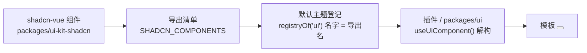

# mini-canvas UI 开发

这个项目所有界面都使用同一套 shadcn-vue 组件。组件只有一个来源：
`packages/ui-kit-shadcn`。组件只在一个地方登记：默认主题插件
`packages/plugins/plugin-theme-default/src/index.ts` 的 `registryOf('ui')`。
业务代码只从插件上下文取组件，不直接 import 组件库。

## 先用一句话判断怎么做

要用的组件已经存在 → 直接 `useUiComponent()` 解构，模板里写组件名。

组件不存在 → 补进 `packages/ui-kit-shadcn`，再确认登记表自动带上它，然后用。

想弹通知 → 用上下文里的 `notify`，不要 import `vue-sonner`，也不要自己挂 Toaster。

容器会滚动 → 用组件库的 `ScrollArea`（`packages/ui` 里统一用现成的 `ScrollPane`）。

## 组件在哪、怎么流转



四层各管一件事：

| 层 | 位置 | 职责 |
| --- | --- | --- |
| 组件源 | `packages/ui-kit-shadcn/src/components/ui/` | 原样的 shadcn-vue 组件，不加适配层 |
| 导出清单 | `packages/ui-kit-shadcn/src/registry.ts` | 收集组件、生成 `SHADCN_COMPONENTS` |
| 登记 | `packages/plugins/plugin-theme-default/src/index.ts` | 全部登记到 `ui` 注册表，名字用导出名 |
| 消费 | `packages/ui`、`packages/plugins/*` | `useUiComponent()` 取件，主题换了自动跟着换 |

依赖方向不能反：`kernel ← canvas-data ← canvas-render ← plugins ← ui`。
主题插件可以 import 组件库；业务插件和 `packages/ui` 不 import 组件库的裸组件。

## 用法：一个组件、多个子组件都这样取

在 `CanvasProvider` 内的组件里：

```vue
<!-- 文件：packages/plugins/my-plugin/src/Panel.vue -->
<script setup lang="ts">
import { useCanvasContext, useUiComponent } from '@mini-canvas/canvas-render'
import { ref } from 'vue'
import type { NotifyContract } from '@mini-canvas/canvas-base'

// 解构：名字与 shadcn-vue 的 import 完全一致，不带 shadcn 前缀。
const {
  Button,
  Input,
  Select,
  SelectContent,
  SelectItem,
  SelectTrigger,
  SelectValue,
  DropdownMenu,
  DropdownMenuContent,
  DropdownMenuItem,
  DropdownMenuLabel,
  DropdownMenuSeparator,
  DropdownMenuTrigger,
} = useUiComponent()

const { ctx } = useCanvasContext()
const notify = ctx.tryGet<NotifyContract>('notify')
const model = ref('seedream-5')
const prompt = ref('')

function save(): void {
  notify?.success('已保存：' + model.value)
}
</script>

<template>
  <DropdownMenu>
    <DropdownMenuTrigger as-child>
      <Button variant="outline" size="sm">模型</Button>
    </DropdownMenuTrigger>
    <DropdownMenuContent align="start">
      <DropdownMenuLabel>生成模型</DropdownMenuLabel>
      <DropdownMenuSeparator />
      <DropdownMenuItem @select="model = 'seedream-5'">Seedream 5</DropdownMenuItem>
      <DropdownMenuItem @select="save">保存</DropdownMenuItem>
    </DropdownMenuContent>
  </DropdownMenu>

  <Select v-model="model">
    <SelectTrigger class="w-48"><SelectValue /></SelectTrigger>
    <SelectContent>
      <SelectItem value="seedream-5">Seedream 5</SelectItem>
      <SelectItem value="seedream-4">Seedream 4</SelectItem>
    </SelectContent>
  </Select>

  <Input v-model="prompt" placeholder="写点什么" />
</template>
```

只取一个组件时是同样的东西：

```ts
const Slider = useUiComponent('slider')
const Button = useUiComponent('Button')
```

解构出来的每个值是 Ref：模板里 Vue 自动解包，不需要写 `.value`；
在 `setup` 的 render 函数或 JS 里要写 `Button.value`。主题热替换时它们原地更新。
不要写 `const { Button } = useUiComponent('Button')`：单个名字直接取，解构的是返回值本身，不是组件。

应用最外层是 `packages/ui/src/Root.vue`，它在 `CanvasProvider` 外面，不能注入上下文，
所以那里用 `useUiComponentOutside('Toaster')`（`App.vue` 才是 Provider 的宿主）。
普通子组件不要模仿；只有项目页、树外浮层这类
确实在 Provider 外的地方才用 Outside 版本。

## 缺组件：先补组件库，再用

### 1. 把 shadcn-vue 组件放进组件库

在 `packages/ui-kit-shadcn` 里按 shadcn-vue 的原样放组件文件，例如：

```text
packages/ui-kit-shadcn/src/components/ui/accordion/
  Accordion.vue
  AccordionContent.vue
  AccordionItem.vue
  AccordionTrigger.vue
  index.ts
```

`index.ts` 只做原样导出：

```ts
// 文件：packages/ui-kit-shadcn/src/components/ui/accordion/index.ts
export { default as Accordion } from './Accordion.vue'
export { default as AccordionContent } from './AccordionContent.vue'
export { default as AccordionItem } from './AccordionItem.vue'
export { default as AccordionTrigger } from './AccordionTrigger.vue'
```

然后在组件库总入口加一行：

```ts
// 文件：packages/ui-kit-shadcn/src/index.ts
export * from './components/ui/accordion'
```

### 2. 在登记清单注册

`registry.ts` 按家族收集组件：家族名 + 模块。子组件不需要单独写，只要导出名以家族名开头
（`Accordion`、`AccordionItem`…），就会自动进入清单。

```ts
// 文件：packages/ui-kit-shadcn/src/registry.ts
import * as AccordionModule from './components/ui/accordion'

const FAMILIES: Record<string, Record<string, unknown>> = {
  // …已有的家族…
  Accordion: AccordionModule,
}
```

同时把家族名加进唯一名单：

```ts
// 文件：packages/ui-kit-shadcn/src/shadcnFamilies.ts
export const SHADCN_FAMILY_NAMES = [
  // …已有的名字…
  'Accordion',
] as const
```

这两个文件要一起改。`shadcnFamilies.ts` 还是组件库使用标记的判定表；只加一个会漏登记或漏标记。

不是 shadcn 生成的组件（例如 `SettingsRow`）不要塞进 `FAMILIES`，在默认主题里单独 `ui.add`。

### 3. 默认主题自动登记，不用逐个写名字

`plugin-theme-default` 遍历 `SHADCN_COMPONENTS`，把每个组件按导出名登记：

```ts
// 文件：packages/plugins/plugin-theme-default/src/index.ts
const ui = ctx.registryOf<unknown>('ui')
for (const [uiName, component] of Object.entries(SHADCN_COMPONENTS)) {
  // 只包一层透明调试标记；props / slots / 事件不变
  ui.add(uiName, withUiKitDebugMark(component, '…/index.ts', uiName), { id: 'shadcn' })
}
```

所以清单里加完就能用。不要改成 `shadcnButton` 这种前缀名字，也不要给同一个组件登记第二套别名。

### 4. 先验证再提交

```bash
pnpm -C packages/ui-kit-shadcn typecheck
pnpm -C packages/plugins/plugin-theme-default typecheck
pnpm -C packages/plugins/plugin-theme-default test
pnpm -C packages/ui typecheck
```

再用 @Chrome 打开实际页面点一遍。不要去写只检查字符串的假测试代替目验。

## 各控件统一走注册组件

这些常见件都已经在 `SHADCN_COMPONENTS` 里，直接用原名取：

| 场景 | 组件 |
| --- | --- |
| 按钮 | `Button` |
| 输入 / 多行输入 | `Input` / `Textarea` |
| 下拉选择 | `Select`、`SelectTrigger`、`SelectContent`、`SelectItem`、`SelectValue` |
| 菜单 | `DropdownMenu`、`DropdownMenuTrigger`、`DropdownMenuContent`、`DropdownMenuItem`、`DropdownMenuSeparator` |
| 弹窗 | `Dialog`、`DialogContent`、`DialogHeader`、`DialogTitle`、`DialogDescription`、`DialogFooter` |
| 滚动容器 | `ScrollArea`、`ScrollBar` |
| 开关 / 滑块 / 页签 / 标签 | `Switch` / `Slider` / `Tabs` / `Badge` |
| 卡片 | `Card`、`CardHeader`、`CardTitle`、`CardContent`、`CardFooter` |
| 通知 | 上下文服务 `notify`；视觉宿主是 `Toaster` |

下拉、弹窗、提示这类浮层必须用组件库里的版本，不要写原生 `<select>`、手搓绝对定位菜单。

### 滚动：优先 ScrollArea

任何可能超出容器的列表、设置页、抽屉、弹窗正文，都用 `ScrollArea`，不要写 `overflow-y: auto` 的普通 div。

`ScrollArea` 实际滚动的是内部 viewport，不是根节点。
需要读 `scrollTop` 或监听滚动时，用 `packages/ui/src/components/ScrollPane.vue`：它已经接好滚动层，
并转发了原生 `scroll` 事件。

```vue
<!-- 文件：packages/ui/src/components/MyPanel.vue -->
<script setup lang="ts">
import ScrollPane from './ScrollPane.vue'
</script>

<template>
  <div class="flex h-64 min-h-0 flex-col">
    <ScrollPane body-class="space-y-1 p-2" @scroll="onScroll">
      <div v-for="item in items" :key="item.id">{{ item.label }}</div>
    </ScrollPane>
  </div>
</template>
```

父容器必须有确定高度并允许收缩（`min-h-0` / `flex-1`），否则 ScrollArea 不会滚。
横向滚动记得把 `direction` 设为 `x` 或 `both`，它会补一条横向滚动条。

### Dialog

普通弹窗用 `packages/ui/src/components/AppDialog.vue`，它已经把遮罩、Esc、焦点、无遮罩形态接好。
不要每次都手工拼一遍 `Dialog + DialogOverlay + DialogContent`。

```vue
<AppDialog v-model="open" width="520px">
  <h2>设置</h2>
  <p>正文</p>
</AppDialog>
```

弹窗内容长到会滚动时，正文用 `ScrollPane`，不要给面板加裸滚动。

## 通知：统一用上下文里的 notify

底层是 `vue-sonner`。服务由默认主题提供，名字是 `notify`；`Toaster` 也是从 `ui` 目录取，
画布页只挂一次。业务插件里不要 `import { toast } from 'vue-sonner'`，也不要挂 `<Toaster>`。

别把它和 `ctx.get('canvas').notify(...)` 搞混：前者是右下角通知，后者是跟随鼠标的画布浮字
（拖线提示那种）；两者各管各的，不要互相替代。

```ts
// 文件：packages/plugins/my-plugin/src/run.ts
import type { Context, NotifyContract } from '@mini-canvas/canvas-base'

export function runGeneration(ctx: Context): void {
  const notify = ctx.get<NotifyContract>('notify')

  notify.success('已保存')
  notify.error('生成失败', { description: '网络连接断了，请重试' })
  notify.warning('图片太大，已压缩')
  notify.info('已复制链接')

  // 常驻 loading，成功或失败时用同一个 id 原地替换
  const id = notify.loading('正在生成…', { duration: Infinity })
  someAsyncTask()
    .then(() => notify.success('生成完成', { id }))
    .catch((err) => notify.error('生成失败：' + String(err), { id }))
}
```

等待 Promise 直接一步到位：

```ts
ctx.get<NotifyContract>('notify').promise(uploadFile(file), {
  loading: '正在上传…',
  success: (data) => '上传成功：' + data.name,
  error: (err) => '上传失败：' + String(err),
})
```

根 `Context` 没有服务属性的运行时 Proxy，组件里要写 `ctx.get('notify')` 或 `ctx.tryGet('notify')`，
不要写 `ctx.notify.success(...)` 这种直属性调用（项目里真实的静默 no-op 就是这样来的）。
拿可选依赖用 `tryGet`；默认主题没装时它会返回 `undefined`，这时退回一句 `console.info` 就好，不要崩。

```ts
const { ctx } = useCanvasContext()
const notify = ctx.tryGet<NotifyContract>('notify')
notify?.success('已保存')
```

`packages/ui` 的 `showToast()` 已经接到这个服务上，外壳旧代码可以继续用；新代码直接写 `ctx.get('notify')`。

## 样式规矩

- 颜色、圆角、字号只读 `--ui-*` / `--mct-*` token，不自造色值。写 UI 前读 `docs/design/ui-style-guide.md`。
- 用 Tailwind class 排布局；组件外观优先靠 `variant` / `size` prop，不靠覆盖内部样式。
- `class` 只用于位置、大小、间距。不要用 `:deep()` 改公共组件的内部结构，除非是在改组件库本身。
- 图标用 `lucide-vue-next`，按钮里图标尺寸交给 Button 的 `[&_svg]` 规则，别手写一大套。

## 提交前清单

1. 用 codegraph 查你改过的组件，确认取件名仍是源码导出名（`Button`、`DropdownMenuContent`），
   没有新写出 `shadcnButton` 这类前缀名。
2. 渲染业务代码没有 import `@mini-canvas/ui-kit-shadcn`；只有默认主题、组件库自己和
   `packages/ui/src/sharedGlobals.ts`（给 UMD 插件暴露全局，属基础设施）可以 import。
3. 滚动容器是 `ScrollArea` / `ScrollPane`。
4. 通知走 `notify`，页面里没有第二个 Toaster。
5. 运行：`pnpm -C packages/ui typecheck`、相关插件 test、组件库 typecheck。
6. 用 @Chrome 实测页面，确认亮色 / 暗色、窄容器、空数据都正常。

## 去哪里对照源码

- 组件清单：`packages/ui-kit-shadcn/src/registry.ts`
- 登记位置：`packages/plugins/plugin-theme-default/src/index.ts`
- 取件实现：`packages/canvas-render/src/contracts/uiCatalog.ts`
- 现成滚动容器：`packages/ui/src/components/ScrollPane.vue`
- 现成弹窗：`packages/ui/src/components/AppDialog.vue`
- 通知服务：`packages/plugins/plugin-theme-default/src/notifyService.ts`
- 真实插件示例：`packages/plugins/plugin-manager/src/components/settings/PluginManagerPage.vue`
