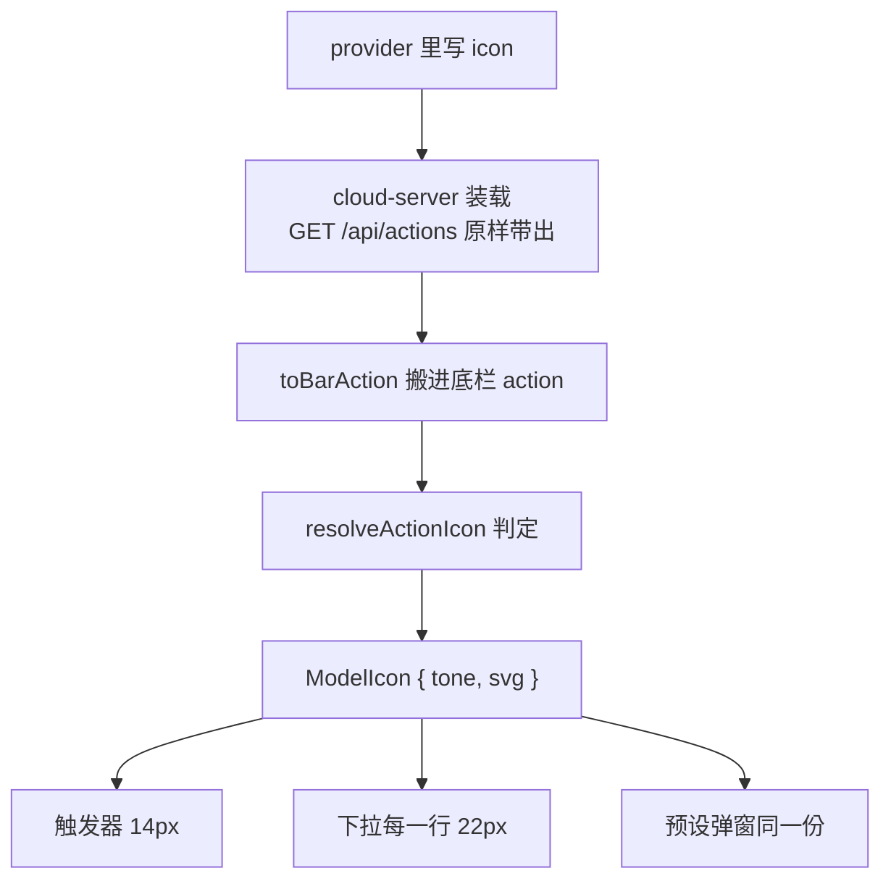

# 图标怎么选、怎么画

这份文件讲一件完整的事：provider 里写下的 `icon`，一路怎么变成你眼前那个图形。
写 provider 只要记住三句话：

1. `icon` 可以写 SVG、可以写 Base64 图片、也可以写**图标名**（如 `seedance`）。
2. 写了就优先用你写的；认不出才按**动作标题**猜；再不行按节点类型给通用图。
3. 同一个图标出现在三处（触发器、下拉每一行、预设弹窗），三处同源，不会不一致。

能写哪些名字见 [icon-names.md](./icon-names.md)。下面是理解它行为时该知道的细节。

## 一、`icon` 的三种写法

| 写法 | 例子 | 结果 |
| --- | --- | --- |
| SVG 字符串 | `icon: '<svg viewBox="0 0 24 24">…</svg>'` | 原样当图形用 |
| Base64 图片 | `icon: 'data:image/png;base64,iVBOR…'` | 包成 `` 画出来 |
| 图标名 | `icon: 'seedance'` 或 `icon: '火山引擎'` | 查平台图标表 |
| 不写 | 省略 `icon` | 按动作标题猜 |

只认**非空字符串**。`icon: ''`、`null`、数字都等于没写。

## 二、判定顺序（命中就停）

第 2 步「`icon` 写成的名字」和第 3 步「动作标题」用的是**同一套规则**，
只是输入不同：一个是你写的 `icon`，一个是动作的 `title`。
所以「豆包 Seedance」这几个字，写在 `icon` 里、或写在标题里，认出来的是同一个图标。

四层，全部收在 `packages/plugins/plugin-bottom-bar/src/node-bottom-bar/actionIcon.ts`
的 `resolveActionIcon()`：

1. `icon` 是 SVG 或 Base64 → 直接用（tone 记成 `custom`）。
2. `icon` 是能认出来的名字 → 用那个平台的图标。
3. 动作标题能认出平台 → 用那个平台的图标。
4. 都不行 → 按节点类型给通用图形（图片 / 视频 / 音频 / 文本）。

几个必须知道的边界：

1. **第 2 步认不出不等于命中自建网关**。认不出返回空串，接着走第 3 步。
   如果把认不出当成 `custom`，所有拼错的名字都会变成同一个网关图标，
   而且再也回不到按标题猜。
2. **`icon: 'custom'` 是有效值**，就是自建网关那一格，不会被当成认不出。
3. **SVG 会先过安全校验**：必须有 `viewBox`（或 `width`）；含 `<script>`、
   `<foreignObject>`、`on*=`、`javascript:` 的一律拒绝，然后回落到第 3 步。
   没有 `viewBox` 也会被拒 —— 换到 14px 的格子里会按原始像素乱放。
4. **Base64 只认 5 种 MIME**：`png` / `jpeg` / `webp` / `gif` / `svg+xml`。
   写 `image/bmp` 之类会被拒，回落标题猜测。

## 三、结果是 `{ tone, svg }` 一对值

| 字段 | 用途 |
| --- | --- |
| `svg` | 完整字符串，可能是 `<svg>…</svg>` 或 ``，界面用 `v-html` 插入 |
| `tone` | 平台家族名，只给 CSS 用 |

为什么给字符串不给组件：面板里一次画几十行图标，`v-html` 一行就够；
给每家公司写一个 Vue 组件既没必要，主题热替换也用不上。

`tone` 只在**本地兜底图形**上起作用：那批图用 `currentColor` 画，
靠 `[data-tone='seedance'] { color: … }` 这类规则上色。品牌图标自带填充色，与 tone 无关。
认出来的平台 key 直接当 tone 用，所以以后图标表新增平台、CSS 忘了写规则，
也只是回到默认前景色，不会出问题。

## 四、链路：从文件到屏幕

中间那步 `toBarAction` 只搬**非空字符串**，所以 `icon: ''` 到那里就没了。

三处消费点：

| 位置 | 代码 |
| --- | --- |
| 触发器 | `currentModelIcon`（`useBottomBarActions.ts`） |
| 下拉每一行 | `ChoicePickerMenu` 把 `icon.svg` 传成 `ChoiceItem.svg`，面板里 `item.svg \|\| brandSvg(...)` |
| 预设弹窗 | `BottomBarPresets.vue` 复用同一个 `resolveActionIcon` |

历史上只有触发器走这条判定，下拉列表由 Agent 的 `ChoicePicker` 自己按标题猜，
于是出现「触发器有图标、列表里全是兜底」。判定收成一处就是为了断掉这种漂移。

## 五、尺寸由 CSS 定，图本身不带尺寸

| 容器 | 外框 | 图形 |
| --- | --- | --- |
| 底栏触发器 `.nb-model-badge` | 20×20 | 14×14 |
| 下拉列表行 `.ac-model-brand` | 35×35 | 22×22 |
| 分栏左栏 `.ac-rail-brand` | 14×14 | 14×14 |

`<svg>` 和 `` 两条规则**必须成对写**。只写 `svg` 那条是踩过的坑：
Base64 图标走的是 ``，没有尺寸规则就按原始像素画 ——
1×1 的图缩成一个点，看着就是一块空白；大图又会撑破外框。
`` 那条还要带 `object-fit: contain`，保住比例、不裁内容。

## 六、`icon` 管显示，不管分组

下拉分栏左栏的平台分组、搜索命中，都按**动作标题**认，不按 `icon`。

所以可能出现：动作标题叫「演示 · 图标名」、`icon: 'seedance'`，
行里显示 Seedance 图标，却被归到「自建网关」那一组。

两种做法选一个：

1. 想让分组也对得上，就把平台名写进标题（如「豆包 Seedream 4.5」）。
2. 只是想要个图，标题随便写，接受它归在兜底分组。

## 七、写 Base64 图标的建议

1. **方形、边长 ≥ 64px**。界面只画 14～22px，大图只为保清晰度。
2. **用带透明通道的 PNG**，圆角交给 CSS，别自己在图里画大圆角。
3. **留白自足**：四周留一点空，贴边的图缩到 22px 会显得很挤。
4. 别用 1×1 的占位图 —— 尺寸修好了也只是一个色块，看不出是什么。

## 八、自测

0. 想用平台图标时，先 `GET /api/agent/icons/<你的写法>` 看 `matched`。
   认不出（`matched: false`）就换一个别名，或写成 SVG / Base64。
1. `GET /api/actions` 找到你的动作，确认 `icon` 字段是你写的那串。
   Base64 可以解一下：前 8 字节是 `89 50 4E 47 0D 0A 1A 0A`，
   第 17～24 字节是大端宽高。
2. 打开底栏下拉，**触发器和列表每一行都要看**。只看触发器会漏掉列表那条路。
3. 切到「分栏」视图再确认一次（左栏与右列两套 DOM）。
4. 亮色 / 暗色各看一遍：自定义图标是内容资产，不该跟着主题变色。

