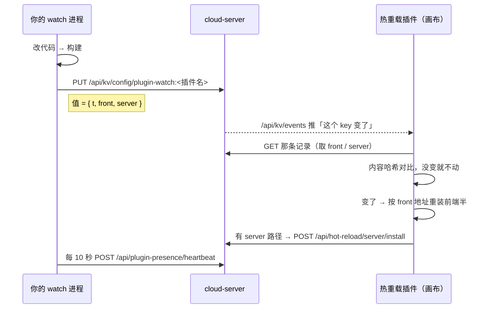

# 热重载：改完插件立刻看到效果

**一句话**：装上「热重载」插件，你在本地改插件代码、跑一次构建，画布会**自己把那个插件换成新版**，不用刷新、不用重启、不用重新安装。watch 停了（心跳超时）还能按开关自动把它卸掉。

它在设置里的位置：**开发 → 调试 → 调试插件**。

## 这个插件能让你做什么

| 想要的效果 | 装完怎么用 |
| --- | --- |
| 改插件源码后立刻看到新界面 | 在插件包里跑 `pnpm watch`，之后什么都不用做 |
| 看一眼现在有哪些插件在调试、监听还在不在 | 打开「设置 → 开发 → 调试」 |
| 手动让某个插件重新加载 | 那一行点「重装」 |
| 让关掉的 watch 对应的插件自己消失 | 打开「失联后自动卸载」（默认关） |
| 调试一个带后台的插件 | watch 会上报后台产物的绝对路径，后台半会按路径装进去 |
| 仓库里的产物还没装进数据根 | watch 自己把 `dist/` 发出来，上报的就是刚构建的那份 |

## 它是怎么工作的



三条要点：

1. **watch 只报地址，不搬运文件**。上报的 `front` 就是浏览器能打开的 js 地址，`server` 是后台机器上的绝对路径。热重载插件直接照着用，**不会把产物复制到别处**。
2. **不重复重装**。每次先把产物拉下来算内容哈希，跟上次比过、确认变了才卸旧装新。
3. **心跳只管"还在不在"**。watch 每 10 秒报一次；后台记住最后收到的时间，超时就标记为「已失联」，默认**不会**因此卸掉插件。

### 为什么 watch 自己起一个静态服务

后台的 `/plugins/<插件>/<产物>.js` 读的是**数据根里那份安装副本**（`<数据根>/plugins/...`），
而 `pnpm watch` 构建的是**仓库里的 `dist`**。这两个不是同一个文件。

只上报后台地址的话，链路看起来完全正常——构建成功、重装成功、通知弹出来了——但装回去的还是旧字节，改代码一点反应都没有。
所以 watch 构建过之后，会把仓库的 `dist/` 用一个本地静态服务发出来（默认 `127.0.0.1:5199`），`front` 指向它。

上报顺序是：`--front` 指定 > 自己发的 `dist` > 后台 `/plugins` > 清单。

## 手动跑一遍

### 1. 起后台

本地开发用仓库的服务（端口铁律 8865）：

```powershell
pnpm dev:server
```

或者用发布版验证：

```powershell
npx @plume-canvas/server@latest serve -d C:\Users\<你>\.plume --port 8865
```

### 2. 装上热重载

在「设置 → 插件 → 市场」里搜「热重载」，点安装。装完打开「设置 → 开发 → 调试」，能看到「调试插件」这一栏就说明它在跑。

> 发布版里它是从 npm 装的。**后台半只在服务启动时加载**，所以如果装完发现 `/api/hot-reload/server/*` 返回 404，重启一次服务就有了。之后再用就不用重启。

### 3. 让 watch 盯住一个插件

```powershell
pnpm -C packages/plugins/plugin-bottom-bar watch --backend http://127.0.0.1:8865
```

watch 构建过一次之后，上报的是它自己发的地址：`http://127.0.0.1:5199/<产物>.js`（默认端口）。
端口被占就换一个：

```powershell
pnpm -C packages/plugins/plugin-node-ui watch --serve-port 5200
```

如果你有别的静态服务托管产物，用 `--front` 直接指过去（它优先于上面两条）：

```powershell
pnpm -C packages/plugins/plugin-bottom-bar watch --backend http://127.0.0.1:8865 --front http://localhost:5199/plugin-bottom-bar.js
```

后台产物的路径用 `--server` 指定，不指定就用 `dist/server.js`。

> 想盯别的插件就把包名换掉：`plugin-bottom-bar`、`plugin-node-ui` 都带同款 watch 脚本（两份内容一致，改一处要同步另一处）。

### 4. 改一行代码

保存 → watch 自动构建 → 画布右上角弹「热重载完成：bottom-bar」。界面应该已经变了，不需要刷新页面。

## 两个容易踩的点

**第一，`front` 必须指向**刚构建的那份**。** 后台的 `/plugins/...` 是安装副本，通常是旧的；watch 自己发的 `dist` 才是新的。
这也是 `front` 排在清单前面的原因——清单里那条也可能指回安装副本。

**第二，后台半要重启一次才生效。** 重装会按名字卸旧装新（同名不会撞车），但如果这个插件后台半是**第一次**装进进程，`/api/hot-reload/server/*` 要等下一次服务启动才注册。之后就不用重启了。

**第三，后台半按路径装进来的插件只活在当前进程内存里。** 服务重启就没了（它本来就不在插件目录里）。这是调试语义，不是安装语义；要持久化就走插件管理或 NPM 安装。

## 自动卸载

配置项叫 `autoUninstallOnStale`，默认关闭。打开后：watch 心跳超时（后台判定失联）满阈值，就把这个插件**从画布卸掉并删除上报记录**。

构建中、休眠几十秒都不会误删 —— 只有连续超过后台的心跳超时才动手。

## 相关配置

| 配置项 | 默认 | 作用 |
| --- | --- | --- |
| `watchBackend` | 空（同源） | 调试这一侧连哪个后台。留空就用打开画布的这个地址 |
| `autoUninstallOnStale` | `false` | watch 失联后是否自动卸掉插件 |

## 排查清单

| 现象 | 先查什么 |
| --- | --- |
| 调试页一直是「还没有调试插件」 | watch 有没有在跑；`--backend` 是不是指到同一个后台 |
| 显示「监听中」但改代码没反应 | 先看 watch 最后那行 `front=` 是不是 `127.0.0.1:5199/...`（指向 `dist`）。若是 `/plugins/...`，说明它拿到的是安装副本，改代码不会生效 |
| 重装成功、界面还是旧的 | 同上。另外在浏览器里直接打开那条 `front`，搜一下新加的字符在不在 |
| 后台半改了没生效 | 后台半只在服务启动时注册路由；第一次装完要重启一次服务 |
| `Duplicate plugin name` | 旧版热重载的 bug（重装没先卸旧的）。0.1.2 起已修，升级即可 |
| 一键重装报错 | 那条记录的 `front` 是否还在；插件是不是核心插件（核心插件不能热替换） |
| `/api/hot-reload/server/*` 返回 404 | 服务是不是装完插件后没重启过（后台半只在启动时加载） |
| 后台半装上了但接口不通 | 路径是不是绝对路径；文件里有没有导出 `name` 与 `apply` |

## 真实源码

| 这一页说的 | 文件 |
| --- | --- |
| 前端半：调试页、监听、重装、自动卸载 | `packages/plugins/plugin-hot-reload/src/data/hotReload.ts` |
| 后台半：按绝对路径装/卸 | `packages/plugins/plugin-hot-reload/src/server.ts` |
| 插件装配与两个配置项 | `packages/plugins/plugin-hot-reload/src/index.ts` |
| watch 脚本模板（两份内容一致） | `packages/plugins/plugin-bottom-bar/scripts/watch.mjs`、`packages/plugins/plugin-node-ui/scripts/watch.mjs` |
| 后台心跳与在场判定 | `apps/server/src/plugins/pluginPresence.ts` |

## 注意事项

1. **核心插件不能热替换**：内核会明确报错，这是保护画布不会因为热替换中间状态而崩掉。
2. **一个插件名只有一份**：重装是「先卸旧、再装新」，不会同时存在两个版本。
3. **多个 watch 盯着同一个插件时，调试页会提示多实例** —— 那多半是你开了两个终端，关掉一个。
4. **发布版里要重新发版才带后台半**：npm 上的旧版本可能只有前端，`server.entry` 要随新版本一起发出去。
5. **`front` 一定要指向刚构建的产物**：`dist` 和安装副本是两个文件，指错了就是「重装成功、代码没变」，而界面上不会报任何错。
6. **watch 的静态服务只发 `dist/` 下的直接子文件**，也不允许 `../`。它只给本机调试用，不改你装的那份插件。
