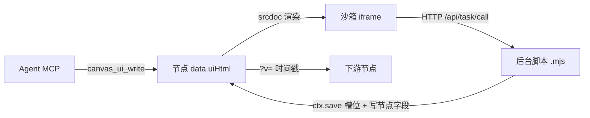

# 可视化节点 API 手册（前后端）

> 本文档是「可视化节点（type = "ui"）」的**稳定契约**：前端界面能拿到什么、能调什么；
> 后台脚本（task-scripts/*.mjs）能拿到什么、能调什么；以及整条流程。
>
> 与代码同源的两份参考：
> - `packages/plugins/plugin-node-ui/src/server.ts` → `canvas_ui_guide` 手册（运行时现读，含实时脚本清单）
> - `docs/plan/task-script-router-plan.md` · `docs/plan/node-package-plan.md`（设计与实现细节）
>
> 改接口时**两处一起改**：代码 + 本文档。

---

## 〇、一句话总览

一个可视化节点由三块组成：

```
界面（HTML，长什么样） + 后台脚本（.mjs，干什么活） + 节点声明（data.uiScripts，把两者绑在一起）
```



判断准则：**界面管「长什么样」，脚本管「干什么活」，声明把两者绑在一起。**

---

## 一、界面能拿到什么（宿主注入，只读）

界面住在一个沙箱 iframe（不透明源）里。文档加载前，宿主已注入：

```js
window.__CANVAS_INPUTS__   // 本节点参数 { 键: 值 }（含界面自己 setInputs 交上去的）
window.__CANVAS_UPSTREAM__ // 连进来的素材 [{ refName, kind, url?, value?, nodeId? }]
window.__CANVAS_UI__       // { theme, baseUrl, canvasId, nodeId, palette }
```

- `kind`：`image / video / audio / text`。媒体给 `url`（可直接放进 `/<video>`），文本给 `value`。
- `refName`：引用名（图片1 / 视频2 …），按类型各自编号。
- `palette`：`{ light: {...}, dark: {...} }` 主题色板，用不用随你。
- 页面基地址是 `about:srcdoc`，**发请求必须写绝对地址**（用 `__CANVAS_UI__.baseUrl` 拼）。

### 硬性约束（缺一条就白屏）

1. 不许外链任何 js / css / 字体 / 图片 CDN —— 沙箱里只有后台一个源可达。
2. 样式写 `<style>`、脚本写 `<script>`，图标用内联 SVG 或字符。
3. 铺满整块（html, body 宽高 100%，body margin 0），字号 12–14px。
4. 深浅色都要能看清：读 `__CANVAS_UI__.theme`，或用 `html[data-theme="dark"]` 写分支。

---

## 二、界面往外交东西：`window.CanvasUI`（就 5 个）

| 方法 | 干什么 | 走哪条路 |
|---|---|---|
| `setInputs(params)` | 交**参数**（笔迹、选项、配置都算参数） | `doc.updateNode`，**进撤销栈** |
| `onChange(fn)` | 上游或参数变了 → `fn({ upstream, inputs })`，照着重画 | 消息推送，**页面不重挂** |
| `save(data, name)` | 交**产物**（图/视频/音频/文本） | 上传槽位 + 写节点字段，**不进撤销栈** |
| `task(name, methods, args, opts)` | 叫后台脚本干活，自动带 canvasId/nodeId | `/api/task/call` + SSE |
| `cancel(runId)` | 取消一次调用（杀整棵进程树） | `/api/task/cancel` |

`save` 传字符串就是文本，传 Blob/字节就是文件。它自动落在**本节点自己的槽位**
（`?slot=<nodeId>`），一个节点永远只有一份产物文件，地址不变、内容被覆盖。

### 两条关键规矩

1. **参数变化不重开页面**：上游/参数变化走消息（`onChange`），用户正在输的东西不丢。
2. **页面主动报到**：页面脚本一跑起来就发 `type:"ready"`，宿主收到才把数据送回去 ——
   这解决了「刷新后笔迹回不来」（以前靠宿主猜时机，消息早于监听建立就是白发）。

---

## 三、界面能调的 HTTP 口

```js
// 叫后台干活（= CanvasUI.task 的底层）
POST {base}/api/task/call    { type:"call", name, methods, args, canvasId, nodeId, wait? }
POST {base}/api/task/call    { type:"list" }                    // 列脚本与函数
GET  {base}/api/task/info?name=xxx                              // 某脚本有哪些函数
GET  {base}/api/task/events?runId=xxx                           // SSE: log/progress/done/error
GET  {base}/api/task/status?runId=xxx                           // 查状态（刷新回来靠它）
POST {base}/api/task/cancel  { runId }                          // 取消

// 读 / 改画布
GET  {base}/api/canvases                                        // 画布清单
GET  {base}/api/canvases/{canvasId}                             // → { ok, nodes, edges, view }
POST {base}/api/canvases/{canvasId}/nodes  { add?,delete?,update? }   // 增量改（推荐）
POST {base}/api/canvases/{canvasId}/edges  { add?,delete?,update? }   // 连线只写 source/target（端口固定右出左入）
PUT  {base}/api/canvases/{canvasId}  { nodes, edges }           // 整体替换（慎用：少一个节点它就没了）

// 资源
POST {base}/api/canvases/{canvasId}/resources?slot={节点id}&name=out.png  // 交产物到槽位（覆盖）
POST {base}/api/canvases/{canvasId}/resources  (body=字节)                // 只新增、不覆盖
GET  {base}/api/assets  ·  POST {base}/api/assets              // 资产库

// 节点包
POST {base}/api/node-packages/build    { canvasId, nodeId }            // → .mcnode 字节
POST {base}/api/node-packages/save     { canvasId, nodeId, name?, folderId? }
POST {base}/api/node-packages/inspect  (body=包字节)                   // 体检：会不会升版本
POST {base}/api/node-packages/import   (body=包字节)                   // 真落地
GET  {base}/api/node-packages/read?assetUrl=…

// 让界面问 AI（单轮，不建会话、不进对话列表）
POST {base}/api/agent/chat/completion  { model?, messages, stream?, max_tokens? }
// 非流式 → OpenAI 形状 { choices:[{message:{content}}], usage }
// 流式 → SSE，末帧 data: [DONE]
// 不支持的参数（tools/n/stop/logprobs/temperature…）明确回 400，不静默忽略

// 调模型出媒体（与「画界面」是两条轨道，别混）
GET  {base}/api/actions                                         // 有哪些 actionId 与参数
POST {base}/api/jobs  { canvasId, nodeId, actionId, prompt?, values? }
```

> ⚠️ **非默认画布必须用带画布 id 的那条** `/api/canvases/{canvasId}/nodes`。
> 老路径 `/api/canvas/nodes` 只认默认画布，写错会静默无效。

---

## 四、脚本侧（task-scripts/*.mjs）

### 脚本长什么样

```js
// <数据根>/task-scripts/scale.mjs
export async function run(width, ctx) {   // ctx 永远在最后一个
  ctx.log('收到 width=' + width)
  ctx.progress(0.5)
  if (ctx.signal.aborted) return          // 用户点了取消
  return { width }                        // 返回值 = 调用方的 result（要能 JSON 化）
}
```

- 文件名 = 脚本名；文件里 export 的函数 = 能调的动作。
- 放进目录即生效，**不用重启后台**。
- 干活用 Node 自带的 `spawn / fs / fetch`（比如 ffmpeg），**没有任何封装命令** —— 这就是自定义脚本。

### ctx 里有什么

```js
// 信息
ctx.workspace   // 本次调用专属空目录，跑完自动删
ctx.dir         // 脚本自己所在目录（想 import 旁边的 lib/ 用它）
ctx.baseUrl     // 后台地址（拼绝对地址用）
ctx.dataRoot    // 数据根目录（兜底用）
ctx.canvasId / ctx.nodeId / ctx.name

// 方法
ctx.log(msg) / ctx.progress(0..1) / ctx.signal   // AbortSignal，取消时 aborted

// 三个助手
await ctx.save(字节或字符串, "名字.ext"[, { slot, mime }])
ctx.file(地址或文件名)   // → 本地磁盘路径（喂给 ffmpeg 最快；认不出就原样返回）
ctx.temp("名字")         // → 工作目录里的路径（中间文件写这）
```

### ★ 产物落哪个字段（后台按扩展名自动判，不用管）

| `ctx.save(data, "a.xxx")` | 节点字段 | 值 |
|---|---|---|
| `.png / .jpg / .webp …` | `imageUrl` | 地址 + `?v=时间戳` |
| `.mp4 / .webm / .mov` | `videoUrl` | 地址 + `?v=时间戳` |
| `.mp3 / .wav / .ogg / .m4a` | `audioUrl` | 地址 + `?v=时间戳` |
| `.txt / .md / .json / .csv` | `text` | **正文内容本身**（不是地址） |

规则与坑：

- 下游（底栏素材区、图片对比、图片生成）是**按这四个字段名**认类型的。
  自己往 `imageUrl` 塞音频 → 下游当图读 → 裂图。
- 只有落在**本节点自己的槽位**（不传 `opts.slot`）才写这些字段；
  显式存到别的槽位不算本节点的产物，后台不动那个节点。
- 槽位地址固定、内容会覆盖，所以字段里带 `?v=毫秒` 让下游重新取。
  **展示端去重要用干净 URL**（去掉 `?` 与 `#` 再比），否则同一文件被算成好几份。
- 判类型**按地址扩展名**，别按字段名 —— 叫 `imageUrl` 的字段里可能装着 `.mp3`。
- 并发交产物由后台写锁串行，不会各读各的旧值再互相覆盖（走增量口 `/nodes` 写回）。

---

## 五、403 那道关：节点必须声明依赖

界面想调某个脚本，节点上必须先声明：

```json
data.uiScripts = { "video-grid": {}, "scale": {} }
```

后台 `/api/task/call` 会按 `canvasId + nodeId` 把节点读出来核对声明，没有就直接 403（连进程都不起）。

为什么要有这一关：`nodeId` 是调用方自己填的，不核对等于谁都能调机器上任何脚本。
AI 忘了写声明时，`canvas_ui_write` / `canvas_ui_update` 会**顺手自动补**（返回值里 `declaredScripts`
就是补上的那些），但自己写上更稳。

调用时**建议带上 runId 写进节点字段**（长任务），页面刷新后还能接上订阅。

---

## 六、MCP 工具（Agent 手上的）

```
canvas_ui_guide   (canvasId)                     读手册（含实时脚本/节点清单）
canvas_ui_write   (canvasId, nodeId, html)       整段写界面（顺手补依赖声明）
canvas_ui_update  (canvasId, nodeId, old, new)   局部替换（改一个 class 不必重写整段）
canvas_ui_read    (canvasId, nodeId)             看现状（含说明书与声明的脚本）
canvas_ui_package (canvasId, nodeId, name?, folderId?)   打包进资产库
canvas_ui_describe(canvasId, nodeId, what, effect?, inputsJson?, outputsJson?)
                                                 给节点写功能说明书（收藏前先写）
canvas_ui_favorites(keyword?)                    列资产库里收藏的可视化节点（带说明书）
canvas_ui_add_favorite(url?|name?, canvasId?)    把收藏的节点建成到画布上
```

其余画布操作复用**内置**工具，本插件不重复造：
`canvas_get / canvas_overview / canvas_list_canvases / canvas_batch_nodes / canvas_batch_edges /
resource_upload / generation_*`。

### 6.1 后台功能函数（task-scripts 里那些）

```
canvas_fn_list(keyword?)               列全部功能函数（做什么 / 参数 / 返回 / 示例）
canvas_fn_info(script, fn?)            查某个函数的参数与返回值
canvas_fn_call(script, fn, argsJson?)  直接调它并拿回结果（不必传 Canvas ID / Node ID）
```

canvas_fn_call 跑在**一张虚拟画布**上（id 形如 fn-probe-default）：脚本的 ctx 里本来要
canvasId / nodeId（用来拼「回写画布」的地址），调用方不提供就由工具现造一张顶上。
虚拟画布**不会出现在用户的画布列表里**（CanvasStore.list 按前缀过滤掉），
脚本即使往里写了产物也只是写进那张临时画布，碰不到用户的任何画布。

### 6.2 节点的功能说明书（data.uiNodeDoc）

用户口径：「每个可视化节点要有详细的功能描述，包括它自己的输入和输出」。
说明书就写在**节点 data** 上（键 uiNodeDoc），跟着节点包一起走：

```json
{
  "what":   "这个节点做什么（必填的那一句）",
  "effect": "功能效果（可选）",
  "inputs":  ["参考图", { "name": "列数", "type": "number", "desc": "几列" }],
  "outputs": [{ "name": "宫格图", "type": "image" }]
}
```

写法宽松：inputs / outputs 每条可以是一行字，也可以是 {name,type,desc}。
收藏进资产库之后，canvas_ui_favorites 会把它的说明书一起列出来。

### 6.3 脚本侧的说明书（export const docs）

脚本里**可以**（不是必须）导出 docs 对象，把每个函数的四件事说清：

```js
// <数据根>/task-scripts/scale.mjs
export const docs = {
  run: {
    what: "把图片缩放到指定宽度",
    args: [{ name: "width", type: "number", required: true, desc: "目标宽度（像素）" }],
    returns: "缩放后的图片地址",
    example: "scale.run(640)",
  },
}
export async function run(width, ctx) { /* ... */ }
```

docs 是**对象**不是函数，所以它不会混进「可调函数」清单。没写 docs 的函数
**照样列出来**（名字来自真实 import），只是标一句「没写说明书」——
不因为作者偷懒就把这个能力整个藏起来。

---

## 七、整条流程（四步）

```mermaid
flowchart TD
  A[① 读手册 + 看现状<br/>canvas_ui_guide / canvas_ui_read] --> B{② 只展示还是要干活？}
  B -->|只展示| F[纯 HTML 就完了]
  B -->|要干活| C{机器上有现成脚本吗？<br/>看手册尾部实时清单}
  C -->|有| D[直接用]
  C -->|没有| E[让用户往 task-scripts/ 放一个 .mjs<br/>Agent 写不了那个文件]
  D --> G[③ 写界面 canvas_ui_write<br/>顺带声明 data.uiScripts]
  E --> G
  G --> H[界面里 task() 调脚本<br/>脚本里 ctx.save 交产物]
  H --> I[④ 可选：canvas_ui_package 收进资源库]
```

动手之前**先跟用户确认需求**（这一步别省）：

1. 这个界面只是「看」，还是要「干活」？只看 → 纯前端；干活 → 需要后台脚本。
2. 要干活的话，机器上已经有能干这个活的脚本吗？看手册最后一节的实时清单。
3. 要不要收进资源库（之后能拖到别的画布复用）？要 → 最后调 `canvas_ui_package`。

写完才发现「其实需要后台能力、而脚本还没有」，那一整轮界面都得推倒重来。

---

## 八、节点包（导出 / 导入 / 版本化）

- **导出 / 收藏**：`canvas_ui_package` 把「节点 data + 它声明的脚本」打成一个 `.mcnode`
  （ZIP 结构），存进资产库后能从左侧资源库拖到任何画布。
- **导入**：拖进画布 = 自动落脚本 + 还原节点（带 `uiHtml` / `uiScripts` 一起）。
- **冲突就整包升版本**：逐个脚本比 sha256 ——
  - 本机没有 → 直接写入；
  - 同名同内容 → 用本机那份（幂等跳过）；
  - 同名不同内容 → **整包升 `_vN`**。

  升版本四处一起改，一处不能漏：

  | 位置 | 改成 |
  |---|---|
  | ① 脚本文件 | `scale.mjs` → `scale_v2.mjs` |
  | ② 依赖声明 | `{ scale: … }` → `{ scale_v2: … }` |
  | ③ 界面引用 | `name: "scale"` → `name: "scale_v2"` |
  | ④ 节点标题 | `视频可视化` → `视频可视化_v2` |

  不搞「一半升一半」：会出现 v2 界面调 v1 脚本，看着能跑、行为是混的。

---

## 九、AI 写界面时的常见坑（复盘沉淀）

### 9.0 拖拽进画布：落点与「取景」的口径（2026-10-14 定，别改回去）

用户在左侧资产面板里把**可视化节点包**拖到画布上时，行为必须与拖图片/视频**一致**：

**落点** = 指针位置（把指针屏幕坐标换算成 flow 坐标，再往左上回退半个身位）。
等价于「节点看起来落在指针处」，与图片那条路**逐像素相同**。
三层入口都要把落点传下去：createAssetNode（资产库拖 / 文件名拖）、LeftDrawer.onCanvasDrop（文件系统拖）、
importPackFile（没有指针落点时用**视口中心**）。
漏传落点的后果有两个，都实测踩过：节点落进级联默认位、以及下面那条「聚焦」。

**只选中，不取景**：拖拽那条路走 selectNewNode（只把新节点设为选中），**不走** focusNewNode
（那是「按 F 聚焦」，会缩放平移视口）。用户 2026-10-14 报的「聚焦光圈」就是它。
**但**：菜单「添加到画布」那条路（没有指针落点、节点可能落在视口外）**照旧**取景 ——
用户口径只针对拖拽，别顺手把菜单那条也改掉。

缩放行为因此不变（拖拽全程不碰 viewport）。

**名字也要跟着画布现状去重**（用户 2026-10-14 追加）：从包里建出来的节点名如果与画布上已有的撞了，
自动接号（「跑一下」→「跑一下 2」；「可视化 3」→「可视化 4」）。规则见 uniqueLabel
（两份：packages/ui/src/composables/nodeLabel.ts 与 src/task/uniqueLabel.ts，由测试盯一致）。

1. **别去翻项目源码**。手册给的是稳定契约，源码是实现、随时会变。
   要「有哪些脚本 / 动作」用运行时接口（`{type:"list"}`、`generation_actions`）。
2. **看到「可视化节点 / ui 节点 / 面板」第一个动作是 `canvas_ui_guide`**，
   别和「生成图片」（`generation_*`）混起来：那是调模型出媒体，这是画界面，两条轨道。
3. **产物一律走宿主通道**（`CanvasUI.save` / `ctx.save`），
   别自己跨源 `POST /api/canvas/nodes` 当主路 —— 沙箱是不透明源，会静默失败。
4. **新建带后台能力的节点，主动写 `data.uiScripts`**，别指望自动补。
5. **一个节点一份产物**（槽位覆盖）；上游产物会同时出现在「注入素材」和「节点字段」两条路上，
   展示端必须按干净 URL 合并去重、按扩展名判类型。
6. **改一小块用 `canvas_ui_update`**（old → new），不要整段重写。
7. **长任务把 runId 写进节点字段**，刷新后还能接上订阅。

---

## 附：与代码的对应关系

| 本文档章节 | 代码位置 |
|---|---|
| 注入变量 / CanvasUI 桥 | `packages/plugins/plugin-node-ui/src/uiData.ts`（`buildUiBridge` / `INPUTS_GLOBAL` 等） |
| 消息接收 / 写节点字段（前端半） | `packages/plugins/plugin-node-ui/src/UiContent.vue`（`onBridgeMessage`） |
| 任务路由 / 403 校验 | `packages/plugins/plugin-node-ui/src/task/routes.ts` · `authorize.ts` |
| 脚本子进程 / ctx 三助手 | `packages/plugins/plugin-node-ui/src/task/runner.ts` · `context.ts` · `resolve.ts` |
| 节点包打 / 导 / 版本化 | `packages/plugins/plugin-node-ui/src/task/pack.ts` · `importPack.ts` · `packRoutes.ts` · `importRoutes.ts` |
| 手册（运行时现读版） | `packages/plugins/plugin-node-ui/src/server.ts`（`GUIDE`） |
