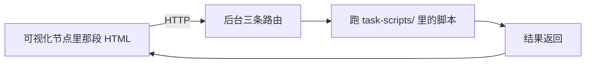

# 可视化节点的「任务脚本」后台 · 设计与实测
> ## 修订 5（2026-10-13）：**已联调通过**，并补了「怎么把它装上去」
>
> 上一版的实现一直是通的，但**没部署到跑着的后台** —— 表现为
> GET /api/task/list 掉进 SPA 回落拿到一份 index.html、canvas_ui_guide 里也没有
> 「任务脚本」那一段。查起来很像是前端坏了，其实是**后台在跑旧产物**。
>
> ### 怎么装（以后照这条走）
>
>     pnpm -C packages/plugins/plugin-node-ui build:server    # 打后台半 → dist/server.js
>     pnpm -C packages/cloud-server bundle                     # 后台清单要现扫磁盘，才认得到新的 sha
>     pnpm -C packages/plugins/plugin-node-ui deploy:server    # 调安装接口装进去（自动取清单里的可信 sha）
>
> 最后一步若报「热装失败（Duplicate plugin name）」，属**预期** —— 同名插件已在跑，
> 重启后台即生效（pnpm -C packages/cloud-server serve）。
>
> ### 顺带修掉的一个真问题：自带插件装不上自己的后台半
>
> plugin-catalog.json 里，「自带（builtin）插件」那条**从来没算过后台产物的 sha256**
> （非自带那条会算）。而安装路由拿清单里的哈希当唯一可信源 —— 清单不给，
> 连自己的自带件都被「未列入清单，拒绝安装」挡掉。
> 修法：catalog.ts 抽出 readServerArtifact()，两条路共用；自带插件有 dist/server.js
> 就带上它的哈希。可视化节点的 id 是 **plugin-node-ui**（插件目录名），
> 安装时用的是它，不是 node-ui。
>
> ### 联调实测（本机 127.0.0.1:8865，Node v24.15.0 / Windows）
>
> 后台侧（task-scripts/demo.mjs，就一件事的三条方法）：
>
> | 验的什么 | 结果 |
> |---|---|
> | 列脚本 | scripts 列表里是 demo，methods 为 echo / tick / version |
> | 跑 + wait:true | ok=true、state=done，result 里带回 ctx 的 canvasId / nodeId / workspace 可用 |
> | SSE 实时 | 依次收到 log／progress（0.2…1）／done，一帧不丢 |
> | 取消 | state=cancelled，tail 里留着脚本自己那句「收到取消，第 5 步停下」 |
> | 自己开子进程 | 脚本 spawn ffmpeg -version → 退出码 0（证明「不关笼子」这条真的能用） |
>
> 前端侧（往可视化节点里写一段真界面，沙箱里跑）：
> 列脚本 → 拿到 demo(echo,tick,version)；wait:true 的 echo 回话里读到自己那个 nodeId；
> tick 走 EventSource 收到 **9 帧**并以 done 收尾。
> 也就是说：**节点里那段 HTML 在沙箱里直接叫后台跑脚本这件事，端到端成立**。
>
> ==「允许联网」这个开关是前提 ==：沙箱页要发 fetch 靠它放行（默认就是开的，
> 见 uiConfig.netEnabled）；关掉它 = 纯展示，任务脚本也调不动。
>
> ### 手册里的脚本清单
>
> canvas_ui_guide 现在会在末尾附一段**实时**脚本清单（每次现读目录，不缓存），
> 形如「- demo（可调：echo、tick、version）」。空的就写「一个脚本都没有」并说清怎么加。
> 理由：AI 拿到手册那一刻就要决定「这个界面能不能真的干活」——不给清单，
> 它只能写一段没人验证过的调用，或者干脆不敢用。
>
> 实测的 demo.mjs 没留在数据目录（那是运行期垃圾，也进不了 git），
> 但**插件包里放了一份**（task-scripts/demo.mjs）与部署脚本（scripts/deploy-server.mjs），
> 照上面三条命令即可复现。
>
> ### 本次验证
>
> plugin-node-ui **117**（+3：手册带清单 1 条、清单文案 2 条）、tsc --noEmit 干净；
> cloud-server **625** 全绿（其中一条打真 npm registry 的用例并发时偶发，单独跑绿，与本次无关）。
>

> 修订 4（2026-10-13）。这一版把前面几个说法改正了，也把范围收回到你说的那件事：
> **三条路由 + 一个脚本目录 + 一点上下文**，让可视化节点里那段 HTML 能请求后台干活。
> 数字全是本机实测（Node v24.15.0 / Windows）。

## 〇、修订记录（哪些是我说错的）

| 我之前的说法 | 实际 |
|---|---|
| 「节点底部操作条上多一项『转码』」 | **错**。可视化节点没有上下操作栏，操作都在它内部那段 HTML 里（你说的就是这个，我写偏了） |
| `ctx.ffmpeg` / `ctx.ffprobe` | **是我自己加的，不在你的设计里**。你要的上下文是「脚本能拿到什么信息」，不是「我替你封装哪些命令」（见 §四） |

## 一、这个功能到底是什么

一句话：**给可视化节点配一个后台，让节点里那段 HTML 能"叫后台干活"。**



就三件事：

1. **列**：后台有哪些脚本、每个脚本导出哪些函数；
2. **跑**：跑 `某个脚本.某个函数(参数…)`，等它返回；
3. **实时**：跑的中间过程（日志、进度）能推给节点。

脚本是别人自己写的，**想干什么就干什么**。后台不规定它能做什么，只负责"把请求转给脚本、把结果带回来"。

## 二、三条路由

```jsonc
// 1 跑一个函数
POST /api/task/call
{ "type": "call",              // "call" 跑函数；"list" 列脚本
  "canvasId": "default",       // 可选：知道是谁在问
  "nodeId": "3",               // 可选
  "name": "scale",             // task-scripts 下的文件名（无 .mjs）
  "methods": "run",            // 这个文件导出的函数名
  "args": [640] }              // 位置参数数组
→ { ok: true, runId: "r…" }    // 立刻回，跑在后台

// 2 列脚本
POST /api/task/call  { "type": "list" }
→ { ok: true, scripts: [{ name: "scale", methods: ["run", "probe"] }] }

// 3 实时输出（SSE）
GET  /api/task/events?runId=r…
→ data: {"type":"log","line":"frame= 120 …"}
→ data: {"type":"done","result":{…}} / {"type":"error","message":"…"}
```

取消（`POST /api/task/cancel { runId }`）是第 4 条，可要可不要 —— 没有它，长任务没法停。

## 三、脚本长什么样、放哪

```
.mini-canvas/task-scripts/     可 --task-scripts 覆盖
  scale.mjs                    一个文件 = 一件事；文件名（去 .mjs）= 请求里的 name
  lib/ffmpeg.mjs               公共小工具（lib/ 与 _ . 开头的文件不进 list）
```

```js
// task-scripts/scale.mjs —— 自己写，想干什么就干什么
import { spawn } from 'node:child_process'

export async function run(width, ctx) {
  // 开进程、读文件、发请求 … 都由你自己决定
  const p = spawn('ffmpeg', ['-i', ctx.file('videoUrl'), '-vf', 'scale=' + width + ':-1', ctx.temp('.mp4')])
  ctx.log('开始转码')
  await new Promise((ok, bad) => { p.on('close', (c) => (c === 0 ? ok() : bad(new Error('ffmpeg 挂了')))) })
  return '跑完了'
}
```

**这里就是你问的那个点**：ffmpeg 是脚本自己写的、自己开的 —— 就像上面这样。我不该把它塞进 ctx。

## 四、上下文：脚本能拿到什么（没有"命令封装"）

`ctx` 只是**信息与环境**，不带任何"我替你封好的命令"：

| 字段 | 是什么 | 为什么要有 |
|---|---|---|
| `ctx.workspace` | 这次调用专属的一个空目录，随便往里写；跑完自动删 | 脚本总得有个地方放临时文件 |
| `ctx.dir` | `task-scripts/` 的绝对路径 | 想读自己旁边的文件（比如 `lib/` 里的小工具） |
| `ctx.canvasId` / `ctx.nodeId` | 谁在问 | 日志、错误、要回调画布接口时都要它 |
| `ctx.name` | 正在跑的脚本名 | 同上 |
| `ctx.input` | 之前 `CanvasUI.effects()` 交上来的状态 | 节点里的参数能带到后台 |
| `ctx.log(s)` | 往实时通道写一行 | 前端能边跑边看到输出 |
| `ctx.signal` | 取消信号（`AbortSignal`） | 用户点取消时，脚本能自己收摊 |

**就这些。** 它不会给你 `ctx.readFile` / `ctx.ffmpeg` / `ctx.http` 这类东西 ——

> **修订（2026-10-13）**：上面那张表是**第一版**。下面正文里"不给你封装"那句已经过时 ——
> 现在 ctx 多三个**助手**（都是"地址 / 路径 / 落盘"这类**后勤**，不是"替你干活"）：
>
> | 助手 | 干什么 |
> |---|---|
> | await ctx.save(字节或字符串, "名字.ext"[, { slot, mime }]) | 交产物到**本节点槽位**（同址覆盖） |
> | ctx.file(地址或文件名) | 同源地址 → **本地路径**（喂 ffmpeg；认不出就原样返回） |
> | ctx.temp("名字") | 工作目录里的路径 |
>
> 为什么给：没有 ctx.file 时，每个脚本都要自己把 /api/canvases/… 翻成磁盘路径
> （那是后台的内部知识）；没有 ctx.save 时，每个脚本都要自己拼 slot 地址、猜扩展名、
> 写 content-type —— 三件事各写一遍**必漏一个**（用户的 video-grid.mjs 为此写了一大段落盘逻辑）。
>
> **仍然不给**的：ctx.ffmpeg / ctx.http / ctx.readFile 这类"替你决定怎么干活"的东西 ——
> 那是脚本自己的事（用 node:child_process / fetch / node:fs）。
那些用 Node 自带的模块自己写（`node:fs` / `node:child_process` / `fetch`），
那也是"自定义脚本"的意思。

## 五、怎么回画布（这条必须有，不然脚本跑完没法给你看东西）

脚本跑完可以调后台的画布接口把结果写回去。为了让这件事不别扭，我会**从节点那段 HTML 里带一个
"回调票"到后台**，脚本拿它就能直接改自己那个节点：

```js
// 节点里那段 HTML（运行在沙箱页里）
const r = await fetch(base + '/api/task/call', {
  method: 'POST',
  headers: { 'content-type': 'application/json' },
  body: JSON.stringify({ type: 'call', name: 'scale', methods: 'run', args: [640], nodeId, canvasId }),
})
```

脚本侧想回写，就用 `ctx` 里那张票去调画布接口（增量改节点 / 上传产物到本节点的槽位）。
**要不要回写、回写什么，是脚本自己的事。**

## 六、安全：用户代码关不关笼子（实测）

Node 自带一个权限开关，可以把用户脚本关起来。实测：

| 用户脚本想干的事 | 不给开关 | 关笼子（只放行它自己的工作目录） |
|---|---|---|
| 读工作目录外的文件 | 读到了 | **挡住** |
| 读 / 写工作目录里的文件 | 能 | 能（正常干活） |
| 开子进程（ffmpeg） | 能 | **挡住** |
| 开线程 | 能 | **挡住** |

**但这条有个硬结论，我实测到了**：一旦为了跑 ffmpeg 而放开子进程，笼子就**基本失效** ——

```
放开子进程后，脚本用 cmd /c type 去读工作目录外的文件 →  读到了
（Node 自己的旗标会传给 node 子进程，但**原生命令行程序不受 Node 权限模型管**）
```

Node 自己在开这个开关时也会打警告：*"must be used with extreme caution. It could invalidate
the permission model."* —— 官方就是这个意思。

所以只有两条路，你选一条：

| | 用户脚本自己开 ffmpeg | 笼子 | 能做什么 |
|---|---|---|---|
| **不关**（推荐） | 能 | 没有 | 什么都能干（= 服务器代码） |
| **关掉子进程** | 不能 | 有效 | 只能做纯计算，跑不了 ffmpeg |

不存在"既能随便开 ffmpeg、又能挡住它看别的文件"这种第三态。

### 还有两条死角（说清，别指望）

- **网络管不住**：Node 的权限模型只管文件 / 子进程 / 线程 / WASI / 原生扩展，**没有网络**
  （官方文档写得很明确，我实测也一样）。要挡出网只能在系统层面做。
- **CPU 与内存管不住**：死循环、吃光内存，权限开关不管，得靠进程看门狗。

## 七、脚本放哪、谁能加

「加一个任务 = 往服务器目录放一个文件」，所以**能写那个目录的人 = 能在你机器上跑代码的人**。
这是它的本质。要收紧的话：服务默认只听 127.0.0.1（现状就是这样，别被改掉），
界面上的「加脚本」当成一次安装动作来对待（现成做法在 `routes/serverPlugins.ts`：
`confirm: true` + 同源检查）。

## 八、一次调用 = 一个独立进程（为什么要这样）

```
收到的每一次调用 → 起一个独立进程 → 里面 import 脚本、调那个函数 → 进程退出
```

三个原因，都有实测撑着：

1. **缓存不会涨**。ESM 缓存没有 API 能清（Node 官方文档原文：*"there is currently no way to
   bypass the caching behavior"*）。实测：同一个进程里反复「重新执行」2000 次，内存涨 110MB
   且一份都删不掉。独立进程用完即灭，不涨。
2. **改完立刻生效**。进程每次重新读磁盘，不需要重启后台、也不用加时间戳。
3. **取消收得干净**。杀整棵进程树，脚本拉起来的 ffmpeg 一起收掉。

第 3 条有实测对照：

| 起法 | 取消方式 | 脚本拉起的 ffmpeg |
|---|---|---|
| 普通起法 | 只杀脚本进程 | 停了（**靠运气**：Windows 的"爹死儿随"规矩） |
| detached 起法 | 只杀脚本进程 | **还活着**（变孤儿） |
| detached 起法 | 杀整棵树 | 停了 |

代价：每次多一次进程启动（几十毫秒），另外每次调用都会新建一个空工作目录（跑完删掉）。

## 九、最终效果

**装完之后你看不到任何新面板。** 可视化节点还是那个可视化节点，只是它那段 HTML 现在能叫后台干活了。

以「转码」为例：

| 步骤 | 你看到什么 |
|---|---|
| 一次性 | 后台半落到 `.mini-canvas/server-plugins/`；`task-scripts/` 建好，里面放一个样例 |
| 1 | 画布上放一个可视化节点；里面那段 HTML 是 AI 写的，上面有个「转码」按钮 |
| 2 | 点按钮 → 那段 HTML 请求 `/api/task/call` |
| 3 | 后台起一个独立进程跑 `scale.mjs`；脚本自己开 ffmpeg |
| 4 | 节点上边跑边显示日志（HTML 订阅 `/api/task/events` 自己画） |
| 5 | 跑完，脚本把新视频写回节点 → 节点里出现新视频 → 下游对比节点自己跟着变 |
| 6 | 中途点「取消」→ 整棵树被收掉，ffmpeg 立刻停 |

**加一个新功能**：往 `task-scripts/` 放一个 `crop.mjs`、里面写 `export async function run(...)`，
刷新一下，节点的 HTML 里（或者让 AI）调 `name: 'crop'` 就能用。后台一行都不用改。

**AI 那一半**：同一个后台半里放一份说明（跟现在 `canvas_ui_guide` 一个套路），告诉 AI
「这台机器上有哪些脚本、有哪些函数、上下文有什么」。于是你可以说「给这个可视化节点写一个
把画面裁成方形的脚本」，AI 写完脚本、再让节点跑一遍。

**这个方案不会有的东西**：

- 没有图形化脚本编辑器（脚本是代码，人写或 AI 写）；
- 没有"点几下就加个任务"（加任务 = 往服务器目录放文件）；
- 纯前端模式（没连后台）用不了。

## 十、待定

1. ~~安全和能力的取舍~~ **已定（2026-10-13）：不关。** 用户脚本想干什么就干什么 ——
   自己开 ffmpeg、自己读写文件、自己发请求。理由：这个功能的定义就是"脚本可以自定义实现任何功能"，
   关掉子进程等于让 ffmpeg 这类正事全干不了。代价见 §六：能写 `task-scripts/` 的人
   就等于能在你机器上跑代码，所以服务默认只听 127.0.0.1 这条必须守住。
2. **`ctx.input` 从哪里来**：用节点现有的 `uiInputs` / `effects`（`CanvasUI.effects()`），
   还是干脆让脚本自己去读画布接口？
3. **要不要现在加系统层面的出网限制**（挡掉用户脚本自己发网络请求）。

## 十一、事件怎么认出"自己那一路"（判断规范）

你问的是：节点里那段 HTML 订阅了事件通道，它凭什么知道收到这一条是自己那次调用发出来的？

**答案：靠 `runId`，而且它必须"猜不到"。** 下面这几条是实现规范，一条都不能省。

| # | 规则 | 为什么 |
|---|---|---|
| 1 | `/api/task/call` 立刻回一个 `runId`：**128 位随机串**（用 `crypto.randomUUID` 这一级的东西） | 用时间戳或自增数字，别人能猜出来 → 能偷看、能冒充取消 |
| 2 | 后台按 `runId` 存一条记录：`{ runId, canvasId, nodeId, 进程, 状态, 输出缓冲 }`，事件**只进这一条** | 不做全局广播，天然不会串台 |
| 3 | 订阅 `GET /api/task/events?runId=…`：不认识的 runId → 404；认识 → **先把已经攒下的输出回放一遍**，再接着推 | 页面拿到 runId 到真正连上之间，可能已经跑出好几行日志了；不回放就永远缺开头 |
| 4 | **每一帧都带 `runId`**，客户端收到后自己再核一遍，不是自己那路就丢 | 双保险：即使连接串了也不会画错东西 |
| 5 | 同一个节点可以**同时跑好几个**（runId 不同） | 所以**不能只按 nodeId 认**，必须按 runId |
| 6 | 跑完不马上删 runId，留一段（比如 5 分钟）：保留最终结果 + 最后几十行输出 | 页面刷新/断线重连回来还拿得到结果；也能兜底轮询 `GET /api/task/status?runId=`（HTML 里可以压根不订阅，只轮询） |
| 7 | 25 秒一个心跳注释帧 | 照抄项目里那两处 SSE 的现成做法，防止长任务被掐 |

**"独立进程"这件事和这个问题无关**：进程只是执行方式；对客户端来说，判断依据永远是 `runId`。
进程号只在后台内部用来取消，不会发给页面（发出去也不解决"哪一路"的问题）。

### 两条配套的规矩（不然会有幽灵任务）

**① runId 要写进节点数据。** 页面刷新时 srcdoc 会重画，JS 里存着的 runId 就没了 ——
而那个进程还在跑。所以起跑之后要把 runId 存到节点上（走画布增量接口，或让它进 `ctx.input` 那份状态），
页面重建时还能找回来。不然就是"后台在跑、页面什么也看不见、还没法取消"。

**② runId 就是一张票。** 谁拿到谁能看（也能取消）。所以：

- 只在调用方的响应里出现，不写进日志、不放进 URL 给别人看；
- 服务默认只听 127.0.0.1（现状），这张票的暴露面就是本机；
- 要更严可以再加一重：客户端启动时随机一个"身份串"存在 sessionStorage，订阅时一并带上，两边对上才给。

### 顺带说清：跨源这一层已经有了

节点里那段 HTML 住在沙箱（不透明源），它请求后台其实算**跨源**。后台早就全局开了 CORS
（`server.ts` 里的 `app.use('*', cors())`，而且注释写明"必须最先"），现在可视化节点里的
bridge 也是靠它才能发 fetch。SSE 走的是同一层，不用另行处理。
