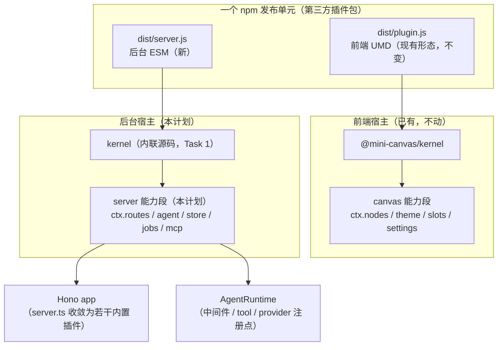

# 后台插件系统（复用 kernel + 路由/Agent 能力段）实施计划

> **状态：已实现（2026-10-04）** —— Task 1–7 全部落地；两轴 code review 后的修正也已合入。
> 实现要点与审查修正见文末「实现记录」。测试基线：**cloud-server 280 条 / plugin-cloud-client 119 条 / kernel 219 条全绿**。
> **为 agentic workers 准备**：实现本计划时用 superpowers:subagent-driven-development（推荐）或 superpowers:executing-plans，逐任务（Task）落地，用 `- [ ]` 勾选跟踪。
> **前置阅读**：`docs/design/core-layers-and-registry.md`（注册场终态设计）、`docs/goal/plugin-system-goal.md`（插件系统目标与验收）、`packages/kernel/src/capabilityLayer.ts`（能力层接缝）、`packages/cloud-server/src/providers/`（现有"后台投递箱"）、`packages/cloud-server/src/mcp/canvasDoc.ts` 文件头（**必读：它记录了"cloud-server 不能引工作区包"这条约束的实测结论**）。

---

## 〇、这个计划要解决什么

**用户原话**：
> "我后台如果要新增一个接口，你根本没办法做到，而且这个 provider 只是它里面的其中一个功能。我觉得正确的是，后台也做一个类似的插件系统……后台可以提供以下功能：1. 路由注册。2. 添加 Agent 中间件及相关插件（例如拦截请求等）。安装插件的时候，分为前后端两个插件。"

**现状（已核实）**：

| 能力 | 前端 kernel | cloud-server 现在 |
|---|---|---|
| 插件生命周期（装/卸/热更） | ✅ | ⚠️ 只有 provider 一种用途（`providers/load.ts` + `watch.ts`） |
| 作用域自动回收副作用 | ✅ `ctx.effect` | ❌ 缺 |
| 依赖编排（`inject`，缺依赖 PENDING） | ✅ | ❌ 缺 |
| 注册场（`ctx.registryOf`） | ✅ | ❌ 缺（只有硬编码 `ProviderRegistry`） |
| 事件 + 中间件（`waterfall`） | ✅ | ❌ 缺 |
| 配置 schema（分组 UI） | ✅ | ❌ 缺（`AgentConfigService` 手写表单） |

**要做的**：让 cloud-server 跑在**同一个 `@mini-canvas/kernel`** 上，并注入一层**后台能力段**（`ctx.routes` / `ctx.agent` / `ctx.store` / `ctx.jobs` / `ctx.mcp`）。现有 `server.ts` 里那 **12 个** `app.route('/', xxxRoutes(...))` 全部收敛成一个个"内置后台插件"。**前后端插件共享同一套作者 API**（`name` / `inject` / `apply(ctx)` / `ctx.effect` / `ctx.registryOf` / `ctx.waterfall`）。

---

## 一、头号约束与两个已实测的硬障碍

### 1.1 约束：`packages/cloud-server` 不能引工作区包

这不是口味，是实测结论，写在两处：
- `docs/superpowers/plans/2026-10-01-cloud-server-storage.md:22`：*"cloud-server 不能引工作区包（它要能独立 `npx` 跑）：类型就地声明，不 import `@mini-canvas/*`。"*
- `packages/cloud-server/src/mcp/canvasDoc.ts` 文件头：记录过"想让 canvas-data 变可发布，实际等于先发布 kernel"，并实测出 `error TS6059`。

**根因**：`@mini-canvas/kernel` 是 `private: true`、`main` 指向 `./src/index.ts`（只发源码），而 cloud-server 用 `tsc -p tsconfig.build.json`（`rootDir: ./src` + `declaration: true`）编译，且 `npx` 时那包不在用户机器上。

### 1.2 障碍一：`tsc` 编译不打包 → 不能直接 import 工作区包（已实测）

现状：cloud-server 的 `build` 是 **`tsc -p tsconfig.build.json`**（`rootDir: ./src` + `declaration: true`），它**只做类型擦除、不做打包**。于是直接 `import '@mini-canvas/kernel'` 会：

1. 撞 `error TS6059: File ... is not under rootDir`（`canvasDoc.ts` 文件头记过这个实测结论）；
2. 即便绕过类型检查，产物会留下对 `@mini-canvas/kernel` 的**运行时 import**，而 `kernel` 是 `private` 且只发 `src/`——用户 `npx` 时装不到它。

**根因**：不是"不能 import 工作区包"，而是"**纯 tsc 编译没有内联能力**"。

**对策（本计划采纳 · 打包内联）**：给 cloud-server 加一个 **esbuild 打包步骤**，把工作区依赖（kernel）**内联进产物**。代码里照常写 `import { Context } from '@mini-canvas/kernel'`，打包器负责解析并内联。

2026-10-04 实测（仓库内 esbuild 0.28.1）：
- 写一个文件 `import { Context } from '@mini-canvas/kernel'`（真实包名、**零特殊配置**）→ `esbuild --bundle --format=esm --platform=node` 成功，产物 63KB，Node 直跑 `new Context()` 正常。
- 整个 `cloud-server/src/cli.ts` 打包成功（203KB，`--packages=external` 只留 npm 依赖、工作区包内联）。

**连带好处**：kernel 那个"无扩展名相对 import"（`from './Context'`）的麻烦**自动消失**——打包器自己解析模块图，不需要手改源码、也不需要复制源码进 vendor。

### 1.3 障碍二：Hono 首次 `app.fetch` 之后**不能再注册路由**（已实测）

默认路由器（SmartRouter→RegExpRouter）在首次匹配时**冻结路由表**。实测：`/health` 请求过一次后再 `app.get(...)` → 抛 `Can not add a route since the matcher is already built.`

这直接冲击"运行时装/卸插件"。**本项目所有插件装载都发生在 `start()` 里（首次请求之前）**，所以正常路径不受影响；但 `ctx.routes` 的 API 必须**把这条约束写清**，并给出卸载方案。

**对策**：`ctx.routes` 走**代理 handler + 注册场**（下详），而不是"动态追加 Hono 路由"：

- 每条插件路由在 `ctx.routes` 里登记进注册场 `server/route`（key = `METHOD path`），并**在首次 `fetch` 之前**（即 `start()` 阶段）统一交给 Hono 一个**代理 handler**：命中的 path 只注册**一次**，代理内部现查注册场，命中就调、否则 `next()`；
- **卸载 = 从注册场移除条目**（`ctx.effect` 自动做），无需碰 Hono 的路由表；
- 因此"后装卸的插件"只要在 `start()` 期间完成注册即可；**运行期热装**（`start()` 之后）需要重建 app（见 §九 后续，本计划不做）。

> 关键：**`ctx.routes` 的注册必须在 `host.start()`/首次 `fetch` 之前完成**。`createCloudServer` 里所有 `host.ctx.plugin(...)` 都在 `app.fetch` 之前执行，满足此前提；但实现时要**在 `createServerFramework` 里显式固化这个顺序**（见 Task 2）。

### 1.4 方案选择（已定：打包内联）

| 方案 | 做法 | 结论 |
|---|---|---|
| **打包内联（采用）** | cloud-server 直接 `import '@mini-canvas/kernel'`；用 esbuild 打包，工作区内联、npm 依赖 external | **实测可行**；代码最直白、无同步层、不碰 kernel 本体 |
| 同步 kernel 源码进 `vendor/` + 改写 import 补 `.js`（原稿方案 A） | 复制源码 + 文本规范化 | **弃用**：是"纯 tsc 无内联能力"逼出来的绕路；打包器已天然解决 |
| 给 kernel 源码本身加 `.js`（原稿方案 B） | 动共享内核 | **弃用**：不必动内核即可达同样效果 |

**已定**：走"打包内联"。`import` 写在源码里，esbuild 负责内联；`tsc` 保留用于 **typecheck**（`--noEmit`），不再用于产出发布产物。

---

## 二、架构



**分层（与前端镜像）**：

| 层 | 前端 | 后台（本计划） |
|---|---|---|
| 框架 | `@mini-canvas/kernel` | 同一个 kernel（内联源码） |
| 能力层 | `createCanvasCapabilityLayer()`（canvas-data） | `createServerCapabilityLayer()`（cloud-server 新写） |
| 能力段 | `ctx.nodes` / `ctx.theme` / `ctx.slots` / `ctx.settings` | `ctx.routes` / `ctx.agent` / `ctx.store` / `ctx.jobs` / `ctx.mcp` |
| 内置插件 | theme-default / node-text / … | `health` / `events` / `canvases` / `actions` / `jobs` / `history` / `kv` / `canvasOps` / `agent` / `agentSessions` / `mcp` / `pluginRoutes` |
| 外挂插件 | UMD，`<script>` 加载 | ESM，import(data:URL) 加载（沿用 `providers/load.ts` 手法） |

---

## 三·补、内置服务名表（Task 3 的 `inject` 唯一来源）

Task 3 说"每个内置插件 `inject` 自己需要的服务"，但**服务名从哪来必须有据可依**。框架在装载前用 `ctx.inject(name, impl)` 把这些现有单例登记好，插件按名取：

| 服务名 | 实例 | 来源 |
|---|---|---|
| `kvStore` | `new KvStore(dataDir)` | `store/kvStore.ts` |
| `canvasStore` | `new CanvasStore(dataDir)` | `store/canvasStore.ts` |
| `canvasResources` | `new CanvasResourceStore(dataDir)` | `store/canvasResources.ts` |
| `doc` | `new CanvasDocument(canvasStore, canvasResources)` | `mcp/canvasDoc.ts` |
| `taskManager` | `new TaskManager({...})` | `tasks/taskManager.ts` |
| `history` | `new HistoryStore(dataDir)` | `tasks/history.ts` |
| `providerRegistry` | `new ProviderRegistry()` | `providers/registry.ts` |
| `agentConfig` | `new AgentConfigService(...)` | `agent/config.ts` |
| `agentSessions` | `new AgentSessionStore(dataDir)` | `agent/sessionStore.ts` |
| `agentRuntime` | `new AgentRuntime({...})` | `agent/runtime.ts` |
| `pluginsDir` | `string \| undefined` | `static.ts` 解析结果 |
| `uiDist` | `string \| undefined` | 同上 |

**规则**：
1. 这些名字是**后台专属**，与前端 kernel 的服务名（`doc`/`selection`/`save`…）**同名不同命**——后台 `doc` 是 cloud-server 自己的 `CanvasDocument`，不是 canvas-data 的。文档与代码注释都要点明，避免混淆。
2. 内置插件 `inject` 缺失的服务 → kernel 会把它留在 PENDING（这是**特性**：诊断面板能看出"谁缺即"）。若某内置插件拿不到服务，先查这张表有没有漏登记。
3. 服务实例的创建顺序即 `server.ts` 里现在 `new` 的顺序（先 store → 再 doc/tasks → 再 agent）；`inject` 只解决"谁依赖谁"，不改变创建时机。

---

## 三、文件结构

| 文件 | 动作 | 职责 |
|---|---|---|
| `packages/cloud-server/scripts/bundle.mjs` | 新 | esbuild 打包：工作区依赖（kernel）内联、npm 依赖 external |
| `packages/cloud-server/src/serverFramework/capabilityLayer.ts` | 新 | `createServerCapabilityLayer()`：产出 ctx.routes/agent/store/jobs/mcp |
| `packages/cloud-server/src/serverFramework/routes.ts` | 新 | `ctx.routes` 的实现（挂 Hono，随插件回收） |
| `packages/cloud-server/src/serverFramework/agent.ts` | 新 | `ctx.agent` 的实现（中间件链 + tool/systemPrompt 注册） |
| `packages/cloud-server/src/serverFramework/store.ts` | 新 | `ctx.store` 实现（插件私有 KV 命名空间，卸载即清） |
| `packages/cloud-server/src/serverFramework/jobs.ts` | 新 | `ctx.jobs` 实现（定时/延时/事件订阅，随插件回收） |
| `packages/cloud-server/src/serverFramework/mcp.ts` | 新 | `ctx.mcp` 实现（插件注册 MCP 工具） |
| `packages/cloud-server/src/serverFramework/pluginLoader.ts` | 新 | 扫目录加载后台插件（泛化自 `providers/load.ts`） |
| `packages/cloud-server/src/serverFramework/index.ts` | 新 | `createServerFramework()`：建 Context + 装能力层 + 加载内置/外挂插件 |
| `packages/cloud-server/src/server.ts` | 改 | 组装改成"建 framework + 注册内置插件"，行为不变 |
| `packages/cloud-server/src/plugins/builtin/*.ts` | 新 | 每个现有路由组收敛成一个内置后台插件 |
| `packages/cloud-server/src/providers/*` | 保留 | 作为**一个**内置插件（`providers`）继续工作 |
| `packages/cloud-server/src/agent/runtime.ts` | 改 | 加 `use(mw)` 中间件链（waterfall 语义） |
| `packages/cloud-server/package.json` | 改 | 加 `@mini-canvas/kernel` 依赖 + esbuild(dev)；`build` 改为 typecheck + bundle |

---

## 四、Task 列表

### Task 1：给 cloud-server 接上 kernel（打包内联）

**Files:**
- Modify: `packages/cloud-server/package.json`（加 `@mini-canvas/kernel` 依赖 + `bundle` 脚本）
- Create: `packages/cloud-server/scripts/bundle.mjs`（esbuild 打包入口）
- Test: `packages/cloud-server/src/__tests__/kernelInline.test.ts`

**Interfaces:**
- Produces: `dist/` 下是**打包好的**产物（工作区依赖已内联）；`pnpm bundle` 可用

**为什么这么做（实测依据，见 §1.2）**：cloud-server 现在用纯 `tsc`，没有内联能力，所以不能直接 import 工作区包。加一个 esbuild 打包步骤后，源码里照常 `import '@mini-canvas/kernel'`，打包器负责内联。

- [ ] **Step 1：加依赖与脚本**

```bash
# 加工作区依赖（真实包名，代码里直接 import）
pnpm -C packages/cloud-server add @mini-canvas/kernel@workspace:*
# esbuild 作为开发依赖（打包用；不进运行时依赖）
pnpm -C packages/cloud-server add -D esbuild
```

`package.json` 的 scripts 改成（保留 `tsc` 做类型检查，新增 `bundle` 做产出）：

```json
{
  "scripts": {
    "typecheck": "tsc --noEmit",
    "bundle": "node scripts/bundle.mjs",
    "build": "pnpm typecheck && pnpm bundle",
    "prepack": "pnpm run build && node scripts/bundle-assets.mjs"
  }
}
```

> 说明：`build` 不再只跑 `tsc -p tsconfig.build.json`（那个用来产出 dist）。改为"先 typecheck、再 esbuild 打包产出 dist"。`tsconfig.build.json` 若不再被引用，可保留（供将来要 d.ts 时用）或删除——**实现时按实际需要定，别留一个坏掉的脚本**。

- [ ] **Step 2：写打包脚本**

```js
// packages/cloud-server/scripts/bundle.mjs
/**
 * esbuild 打包 cloud-server：把工作区依赖（@mini-canvas/*）内联进产物，
 * npm 依赖保持 external（用 --packages=external，运行时照常 require）。
 *
 * 为什么用打包而不是纯 tsc：见计划 §1.2——纯 tsc 不内联，直接 import 工作区包会
 * 撞 TS6059 且发布产物缺依赖；打包器天然解决（顺带消掉 kernel 无扩展名 import 的麻烦）。
 */
import { build } from 'esbuild'
import { fileURLToPath } from 'node:url'
import path from 'node:path'

const PACKAGE_ROOT = path.resolve(path.dirname(fileURLToPath(import.meta.url)), '..')

await build({
  entryPoints: [path.join(PACKAGE_ROOT, 'src/cli.ts'), path.join(PACKAGE_ROOT, 'src/index.ts')],
  outdir: path.join(PACKAGE_ROOT, 'dist'),
  bundle: true,
  format: 'esm',
  platform: 'node',
  target: 'node20',
  sourcemap: true,
  // npm 依赖 external（不下进产物）；工作区包（@mini-canvas/*）**内联**。
  // 注意：--packages=external 会把所有裸包名当 external，包括 @mini-canvas/* ——
  // 所以这里不用它，改为**只把 npm 依赖列 external**（见下 external 列表）。
  external: [
    'hono', '@hono/node-server', 'yaml', 'zod',
    '@modelcontextprotocol/sdk', '@prismshadow/penguin-core',
  ],
  logLevel: 'info',
})
```

> ⚠️ **关键点**：`@mini-canvas/kernel` **不能**进 external（否则产物留下运行时 import，用户 `npx` 拿不到它）。上面用**白名单列 npm 依赖为 external**，工作区包自然内联。新增 npm 依赖时，记得同步这个列表（或改用「读 package.json 的 dependencies 自动生成 external」的写法，更省心——**实现时择一，写清注释**）。

- [ ] **Step 3：写测试证明"Node 里能跑内核"**

```ts
// packages/cloud-server/src/__tests__/kernelInline.test.ts
import { describe, it, expect } from 'vitest'
import { Context } from '@mini-canvas/kernel'

describe('cloud-server 能用内核（打包内联的前提）', () => {
  it('能建 Context、装插件、apply 被调用', async () => {
    const ctx = new Context()
    const seen: string[] = []
    ctx.plugin({ name: 'p1', apply: (c) => { seen.push('applied:' + typeof c.effect) } })
    await ctx.start()
    expect(seen).toEqual(['applied:function'])
    ctx.stop()
  })

  it('ctx.effect 随卸载回收（后台插件系统的基础承诺）', async () => {
    const ctx = new Context()
    let disposed = false
    ctx.plugin({ name: 'p2', apply: (c) => { c.effect(() => () => { disposed = true }) } })
    await ctx.start()
    ctx.uninstallPlugin('p2')
    expect(disposed).toBe(true)
    ctx.stop()
  })

  it('注册场可用（后台插件注册路由/工具的地基）', async () => {
    const ctx = new Context()
    ctx.plugin({ name: 'p3', apply: (c) => { c.registryOf<number>('demo').add('k', 1, { id: 'a' }) } })
    await ctx.start()
    expect(ctx.registryOf<number>('demo').get('k', 'a')?.value).toBe(1)
    ctx.stop()
  })
})
```

- [ ] **Step 4：跑测试 + 类型检查 + **打真实产物并 node 直跑（关键）**

```bash
pnpm -C packages/cloud-server test kernelInline
pnpm -C packages/cloud-server typecheck
pnpm -C packages/cloud-server bundle
# 证明产物自带 kernel、Node 直跑不用装工作区包：
node -e "import('./packages/cloud-server/dist/index.js').then(() => console.log('BUNDLE OK'))"
```
Expected: 测试 PASS（3 条）；typecheck 零错；bundle 成功；`BUNDLE OK`。

> ⚠️ **必须验"产物不依赖 @mini-canvas/kernel"**：
> ```bash
> rg -n "from .@mini-canvas/kernel.|require\(.@mini-canvas" packages/cloud-server/dist/*.js
> ```
> Expected: **无输出**（说明已内联）。若有输出 → 它被当成 external 了，检查 Step 2 的 external 列表。

- [ ] **Step 5：提交**

```bash
git add packages/cloud-server/package.json packages/cloud-server/scripts/bundle.mjs packages/cloud-server/src/__tests__/kernelInline.test.ts pnpm-lock.yaml
git commit -m "feat(cloud-server): 接入 kernel（esbuild 打包内联工作区依赖）"
```

### Task 2：server 能力层骨架 + `ctx.routes`（用户点 1：路由注册）

**Files:**
- Create: `packages/cloud-server/src/serverFramework/routes.ts`
- Create: `packages/cloud-server/src/serverFramework/capabilityLayer.ts`
- Create: `packages/cloud-server/src/serverFramework/index.ts`
- Test: `packages/cloud-server/src/__tests__/serverRoutes.test.ts`

**Interfaces:**
- Produces:
  - `interface RouteSegment { get(path, h); post(path, h); put(path, h); delete(path, h); all(path, h); use(path, h); mount(prefix, honoApp) }`
  - `createServerCapabilityLayer(): CapabilityLayer`
  - `createServerFramework(): { ctx: Context; app: Hono; agentTests: {...} }`

- [ ] **Step 1：写失败测试（路由注册 + 卸载即摘）**

```ts
// packages/cloud-server/src/__tests__/serverRoutes.test.ts
import { describe, it, expect } from 'vitest'
import { createServerFramework } from '../serverFramework/index.js'

describe('ctx.routes：插件注册路由（用户点 1）', () => {
  it('插件能注册一条 GET，命中返回它的响应', async () => {
    const host = createServerFramework()
    host.ctx.plugin({
      name: 'my-api',
      apply: (c) => { c.routes.get('/api/my-thing', (h) => h.json({ hello: 'world' })) },
    })
    await host.ctx.start()
    const res = await host.app.fetch(new Request('http://x/api/my-thing'))
    expect(res.status).toBe(200)
    expect(await res.json()).toEqual({ hello: 'world' })
    host.ctx.stop()
  })

  it('卸载插件 → 它注册的路由消失（作用域回收）', async () => {
    const host = createServerFramework()
    host.ctx.plugin({ name: 'gone', apply: (c) => { c.routes.get('/api/gone', (h) => h.text('x')) } })
    await host.ctx.start()
    expect((await host.app.fetch(new Request('http://x/api/gone'))).status).toBe(200)

    host.ctx.uninstallPlugin('gone')
    expect((await host.app.fetch(new Request('http://x/api/gone'))).status).toBe(404)
    host.ctx.stop()
  })

  it('能挂子应用（mount）', async () => {
    const host = createServerFramework()
    const { Hono } = await import('hono')
    const sub = new Hono()
    sub.get('/ping', (h) => h.text('pong'))
    await host.ctx.start()
    // ⚠️ 实测：Hono 的 app.route() 在**调用那一刻快照**子应用的路由表。
    // 所以必须先建好子应用全部路由、再 mount；mount 之后往子应用加路由 → 404。
    host.ctx.plugin({ name: 'sub', apply: (c) => { c.routes.mount('/subapi', sub) } })
    await host.ctx.flush?.()  // 若 start() 已在上面，则改由 framework 提供"应用挂载"阶段
    expect(await (await host.app.fetch(new Request('http://x/subapi/ping'))).text()).toBe('pong')
    host.ctx.stop()
  })

  it('两个插件注册同 path → **先注册者优先**（实测 Hono 行为，不是后注册者）', async () => {
    const host = createServerFramework()
    host.ctx.plugin({ name: 'a', apply: (c) => { c.routes.get('/same', (h) => h.text('A')) } })
    host.ctx.plugin({ name: 'b', apply: (c) => { c.routes.get('/same', (h) => h.text('B')) } })
    await host.ctx.start()
    // 实测：Hono 同 path 两个 handler 是**先注册者胜**（返回 'A'），与前端注册场的栈序相反。
    // ctx.routes 不去对抗 Hono，而是**明确按先注册者优先**，并在文档里写清（免得作者以为能覆盖）。
    expect(await (await host.app.fetch(new Request('http://x/same'))).text()).toBe('A')
    host.ctx.stop()
  })

  it('装载必须在首次 fetch 之前完成（实测：fetch 后加路由会抛错）', async () => {
    // 这条是**约束测试**：证明 createServerFramework 的所有插件装载都发生在 start() 内、
    // 而 app.fetch 在 start() 之后才能被调用（framework 应保证这个顺序）。
    const host = createServerFramework()
    let appUsableBeforeStart = true
    try { await host.app.fetch(new Request('http://x/health')) } catch { appUsableBeforeStart = false }
    expect(appUsableBeforeStart).toBe(false)  // start() 之前 app 不可用（路由表未建）
    await host.ctx.start()
    expect((await host.app.fetch(new Request('http://x/health'))).status).toBe(200)
    host.ctx.stop()
  })
})
```

- [ ] **Step 2：跑测试，确认失败**

Run: `pnpm -C packages/cloud-server test serverRoutes`
Expected: FAIL —— 找不到 `../serverFramework/index.js`。

- [ ] **Step 3：实现 `ctx.routes` + 能力层**

关键设计（**必须写进代码注释**，三条都是实测结论）：

1. **装载顺序是硬前提**：Hono 默认路由器在首次 `app.fetch` 时**冻结路由表**，之后任何 `app.get/route` 都抛 `Can not add a route since the matcher is already built.`（实测）。所以 `createServerFramework` 必须保证：**插件装载（`ctx.start()`）严格早于 `app` 的任何一次 `fetch`**。实现上让 framework 暴露 `start()`，内部 `await ctx.start()` 后再标记 `app` 可用；`app` 在 `start()` 前访问直接抛清晰错误（见约束测试）。

2. **卸载靠注册场，不靠 Hono**：Hono **没有**反注册 API（实测：`app.routes` 只增不减，也没有 `removeRoute`）。做法 = 每条插件路由在处理链里只挂**一个稳定的分发点**：
   - 命令式 `routes.get/post/put/delete/all(path, h)` 把 `h` 登记进注册场 `server/route`（key = `${METHOD} ${path}`），并用 `ctx.effect` 绑定回收；
   - framework 在装载结束时，把注册场里**已出现的 path 集合**一次性翻译成 Hono 路由，每个 path 挂一个**代理 handler**：`proxy = (c) => { const e = field.get(path, METHOD); return e ? e.value(c) : c.notFound() }`；
   - **卸载 = 从注册场移除**（`ctx.effect` 自动），代理下次查不到 → 404。**Hono 路由表自始至终不动。**
   - ⚠️ 推论：**运行期（start 之后）新增 path 无法生效**（Hono 已冻结）。这是本计划接受的边界：本项目的插件装卸都发生在启动阶段。热装需要重建 app，见 §九。

3. **同 path 是"先注册者胜"**（实测：Hono 同 path 两个 handler 返回第一个）。前端注册场是"后注册者在上"，**两边栈序相反**——`ctx.routes` 不去对抗 Hono，明确以"先注册者优先"为准并写进注释；想覆盖某路由的作者须用更细的 path 或 `order`（若实现选择代理里按 order 取，则改为注册场语义并加测试锁死）。**二选一，实现时定死并写测试，别留模糊。**

4. `mount(prefix, app)`：⚠️ 实测 Hono 的 `app.route(prefix, sub)` 在**调用时刻快照**子应用的路由（mount 之后再往 `sub` 加路由 → 子路由 404）。约定：**先建齐子应用的全部路由，再 mount**；卸载时用同一代理模式跳过（记录 mount 的 entry，代理里查注册场是否还在）。

- [ ] **Step 4：跑测试，确认通过**

Run: `pnpm -C packages/cloud-server test serverRoutes`
Expected: PASS（4 条）。

- [ ] **Step 5：提交**

```bash
git add packages/cloud-server/src/serverFramework/ packages/cloud-server/src/__tests__/serverRoutes.test.ts
git commit -m "feat(cloud-server): ctx.routes 路由注册能力段（卸载自动摘）"
```

---

### Task 3：把现有路由收敛成内置插件（行为不变）

**Files:**
- Create: `packages/cloud-server/src/plugins/builtin/health.ts`（样板）
- Modify: `packages/cloud-server/src/server.ts`
- Test: `packages/cloud-server/src/__tests__/builtinPlugins.test.ts`

- [ ] **Step 1：写失败测试（health 走插件注册，仍可访问）**

```ts
// packages/cloud-server/src/__tests__/builtinPlugins.test.ts
import { describe, it, expect } from 'vitest'
import { promises as fs } from 'node:fs'
import os from 'node:os'
import path from 'node:path'
import { createCloudServer } from '../server.js'

describe('内置插件：health', () => {
  it('GET /health 仍返回 ok（收敛成插件后行为不变）', async () => {
    const dir = await fs.mkdtemp(path.join(os.tmpdir(), 'cs-'))
    const srv = await createCloudServer({ port: 0, dir, watchProviders: false })
    const res = await srv.app.fetch(new Request('http://x/health'))
    expect(res.status).toBe(200)
    expect(await res.json()).toEqual({ ok: true })
    srv.stop()
  })
})
```

- [ ] **Step 2–4**：实现 health 内置插件 → 测试通过 → 提交。

- [ ] **Step 5：逐个迁移其余路由组**

按**一次一个**迁移，每个迁移完立刻跑全量测试：`events` / `canvases` / `actions` / `jobs` / `history` / `kv` / `canvasOps` / `agent` / `agentSessions` / `mcp` / `pluginRoutes`。
**每个内置插件声明它需要的服务为 `inject`**（见 §三·补 的服务名表，如 `canvases` 插件 `inject: ['canvasStore']`）——这样后台插件也享受依赖编排。

**⚠️ 两类东西**不要**塞进 `ctx.routes`（子代理指出的一大风险）**：
- **`uiRoutes`（静态托管 + SPA 回落）**：它是**兜底通配**（`app.get('*')`），必须**最后**挂，且它不属于"插件能力"——它是宿主职责。**保留在 framework 里直接挂**，不收敛成插件。
- **`mcpRoutes`（`/mcp`，MCP SDK transport）**：它 `all('/mcp')` 且内部自建 transport/server，与 `ctx.routes` 的"代理 handler + 注册场"模型不兼容。**保留在 framework 里直接挂**（在静态兜底之前）。

说明：`pluginRoutes`（清单 + `/plugins/*`）**可以**收敛成插件（它只是普通 GET），但它的 `/plugins/*` 通配也是兜底类，挂载顺序要在 ui 兜底之前。

- [ ] **Step 6：为"行为不变"补证据（子代理指出原稿缺这个）**

原稿只说"行为不变"但没有证明手段。逐条补：
1. **先存基线**：迁移**之前**先跑一次 `pnpm -C packages/cloud-server test > base.txt`，记下通过数与文件名。
2. **路由级断言补齐**：现有测试对 `jobs` / `history` / `canvasOps` 的路由断言不全。迁移这些组时，**先补一条 `createCloudServer` 级的冒烟断言**（`app.fetch` 打一次该路由、断言状态码与关键字段），再迁移——这样"迁移前后都绿"才说明行为真的没变。
3. **逐组迁移 + 立即回归**：每迁一组跑全量；任一组出现红，先判断是"断言写死了旧注册方式"还是"行为真变了"——前者改测试的构造方式（不改断言），后者停下来查。

- [ ] **Step 7：全量回归**

Run: `pnpm -C packages/cloud-server test && pnpm -C packages/cloud-server typecheck`
Expected: 全绿，**用例数 ≥ 基线 217**（迁移不改行为，只加新测试）。
> 基线备注：`pnpm -C packages/cloud-server test` 现为 **217 例**（2026-10-04 实测）。其中 `kvStore.test.ts` 的"同一 key 多轮并发写"是**时序型用例**、偶发失败（单独重跑 15/15 全过）——它是既有 flake，与本计划无关；碰到就重跑，别去改它。

- [ ] **Step 8：提交**

---

### Task 4：后台插件加载器（外挂插件）

**Files:**
- Create: `packages/cloud-server/src/serverFramework/pluginLoader.ts`
- Modify: `packages/cloud-server/src/providers/load.ts`（**保留**，作为 providers 内置插件的实现）
- Test: `packages/cloud-server/src/__tests__/serverPluginLoader.test.ts`

**Interfaces:**
- Produces: `loadServerPluginsFromDir(dir): Promise<{ modules: PluginModule[]; failures: {file,error}[] }>`
  - 认 `{ name, inject?, apply, Config? }` 形态；加载手法沿用 `providers/load.ts` 的 `import('data:text/javascript,' + encodeURIComponent(text))`
  - **同时保留旧 `Provider` 形态兼容**（有 `submit`/`actions` 无 `apply` → 当作 provider，喂给 providers 内置插件）

- [ ] Steps：写测试（丢一个假插件 js 进临时目录 → 加载 → 它的路由生效）→ 实现 → 通过 → 提交。

**安全要点（必须逐条落到代码与测试）**：
- 目录扫描照抄 `providers/load.ts` 的既有决策：**只扫显式目录、不跟软链（用 withFileTypes 判 isFile）、不递归、单文件失败不影响其它**。
- ⚠️ 后台插件 = **服务端任意代码执行**，信任边界 = 谁能写那个目录。文档与安装界面都必须写明。
- permissions 声明字段（如 net / store / fs）：本 Task **只记录不强制**，但必须有**消费点**——一个诊断路由要能列出每个已装后台插件声明了什么权限，供界面显示。**没有消费点的字段等于没有**（子代理指出的问题）。
- 目录来源**只允许**：显式 `--server-plugins <dir>`、或 `<数据根>/server-plugins`。**绝不从 URL/网络加载**（那条路走 Task 7 的 install 路由，单独把关）。

---

### Task 5：`ctx.agent` —— Agent 中间件（用户点 2）

**Files:**
- Create: `packages/cloud-server/src/serverFramework/agent.ts`
- Modify: `packages/cloud-server/src/agent/runtime.ts`（加 `use()` 链 + 在 `run()` 里走链）
- Test: `packages/cloud-server/src/__tests__/agentMiddleware.test.ts`

> ⚠️ **先看清真实接缝（实测，别再按想象写）**：
> `AgentRuntime.run` 的签名是
> `async *run(canvasId: string, input: StartRunInput, signal: AbortSignal, notify?): AsyncGenerator<AgentChatEvent>`。
> - 它是 **async generator**（`yield` 事件流），**不是**普通 async 函数；
> - `input` 是 `StartRunInput = { canvasId; sessionId?; text; images?; prefs? }`——**`canvasId` 在 `input` 里也有一份**，且**没有** `meta` 字段；
> - 计划原稿的 `AgentTurn{canvasId,text,meta}` 与 `runThroughMiddleware({canvasId,text})` 与之**不符**，已按真实签名改写（见下）。

**Interfaces（按真实签名定）:**
- Produces:
  - `interface AgentTurn { canvasId: string; input: StartRunInput; abortSignal: AbortSignal; /** 只读旁路，插件一般不写 */ notify?: (e: unknown) => void }`——**持有 runtime 的真实入参**，不另造平行结构；插件改 `turn.input.text` / `turn.input.prefs` 即为"进入前加工"
  - `interface AgentTurnResult { /** 中间件可短路时的产物 */ blocked?: true; response?: unknown }`
  - `ctx.agent.use(mw: (turn: AgentTurn, next: () => Promise<AgentTurnResult>) => Promise<AgentTurnResult>, opts?: { order?: number })`（**koa 式**：调 `next()` 放行；返回 `{blocked:true, response}` 且不调 `next()` = 拦截）
  - `ctx.agent.systemPrompt(text, opts?)` / `ctx.agent.tool(def)`（先做这两个；provider 注册留待后续）
  - **`createServerFramework()` 上加 `runAgentTurn(turn)`（不是"测试用"——它是真接口的 pre-turn 阶段）**，返回值 `AgentTurnResult`；`AgentRuntime` 的 `agent` 路由在调 `runtime.run()` **之前**调它，若 `blocked` 则直接回 `response`、不进模型。

**中间件插在哪（关键）**：`ctx.agent.use` 的链**不插在生成器内部**（生成器里 yield 事件很危险，且 `yield` 不能在嵌套函数里用——runtime 自己的注释就写了这个坑）。正确位置是 **`run()` 之前的一层"pre-turn"**：HTTP 路由拿到 `{canvasId, sessionId, text, images, prefs}` → 先跑 `runAgentTurn`（可改写 text / 拦截）→ 再调 `runtime.run(canvasId, input, signal, notify)`。这样链与生成器解耦、可单测、空链时零开销。

- [ ] **Step 1：写失败测试**

```ts
// packages/cloud-server/src/__tests__/agentMiddleware.test.ts
import { describe, it, expect } from 'vitest'
import { createServerFramework } from '../serverFramework/index.js'

/** 造一个最小 StartRunInput（只填必需字段） */
const turnInput = (text: string) => ({ canvasId: 'd', text })

describe('ctx.agent 中间件（用户点 2）', () => {
  it('中间件能改写 turn.input.text（进入前加工）', async () => {
    const host = createServerFramework()
    host.ctx.plugin({
      name: 'scrubber',
      apply: (c) => { c.agent.use(async (turn, next) => { turn.input.text = turn.input.text.replace(/secret/g, '***'); return next() }) },
    })
    await host.ctx.start()
    const r = await host.runAgentTurn({ canvasId: 'd', input: turnInput('my secret'), abortSignal: new AbortController().signal })
    expect(r.blocked).not.toBe(true)
    // runAgentTurn 就地改写 turn.input（host.lastTurn 是它存下的最后一个 turn，供断言）
    expect(host.lastTurn?.input.text).toBe('my ***')
    host.ctx.stop()
  })

  it('中间件不调 next() 且返回 blocked → 拦截（下游看不到）', async () => {
    const host = createServerFramework()
    let downstreamRan = false
    host.ctx.plugin({ name: 'blocker', apply: (c) => { c.agent.use(async () => ({ blocked: true, response: { ok: false, error: '拦截' } })) } })
    host.ctx.plugin({ name: 'downstream', apply: (c) => { c.agent.use(async (t, next) => { downstreamRan = true; return next() }) } })
    await host.ctx.start()
    const r = await host.runAgentTurn({ canvasId: 'd', input: turnInput('hi'), abortSignal: new AbortController().signal })
    expect(r.blocked).toBe(true)
    expect(downstreamRan).toBe(false)
    host.ctx.stop()
  })

  it('order 决定中间件顺序（小者在外，与前端注册场一致）', async () => {
    const host = createServerFramework()
    const order: string[] = []
    host.ctx.plugin({ name: 'outer', apply: (c) => { c.agent.use(async (t, n) => { order.push('outer-in'); const r = await n(); order.push('outer-out'); return r }, { order: -10 }) } })
    host.ctx.plugin({ name: 'inner', apply: (c) => { c.agent.use(async (t, n) => { order.push('inner-in'); const r = await n(); order.push('inner-out'); return r }, { order: 10 }) } })
    await host.ctx.start()
    await host.runAgentTurn({ canvasId: 'd', input: turnInput('hi'), abortSignal: new AbortController().signal })
    expect(order).toEqual(['outer-in', 'inner-in', 'inner-out', 'outer-out'])
    host.ctx.stop()
  })

  it('卸载插件 → 它的中间件不再跑（作用域回收）', async () => {
    const host = createServerFramework()
    let ran = false
    host.ctx.plugin({ name: 'temp', apply: (c) => { c.agent.use(async (t, n) => { ran = true; return n() }) } })
    await host.ctx.start()
    await host.runAgentTurn({ canvasId: 'd', input: turnInput('a'), abortSignal: new AbortController().signal })
    expect(ran).toBe(true)
    ran = false
    host.ctx.uninstallPlugin('temp')
    await host.runAgentTurn({ canvasId: 'd', input: turnInput('b'), abortSignal: new AbortController().signal })
    expect(ran).toBe(false)
    host.ctx.stop()
  })

  it('空链 = 零改动（没有插件时行为与今天一字不差）', async () => {
    const host = createServerFramework()
    await host.ctx.start()
    const r = await host.runAgentTurn({ canvasId: 'd', input: turnInput('原样'), abortSignal: new AbortController().signal })
    expect(r.blocked).not.toBe(true)
    expect(host.lastTurn?.input.text).toBe('原样')
    host.ctx.stop()
  })
})
```

- [ ] **Step 2-5：实现 → 测试通过 → 接线 → 提交**，顺序如下：
  1. 实现 runAgentTurn：注册场 registryOf('server/agent-mw')（key = 自增 id，值 = { mw, order }）；跑链时按 order 升序、用 koa 式 dispatch(i) 递归（next() = dispatch(i+1)）；链尾是完成空终点；空链直接返回 {}（零开销）。
  2. 注册必须走注册场（不能存普通数组），这样 ctx.effect 才能让卸载自动摘。
  3. 接到 agent 路由：在真正调 runtime.run 的地方（先 grep 确认是 routes/agentSessions.ts 还是别处）里，调 runtime.run(...) 之前先调 host.runAgentTurn(...)；若 blocked 则直接回它的 response、不进模型。
  4. 锁空链行为不变：跑 agent 相关的既有测试；本 Task 只加链，无插件时应等价于原路径。

---

### Task 6：`ctx.store` / `ctx.jobs` / `ctx.mcp`（配套能力，可分批）

**Files:**
- Create: `packages/cloud-server/src/serverFramework/store.ts` / `jobs.ts` / `mcp.ts`
- Test: 各自单测

**Interfaces:**
- `ctx.store.namespace(name)` → `{ get(k); set(k, v); delete(k); keys() }`；**卸载插件时该命名空间数据清除**
- `ctx.jobs.every(interval, fn)` / `once(delay, fn)` / `on(event, fn)`；**卸载自动清除定时器**
- `ctx.mcp.tool(def)`：把插件工具加进 `createCanvasMcpServer` 的工具表

- [ ] Steps：每个能力单独一个测试 + 实现 + 提交。**这三个可拆成三个独立小任务**，不必一次做完。

---

### Task 7：前后端配对安装（用户的核心体验）

**Files:**
- Modify: `packages/plugins/plugin-cloud-client/src/manager/catalogTypes.ts`（加 `server?: { url }`）
- Modify: `packages/cloud-server/src/plugins/catalog.ts`（扫 `dist/server.js`，有则填进清单）
- Modify: `packages/plugins/plugin-cloud-client/src/manager/pluginManagerService.ts`（装前端时若清单有 server → 调后台安装接口）
- Modify: `packages/plugins/plugin-cloud-client/src/manager/components/settings/PluginManagerPage.vue`（两个状态灯）
- Test: 前后端各自单测

**Interfaces:**
- 清单新字段：`server?: { url: string; globalName?: string; permissions?: string[] }`
- 后台新路由：`POST /api/server-plugins/install { url, sha256?, confirm }` / `POST /api/server-plugins/uninstall { id }` / `GET /api/server-plugins`（诊断：列出已装 + 各自 permissions）

**⚠️ 安全（子代理指出：原稿这条路由等于"从任意 URL 取服务端代码执行"，必须收口）**

`POST /api/server-plugins/install` 是**本计划攻击面最大的地方**，落实现必须：
1. **默认只允许同源**：`url` 必须与当前服务的 origin 一致（即先由"下载到本机"或"本地目录"取得文件，再由 URL 引用同源路径）。**跨源安装默认拒绝**，要开必须显式 `--allow-remote-server-plugins`。
2. **`confirm: true` 必填**：界面必须让用户看到"这将安装一个以服务端权限运行的插件"并显式确认；缺 `confirm` → 400。
3. **完整性校验**：清单里的 `sha256` 必填；服务端拉文件后算哈希比对，不匹配拒绝安装（防传输篡改）。
4. **写到 `<数据根>/server-plugins/` 后再加载**（不要直接 `import(url)`）：文件落盘 → 校验 → 从**本地路径**加载，避免"远程代码直接执行"。
5. **不递归/不跟随重定向**到内网：`fetch` 用 `redirect: 'manual'`，拒 3xx；解析出的 IP 若属私网段则拒（基础 SSRF 防护）。

- [ ] Steps：写测试（清单含 server → 界面显示两个灯；缺 confirm → 400；sha 不符 → 拒绝；跨源 → 拒绝）→ 实现 → 通过 → 提交。

---

## 五、验收清单（全勾 = 已完成）

- [x] **Task 1**：`@mini-canvas/kernel` 在 `devDependencies`（构建期内联用，不进运行依赖）；`bundle` 成功；`kernelInline.test.ts` 3 条绿；**`dist/` 产物里搜不到 `@mini-canvas/kernel` 的运行时 import**（已内联）
- [x] **Task 2**：`ctx.routes` 能注册路由；**卸载插件路由消失**；同 path 先注册者胜；装载期前发请求抛错；`serverRoutes` 7 条 + 顺序/隔离/优先级 7 条绿
- [x] **Task 3**：12 个内置插件承接原 12 组路由（`uiRoutes`/`mcpRoutes` **故意**保留宿主直挂）；`/health` 等行为逐条不变；`builtinBehavior` 5 条 + `pluginTakeover` 3 条绿
- [x] **Task 4**：丢一个 `.js` 进 server-plugins → 重启后它的路由生效；坏文件不影响服务；**permissions 有消费点**（诊断路由列出）
- [x] **Task 5**：`ctx.agent.use` 能改写 `turn.input.text` / 拦截；order 生效；卸载即停；**空链行为不变**；含 E2E 打真实 `/messages` 共 7 条绿
- [x] **Task 6**：`ctx.store` / `ctx.jobs`（含 `on`）/ `ctx.mcp`（含 `agent.tool`）各自可用且卸载即清；含 MCP 端点 E2E 共 13 条绿
- [x] **Task 7**：含 `dist/server.js` 的包 → 清单带 `server.url`/`sha256`/`permissions` → 界面两个状态灯 + 确认交互；**缺 `confirm` → 400、sha 与清单不符 → 拒、跨源 → 拒**（15 条绿）
- [x] **全量**：cloud-server **280** 条绿 + typecheck 干净；plugin-cloud-client **119** 条绿 + typecheck 干净；kernel **219** 条绿
- [x] **独立可跑**：`pnpm pack` → 空项目 `npm install <tarball>` → `npx mini-canvas-cloud serve` 起得来（实测 `/health` 200）
- [x] **审查闸门**：已用两个独立子代理（Standards / Spec）逐条审核；发现的 7 处硬问题（含 4 项安全/生命周期）已全部修复并有测试（详见 §十）

> **注**：`@mini-canvas/kernel` 放 `devDependencies` 而非 `dependencies` —— 它构建期内联进 dist、运行期不需要；放 `dependencies` 会让装包方去 npm 抓一个不存在的包（实测 E404）。

---

## 六、不做 / 明确边界

- **不重写 kernel**：它是零依赖纯逻辑，内联复用。
- **不改 `providers/`**：作为 providers 内置插件继续工作，web2api 照旧。
- **不让后台插件直接碰全局 Hono**：只经 `ctx.routes`（卸载才能摘干净）。
- **不做前后端插件共享运行时**：前端在浏览器、后台在 Node，只共享同 id 的配对身份与同款作者 API。
- **不做插件沙箱/签名**：本计划的信任模型是"用户信任自己装的插件"（与 `providers/load.ts` 既有结论一致）。**但必须加**：
  - 安装确认（界面上说明"后台插件会以服务端权限运行"）；
  - 一个 `permissions` 声明字段（先只记录、不做强制，为将来留口）。
- **不把 `canvas-data` 拉进来**：它依赖 Vue/渲染，属前端层（`canvasDoc.ts` 已论证）。

---

## 七、风险与对策

| 风险 | 影响 | 对策 |
|---|---|---|
| **纯 tsc 编译不内联 → import 工作区包撞 TS6059 / 产物缺依赖** | 计划前提不成立 | 已定对策：esbuild 打包内联（§1.2/§1.4，实测可行）；Task 1 Step 4 校验产物里搜不到 `@mini-canvas/kernel` 的运行时 import |
| **打包时误把工作区包当 external → 产物仍依赖 kernel** | `npx` 装不上 | Task 1 Step 2 用白名单列 npm 依赖为 external（kernel 不在此列）；Step 4 有专门校验 |
| **Hono 首次 `fetch` 后不能注册路由** | 运行期热装失效 | **已实测**：装载必须在 `start()`/首次 fetch 之前（§1.3）；本计划只支持启动期装卸；热装需重建 app（§九） |
| **Hono 无路由反注册 API** | 卸载摘不掉路由 | 代理 handler + 注册场（Task 2 Step 3）；测试锁"卸载后 404" |
| **Hono 同 path 是先注册者胜（与前端注册场相反）** | 作者以为能覆盖却覆盖不了 | **已实测**：`ctx.routes` 明确"先注册者优先"并写进注释与测试（Task 2 Step 1 第 4 条） |
| **Hono `route()` 快照子应用路由** | mount 后再加子路由 → 404 | **已实测**：约定先建齐子应用再 mount（Task 2 Step 3 第 4 条） |
| **AgentRuntime 是 async generator、入参含 prefs 无 meta** | Task 5 按想象写会返工 | 已按真实签名 `run(canvasId, input, signal, notify)` 改写（Task 5）；中间件放 `run()` **之前**的 pre-turn 层 |
| 迁移 12 组路由时行为漂移 | 存量功能坏 | 先存基线 + 补路由级冒烟断言 + 逐组迁移（Task 3 Step 6）；`uiRoutes`/`mcpRoutes` 不收敛成插件 |
| 内联 kernel 版本漂移 | 前后端语义不一致 | 打包内联**天然同步**（每次构建都从 kernel 源码取最新），无漂移面 |
| Agent 中间件改坏现有对话流 | 用户核心功能坏 | 中间件链**默认空**（没插件 = 行为与今天一字不差）；测试锁"空链时行为不变" |
| 后台插件是服务端任意代码 | 安全面扩大 | 只扫显式目录（Task 4）；install 路由收口：同源 + confirm + sha256 + 落盘再加载 + 拒重定向/私网（Task 7） |

---

## 八、实测记录：为什么用「打包内联」而不是「复制源码」

这一节留作决策依据，免得将来有人重新纠结一遍。

**背景**：`@mini-canvas/kernel` 是 `private` 包、`main` 指向 `./src/index.ts`（只发源码）。cloud-server 原来的 `build` 是纯 `tsc`（只做类型擦除、不打包），所以：
- 直接 `import '@mini-canvas/kernel'` → 撞 `error TS6059`（`rootDir` 约束，`canvasDoc.ts` 文件头记过）；
- 且产物会留运行时 import，用户 `npx` 时装不到这个 private 包。

**曾考虑的两个绕路（已弃用）**：
1. **复制 kernel 源码进 `vendor/`**：把 kernel `src/` 复制进来、从相对路径 import。问题：多一层同步工序、要防漂移；还要处理"kernel 用无扩展名相对 import，编译后 Node ESM 报 `ERR_MODULE_NOT_FOUND`"（实测确认过这个错误真实存在，且 **vitest 会掩盖它**）。
2. **给 kernel 源码本身补 `.js` 扩展名**：实测 kernel typecheck + 219 测试 + 前端 vite 都接受；但动的是前后端共用的内核，触碰 `AGENTS.md` 红线。

**最终采用：打包内联。** cloud-server 源码里照常写 `import '@mini-canvas/kernel'`，用 esbuild 打包时把工作区依赖内联。

**实测证据（2026-10-04，仓库内 esbuild 0.28.1）**：
- 一个文件 `import { Context } from '@mini-canvas/kernel'`（**真实包名、零特殊配置**）→ `esbuild --bundle --format=esm --platform=node` 成功，产物 63KB；
- 该产物 Node 直跑：`new Context()` 正常、插件装载正常、`ctx.effect` 正常；
- 整个 `cloud-server/src/cli.ts` 打包成功（203KB，`--packages=external` 只留 npm 依赖）。

**为什么它更好**：
- **代码最直白**：作者/维护者只看到一句 `import`，没有 vendor 目录、没有哈希自检、没有同步脚本；
- **无漂移面**：每次构建都从 kernel 源码取最新，不存在"vendor 落后"；
- **顺带消掉扩展名麻烦**：打包器自己解析模块图，不需要手改 kernel 的相对 import；
- **不碰共享内核**：满足那条"cloud-server 独立可跑"约束的**本意**（构建产物自给自足），而不是字面上的"不 import"。

**代价**：cloud-server 的构建从"纯 tsc"变成"tsc(typecheck) + esbuild(bundle)"。`tsc` 仍保留用于类型检查（`--noEmit`），只是不再用它产出发布产物。


## 九、后续（本计划不做，另行开单）

- **运行期热装/热卸后台插件**：本计划只支持**启动期**装载（因 Hono 首次 `fetch` 后路由表冻结，§1.3）。要做热装，需"重建 Hono app"：保留插件注册场（它不随 app 重建而丢），重建 app 时按注册场重挂代理路由。这是独立任务。
- 后台插件的 **Config schema → 设置面板**（复用 kernel 的 `declareConfig`；后台配置可由前端设置面板编辑——需要一条"后台配置读写"路由）
- 后台插件的 **文件变更热重载**（沿用 `providers/watch.ts` 的签名轮询 + 上面那条"重建 app"）
- **npm 插件市场**（npm 搜索 + CDN 单文件 + sha 校验；与本计划正交）
- Agent **provider 注册**（多模型后端可插拔）
- **`permissions` 强制执行**（本计划只记录 + 展示；将来可做成"按 permission 收窄 `ctx.*` 能力"）

---

## 十、实现记录（2026-10-04）

### 落地的 Task

| Task | 实现 | 测试 |
|---|---|---|
| 1 打包内联 | `scripts/bundle.mjs`（esbuild；工作区包内联、按 dependencies 自动生成 external）、`package.json` 的 `build`/`bundle` | `kernelInline.test.ts` 3 条 |
| 2 `ctx.routes` | `serverFramework/{routes,capabilityLayer,index,capabilityTypes}.ts` | `serverRoutes.test.ts` 7 条 + `serverFrameworkOrder` 3 条 + `serverFrameworkIsolation` 1 条 + `routePriority` 3 条 |
| 3 路由收敛成内置插件 | `plugins/builtin/{health,routes}.ts`（12 个内置插件）、`server.ts` 改为插件装载 | `builtinBehavior` 5 条 + `pluginTakeover` 3 条 |
| 4 外挂后台插件 | `serverFramework/pluginLoader.ts`、`--server-plugins` CLI | `serverPluginLoader` 6 条 + `externalServerPlugin` 2 条 |
| 5 `ctx.agent` 中间件 | `serverFramework/agent.ts`、`routes/agentSessions.ts` 的 `preTurn` | `agentMiddleware` 6 条 + `agentMiddlewareE2E` 1 条 |
| 6 `ctx.store`/`jobs`/`mcp` | `serverFramework/{store,jobs,mcp}.ts`（另含 `agent.tool`、`jobs.on`） | `storeJobs` 6 条 + `mcpTools` 5 条 |
| 7 前后端成对 | `plugins/catalog.ts`（扫 `dist/server.js` → 带 `sha256`/`permissions`）、`routes/serverPlugins.ts`、前端 manager + 界面两个状态灯 | `pluginCatalog` 9 条 + `serverPluginsRoute` 6 条 + 前端 `catalogTypes` 10 条 |

### Code review 后的关键修正

两轴（Standards / Spec）审查发现的问题与修法：

| 问题 | 修法 |
|---|---|
| `confirm` 是橡皮图章（前端硬编码 true、界面无确认） | 界面加显式确认（`window.confirm` + 说明"以服务端权限运行"）；`install(id, {serverConfirm})` 落到 row 上 |
| `sha256` 形同虚设（前端现算自验，同通道可自洽） | 改为**服务端信任源**：清单扫目录时算 `sha256`，安装时以它为准；无信任源 → **拒绝安装** |
| 同源校验整段被跳过（没传 origin） | `serverPluginsPlugin` 注入 `selfOrigin`；`server.ts` 提供 |
| `app.request()`/`fire()` 绕过守卫 | Proxy 同时守 `fetch`/`request`/`fire`（实测 `request` 会内部调 `fetch`） |
| `afterRoutes` 被调两次（ui 兜底重复注册） | `started` 作为唯一闸门；`start()` 幂等 |
| `stop()` 不回收插件作用域（jobs 定时器 / store 泄漏） | `ServerFramework.stop()` 调 `ctx.stop()`；`CloudServer.stop()` 调 `host.stop()` |
| `ctx.store` 落到 `process.cwd()` | `server.ts` 建 framework 时传 `root: dataDir` |
| `permissions` 无消费点 | `GET /api/server-plugins` 列出各插件声明的权限 |
| `agent.tool` / `jobs.on` 缺 | 补上（`agent.tool` 与 `ctx.mcp.tool` 同一落点；`jobs.on` 包内核事件订阅） |

### 实测验证（2026-10-04）

- **产物不依赖工作区包**：`rg '@mini-canvas' dist/*.js` 无输出；`node dist/index.js` 输出 BUNDLE OK。
- **独立可跑**：`pnpm pack` → 在空项目里 `npm install <tarball>` → `npx mini-canvas-cloud serve` 起得来、`/health` 200。
  （过程中发现并修掉：`@mini-canvas/kernel` 在 `dependencies` 里会让装包方 E404 —— 移到 `devDependencies`。）
- **安全四条**（真服务实测）：缺 confirm → 400；无可信源 → 400；跨源 → 400；路径穿越 → 400。
- **篡改拦截**：内容被改但 sha 仍是清单值 → 400 拒绝。
- **成对安装闭环**：造含 `dist/server.js` 的包 → 清单带 `server.url`/`sha256`/`permissions` → 安装 → **重启后插件的路由生效**。
- **Agent 中间件**：E2E 打真实 `/messages`，拦截中间件让本轮不进模型。

### 已知遗留（非本次范围）

- `kvStore.test.ts` 的「同一 key 多轮并发写」是**既有**时序型 flake（160 次并发写在 CPU 忙时偶发超时，单跑必过）；本轮未改它。
- 运行期热装后台插件需要重建 Hono app（路由表冻结所致）——见 §九。
