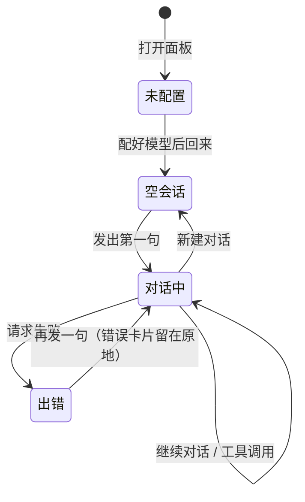
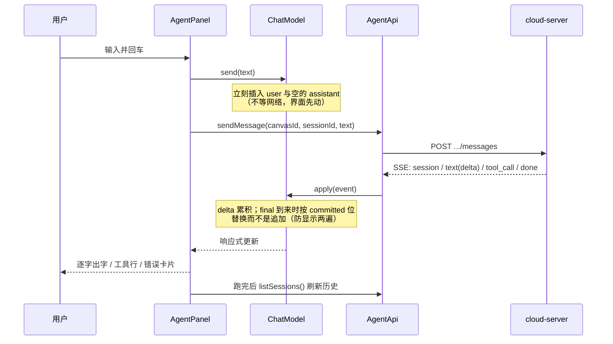

# Agent 面板 —— UI 设计

- 日期：2026-10-01
- 类型：界面设计（属于 Agent 插件设计的一部分）
- 状态：**待评审**
- 相关的实现计划：`docs/superpowers/plans/2026-10-01-agent-plugin.md`
- 对照的现有实现：`packages/ui/src/components/areas/ChatPanel.vue`（150 行，本次要搬进插件的那个面板）

> 这份文档回答一个问题：**搬进插件之后，这个面板长什么样、有哪几块、每块干什么、坏掉了怎么表现。**
> 上一版设计只写了「面板搬到插件里」，没写它的样子 —— 这一份补上。

## 一、现在这个面板有什么（逐条对着代码抄）

来源：`ChatPanel.vue`（整份读完）。这些是**已经存在**的元素，不是设想。

| 区域 | 元素 | 现在干什么 | 搬进插件后 |
|---|---|---|---|
| 头部 | 标题（`chatTitle`） | 显示当前会话名，可拖动整个面板 | **保留**，改成真会话标题、可双击改名 |
| 头部 | 新建对话 | 清空消息数组 | **保留**，改成真的新建一个会话 |
| 头部 | 历史对话（下拉） | 写死的 3 条（技能总结 / 感谢夸奖 / 产品视频脚本） | **保留入口**，改成读后端会话列表 |
| 头部 | 分享 | 只弹一个提示 | **删掉**（没有分享后端；留着就是假按钮） |
| 头部 | Agent 偏好（齿轮） | 打开 TV Director 设置弹窗 | **保留**，改成 Agent 偏好（审批档位等真配置） |
| 头部 | 插件 | 只弹一个提示 | **删掉**（画布已有插件设置入口） |
| 头部 | 停靠/浮窗切换 | 真的在停靠与浮动之间切 | **保留** |
| 头部 | 关闭 | 收起面板 | **保留** |
| 消息 | 引用卡片（`m.refs`） | 显示一个可点的节点引用 chip | **保留**，改成真能定位到画布节点 |
| 消息 | 头像 + 正文 | 用户「ME」/ 助手「AI」，一行文字 | **保留结构**，正文改 Markdown 渲染 |
| 消息 | 空态文案 | 「开始一段新对话，或从画布节点总结 Skill。」 | **保留**，按状态改文案（见 §三） |
| 消息 | 建议 chips | 3 条写死的（5分钟超长视频…） | **保留**，但换成真实可用的开场建议，且只在空会话时出现 |
| 输入 | 输入框 + 发送 | 只往数组塞一句演示文本 | **保留**，接真 SSE 流 |
| 输入 | 附件 | 两个只弹提示的菜单项 | **第一期删掉**（图片输入见计划「后续 C」） |
| 输入 | 创作模式下拉 | 写死 4 个模式 | **保留**，改成「审批档位」选择器（自动 / 询问） |
| 输入 | 模型下拉 | 写死 7 个模型，分图片/视频两栏 | **保留**，改成真模型列表（读 `/api/agent/config`） |
| 输入 | Skill 下拉 | 写死 4 个技能，可「启用」 | **保留**，改成真技能列表（启用状态进下一次请求） |
| 输入 | 手动/自动生成 | 只切一个本地开关 | **保留**，与审批档位合并（它们是同一件事） |
| 输入 | 上下文剩余 % | 写死 96 | **删掉**（后端没给这个数；宁可没有，不做假的） |
| 其他 | 停靠左缘拖宽手柄 | 真的能拖宽 | **保留** |
| 其他 | 浮窗右下角缩放 | 真的能缩放 | **保留** |

**搬迁原则**：**布局与观感尽量不动**（用户已经认得这个面板），只把「假数据 → 真数据」、「假按钮 → 删掉或接真」两类改动做掉。
这样这次改动对用户是「同一个面板，活了」，而不是「换了个面板」。

## 二、放在哪儿、多大、什么形状

| 项 | 值 | 出处 |
|---|---|---|
| 位置 | 浮动态：画布底部居中往上 74px；停靠态：贴右缘全高 | 沿用现状（`bottom-[74px]` / `inset-y-0 right-0`） |
| 浮动态默认尺寸 | 400 × 640 | 沿用现状 |
| 停靠态默认宽 | 400（可拖 320 ~ 视口 55%） | 沿用现状的上下限 |
| 浮窗缩放下限 | 320 × 400 | 沿用现状 |
| 圆角 | 浮动态 28px；停靠态 0（贴边） | 沿用现状 |
| 层级 | z-index 60（在底栏 30 之上、快捷键面板 90 之下） | 沿用现状 |
| 停靠时 | 画布被**挤窄**（不是被盖住） | `CanvasShell` 的 `right-width`，见计划 Task 12 |

## 三、四种状态（面板的脸）

面板在任何时刻只处于一种状态，**优先顺序从上到下**：

| # | 状态 | 触发条件 | 面板显示 |
|---|---|---|---|
| 1 | **未配置** | `GET /api/agent/config` 回来 `models: []` | 一个居中的引导块：图标 + 「还没有配置模型」+ 一句说明 + 一个「去配置」按钮（跳到设置面板的 Agent 页） |
| 2 | **空会话** | 已配模型，但当前没有消息 | 空态文案 + 建议 chips（只在会话**没有任何消息**时出现，不是每轮下面都挂） |
| 3 | **对话中** | 有消息 | 消息流 + 输入区；正在跑时输入框换成「停止」 |
| 4 | **出错** | 请求失败 / 模型报错 | 消息流照旧，**错误以一条独立的消息卡片**插在末尾（不是浮一个 toast，面板里就能看见发生了什么） |



## 四、组件树与文件划分

```
AgentPanel.vue                 // 壳：位置/尺寸/拖宽/缩放/状态判断
├── AgentHeader.vue            // 标题（可改名）+ 新建 + 历史 + 偏好 + 停靠 + 关闭
│   └── AgentHistoryMenu.vue   // 历史会话下拉（搜索 + 列表 + 改名 + 删除）
├── AgentOnboarding.vue        // 状态 1：未配置模型的引导
├── AgentMessageList.vue       // 状态 3/4：消息流
│   ├── AgentMessageItem.vue   // 一条消息（头像 + 正文 + 引用 chips）
│   ├── AgentThinkingBlock.vue // 可折叠的思考过程
│   ├── AgentToolCall.vue      // 一次工具调用（名字 + 参数 + 结果，默认折叠）
│   └── AgentErrorCard.vue     // 错误（红色边框的一条）
└── AgentComposer.vue          // 输入区
    ├── 输入框 + 发送/停止
    └── 底行：审批档位 + 模型 + 技能
```

## 五、视觉与实现约定（**这一节是纠错**）

### 5.1 不能用 Tailwind 类名（我上一版计划写错了）

实测结论：`packages/plugins` 下**没有一个插件**用 Tailwind 工具类。
它们一律是「BEM 风格的类名 + 普通 CSS + `var(--ui-*)` token」，例如
`plugin-bottom-bar` 的 `.nb-shell` / `.nb-pill`、`plugin-node-image` 的 `.ig-root` / `.ig-card`。

原因：Tailwind 的入口（`@import "tailwindcss"` + `@custom-variant dark`）只在 `packages/ui/src/app.css` 一处；
插件包不是 Tailwind 入口，在插件里写 `class="flex items-center rounded-lg"` 会**生成不出样式**（类名在、规则不在），
而且 `dark:` 变体在插件里根本不可用。

所以插件里的写法统一为：

```vue
<template>
  <button class="agent-icon-btn" @click="..."><X :size="16" /></button>
</template>

<style scoped>
/* 数值一律取自 docs/design/ui-style-guide.md，颜色一律走 --ui-* token */
.agent-icon-btn {
  display: grid;
  place-items: center;
  width: 28px;
  height: 28px;
  border: 0;
  border-radius: 8px;          /* --radius-control */
  background: transparent;
  color: var(--ui-ink, #374151);
  cursor: pointer;
}
.agent-icon-btn:hover { background: var(--ui-hover, rgb(0 0 0 / 0.05)); }
</style>
```

**含义**：计划 Task 10–13 里所有组件的模板与样式都要照这条改写过（模板里的工具类换成类名，
样式写进各自的 `<style scoped>`）。工作量不变，只是写法换一种。

### 5.2 尺寸与颜色取值的出处

| 项 | 值 | 依据 |
|---|---|---|
| 头部图标按钮 | 28 × 28，圆角 8px | 现状（`size-7` / `rounded-lg`）；UI 规范 `--radius-control` |
| 头像 | 24 × 24 圆，字号 9px 粗体 | 现状（`size-6` / `text-[9px]`） |
| 正文 | 12px / 行高 1.6 | 现状（`text-xs`） |
| 次要文字 | 11px | 现状（`text-[11px]`） |
| 标题 | 13px 中等 | 现状（`text-[13px] font-medium`） |
| 输入框 | 最小高 36，圆角 16 | 现状（`min-h-9` / `rounded-2xl`） |
| 发送按钮 | 36 × 36 圆 | 现状（`size-9` / `rounded-full`） |
| 面板底/边框 | `--ui-overlay-solid` / `--ui-line` | 现状 |
| 用户气泡底 | `--ui-hover-strong` | 现状 |
| 助手气泡底 | `--ui-accent` | 现状 |
| 危险色（错误卡片） | `--ui-danger` | UI 规范 §2.1 |
| 动效 | 150–240ms，统一缓动；带 `prefers-reduced-motion` 降级 | UI 规范 §1.5 |

### 5.3 无障碍硬要求（UI 规范 §5）

- 每个图标按钮都要有 `aria-label`（现状都写了，迁移时不许丢）；
- 消息流用 `role="log"` + `aria-live="polite"`，让屏幕阅读器跟着新消息走；
- 正在跑的那条消息给 `aria-busy="true"`；
- 焦点可见：所有可点元素保留 `:focus-visible` 的 2px 青色描边；
- 输入框与面板各有 `aria-label`（沿用现状的「对话输入」「AI 对话面板」）。

## 六、每个区域的细节

### 6.1 头部（32px 高感，一行）

```
┌────────────────────────────────────────────────────────┐
│ 订单流程助手                    ＋  ⏱  ⚙  ▤  ✕      │
└────────────────────────────────────────────────────────┘
```

- 标题：当前会话标题；**双击进改名**（就地输入，Enter 提交、Esc 取消）；空标题回落到「新会话」；
- ＋：新建会话（先问一句「当前对话要保留吗」？—— 保留则留在历史里，所以不必问，直接新建）；
- ⏱：历史下拉（见 §6.2）；
- ⚙：Agent 偏好（见 §6.3）；
- ▤：停靠/浮窗切换；
- ✕：关闭（**不丢数据**：会话与转录都在后台）；
- 浮动态：整条头部可拖动面板（沿用现状）；停靠态：不拖。

### 6.2 历史下拉

沿用现状的形态（320px 宽菜单），内容换成真的：

```
┌──────────────────────────────┐
│ 🔍 搜索历史对话              │
├──────────────────────────────┤
│ 订单流程助手      10 分钟前  │  ✎  🗑
│ 昨天那个 bug      昨天 18:2  │  ✎  🗑
└──────────────────────────────┘
```

- 来源：`GET /api/agent/canvases/:id/sessions`；
- 每条显示：标题 + 相对时间 +（有就显示）最后一句的摘要；
- 点一条：加载它的转录并替换消息列表（`GET .../sessions/:id`）；
- ✎：改名（`PATCH`）；🗑：删除（二次确认，因为不可撤销）；
- 搜索：本地过滤（会话数量级小，不值得做后端搜索）。

### 6.3 Agent 偏好（原来那个 TV Director 弹窗）

| 现在的开关 | 处置 |
|---|---|
| 协作模式 | **改名「自动执行」**，接到审批档位（与输入区那个下拉同一个值） |
| 积分预算管理 + 阈值 | **删掉**（本系统没有积分） |
| 浏览器通知 | **保留并做真**（请求 Notification 权限；没有权限或用户拒绝则显示「已拒绝，点这里到浏览器设置」） |
| 通知声音 | 保留为本地开关（与通知配套） |

### 6.4 消息流

一条助手消息的完整层次（自上而下，只显示有内容的那些）：

```
▸ 思考过程                         ← 折叠块，默认展开（跑的时候），收到正文后自动收起
  ┌──────────────────────────┐
  │ …模型的思考文字…          │
  └──────────────────────────┘
⚙ canvas.get                       ← 工具调用行，折叠；展开看到参数与结果
🤖  ┌──────────────────────────────┐
    │ 这是模型的回答，支持 Markdown │
    │ • 列表                        │
    │ `代码`                        │
    └──────────────────────────────┘
ℹ 已连接 MCP：canvas(7 个工具)      ← 过程提示，小字灰
```

- 用户消息：右对齐？**不**。沿用现状的**左对齐 + 头像**（与助手同构，只有头像底色不同）——
  这个面板宽度只有 400px，两侧对齐在窄栏里读起来会更碎；
- 正文：**Markdown 渲染**。现状是纯文本（`{{ m.text }}`），模型输出代码块与列表会糊成一团。
  需要一个新的轻量渲染组件（计划里新增一个 `AgentMarkdown.vue`，纯前端、零依赖、禁 HTML 注入）；
- 引用 chips：点击 → 画布选中并聚焦到该节点（现状只弹提示）；
- 自动滚动到底：新消息进来时若用户**已经在底部**才跟随（用户手动往上翻时不许抢滚动位置）；
- 长回答折叠：超过 12 行给「展开」，避免一条回答占满整屏。

### 6.5 输入区

```
┌────────────────────────────────────────────┐
│ 说点什么…                                  │
└────────────────────────────────────────────┘
  [自动执行 ▾]   [模型 ▾]   [技能 ▾]        ← 一行，贴左；跑的时候右边显示「停止」
```

- 输入框：Enter 发送、Shift+Enter 换行；自动长高到 96px 后内部滚动；
- 发送按钮：空文本禁用；跑一轮时变成方块图标（停止），点击 = 中止这一轮（会话留着）；
- **审批档位**：一个下拉两选一（自动 / 询问），与偏好里的「自动执行」是**同一个值**（两处改一处，即时同步）；
- **模型**：读 `/api/agent/config` 的真模型列表；显示当前模型名；没有模型时这一格显示「未配置」并引导去设置；
- **技能**：读真的技能列表；勾选表示「这一轮带上这个技能」（多选，显示已选数量，例如「技能 2」）；
  没装任何技能时这一格**不显示**（不是显示一个空下拉）；
- 删掉：「手动/自动生成」的第二个入口（与审批档位合并）、附件、上下文剩余百分比。

## 七、一次对话的数据流（面板侧）



## 八、空态、加载态、错误态（逐个写清，不做留白）

| 场景 | 面板显示 |
|---|---|
| 还没配模型 | 居中引导块 +「去配置」按钮（点击 → 打开设置面板并选中 Agent 页） |
| 历史上拉正在加载 | 历史菜单里三行骨架条 |
| 打开一个旧会话正在加载转录 | 消息区三行骨架条 |
| 一轮进行中 | 最后一条助手消息末尾一个闪烁光标；输入区按钮变「停止」 |
| 工具调用进行中 | 工具行显示「运行中…」，完成后换成结果的摘要（一行，可展开全文） |
| 请求失败 | 末尾插入一张红色错误卡片（含原文与一个「重试」按钮） |
| SSE 断了 | 错误卡片写「连接中断」并给「重试」；**已收到的内容保留**，不清空 |
| 后端整个连不上（例如没起 cloud-server） | 未配置引导块换成「连不上后台」+ 一个「重试连接」按钮 + 当前地址（便于排查） |

## 九、这次不做的（你说了才会做）

1. **图片输入**：附件按钮删掉，画布节点的图作为输入见计划「后续 C」；
2. **分享链接**：删掉（没有分享后端）；
3. **消息内搜索**：历史有搜索，消息内没有；
4. **多会话并排 / 分屏**：一次只显示一个会话；
5. **消息点赞/反馈**：没有后端存这个。

## 十、与实施计划的对应（要改哪几个任务）

| 计划里的 Task | 要改什么 |
|---|---|
| Task 10（骨架） | 面板模板与样式从 Tailwind 类名改成 BEM 类 + `<style scoped>`（§5.1）；尺寸按 §5.2 |
| Task 12（接真后台） | 按 §六 拆出 AgentHeader / AgentHistoryMenu / AgentOnboarding / AgentMessageItem / AgentThinkingBlock / AgentToolCall / AgentErrorCard；消息正文改 Markdown 渲染（新增 `AgentMarkdown.vue`）；补 §八 的四个状态 |
| Task 13（设置页） | 三个配置页的模板与样式同样改成 BEM 类（现在是 Tailwind 类名） |
| Task 14（清理） | 不变 |
| 新增 | `AgentMarkdown.vue`（轻量 Markdown 渲染：段落 / 列表 / 行内代码 / 代码块 / 链接，禁止 HTML 注入） |

## 十一、已定稿（2026-10-01 用户逐条拍板）

| # | 问题 | 结论 |
|---|---|---|
| 1 | 消息正文 Markdown 渲染 | **上**。新增 `AgentMarkdown.vue`（零依赖、禁 HTML 注入） |
| 2 | 用户消息对齐 | **保持左对齐**（与助手同构），不改成靠右 |
| 3 | 删掉分享 / 插件 / 上下文剩余 | 分享与插件**删**；**上下文剩余百分比保留**（经核实能做出来，见 §6.6） |
| 4 | 历史下拉的改名与删除 | **保留**，改名就在下拉里做 |
| 5 | 通知开关 | **做成真的**（申请浏览器 Notification 权限 + 降级提示） |

### 6.6 上下文剩余百分比怎么算（**新增，因为要保留它**）

SDK 里有两处真数据（不是估的）：

| 数据 | 出处 | 含义 |
|---|---|---|
| `model_context_window` | `session_meta` 事件 | 模型上下文窗口总量（number 或 string） |
| `request.total` | `token_usage` 事件 | 当前上下文实际用量（SDK 注释原话：current context usage figure） |
| `max_context_length` | Agent 配置 `compaction`（默认 256000） | 触发压缩的阈值 |

```
有效上限 = min(模型窗口, 压缩阈值)      // 压缩一到，旧内容就被摘要，所以分母取小的更贴实际
剩余百分比 = round((1 - request.total / 有效上限) * 100)，夹在 0..100
```

显示规则：**没收到过 `token_usage` 就不显示这一项**（宁可没有，不显示假数）。
这条数据只在一次请求**正常完成**时产生，所以对话进行中显示的是上一轮的数字 —— 这是真实情况，不做插值。

实现落在：后端 `translate.ts` 多出一条 `{ type: 'usage', usedTokens, limitTokens }` 事件（计划 Task 3）；
前端 `ChatEvent` 加同一形状、由 `agent.contextLeft` 承接（计划 Task 11 / 12）。
