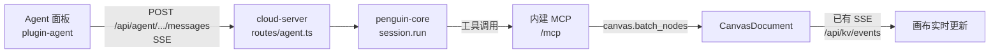

# Agent 插件 —— 画布内的对话助手（设计）

- 日期：2026-10-01
- 类型：架构设计
- 状态：**待评审**
- 相关：
  - `docs/superpowers/plans/2026-10-01-cloud-server-storage.md`（画布文件夹存储，**尚未实施**）
  - `packages/cloud-server/src/server.ts`（一个 Hono app 挂多组路由的现状）
  - `packages/plugins/plugin-theme-default/src/components/settings/PluginSettingsContent.vue`（设置内容的三层扩展插槽）
  - `packages/plugins/plugin-mini-map/src/miniMapPlugin.ts`（槽位 + 服务的现行写法）

## 一、要解决的问题

今天 UI 里的 Agent 面板是**宿主级假货**：`packages/ui/src/components/areas/ChatPanel.vue` 直接挂在
`App.vue` 的 `CanvasShell` 下（不在 `CanvasHost` 插件渲染树里），对话状态（`chatOpen` / `chatMessages` /
`models` / `skills` / `director` 等）全部堆在 `packages/ui/src/composables/ui.ts`（748 行）这个全局单例里，
消息内容是写死的假数组，`sendChat()` 只往数组里塞一句「（演示数据）已收到你的指令」。

要变成真的，得同时解决三件事：

1. **界面**：Agent 相关的 UI（对话面板、偏好设置、模型/技能/MCP 配置页）必须是一个**独立插件**，
   宿主里不再有它的业务代码；
2. **后台**：对话要由 `packages/cloud-server` 提供（真模型、真流式），按用户口径
   「**一个画布对应多个 session**」组织会话；
3. **配置**：模型 / 技能 / MCP 是**全局配置**，与画布无关，但配置界面要长在插件里，且**不用**内核
   schema 自动渲染的那套字段控件。

## 二、六条已定决策（用户拍板，2026-10-01）

| # | 决策 | 说明 |
|---|---|---|
| D1 | **一个端口**，Agent 后台全部进 `packages/cloud-server` | 画布界面就是它吐出来的，同源调 `/api/agent/*` 无跨域；MCP（`/mcp`）与网页共用同一份 `CanvasDocument` |
| D2 | **直接用 `@prismshadow/penguin-core`** | 会话、流式、审批、技能注入、MCP 连接全部复用 SDK，不自造 |
| D3 | Agent 的 UI 全部收进**新建的 `plugin-agent` 插件** | 与 `plugin-mini-map` 同一条路：槽位注册 UI + 服务持有状态 |
| D4 | 模型 / 技能 / MCP = **全局配置**；**会话按画布隔离** | 「技能 MCP 模型都是全局配置直接 config 就行，会话则是针对画布内部」 |
| D5 | **会话落本地，跨重启保留** | 「这个肯定要保存到本地的呀」；比参考项目进一步（它的会话只在内存、重启即空） |
| D6 | **会话工作目录 = 本画布目录** | 「按画布划」 |

## 三、D4 怎么落地：penguin 项目是全局的，会话归属画布

先看 SDK 的目录形状（实测 `@prismshadow/penguin-core@0.2.13`）：

```
<root>/<projectId>/.project_config.toml                    # 模型 / Provider / 密钥（按 project 分）
<root>/<projectId>/agents/<agentId>/agent_state/           # system_config.yaml（MCP）/ AGENTS.md / skills/
<root>/<projectId>/agents/<agentId>/traces/<日期>/<sessionId>_NNN.jsonl   # SDK 自己落的会话轨迹
```

SDK 只有一个入口 `createAgent({ root, projectId, agentId })`，会话由 `createSession()` 建、
`resumeSession({ sessionId })` 续。若把 `projectId` 直接当成画布 id，会话确实天然按画布分 ——
但**模型配置也会跟着按画布分**（`.project_config.toml` 在 project 下），与 D4 冲突。

所以采用：

```
penguin 项目  = 固定一个（projectId = 'mini-canvas'）→ 模型 / 技能 / MCP 全局唯一一份
画布          = 会话的归属单位：每个画布自己一份会话索引与转录
```

存储形状（数据根 = cloud-server 的 `--dir`，默认 `.mini-canvas/`）：

```
<dataRoot>/
  agent/                                     # 全局 Agent 配置（penguin 的数据根）
    mini-canvas/                             # penguin project
      .project_config.toml                   # 模型 / Provider / 密钥（密钥只在服务端，不回传前端）
      agents/canvas-agent/agent_state/       # system_config.yaml（MCP）/ skills/ / AGENTS.md
  canvases/<canvasId>/agent/                 # 本画布的会话（D4 / D5）
    sessions.json                            # 会话索引：id / 标题 / 创建时间 / 最后一条 / sdkSessionId
    sessions/<sessionId>.json                # 单个会话的转录（刷新与重启后回放）
    workspace/                               # 该会话的工作目录（D6）
```

**与画布文件夹计划的依赖（必须说清）**：
`docs/superpowers/plans/2026-10-01-cloud-server-storage.md` 那份「一个画布一个文件夹」计划
（`canvases/<id>/{canvas.json,view.json,history.json,resources/}`）**目前尚未实施** ——
`packages/cloud-server/src/store/` 下只有 `kvStore.ts` 与 `fileStore.ts`，没有 `canvasStore.ts`。
本设计的落点是 `canvases/<canvasId>/agent/`，与那份计划**同构**：它落地后两者天然拼在一起；
若本设计先做，就先由 Agent 子系统创建 `canvases/` 目录，不阻塞，也不需要改那份计划。

## 四、后台：`packages/cloud-server/src/agent/`

cloud-server 有一条现成的硬约束：**要能独立 `npx` 跑，不能 import 工作区包 `@mini-canvas/*`**
（那份存储计划的 Global Constraints 里写着）。本子系统照此办理：自包含，类型就地声明。

| 文件 | 职责 | 对应参考项目 |
|---|---|---|
| `agent/agentStore.ts` | 画布会话索引与转录的读写（纯逻辑，注入数据根，可单测） | ——（新增，D4/D5 的落点） |
| `agent/agentConfig.ts` | MCP 服务清单读写（`system_config.yaml`） | `server/agent-state.ts` |
| `agent/agentSkills.ts` | 技能扫描 / 导入 / 卸载 / 体检 | `server/skills.ts` |
| `agent/agentProviders.ts` | 模型与 Provider 读写（含 base_url 校验、密钥不回传） | `server/providers.ts` |
| `agent/agentRuntime.ts` | 建会话 / 跑一轮 / 打断；SDK 消息 → 前端事件 | `server/runtime.ts` |
| `agent/log.ts` | 带关联 id 的日志 | `server/log.ts` |
| `routes/agent.ts` | 全部 `/api/agent/*` 路由 | `server/index.ts` 的路由段 |

### 4.1 路由契约

全局配置（与画布无关）：

```
GET    /api/agent/config                     → { providers, models, defaultRef, skills, mcpServers, tools }
POST   /api/agent/models                     → 增改一个模型（apiKey / baseUrl / clientType / vision / setDefault）
DELETE /api/agent/models                     → 删模型
POST   /api/agent/models/default             → 设默认模型
POST   /api/agent/models/vision              → 设看图模型
GET    /api/agent/skills                     → 已安装技能
GET    /api/agent/skills/sources             → 可导入候选（扫技能来源目录）
POST   /api/agent/skills/import              → 按目录导入
DELETE /api/agent/skills/:name               → 卸载
POST   /api/agent/mcp                        → 增改一个 MCP 服务（stdio / http / sse）
DELETE /api/agent/mcp                        → 删 MCP 服务
GET    /api/agent/tools                      → 本会话实际会装配到的工具清单（含警告）
```

画布会话（D4 的落点）：

```
GET    /api/agent/canvases/:canvasId/sessions                     → { sessions }
POST   /api/agent/canvases/:canvasId/sessions                     → { id, title, ... }（可带 provider / modelId / title）
GET    /api/agent/canvases/:canvasId/sessions/:sessionId          → { id, title, transcript, running }
DELETE /api/agent/canvases/:canvasId/sessions/:sessionId          → { removed }
POST   /api/agent/canvases/:canvasId/sessions/:sessionId/messages → **SSE 流**
```

`canvasId` 走白名单校验（`^[A-Za-z0-9_-]{1,64}$`，与存储计划同一条正则口径），拒绝 `..`。
今天是单画布，前端恒传 `default`；结构先按多画布做好。

### 4.2 SSE 事件（形状照抄参考项目，前端代码可整段搬）

```ts
type ChatEvent =
  | { type: 'session';  sessionId: string; title: string }
  | { type: 'text';     delta?: string; text?: string; partial?: boolean; final?: boolean }
  | { type: 'thinking'; delta?: string; text?: string; partial?: boolean; final?: boolean }
  | { type: 'tool_call';   id: string; name: string; arguments: string }
  | { type: 'tool_output'; id: string; output: string }
  | { type: 'notice';   message: string }
  | { type: 'error';    message: string }
  | { type: 'done' }
```

**「已提交过」去重是硬要求**：参考项目踩过「回答显示两遍」—— `delta` 与 `final` 都做了追加。
前端按块记 `committed`（首次收到 delta 就标记，final 到时不重复追加），这条要写成测试。

### 4.3 会话生命周期（D5）

| 时机 | 服务端做什么 |
|---|---|
| 首次进入画布 | 读 `sessions.json`；空则列出空态，**不隐式建会话** |
| 用户发第一句话 | 无 `sdkSessionId` → `createSession({ provider, modelId, workspaceDir })`；随后 `session.run()` 流式回传 |
| **刷新页面** | 读我们的转录回填界面（数据在盘上，不依赖进程内存） |
| **服务重启后再进来** | 同上；下一句话时 `resumeSession({ sessionId })` 续上 SDK 侧上下文 |
| 一轮进行中又来一句 | 转成 steering（参考项目同款：不并发开两个 run） |
| 关页面 | 中止当前 run（abort），会话与转录**保留** |
| 删会话 | 删 `sessions/<id>.json` + 索引项；SDK 轨迹文件不删（保留追溯） |

「服务重启后 `resumeSession` 能接回上下文」这一条**必须实测**，不能只看它接受参数就当作成立
（见 §八 风险 1）。

### 4.4 与画布数据的关系（最值钱的一环）

cloud-server 已经对外开放 `/mcp`（`routes/mcp.ts`），工具面是 `canvas.get` / `canvas.overview` /
`canvas.batch_nodes` / `canvas.batch_edges` / `canvas.add_image` / `resource.upload` / `resource.list`。
把这台服务器自己的 `/mcp` 地址写进 Agent 的 MCP 配置，Agent 就能真的读写画布节点，
而改动会经**已有的** SSE（`GET /api/kv/events`）推回浏览器 —— 画布上的新节点立刻出现。



不需要为 Agent 新造实时通道，也不需要写 MCP 客户端封装。

## 五、前端：`packages/plugins/plugin-agent`

### 5.1 包结构

```
packages/plugins/plugin-agent/
  package.json          # @mini-canvas/plugin-agent；deps: canvas-base / canvas-render；peer: vue
  tsconfig.json         # 与 plugin-bottom-bar 同形（Bundler + DOM + env.d.ts）
  vitest.config.ts
  src/
    index.ts                     # export { agentPlugin }
    agentPlugin.ts               # ★插件主体：槽位注册 + agent 服务 + 命令 + 设置页注册 + Config
    agentApi.ts                  # 后端接口封装（fetch + SSE 解析），零 Vue 可单测
    agentSessionStore.ts         # 前端会话状态（消息列表 / 运行态 / 当前会话），纯逻辑部分可单测
    approvalMode.ts              # 审批档位（D7）与「哪类工具需要问」的纯函数，可单测
    components/
      AgentConversation.vue      # ★**内容**：消息流 + 输入区（不含外框/头部/拖拽）
      AgentMessageList.vue       # 消息流（含 tool_call / thinking 折叠）
      AgentComposer.vue          # 输入区（模式 / 模型 / 技能 / 发送）
      AgentApprovalPrompt.vue    # ★审批气泡（D7：需要询问时，在对话里问用户）
      AgentPreferencesDialog.vue # Agent 偏好（原 TV Director 弹窗）
      settings/                  # ★自定义配置页（§六）
        AgentSettingsNav.vue     # 左侧一级导航项「Agent」
        AgentSettingsTabs.vue    # 二级页签（模型 / 技能 / MCP）
        ModelsPage.vue / SkillsPage.vue / McpPage.vue
```

### 5.2 与宿主的三条接口（全部是现行机制，无新发明）

| 机制 | 用法 | 参照 |
|---|---|---|
| 槽位 | `ctx.slots.register('agent-conversation', { id: 'agent-conversation', order: 60, component: AgentConversation })` | `plugin-mini-map` 注册 `mini-map` 槽 |
| 服务 | `ctx.inject('agent', state)`；`state` 是 `reactive({ open, docked, width, sessions, messages, running, approval })` | `mini-map` 服务的 `{ visible }` |
| 命令 | `ctx.commands.register({ id: 'agent:toggle', keys: ['mod+j'], run })` | `mini-map:toggle` |

宿主读这个服务的方式与今天读小地图完全一样（`ui.ts` 里 `ctx.get('mini-map')?.visible` 那两句就是模板）：

```ts
// ui.ts 里新增（与 minimapOn 同形）
const agentOpen  = computed(() => readyHost?.ctx?.get<{ open: boolean }>('agent')?.open ?? false)
const agentWidth = computed(() => readyHost?.ctx?.get<{ docked: boolean; width: number }>('agent') ?? null)
```

### 5.3 必须改的宿主代码（躲不掉，逐条写清）

| 文件 | 改动 | 为什么躲不掉 |
|---|---|---|
| `packages/ui/src/App.vue` | `#ui` 内加 `<SlotHost slot="agent-conversation" />`；`right-width` 改读 agent 服务 | 面板要挤画布，而 `right-width` 是 `CanvasShell` 的 prop，插件拿不到这个绑定；`mini-map` 那行就是现成写法 |
| `packages/ui/src/components/AgentPanel.vue`（新，替换 `ChatPanel.vue`） | **外壳归应用**：浮动框 / 停靠 / 拖宽 / 缩放 / 头部按钮；内部放 `<SlotHost slot="agent-conversation" />` | 与 `SettingsShell` 的分工一致；且「挤窄画布」依赖 `CanvasShell` 的 `right-width`，插件够不到 |
| `packages/ui/src/components/areas/DockArea.vue` | TV Director 圆按钮改为调 `agent.toggle()` | 按钮只是触发器，业务逻辑在插件服务里 |
| `packages/ui/src/composables/ui.ts` | 删 `chat*` / `models` / `skills` / `director` / `contextLeft` / `genMode` / `modelTab` / `skillTab` / `storyboard` 等一整段 | 状态搬进插件服务，`ui.ts` 只剩宿主自己的东西 |
| `packages/ui/src/components/areas/ModalsArea.vue` | 删 TV Director 设置弹窗 | 搬进插件（`AgentPreferencesDialog.vue`） |
| `packages/ui/src/assembly.ts` | 清单加 `agentPlugin`（24 → 25） | 装配清单是「装了哪些插件」的唯一住址 |
| `packages/ui/package.json`、`packages/ui/vite.config.ts` | 加 `@mini-canvas/plugin-agent` 依赖与 `optimizeDeps.exclude` 条目 | 源码插件要交给 vite 直接转换 |

## 六、配置界面：挂在设置面板的内容插槽上，但内容全自绘

用户口径（**2026-10-01 澄清**）：

> 这边放在 settinghost 里面的插槽，也就是插件的时候配置的 Config，但是他是支持自定义内容页面的，
 > 具体可以理解一下 `PluginSettingsContent.vue`

> （那个文件 2026-10-01 从 `PluginSettingsDialog.vue` 改名而来 —— 它里面没有 Dialog，
> 只是设置窗口里的那一块内容；弹窗本身由渲染层的 `SettingsShell` 提供。）

也就是：**借设置窗口的位置与外壳，内容自己画**；不用内核按 schema 自动长控件的那一套
（`SettingsSchemaField` 按 `type` 出开关/下拉/数字框）。三件事的形状都不是「一个标量字段」：
模型是列表 + 密钥 + 设为默认，技能是扫描/导入/卸载，MCP 是 stdio/http/sse 三种表单，
硬塞进 schema 只会既丑又不够用。

### 6.1 现行机制（读 `PluginSettingsContent.vue` 与 `SettingsStore` 得出）

1. `Config` schema 的字段会经内核 `resolveConfig` 校验后，按 `group` 登记进 `SettingsStore`；
   面板左侧一级导航 = `group` 的第一个 `/` 分段，右侧是「该一级下所有分组卡片 + 字段行」。
   **这条适合放少量开关，不适合放列表与表单。**
2. 面板另有三层**内容插槽**（内核 `ctx.slots` 多 occupant 机制），用来挂自定义页面：
   - `settingsNav`（id = 一级名，命中则顶替该导航项，否则在末尾追加一个自定义一级项）；
   - `settingsTab`（id 首段 = 一级名；命中已有分组则顶替该段内容，否则作为自定义段追加）；
   - `settingsGroup/<完整分组key>`（接管某个分组的内容区，可用 `meta.mode` 选择 `replace/prepend/append`）。
3. `settingsNav` / `settingsTab` 的 occupant 通过 props 收到 `{ group, active, onSelect }`；
   本插件用不上 `settings`，数据自取自 `agentApi`。
4. 关闭通道不变：外壳（`SettingsShell`）负责遮罩 / ✕ / Esc / 浮动窗 / 悬浮球，我们只画内容，
   **不自己实现关闭** —— 这是项目刻意集中的地方（历史上两个皮各写一遍导致点遮罩关不掉的缺陷）。

### 6.2 两条已核实的事实（避免踩空）

1. **当前设置内容的赢家就是 `PluginSettingsContent`**（theme-default 注册，order 0）。
   `packages/ui/src/settingsPanelPlugin.ts` 里那句把 `AppSettingsPanel` 注册进 `settingsPanel` 槽的
   `ctx.theme.register(...)` **是注释掉的** —— 所以上面那三层内容插槽确实在生效路径上，可以依赖。
   （若将来那行打开、换成 `AppSettingsPanel` 当赢家，它声明的是同一套 `settingsNav` / `settingsTab` /
   `settingsGroup/<key>` 协议，本插件不受影响。）
2. **`packages/ui/src/__tests__/settingsCoverage.test.ts` 会断言「一级分类只允许 布局/常规/节点/边」**，
   但它在自己的 `bootWithSettings()` 里只装了 5 个插件（不含 `plugin-agent`），所以新增 `Agent` 一级
   不会让它变红。新增一级分类这件事本身是有意的：Agent 的设置与画布设置不是一类东西。

### 6.3 本插件怎么接（两条腿，各管各的）

| 内容 | 接法 |
|---|---|
| 少量开关（审批档位、面板默认停靠、默认模型名等） | 走插件自己的 `Config` schema，分组 `Agent/常规`（自动长控件，省事且跟随主题） |
| 模型页 / 技能页 / MCP 页 | 走内容插槽：`settingsNav` 注册 id=`Agent` 的导航项，`settingsTab` 注册 `Agent/模型`、`Agent/技能`、`Agent/MCP` 三个页签组件，页面内容与本插件 `Config` 无关，全部自绘、数据全走后端接口 |

一点实现细节（读代码得出，别踩）：三个自定义页签的 id 要以 `Agent/` 开头，才会被
`PluginSettingsContent` 归到 `Agent` 这个一级下并渲染成右侧的段；若只想追加段而不动既有分组，
不要用与既有分组相同的 id（同 id 是顶替）。

三页各自的数据来源（全部走后端全局配置接口，落点见 §四）：

| 页 | 读 | 写 |
|---|---|---|
| 模型 | `GET /api/agent/config`（`providers` / `models` / `defaultRef`） | `POST/DELETE /api/agent/models`、`/models/default`、`/models/vision` |
| 技能 | `GET /api/agent/skills`、`/skills/sources` | `POST /api/agent/skills/import`、`DELETE /api/agent/skills/:name` |
| MCP | `GET /api/agent/config`（`mcpServers` / `tools`） | `POST/DELETE /api/agent/mcp` |

密钥只写不回读（服务端返回 `hasKey: boolean`，界面显示「已配置」）—— 参考项目就是这么做的，照抄。

## 七、审批档位（D7）：全放行，但要能配置成「先问我」

用户口径（**2026-10-01**）：

> 这里全部放行，这里我一般只会让你执行我提供的工具，比如操作画布、创建任务什么的，写文档，
> 其他的都没有什么操作本地的，我不会让你执行命令脚本。
>
> 不要积分……协作模式和第四个问题差不多，这里我提供多种方式，默认如果开启协作模式的话
> 就类似于全部放行，但是这里我可以配置为手动控制，比如你执行我的生图操作的时候，你必须先询问我。

落到实现上：

1. **默认全放行**：SDK 的审批回调返回「允许」，Agent 可以调画布工具、任务工具、写文档类工具。
2. **档位可配**，两档（**2026-10-01 定稿：默认就叫「自动」**，不叫协作模式 —— 名字要能自解释）：

   | 档位 | 语义 |
   |---|---|
   | 自动（默认） | 全部放行，相当于参考项目的「协作模式」开启 —— 用户口径「自动放行就行」 |
   | 询问 | **按工具白名单**发起询问：命中「需要询问」的工具（例：生图/生视频等花钱的动作）时，在对话里弹审批气泡等用户点允许/拒绝 |

3. **「哪些工具要询问」是一份可按工具名通配配置的清单**，存在插件配置里（`Config` 的 `array` 字段），
   判定写成纯函数（`approvalMode.ts`）以便单测。例：`['web2api:*', '*.generate*']` 命中即问。
4. **本地命令与脚本**（**2026-10-01 定稿**）：用户原话「我不会让你执行命令脚本，我一般只会让你执行我提供的工具」——
   所以默认询问清单 = `['exec_command', 'input_command', 'write_file', 'edit_file', '*write*', '*delete*']`。
   默认档位是「自动」，所以这条清单平时不生效；用户一旦切到「询问」，这几个就是最该先拦下来的。
5. **审批气泡的数据通道**：SDK 的 `approve` 回调由服务端持有，而点允许/拒绝的是浏览器 ——
   所以做「询问」档位需要一个往返：服务端在回调里挂起 → 经 SSE 给前端推一个 `approval_request` 事件 →
   前端弹气泡 → 用户点选后 `POST /api/agent/.../approvals/:id` → 服务端解开挂起的回调。
   这一层是本设计**唯一**需要新造的实时通道（全放行的档位下完全不触发，所以可以后置到 Phase 3）。

## 八、分期（每期都可独立验证，不破坏现有功能）

| 期 | 内容 | 验证方式 |
|---|---|---|
| 0 | cloud-server 加依赖与 `agent/` 骨架（不接线） | `pnpm -C packages/cloud-server test` 仍全绿、`typecheck` 干净 |
| 1 | 后端会话与全局配置接口 + SSE（含转录落盘与 `resumeSession` 续接） | curl：建会话→发消息能看到流式 `data:` 帧；杀掉进程重启后，会话与转录仍在，且续上一句能引用前文 |
| 2 | `plugin-agent`：内容 UI + `agent-conversation` 槽 + 服务 + 宿主外壳 | `pnpm -C packages/ui test`；浏览器实测：面板开合/停靠、发消息出真回答 |
| 2b | 设置三页（模型/技能/MCP） | 浏览器实测三页读写；密钥只显示「已配置」；控制台零 error |
| 2c | 清理宿主假数据（删 `ChatPanel.vue` 与 `ui.ts` 里那一段） | `pnpm -C packages/ui test` + `typecheck` 全绿；画布原有功能回归 |
| 3 | 审批档位（默认自动 + 可切询问）+ 询问气泡 + 系统通知 | 切到「询问」后触发生图动作会弹气泡并能放行/拒绝；跑完一轮能收到系统通知 |

> **为什么把「设置三页」与「清理假数据」提前到 Phase 2**（**2026-10-01 定稿**）：用户口径是
> 「你这边反正都要做，自己看在哪里做，反正这个是需要实现的」。放在 Phase 2 的好处是，
> Phase 2 结束时宿主里已经没有假 Agent 了，不存在新旧两套并存的中间态。
> 审批气泡与系统通知留在 Phase 3 —— 前者需要新造一条往返通道（§七 第 5 条），后者需要权限申请，
> 两者都不阻塞对话功能本身能用。

## 九、风险与限制

1. **`resumeSession` 能否真接回上下文要实测**（D5 的关键）。SDK 的 `Session` 有
   `setHistory(history)` 与「resume 时的历史注入」描述，但本设计的转录是我们自己存的一份
   （不是 SDK 的 trace 格式）。若实测发现续接失败，退路是：把 SDK trace 的路径也在会话索引里记下来，
   或干脆在新会话里把转录作为上下文前缀注入。这条要在 Phase 1 就验掉，不能留到最后。
2. **依赖重量**：`@prismshadow/penguin-core` 带 16 个 `@penguinharness/*` 包，要求 Node ≥ 24
   （本机 v24.15.0，满足）。cloud-server 的 `npx` 安装体积会明显变大 —— D1 + D2 的直接代价，已知并接受。
3. **cloud-server 不能引工作区包**：`agent/` 子系统里所有类型必须就地声明，不 import `@mini-canvas/*`。
4. **SDK 轨迹不在画布目录**：`traces/` 由 SDK 落在全局 agent 目录下（其路径规则写死）。
   画布内落的是**我们自己的**转录与索引，界面用后者；两者不冲突。
5. **单画布现状**：`canvasId` 今天恒为 `default`，多画布结构属于提前准备，不做界面。
6. **会话工作目录的清理**（D6 的副作用）：`canvases/<id>/agent/workspace/` 会积 Agent 写的中间产物。
   **已定稿（2026-10-01）**：删画布 = 删整个文件夹 —— `canvases/<id>/`（含 `agent/`）整棵清掉。
   实现落在 `AgentSessionStore.removeCanvas(canvasId)`（实施计划 Task 2）。
   **一处已知缺口**：本仓库当前**没有**删画布的入口（`routes/canvases.ts` 只有读/存/资源），
   所以这条规矩暂时只写进代码与注释、没有调用方；等真做删画布功能时一起接上。

## 十、已定稿（2026-10-01 用户逐条拍板）

| # | 问题 | 结论 |
|---|---|---|
| 1 | 审批档位的名字与默认值 | **默认就叫「自动」**（不叫协作模式）。询问清单默认 `['exec_command', 'input_command', 'write_file', 'edit_file', '*write*', '*delete*']` |
| 2 | 审批气泡什么时候做 | 「反正都要做，自己看在哪里做」→ 排 **Phase 3**（它是唯一需要新造往返通道的地方，见 §七 第 5 条） |
| 3 | 浏览器通知 / 通知声音 | **接真实的系统通知**（浏览器 Notification API，含权限申请与降级）。**积分相关开关整个删掉** |
| 4 | 删画布时会话怎么办 | **删画布 = 删整个文件夹**：`canvases/<id>/` 连 `agent/` 一起清空 |
| 5 | 还没配模型时 | **给「去配置模型」的引导**，直接跳到设置面板的 Agent 页，不报错 |

> 以上五条都已落到实施计划 `docs/superpowers/plans/2026-10-01-agent-plugin.md`：
> 1 → Task 4 的 `DEFAULT_POLICY`；2 → 计划末尾「后续 A」；3 → 「后续 B」；
> 4 → Task 2 的 `removeCanvas`；5 → Task 12 Step 3 与 Task 13 的 `ModelsPage`。
