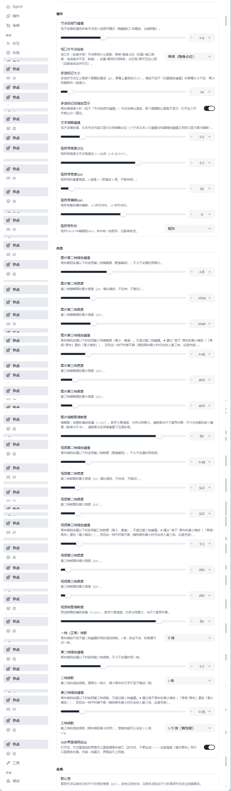

# 01 · 节点设置里的活动区域、吸附区域和图片视频分档

## 你的原话

> 图片1 可以看到这里的配置项 他们不太合理，吸附相关的，还有节点等级什么的 不太合理，你的图片视频 分档次 这才是问题 我更希望你给他们配置一个特殊的 UI 进行渲染，分的更细节一些而不是所有细节都放在同一个二级菜单里面

## 要解决的问题

把「节点」页里挤在一起的一长串配置，按用户真正想调的东西拆开：

- 节点缩放时的显示层级（低细节、视口外、多选标记、文本缩略）放一起。
- 「节点 > 端口」里的接收区改名「活动区域」，避免和真正的拖线吸附带重名。
- 新增「节点 > 吸附区域」二级菜单，把拖线吸附带从「细节」里移出来。
- 图片缩略图分档、视频缩略图分档各成一块，并给它们专用的分档预览/编辑 UI。

目标不是换个名字，而是让用户打开「节点」页时，能一眼找到「图片分档」「视频分档」「吸附区域」三件事，不用在同一个'细节'大卡片里往下翻很久。

## 范围与位置

- 页面：设置 → 画布 → 节点。
- 菜单定义：`packages/plugins/plugin-theme-default/src/components/settings/defaultMenu.ts`
  - 现在 `细节` 合并了 `节点/细节`、`节点/低细节`、`节点/多选标记`、`节点/文本LOD`、`节点/吸附带`。
  - 现在 `内容` 合并了 `节点/内容`、`节点/缩略图`、`可视化节点/渲染清晰度`、`常规/可视化节点`。
- 吸附字段：`packages/plugins/plugin-theme-default/src/index.ts` 中 `DEFAULT_THEME_SNAP_ZONE` 对应的四个字段。
- 端口活动区域字段：同一个文件里 `DEFAULT_THEME_HANDLE` 的 `portZone*` 五个字段；当前显示名都带「吸附区」，容易和吸附带混淆。
- 图片分档字段：`packages/plugins/plugin-node-image/src/thumbTier.ts`，7 个字段，组名 `节点/缩略图`。
- 视频分档字段：`packages/plugins/plugin-node-video/src/videoThumbTier.ts`，7 个字段，当前也归在 `节点/缩略图`。
- 通用字段渲染：`packages/plugins/plugin-theme-default/src/components/settings/SettingsSchemaField.vue`。

## 现在 vs 期望

| | 现在 | 期望 |
| --- | --- | --- |
| 吸附设置 | 在「细节」卡片最下面，和低细节、多选标记、文本缩略混在一起 | 新增「节点 > 吸附区域」二级菜单，只放吸附高度、宽度、偏移、形状 |
| 端口接收区命名 | 「节点 > 端口」里叫「吸附区宽度 / 高度占比 / 偏移 / 弧饱满度 / 形状」 | 统一改名「活动区域宽度 / 高度占比 / 偏移 / 弧饱满度 / 形状」 |
| 节点层级 | 低细节、视口外、多选标记、文本缩略共用一个「细节」大卡片 | 按用途分成 2～4 个小节，标题能直接说明调的是哪一种显示 |
| 图片分档 | 第二档 3 项 + 第三档 3 项 + 清晰度 1 项，全在「内容」里 | 图片单独一块，能看清「第二档」「第三档」和各自阈值/尺寸/清晰度 |
| 视频分档 | 7 项紧跟在图片后面，用户不容易分辨哪几项属于视频 | 视频单独一块，和图片并列，不混在同一张卡片里 |
| 分档操作 | 只有滑块和数字框，改完要回画布缩放到对应倍率才知道效果 | 有专用 UI：档位预览、当前阈值标记、每档目标尺寸/质量的可视化编辑 |

## 验收标准

- [ ] 「节点」页里不再有一个同时装着吸附带和缩略图分档的超长「细节/内容」混合卡片。
- [ ] 「节点」下新增「吸附区域」二级菜单；四个吸附带设置项只出现在这里，不再留在「细节」中。
- [ ] 「节点 > 端口」里五个 `portZone*` 字段的显示名和说明统一使用「活动区域」，不再出现「吸附区」字样。
- [ ] 「活动区域」和「吸附区域」的说明分别讲清：前者是端口自己的命中范围，后者是拖线时的吸附范围。
- [ ] 图片分档与视频分档分成两个独立分组，打开任一组时不需要先翻过另一组的 7 个字段。
- [ ] 图片、视频各有至少一个专用可视化控件，能在同一处看出第二档、第三档的阈值与目标尺寸。
- [ ] 修改任一字段后，画布上对应缩放档位立即生效；原有设置的持久化 key 不变，旧数据仍能读回。
- [ ] 原有「低细节阈值」「视口外节点绘制」「多选标记」「文本缩略阈值」仍可配置，没有被隐藏或重置。

## 不能动

- 不改图片/视频分档的持久化 key（`imageTier2Zoom`、`videoTier2Zoom` 等），避免用户现有配置丢失。
- 不改 `portZone*`、吸附带字段的持久化 key；这次只调整菜单归属、显示名称和说明。
- 不改分档判定规则：第三档阈值仍夹到不超过第二档，画布最小缩放仍保证进第三档。
- 不把配置项做成装饰性的假开关；每个字段都必须有真实读取点。
- 不破坏节点壳核心件，不重写 `BaseNode.vue` 等红线文件。

## 假设与待确认

- 假设：「配置一个特殊的 UI」指图片、视频分档各自有可视化分档编辑器，不是只把字段换个分组。
- 待确认：分档专用 UI 是做成组内嵌卡片，还是点击后打开侧栏/弹窗？
- 待确认：「节点等级」如果另有所指（例如节点 z 层级），需要补一张图或一句说明。

## 给执行 AI 的指令

先做信息架构调整：新增「节点 > 吸附区域」二级菜单，把 `节点/吸附带` 四个字段从「细节」移过去；
把「节点 > 端口」里的 `portZone*` 显示名和说明改成「活动区域」；
再把图片分档、视频分档从「内容」中拆出来，补清晰的二级标题。
不要先改判定逻辑，也不要改持久化 key。拆完后为图片和视频各做一个分档可视化编辑器，
用真实字段值渲染，改值直接写回；在亮色、暗色、窄窗口下检查排版。

## 图片

图片说明：截图上半部分是「细节」，吸附带四项被放在最下面；下半部分是「内容」，图片 7 项后紧跟视频 7 项。
