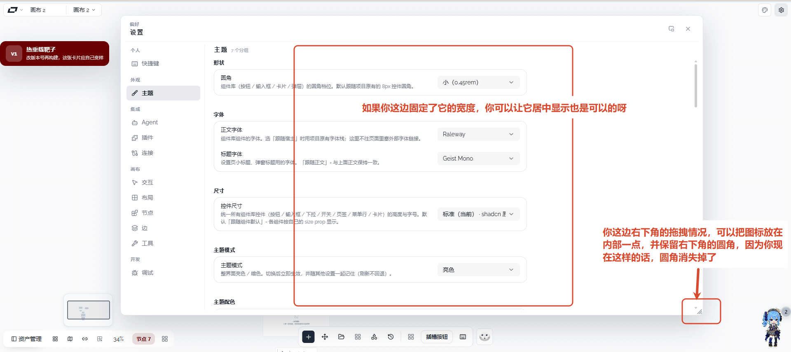

# 02 · 设置内容居中、右下拖拽角保持圆角

## 你的原话

> 图片2，这里应该给他们居中显示 UI 还有一个地方 你设置界面右上角的这个按钮 悬浮按钮 点击切换的时候 没有一个切换效果

## 要解决的问题

两件事分开验收：

1. 设置右栏内容被固定在左侧，右边留下大片空白。用户接受「固定宽度」，但希望这组设置内容在可用区域里水平居中。
2. 悬浮设置窗右下角的拖拽把手区域看起来把面板圆角盖掉了，希望图标往内收，保留右下圆角。

## 范围与位置

- 设置内容右栏：`packages/ui/src/components/settings/settings/SettingsContent.vue`，默认主题的同名文件 `packages/plugins/plugin-theme-default/src/components/settings/settings/SettingsContent.vue`。
- 设置外壳、浮动窗、右下拖拽角：`packages/canvas-render/src/components/SettingsShell.vue`。
- 主题插件与成品应用各有一套设置皮，改动必须同步，否则换主题/切宿主后表现不一致。

## 现在 vs 期望

| | 现在 | 期望 |
| --- | --- | --- |
| 设置正文 | `max-width: 760px`，靠左排；窗口拉宽后右侧留白很大 | 固定最大宽度，但整组卡片在正文区水平居中 |
| 右栏留白 | 左边距固定 22px，右边空着 | 左右留白尽量对称，文字仍左对齐，不把行内容也居中 |
| 拖拽角 | 16×16 图标贴住右下角，视觉上盖住面板圆角 | 图标向面板内部收一点，面板右下圆角完整可见 |
| 点击拖拽角 | 命中区贴着角，容易被圆角裁掉 | 命中区仍够大，但视觉图标不压住圆角 |

## 验收标准

- [ ] 设置窗口拉宽后，右栏卡片组在可用宽度内水平居中，不再长期靠左。
- [ ] 卡片里的标题、说明、控件仍保持左对齐，不被错误地居中。
- [ ] 窄窗口（设置窗宽度接近最小宽度）时没有新增横向滚动或文字挤压。
- [ ] 浮动设置窗右下角圆角完整显示，拖拽图标与圆角之间留出明显空隙。
- [ ] 拖拽角仍能按住拖动窗口大小，命中区域不小于改动前。
- [ ] 亮色、暗色下圆角和图标都可见，不出现被裁掉的直角。

## 不能动

- 不改设置窗口的拖动、缩放、最小化、恢复逻辑。
- 不改设置页的左侧导航宽度和分类顺序。
- 不改字段值、持久化或设置菜单结构。
- 默认主题皮和成品应用皮要一起改，避免只修一套。

## 假设与待确认

- 假设：用户说的「居中」是设置正文卡片组居中，左侧导航仍贴左。
- 假设：「右上角悬浮按钮」指设置标题栏的“转悬浮窗”按钮，需要补切换动效；但截图红框标的是正文宽度。
- 待确认：悬浮按钮想要哪种效果（缩放、淡入淡出、图标替换、按压反馈）？当前截图看不出目标效果。
- 待确认：右下拖拽图标是只往里收，还是要换成更小的 L 形把手？

## 给执行 AI 的指令

先改正文布局：保留卡片最大宽度，在 `psd-body` / `asp-body` 这一层用水平居中，不要居中卡片内部文字。
然后改 `SettingsShell.vue` 的拖拽角：图标内缩，圆角保持完整，命中区不缩小；同步检查默认主题和成品应用两套设置皮的正文宽度行为。
最后在真实浏览器里把浮动窗拉宽、缩窄、拖大、拖小各看一遍。

## 图片

图片说明：红框标出右侧正文区；右下红框标出拖拽把手，当前图标贴边，圆角看起来被吃掉。
