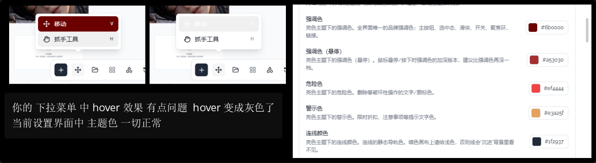

# 03 · 下拉菜单悬停变成灰色

## 你的原话

> 图片3 下拉选择颜色块有问题

> 你的下拉菜单中 hover 效果有点问题 hover 变成灰色了
> 当前设置界面中 主题色 一切正常

## 要解决的问题

下拉菜单高亮行使用通用半透明灰色底，和当前主题强调色脱节。用户希望 hover 仍表现主题色，而不是突然变灰。

## 范围与位置

- 全局菜单行高亮：`packages/ui-kit-shadcn/src/styles/host.css` 中 `data-highlighted` 规则。
- 下拉菜单容器与行：`packages/ui-kit-shadcn/src/components/ui/dropdown-menu/DropdownMenuContent.vue`、`DropdownMenuItem.vue`。
- 颜色语义 token：`packages/canvas-render/src/styles/ui-theme.css` 的 `--ui-accent`、`--ui-accent-soft`、`--ui-hover` 等。
- 状态色契约测试：`packages/ui-kit-shadcn/src/__tests__/menuContrastContract.test.ts`，当前明确要求高亮行只能用 `--ui-hover`，不能使用 `--ui-accent`。
- 截图左侧是左下工具栏“移动 / 抓手工具”菜单；右侧是设置里的主题配色色块。

## 现在 vs 期望

| | 现在 | 期望 |
| --- | --- | --- |
| 菜单 hover | 通用半透明灰底 | 与主题一致的强调色浅底 |
| hover 文字/图标 | 换回普通墨色 | 保持清晰可读，暗色下不能黑字压深底 |
| 选中态 | 实色强调底 + on-accent 前景 | 选中态不变，仍明显强于 hover |
| 设置里的色块 | 显示正常主题色 | 保持不变；它只是对照，不是要修的对象 |

## 验收标准

- [ ] 「移动 / 抓手工具」下拉菜单 hover 时，底色来自当前主题强调色的浅色档，不再出现中性灰块。
- [ ] 修改「主题配色 → 强调色」后，菜单 hover 颜色同步变化，无需刷新页面。
- [ ] 亮色、暗色下 hover 行的文字、图标、快捷键提示都清晰可读。
- [ ] 键盘上下键移动高亮时，表现与鼠标 hover 一致。
- [ ] 真正选中项仍明显区别于 hover 行，不能把两种状态混成同一种颜色。
- [ ] 破坏性菜单项（如删除）仍保持红色语义，不被强调色覆盖。
- [ ] 下拉菜单、选择器、右键菜单至少各检查一处，避免只修了移动菜单。

## 不能动

- 不改菜单的定位、开合、键盘导航和滚动行为。
- 不改主题色板字段和用户已选颜色。
- 不把 `--ui-hover` 全局替换成强调色；这会改变按钮、列表等其它 hover 语义。
- 不删除已有的状态色契约测试，要同步更新它，让新规则可回归。

## 假设与待确认

- 假设：用户说的「下拉选择颜色块有问题」指下拉菜单 hover 变灰，而不是右侧主题配色的色块渲染错误。
- 待确认：「hover 变成灰色」是想要「浅强调色」，还是想要「完全不变色，只改文字颜色」？
- 待确认：是否所有下拉菜单都要改，还是只改左下工具栏的「移动」菜单？

## 给执行 AI 的指令

先复现：打开左下「移动」菜单，悬停「抓手工具」，读实际背景色和对应 token。
确认是全局菜单高亮规则导致后，只改菜单项高亮态：使用主题强调色的浅档，并在暗色下保持足够对比。
同步更新 `menuContrastContract.test.ts`，覆盖 hover 与选中态分离、主题色实时变化、破坏性项不受影响。

## 图片

图片说明：左侧两张小图对比菜单项的移动 / 抓手工具；下方文字指出 hover 变灰。右侧是设置里的主题配色，作为「主题色正常」的对照。
