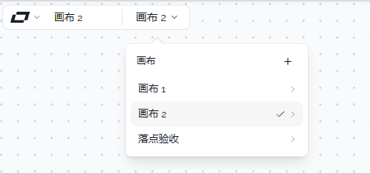
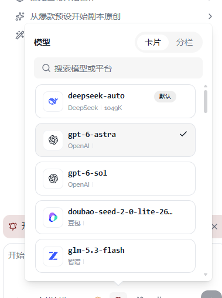
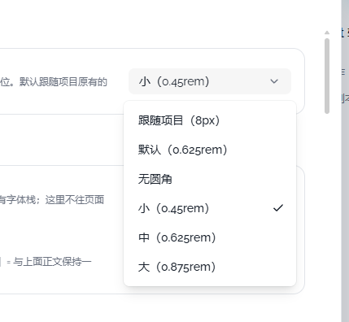
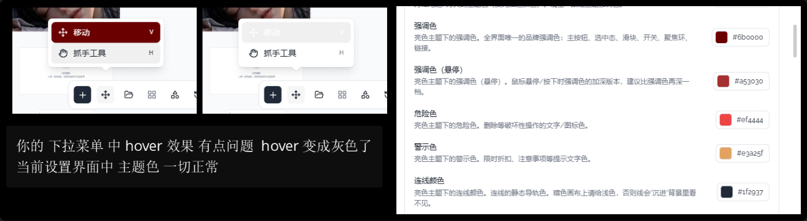

# 03 · 统一菜单的悬停与选中样式

- 状态：待确认
- 负责人：未领取
- 完成时间：—

## 你的原话

> 图片3 下拉选择颜色块有问题

> 你的下拉菜单中 hover 效果有点问题 hover 变成灰色了
> 当前设置界面中 主题色 一切正常

> 补充（2026-11-03）：这里的问题 3 其实与很多地方都相关。
> 目前这个下拉菜单，当处于你主题颜色的情况下，选中时会有一个高亮显示效果。但是我看了一下，其他地方并不是这样的：
> 1. 有的地方选中效果是默认的灰色背景；
> 2. 有的地方根本就没有背景；
> 3. 还有有些是在后面打个勾。
> 也就是说，你的这个下拉菜单在很多地方都不是统一的，就是这样乱七八糟地设计的。我觉得可以改为统一的 UI 变成打勾的方式。

## 要解决的问题

所有“可选一项或多项”的菜单，统一用行尾的勾表示当前选中；浅色底只表示鼠标悬停或键盘高亮。用户打开任意菜单，都能一眼分清“现在选的是哪个”和“鼠标正经过哪个”。

## 范围与位置

- 页面：画布左上角画布列表、Agent 输入框的模型面板、全局设置里的下拉选择、左下状态栏的缩放菜单、底部工具栏的移动菜单、资产筛选菜单等所有可选择菜单。
- 参考代码：组件库已有勾的实现见 `packages/ui-kit-shadcn/src/components/ui/select/SelectItem.vue`、`packages/ui-kit-shadcn/src/components/ui/dropdown-menu/DropdownMenuRadioItem.vue`、`packages/ui-kit-shadcn/src/components/ui/dropdown-menu/DropdownMenuCheckboxItem.vue`；业务里仍只用底色表示选中的位置见 `packages/ui/src/components/areas/StatusArea.vue`、`packages/ui/src/components/areas/DockArea.vue`、`packages/ui/src/components/AssetUploadDialog.vue`、`packages/ui/src/components/assets/manage-dialog/ManageDialogToolbar.vue`、`packages/ui/src/components/areas/left-drawer/CanvasTabToolbar.vue`、`packages/ui/src/components/areas/left-drawer/AssetTabToolbar.vue`、`packages/ui/src/components/areas/ChatPanel.vue`。
- 相关资源：`images/03-下拉hover与主题色-现状.png`、`images/03-画布列表选中-现状.png`、`images/03-模型面板选中-现状.png`、`images/03-设置下拉选中-现状.png`
- 关联问题：06、07 都改 `packages/ui/src/components/ProjectCluster.vue` 的画布列表；01、04 的设置菜单会复用本问题的统一样式。

## 现在 vs 期望

| | 现在 | 期望 |
| --- | --- | --- |
| 选中标记 | 有的用整行灰底，有的用灰底加勾，有的只有勾 | 所有菜单统一用行尾勾表示选中 |
| 选中行底色 | 画布列表、模型卡片、部分菜单保留整行浅色底 | 选中行只有勾，不再保留持久底色 |
| 鼠标悬停、键盘高亮 | 与选中态混用同一种浅色底，难以区分 | 只做临时浅色高亮，不出现勾 |
| 勾的位置 | 画布列表在箭头左边，模型卡片在标题右侧，下拉在行尾 | 同一类菜单固定在右侧；有子菜单箭头时，勾在箭头左侧 |
| 单选、多选 | 单选和多选混用普通菜单行 | 单选只能有一个勾；多选可同时有多个勾 |

## 问题原因

- 状态：已确认
- 复现步骤：打开画布左上角的画布列表，当前画布是“整行灰底 + 勾”；打开 Agent 输入框的模型面板，选中模型是“灰底卡片 + 勾”；打开设置里的圆角下拉，选中项只有勾，没有底色。三处选中样式各不相同。
- 证据（日志 / 截图 / 调用路径）：`packages/ui-kit-shadcn/src/components/ui/select/SelectItem.vue`、`.../dropdown-menu/DropdownMenuRadioItem.vue`、`.../dropdown-menu/DropdownMenuCheckboxItem.vue` 已经内置行尾勾；但 `packages/ui/src/components/ProjectCluster.vue` 给选中行加了 `.is-active` 灰底，并自己画 `Check`；`packages/plugins/plugin-agent/src/components/agent-conversation/AgentComposer.vue` 的模型卡片和分栏行也自己画 `Check`，`packages/plugins/plugin-agent/src/components/agent-conversation/agent-composer/part3.css` 又给 `[aria-selected='true']` 加浅色底和边框。
- 根因：业务页面没有统一的“选中项”约定。`bg-accent` 既被用来表示持久选中，又被 `data-highlighted` 用来表示临时高亮；还有页面绕开现成的单选、多选菜单组件，用普通 `DropdownMenuItem` 加 `bg-accent` 表示选中，所以出现了三种互不一致的表现。

## 修改方案

- 改哪里：先统一菜单项组件的行为，再逐个把业务菜单从“普通行 + 底色”换成“单选 / 多选行 + 勾”。
- 怎么改：按下面的顺序改，先统一组件行为，再换业务菜单。
  1. 以 `SelectItem.vue` 的勾为基准：勾固定 16px，放在行尾右侧 8px 的位置；有子菜单箭头时，顺序是“文字 → 勾 → 箭头”。
  2. 单选列表改用 `DropdownMenuRadioGroup` + `DropdownMenuRadioItem`；多选列表改用 `DropdownMenuCheckboxItem`。这样勾由组件的选中状态驱动，不再手写 `v-if` 和图标。
  3. 把 `StatusArea.vue`、`DockArea.vue`、`AssetUploadDialog.vue`、`ManageDialogToolbar.vue`、`CanvasTabToolbar.vue`、`AssetTabToolbar.vue`、`ChatPanel.vue` 里的 `bg-accent` 选中类去掉，换成上面两种带勾的菜单行；筛选类菜单同时使用单选组。
  4. `ProjectCluster.vue` 保留“整行可点 + 行尾独立操作按钮”的结构，但选中标记只留勾：取消 `.canvas-row.is-active` 的浅色底；勾与“⋯”仍在同一格，鼠标悬停时勾让位给“⋯”，这属于行尾操作，不改选择语义。
  5. 模型卡片可以保留卡片布局、品牌图标和说明文字，但把选中底色去掉；卡片视图的勾固定在右上角，列表行最右，卡片悬停只做临时高亮。分栏视图同样处理。
  6. 全局只保留一条高亮规则：`[data-highlighted]` 使用 `--ui-hover`；删除“选中项必须加 `bg-accent` 实色底”的成对规则。勾的颜色用 `--ui-ink`，暗色下自动反白。
- 为什么这样改：勾是明确、持久的选中信号；浅色底是临时经过的信号。两者分开后，用户不用猜“这块灰底是选中的，还是鼠标碰到的”。复用组件库的单选、多选行后，键盘操作和读屏语义也一起统一。
- 风险 / 影响面：菜单组件是全局共用件，改动会影响画布、插件面板和设置页；要逐类检查单选、多选、分组标题、破坏性项和子菜单。模型面板是自定义卡片，不会自动获得组件行为，需要单独对齐样式。
- 验证方式：在亮色和暗色下分别打开画布列表、模型面板、设置下拉、缩放菜单、移动菜单、资产筛选菜单，逐项检查“选中只有勾、悬停只有浅底”；再用键盘上下键确认高亮与勾互不混淆。

## 验收标准

- [ ] 画布列表、模型面板、设置下拉、缩放菜单、移动菜单、资产筛选菜单的当前项都只在右侧显示勾
- [ ] 同一组单选项里只有一个勾；多选菜单可以同时有多个勾
- [ ] 鼠标悬停或键盘高亮只出现临时浅色底，不新增勾，也不被误认为已选中
- [ ] 选中行不再保留整行浅色底
- [ ] 勾的大小统一为 16px，右侧对齐；有子菜单箭头时勾在箭头左侧，间距一致
- [ ] 亮色、暗色和键盘操作下，勾与高亮底都能清楚分辨
- [ ] 破坏性菜单项仍保持红色语义，不受本次修改影响

## 不能动

- 不改菜单的定位、开合、键盘导航、滚动和点击行为
- 不改主题色板字段和用户已选颜色
- 不改画布列表“整行切画布、行尾开操作菜单”的两个独立动作
- 不删除现成的单选、多选和选择器组件，不另造一套勾图标

## 假设与待确认

- 假设：模型卡片的勾放在卡片右上角，列表行的勾放在最右侧；两者都靠右，保持同一阅读方向。
- 假设：“新建画布”“删除”这类只执行动作、不能保持选中的菜单不显示勾。
- 待确认：选中项除了勾，是否还要保留一层很浅的底色？本文默认去掉底色，让勾单独表示选中。

## 执行指令

把所有可选择菜单的选中态统一成行尾勾，去掉用整行浅色底表示选中的写法；单选使用单选组，多选使用多选行，勾放在右侧、有子菜单箭头时放在箭头左边。悬停和键盘高亮只保留临时浅色底，不出现勾。画布列表和模型卡片的点击行为、菜单定位保持不变。

## 图片

图片说明：当前画布“画布 2”同时有整行灰底和行尾勾，另外还有子菜单箭头。

图片说明：选中的“gpt-6-astra”是灰底卡片，勾在标题右侧；其它模型没有持久底色。

图片说明：圆角下拉的当前值“小（0.45rem）”只有行尾勾，说明同一产品里至少存在三种选中表现。

图片说明：左侧是移动菜单的 hover 灰底，右侧是设置里的主题配色色块；这张图是旧的 hover 问题，新补充的截图说明同一问题已经扩展到所有菜单的选中样式。

## 执行记录

- 改动文件：（实施后填写）
- 验证命令与结果：（实施后填写）
- 完成时间：—
