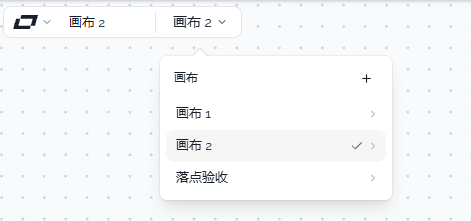
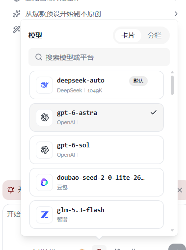
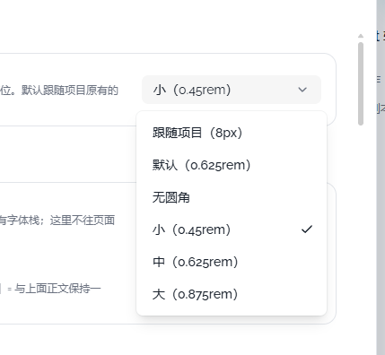

# 03 · 菜单选中只用默认勾

- 状态：进行中
- 负责人：画布与外壳对话
- 完成时间：—

## 你的原话

> 图片3 下拉选择颜色块有问题

> 你的下拉菜单中 hover 效果有点问题 hover 变成灰色了
> 当前设置界面中 主题色 一切正常

> 补充（2026-11-03）：这里的问题 3 其实与很多地方都相关。
> 目前这个下拉菜单，当处于你主题颜色的情况下，选中时会有一个高亮显示效果。但是我看了一下，其他地方并不是这样的：
> 1. 有的地方选中效果是默认的灰色背景；
> 2. 有的地方根本就没有背景；
> 3. 还有有些是在后面打个勾。
> 也就是说，你的这个下拉菜单在很多地方都不是统一的，就是这样乱七八糟地设计的。我觉得可以改为统一的 UI 变成打勾的方式。

## 要解决的问题

菜单的当前选中项只用默认的勾表示，不要再叠加主题色的选中底色。悬停、键盘高亮和选中保持现有行为，不做额外改版。

## 范围与位置

- 页面：所有带「当前选中项」的菜单，包括画布列表、模型面板、全局设置下拉、缩放菜单、移动菜单、资产筛选菜单。
- 参考代码：`packages/ui-kit-shadcn/src/components/ui/select/SelectItem.vue`、`packages/ui-kit-shadcn/src/components/ui/dropdown-menu/DropdownMenuRadioItem.vue`、`packages/ui-kit-shadcn/src/components/ui/dropdown-menu/DropdownMenuCheckboxItem.vue`；额外加主题色底的位置见 `packages/ui/src/components/areas/StatusArea.vue`、`packages/ui/src/components/areas/DockArea.vue`、`packages/ui/src/components/AssetUploadDialog.vue`、`packages/ui/src/components/assets/manage-dialog/ManageDialogToolbar.vue`、`packages/ui/src/components/areas/left-drawer/CanvasTabToolbar.vue`、`packages/ui/src/components/areas/left-drawer/AssetTabToolbar.vue`。Agent 对话的创作模式 / 模型面板在 `packages/plugins/plugin-agent/src/components/agent-conversation/AgentComposer.vue`。
- 相关资源：`images/03-画布列表选中-现状.png`、`images/03-模型面板选中-现状.png`、`images/03-设置下拉选中-现状.png`
- 关联问题：12 也改 `packages/ui/src/components/ProjectCluster.vue` 的画布列表；01、04 的设置菜单会复用同一套选中样式。公共浮层间距与箭头见 11。

## 现在 vs 期望

| | 现在 | 期望 |
| --- | --- | --- |
| 选中标记 | 有的只有勾，有的在勾外面再加一层主题色或灰底 | 只用默认勾，不加任何额外的选中底色 |
| 悬停、键盘高亮 | 保持现状 | 保持现状，不因这次改动而变化 |
| 勾的位置 | 有的在行尾，有的在卡片标题旁 | 保持各菜单现有位置，只去掉额外底色 |

## 问题原因

- 状态：已确认
- 复现步骤：打开设置里的圆角下拉，选中项只有勾；打开画布列表和模型面板，选中项在勾之外还有整行或整张卡的底色。打开缩放或移动菜单，选中项只有一整行主题色底、没有勾。三处表现不一致。
- 证据（日志 / 截图 / 调用路径）：`SelectItem.vue` 用组件自带的 `SelectItemIndicator` 显示勾；`ProjectCluster.vue` 的 `.canvas-row.is-active` 和 `AgentComposer.vue` 的 `[aria-selected='true']` 样式又给选中行加了背景。
- 根因：部分业务菜单把「选中」同时做成了「勾 + 主题色底」，还有的只用主题色底；组件库的默认约定只有勾。

## 修改方案

- 改哪里：逐个菜单去掉选中项额外的主题色底，保留默认勾。
- 怎么改：把菜单选中态的背景类或选中态背景样式删掉；勾继续用组件自带的 `SelectItemIndicator`、`DropdownMenuItemIndicator`，不新增图标、不改勾的位置；对于现在只有底色、没有勾的菜单，改用组件库原生的单选或勾选行，让默认勾显示出来；悬停和键盘高亮不动。
- 为什么这样改：默认勾已经能表达选中，再加一层底会让选中项和悬停项看起来一样，也会跟主题色绑在一起。
- 风险 / 影响面：只影响菜单选中项的底色，不影响点击、数据、菜单定位和菜单开合。
- 验证方式：打开上述菜单，确认只有当前项有勾、勾外没有额外底色；亮色和暗色各看一次。

## 验收标准

- [ ] 所有菜单的当前选中项只有默认勾，没有额外的主题色或灰底。
- [ ] 同一组单选项只有一个勾；多选菜单可以同时有多个勾。
- [ ] 悬停和键盘高亮保持原样，不新增或删除勾。
- [x] 画布列表当前画布只用整行背景表示选中，行尾不再同时出现勾；行尾图标替换由 12 验收。
- [x] 模型面板当前模型不再是一张带主题色底的卡片。
- [x] 缩放和移动菜单的当前值能通过默认勾辨认，不再依赖整行主题色。
- [x] 亮色、暗色主题下都能分辨「当前选中」和「鼠标悬停」。

## 不能动

- 不改菜单的点击、数据、过滤和关闭行为。
- 不改勾的尺寸、位置和相对文字的对齐。
- 不把悬停高亮一起删掉。
- 不改菜单的宽度、圆角、底色和定位。

## 假设与待确认

- 假设：用户说的「默认的选中方式」就是组件库现在设置下拉里的「只有勾、没有底色」。
- 待确认：无。

## 执行指令

把所有菜单选中项额外的主题色底和灰底去掉，只保留默认勾。勾的位置、大小、悬停高亮、点击行为和菜单定位都不改。

## 图片

图片说明：当前画布「画布 2」同时有整行灰底和行尾勾，另外还有子菜单箭头。

图片说明：选中的「gpt-6-astra」是灰底卡片，勾在标题右侧；其它模型没有持久底色。

图片说明：圆角下拉的当前值「小（0.45rem）」只有行尾勾，说明同一产品里至少存在三种选中表现。

## 执行记录

- 改动文件：`packages/ui/src/components/areas/StatusArea.vue`、`packages/ui/src/components/areas/DockArea.vue`、`packages/ui/src/components/AssetUploadDialog.vue`、`packages/ui/src/components/assets/manage-dialog/ManageDialogToolbar.vue`、`packages/ui/src/components/areas/left-drawer/CanvasTabToolbar.vue`、`packages/ui/src/components/areas/left-drawer/AssetTabToolbar.vue`、`packages/ui/src/__tests__/canvasChipMenu.test.ts`
- 验证命令与结果：`pnpm -C packages/ui test` 通过（86 个测试文件、589 项）；`pnpm -C packages/ui typecheck` 通过；Chrome 实测缩放下拉、移动菜单、画布筛选、展示设置、资产筛选、上传保存位置，选中项只保留默认勾，不再叠主题色或灰底。
- 剩余项：`AgentComposer` 与设置页的选中项由其它对话处理，本对话不修改；因此整体状态保持「进行中」。
- 完成时间：—
