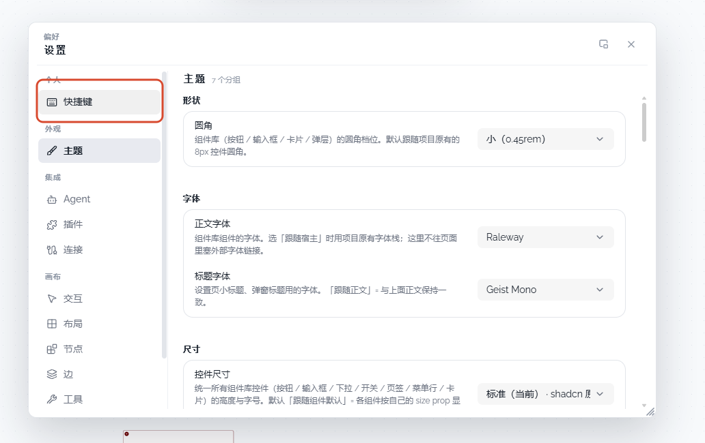

# 04 · 快捷键配置面板

- 状态：已完成
- 负责人：root
- 完成时间：2026-11-03

## 你的原话

> 图片4 你的设置界面中 你的快捷键面板是空的，我希望你提供一个快捷键的设置面板（而不是你当前这个触发快捷键的显示面板）我要的是配置面板，可以配置每一个快捷键的UI，我记得我以前是实现过这个面板的，你可以找一找 把他作为config 组件 嵌入里面，记得组件开发手册 使用 ui-development

## 要解决的问题

设置 → 个人 → 快捷键当前点开后只唤起外部「快捷键参考」浮层，右侧没有配置内容。
用户要的是设置页里的快捷键配置面板：能看每一项、能录新键、能重置、能导出导入，并且沿用仓库已有的重映射组件。

## 范围与位置

- 页面：设置 → 个人 → 快捷键。
- 参考代码：`packages/plugins/plugin-theme-default/src/components/settings/defaultMenu.ts` 的 `nav/personal/shortcuts`；`packages/ui/src/composables/ui/useUiLifecycle.ts` 的 `settings:ui-action`；`packages/plugins/plugin-theme-default/src/components/settings/PluginSettingsContent.vue`；`packages/ui/src/components/settings/AppSettingsPanel.vue`；`packages/plugins/plugin-shortcut-manager/src/RemapPanel.vue`；`packages/plugins/plugin-shortcut-manager/src/shortcut-help-panel/ShortcutHelpList.vue`；`packages/plugins/plugin-shortcut-manager/src/shortcut-help-panel/ShortcutHelpPanelShell.vue`；旧版参考 `backup/canvas-core/src/plugins/shortcut-manager/RemapPanel.vue`、`backup/canvas-core/src/plugins/shortcut-manager/ShortcutHelpPanel.vue`。
- 相关资源：`images/04-快捷键设置入口-现状.png`；UI 规范 `.codex/skills/ui-development/SKILL.md`。
- 关联问题：无

设置面板必须用 `ScrollPane`/`ScrollArea`、`AppDialog`，控件从 `ui` 注册表取件。

## 现在 vs 期望

| | 现在 | 期望 |
| --- | --- | --- |
| 左导航「快捷键」 | 点击后右侧不切换配置页 | 点击后右侧显示快捷键配置面板 |
| 右侧内容 | 空，或只有外部浮层 | 分组列表 + 每行当前键位 + 重映射入口 |
| 修改快捷键 | 必须打开帮助浮层再点「重映射」 | 在设置页内直接录制并保存 |
| 冲突处理 | 有逻辑，但入口不直观 | 录制时就提示冲突，未解决前不能确认 |
| 导入导出 | 帮助浮层里有 | 设置面板也提供，行为和旧版一致 |

## 问题原因

- 状态：已确认（入口性质）；配置页的落点仍待确认。
- 复现步骤：设置 → 个人 → 快捷键；右侧仍停留在之前的页面，实际弹出外部参考浮层。
- 证据（日志 / 截图 / 调用路径）：`defaultMenu.ts` 把 `nav/personal/shortcuts` 注册为 `action: 'shortcuts'`；`useUiLifecycle.ts` 收到 `settings:ui-action` 后打开 `ShortcutModal`，这里没有可渲染的配置内容。
- 根因：菜单项被定义成「动作」而不是「配置页」；重映射能力其实已经在 shortcut-manager 插件里，但没有接到设置内容区。

## 修改方案

- 改哪里：`defaultMenu.ts` 的快捷键菜单项；两套设置面板的页面映射；`ShortcutHelpList.vue` 与 `RemapPanel.vue` 的复用入口。
- 怎么改：把「快捷键」从纯动作改成能渲染配置页的入口；右侧用设置页滚动容器装列表，每行复用 `RemapPanel` 的录制、冲突预检、重置、完成逻辑；导入导出复用现有 hook。
- 为什么这样改：用户已经记得旧版有可复用的重映射组件；重新写一套编辑器会导致冲突规则和持久化再次分叉。
- 风险 / 影响面：影响设置页个人分组和快捷键持久化入口；底部快捷键参考浮层仍保留。
- 验证方式：Chrome 中打开设置逐项录制、冲突、重置、导入导出；刷新后键位仍在；跑 `pnpm -C packages/plugins/plugin-shortcut-manager test` 和 `pnpm -C packages/ui typecheck`。

## 验收标准

- [x] 设置 → 个人 → 快捷键立刻在右侧显示配置面板，不再跳去 help 浮层。
- [x] 面板按系统/编辑/画布/视图/插件等分组列出快捷键，每行显示命令名、当前键位和「重映射」。
- [x] 点击「重映射」能录制新组合键，纯修饰键和组合键都能识别，失焦会取消录制。
- [x] 与现有快捷键冲突时显示冲突命令名，且不能确认。
- [x] 「完成」后立即生效，刷新页面仍保留；「重置默认」只恢复该条命令。
- [x] 导出、导入、恢复全部默认可在面板里完成，损坏 JSON 有错误提示。
- [x] 面板使用 `ScrollPane`/`ScrollArea`，长列表可滚，标题与操作栏不跟着滚走。
- [x] 亮色、暗色、窄窗口下都可用；键盘 Tab、Enter、Esc 能操作。
- [x] 底部工具栏的快捷键按钮仍打开原来的参考浮层，不因这次改动失效。

## 不能动

- 不改命令注册表中的 `keys` 字段作为唯一数据源。
- 不改快捷键持久化 key（`save` 的 `shortcut` 类型 / `SHORTCUT_SAVE_KEY`），避免用户已有重映射丢失。
- 不复制一份新的重映射引擎；复用 `shortcutRemapEngine` 与 `v2ShortcutManager`。
- 不直接 import 组件库裸组件；业务 UI 从 `ui` 注册表取件。
- 不改 `ShortcutModal` 的参考浮层用途，除非用户确认要合并。

## 假设与待确认

- 假设：用户要的是「设置页内的配置面板」，底部快捷键参考浮层继续保留。
- 待确认：配置面板是只放在成品应用 `AppSettingsPanel`，还是默认主题 `PluginSettingsContent` 也要同步？两套设置皮目前是分开的。
- 待确认：「作为 config 组件嵌入」是希望以自绘整页形式挂到菜单，还是登记成一个 `settingsGroup` 配置分组？
- 待确认：旧版「重映射」是行内展开，用户是否希望设置页也保持行内展开，而不是另开弹窗？

## 执行指令

先阅读 `ui-development` 和现有 `RemapPanel.vue`、`ShortcutHelpList.vue`，不要重写一套快捷键编辑器。
把「快捷键」菜单项从纯动作改成能渲染配置页的入口：右侧用设置页的滚动容器装列表，
每行复用 `RemapPanel` 的录制、冲突预检、重置、完成逻辑；导入导出复用现有 hook。
默认主题和成品应用两套设置皮都要能看到入口；先 Chrome 实测，再补回归测试。

## 图片

图片说明：红框标出左侧「快捷键」菜单项，右侧仍停留在「主题」页，说明它当前只是动作入口。

## 执行记录

- 改动文件：`packages/ui/src/components/settings/SettingsShortcutPage.vue`、`packages/ui/src/settingsPanelPlugin.ts`、`packages/ui/src/composables/ui/useShortcutsScope.ts`、`packages/plugins/plugin-shortcut-manager/src/SettingsShortcutPanel.vue`、`packages/plugins/plugin-shortcut-manager/src/v2ShortcutManager.ts`、`packages/plugins/plugin-theme-default/src/components/settings/defaultMenu.ts`、两套 `useSettingsNavigation.ts`、两套 `settingsMenuModel.ts`
- 验证命令与结果：见下三行（真实跑过）
  - `pnpm -C packages/plugins/plugin-shortcut-manager test` → 6 文件 / 40 用例全过（含 `mod+z` 与 `ctrl+z` 冲突归一化的失败测试）。
  - `pnpm -C packages/ui test` → 86 文件 / 592 用例全过；`pnpm -C packages/ui typecheck` → 通过。
  - Chrome 实测：设置左导航出现「个人 > 快捷键」，配置页分组、搜索、行内重映射、冲突提示、导出/导入、恢复默认均可用；Agent 面板快捷键改为 `Ctrl+Alt+J` 后旧键失效、新键生效、刷新保留，恢复默认回到 `Ctrl+J`；底部快捷键参考浮层未受影响。
- 完成时间：2026-11-03
