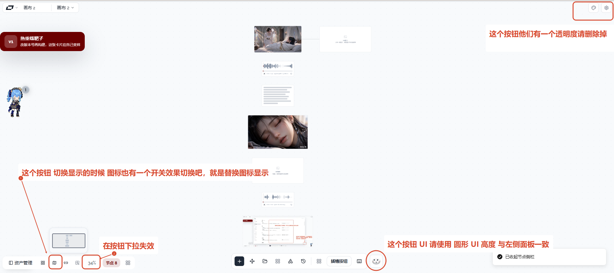

# 05 · 底栏与右上按钮

- 状态：已完成
- 负责人：画布与外壳对话
- 完成时间：2026-11-03

## 你的原话

> 图片5 的几个问题

截图里能看到的文字标注：

- 右上角按钮区：「这个按钮他们有一个透明度请删除」
- 左下状态栏：「这个按钮切换显示的时候 图标也有一个开关效果切换吧，就是替换图标显示」
- 左下缩放：「在按钮下拉失效」
- 右下 Agent 按钮：「这个按钮 UI 请使用 圆形 UI 高度 与左侧面板一致」

## 要解决的问题

截图里有四处独立的界面问题，拆成四条验收：

1. 右上角「主题切换 / 设置」按钮带半透明底色，用户希望去掉透明感，变成实色面板按钮。
2. 左下状态栏的图标开关在切换时没有明显的图标替换效果，需要能看出状态变了。
3. 左下缩放百分比按钮的下拉在点击后没有正常弹出。
4. 右下 Agent 按钮当前是方形圆角按钮，用户希望是圆形，并且高度与左侧工具栏/状态栏一致。

## 范围与位置

- 页面：画布外壳右上角、左下状态栏、画布底部中央工具栏。
- 参考代码：`packages/ui/src/components/areas/TopRightArea.vue`；`packages/ui/src/components/areas/StatusArea.vue` 的图标开关与 `s.zoomMenuOpen`；`packages/ui/src/components/areas/DockArea.vue` 的 50px 托盘、`size-8` 按钮和 `size-10` Agent 按钮；左侧状态栏 `h-10` 容器。
- 相关资源：`images/05-工具栏与按钮-现状.png`
- 关联问题：公共浮层箭头与间距见 11；本条只验收按钮外观和缩放下拉开合。

## 现在 vs 期望

| 问题 | 现在 | 期望 |
| --- | --- | --- |
| 右上按钮透明度 | `bg-panel/80`，能透出画布 | 使用实色 `--ui-panel`，无透明度 |
| 状态栏图标切换 | 图标会换，但用户看不出切换效果 | 切换时有明确的图标替换/过渡，状态一眼可辨 |
| 缩放下拉 | 点击百分比按钮，菜单没有正常出现 | 点击后稳定弹出缩放菜单，选项可用 |
| Agent 按钮 | 类名写圆形，样式又被全局圆角覆盖成方形圆角 | 真正的圆形，直径与左侧 40px 面板一致 |

## 问题原因

- 状态：已确认
- 复现步骤：看右上角按钮，能透出画布；看右下 Agent 按钮，实际是方形圆角；点击左下缩放百分比，菜单没有正常出现。
- 证据（日志 / 截图 / 调用路径）：`TopRightArea.vue` 按钮类名使用 `bg-panel/80`；`StatusArea.vue` 把缩放的 `DropdownMenuTrigger` 套在 `TooltipTrigger` 里，两个浮层共用同一个按钮锚点；小地图原先只使用 `Map` 图标；`DockArea.vue` 的 Agent 按钮类名写 `rounded-full`，scoped 样式又用 `border-radius: var(--mct-radius, …)` 覆盖。
- 根因：右上按钮直接使用了带透明度的面板色；Agent 按钮的圆形类被全局圆角变量覆盖；缩放按钮同时被 Tooltip 和 DropdownMenu 当作锚点，Tooltip 接管后菜单被挪出按钮附近，看起来像没有打开。

## 修改方案

- 改哪里：`TopRightArea.vue` 的背景类；`StatusArea.vue` 的图标状态与缩放下拉；`DockArea.vue` 的 Agent 按钮样式。
- 怎么改：右上改用实色 `bg-panel`；状态栏小地图使用 `MapPin` / `MapPinOff` 真实图标替换，连线和吸附继续使用各自的开关图标；缩放下拉移除共用的 Tooltip 包装，保留原生 `title` 提示；Agent 按钮去掉圆角变量覆盖，固定为 40px 真圆形。
- 为什么这样改：四种表现的原因不同，分开修才能避免一处改动掩盖另一处没修好。
- 风险 / 影响面：不改缩放数值和视口服务；不改 Agent 面板打开、停靠、宽度；不改其它区域按钮语义。
- 验证方式：逐条在 Chrome 复现并截图；量右上背景色、Agent 按钮计算尺寸、缩放下拉 `aria-expanded`；亮暗主题和窄窗口各看一次。

## 验收标准

- [x] 右上角「主题切换 / 设置」按钮背景是实色，不再能看到画布透过按钮。
- [x] 亮色、暗色下按钮背景都与所在面板协调，hover 和按下状态仍清楚。
- [x] 状态栏小地图、连线显隐、网格吸附切换时，图标有可观察的替换/过渡，不只改颜色。
- [x] 缩放按钮点击后，菜单在按钮上方稳定出现；再点、点外部、按 Esc 都能关闭。
- [x] 缩放菜单里的放大、缩小、适合屏幕、50%、100%、最大倍率都能执行。
- [x] Agent 按钮是圆形，直径与左侧「画布状态栏」「画布工具栏」的 40px 高度一致。
- [x] Agent 按钮打开 / 关闭态有清楚区别，tooltip 与点击行为不变。
- [x] 窄窗口下四个元素都不互相挤压、不跑到屏幕外。

## 不能动

- 不改主题色板、圆角全局档位和其它区域按钮的语义。
- 不改缩放的实际数值计算和视口服务，只修菜单开合。
- 不改 Agent 面板的打开、停靠、宽度逻辑。
- 不为了做「开关效果」写纯动画假象；图标必须真实反映当前状态。

## 假设与待确认

- 已确认：右上角红框里的两个按钮是「主题切换」和「设置」，需要去掉半透明底，改成实色面板。
- 已确认：状态栏使用真实的开/关图标替换；小地图用 `MapPin` / `MapPinOff`，连线用 `Link2` / `Link2Off`，吸附用 `Magnet` / `Grid2x2X`。
- 已确认：缩放下拉失效来自 Tooltip 与 DropdownMenu 共用按钮锚点；移除 Tooltip 包装后菜单稳定打开。
- 已确认：Agent 按钮与左侧状态栏、工具栏的 40px 高度对齐，使用 40px 直径，不按托盘 50px 外框计算。
- 待确认：无。

## 执行指令

先逐条复现，不要一次改四处：

1. 用浏览器读右上按钮实际背景色，确认是 `/80` 透明度导致，改成实色 token。
2. 逐个点状态栏三个开关，录屏或截两张切换前后图，再决定用哪种图标过渡。
3. 点缩放百分比，检查菜单 DOM 是否创建、是否被遮挡、`zoomMenuOpen` 是否变化。
4. 读 Agent 按钮最终计算样式，找出覆盖 `rounded-full` 的 scoped 规则；改成真圆形并核对 40px 高度。

四条分别验收，不要用一次大改掩盖其中一条没修好。

## 图片

图片说明：右上红框是两个半透明按钮；左下红框标出图标切换和缩放百分比；右下红框标出 Agent 按钮，并要求圆形、与左侧面板同高。

## 执行记录

- 改动文件：`packages/ui/src/components/areas/TopRightArea.vue`、`packages/ui/src/components/areas/StatusArea.vue`、`packages/ui/src/components/areas/DockArea.vue`、`packages/ui/src/__tests__/canvasChipMenu.test.ts`
- 验证命令与结果：`pnpm -C packages/ui test` 通过（86 个测试文件、589 项）；`pnpm -C packages/ui typecheck` 通过；Chrome 实测亮/暗主题右上按钮与面板同色，缩放下拉在按钮上方打开且 50% / 100% 生效，Agent 按钮为 40×40 圆形，窄窗口下各区域无挤压。
- 完成时间：2026-11-03
