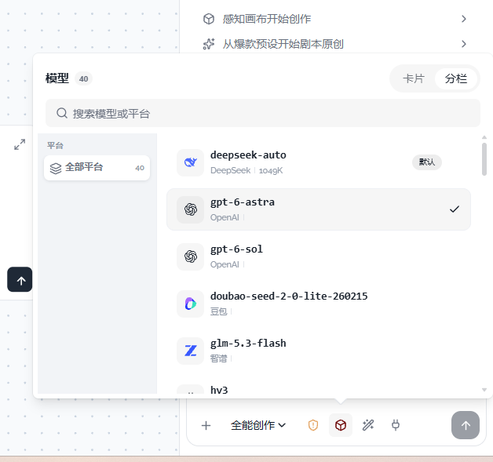

# 07 · 模型面板平台与滚动条

- 状态：已完成
- 负责人：deepseek-auto
- 完成时间：2026-11-03 20:11

## 你的原话

> 图1， 你这里模型面板中 左侧的平台 你没有加载出来 还有你这里的所有 滚动条 请参考 ui-development

## 要解决的问题

模型面板切到「分栏」后，左栏应显示「全部平台」和每个平台的图标、名称、模型数量；现在截图里只剩「全部平台」，其它平台看不见。
模型、技能、MCP 三个面板里的列表滚动条也要统一改用组件库的 `ScrollArea`，不再使用手写原生滚动条样式。

## 范围与位置

- 页面：Agent 输入框 → 模型 → 分栏。
- 参考代码：`packages/plugins/plugin-agent/src/components/agent-conversation/AgentComposer.vue` 中 `.ac-model-panel` 的 `.ac-split-rail`；`packages/plugins/plugin-agent/src/components/agent-conversation/useAgentConversation.ts` 的 `platformOf`、`modelPlatformGroups`、`filteredModels`。
- 相关资源：`images/07-模型面板平台与滚动条-现状.png`；`packages/plugins/plugin-agent/src/modelBrandIcons.ts`；`packages/plugins/plugin-agent/src/components/agent-conversation/agent-composer/part2.css`、`part3.css`、`part4.css`；`packages/ui-kit-shadcn/src/components/ui/scroll-area/`；`packages/ui/src/components/ScrollPane.vue`。
- 关联问题：06 修开合，08 修技能空状态，09 修 MCP 面板；滚动区改动会同时影响 08、09。公共浮层箭头与间距见 11。

## 现在 vs 期望

| | 现在 | 期望 |
| --- | --- | --- |
| 左栏平台 | 只看到「全部平台 40」，下面一大片空白 | 按模型实际平台逐行显示图标、名称、数量 |
| 平台图标 | 没有可见图标，留出 14px 空位 | 显示平台品牌图标；认不出时显示「自建网关」 |
| 平台名称 | 被挤到看不见 | 常用平台名能完整显示；极窄时才省略 |
| 平台计数 | 只有「全部」有数字 | 每个平台右侧显示模型数 |
| 左栏滚动 | 原生滚动条，粗细/颜色与面板不一致 | 用 `ScrollArea`，只在需要时出现 |
| 右侧模型列表滚动 | 多层 `overflow-y: auto`，滚动条位置不统一 | 只有列表区域滚动，标题与搜索固定 |
| 技能 / MCP 列表滚动 | 同样使用原生滚动条 | 同样统一为 `ScrollArea` |

## 问题原因

- 状态：已确认
- 复现步骤：打开 Agent 对话 → 选择模型 → 切换「分栏」；左栏只看到「全部平台 40」，其余平台不显示。
- 证据（日志 / 截图 / 调用路径）：`modelPlatformGroups` 会先补「全部平台」再追加各平台；左栏模板遍历 `modelPlatformGroups`，但图标样式 `.ac-rail-brand :deep(svg)` 写在 `scoped src` 的 `part4.css` 里，` :deep()` 在该位置可能不生成预期选择器，图标占位后把名称挤出可用宽度。滚动区同时手写了 `overflow-y: auto` 与 `::-webkit-scrollbar`，与 `ui-development` 的 `ScrollArea` 规范不一致。
- 根因：`useAgentMenus` 声明了 `brandSvg`，但控制器漏导出它；模板调用 `brandSvg(...)` 时抛 `TypeError: $setup.brandSvg is not a function`，整段左栏渲染失败。滚动层另有手写 `overflow-y:auto` / `::-webkit-scrollbar`，与组件库 `ScrollArea` 规范不一致。
- 修复证据：补出 `brandSvg` 导出后，Chrome 模型分栏显示 11 行平台（全部平台 + 10 个平台），数量合计 40；左栏 151px 宽且每行有 SVG 图标，右栏视口 288px、内容 2394px，可独立滚动；重新打开时选中项 `git-commit` 自动滚到可视区（scrollTop 1870，选中项距视口顶部 230px）。

## 修改方案

- 改哪里：`AgentComposer.vue` 的模型分栏左栏模板；`part4.css` 的 `.ac-split-rail`、`.ac-rail-brand`、`.ac-rail-name`；`useAgentConversation.ts` 的分组过滤逻辑；三个面板的列表滚动容器。
- 怎么改：先确认 `modelPlatformGroups` 返回的行数；行存在但不可见时，修图标选择器和左栏宽度，让图标、名称、计数各占应有位置。滚动部分改用 `ScrollArea` / `ScrollBar`（或 `ScrollPane`），父容器保持 `min-h-0` 与确定高度。
- 为什么这样改：左栏的内容应与模型数据同一来源，样式只负责呈现；滚动层统一后，滚动条才能跟随主题并只出现在列表区。
- 风险 / 影响面：影响模型、技能、MCP 三个下拉的滚动层；不改平台识别规则、模型数据与选中逻辑。
- 验证方式：在 Chrome 检查`.ac-rail-item` 行数、每行 svg 与文本宽度；切平台验证右侧过滤，再在亮色、暗色、320px 宽下检查滚动条，并跑 `pnpm -C packages/plugins/plugin-agent test` 与 `pnpm -C packages/plugins/plugin-agent typecheck`。

## 验收标准

- [x] 「模型 → 分栏」左栏在「全部平台」下列出所有存在模型的平台，行数等于分组数减一。
- [x] 每行能看到平台图标和平台名；当前截图数据至少显示 DeepSeek、OpenAI、豆包、智谱等。
- [x] 每行右侧显示数量，数量之和等于「全部平台」的数字（当前截图为 40）。
- [x] 点击任一平台后，右侧只显示该平台模型；搜索与平台筛选可同时生效。
- [x] 认不出的 provider 显示「自建网关」图标与名称，不是空白方块。
- [x] 模型、技能、MCP 面板的列表滚动都使用 `ScrollArea` / `ScrollBar`（或 `ScrollPane`），不再以手写原生滚动条样式为主。
- [x] 滚动条只在内容超出时出现；滚轮、触控板、PageUp/PageDown 都能滚。
- [x] 亮色、暗色、窄面板下滚动条不与标题、搜索栏、底栏重叠。

## 不能动

- 不改 `detectPlatform` 的品牌映射，除非验证确认某平台认错。
- 不改模型的 provider / modelId 数据、选中逻辑和默认模型标记。
- 不改卡片视图布局；本次只修分栏左栏与滚动容器。
- 不直接 import `@mini-canvas/ui-kit-shadcn`，组件仍从 `useUiComponent()` 取。
- 不改整体面板宽度、圆角、底色和输入框位置。

## 假设与待确认

- 假设：「左侧平台没有加载出来」指分栏左栏除「全部平台」外没有可见内容。
- 假设：「所有滚动条」指模型、技能、MCP 三个输入区面板，不含消息流和设置页。
- 待确认：左侧平台栏显示品牌名还是原始 provider 名？当前按品牌名验收。

## 执行指令

先复现：切到模型分栏，检查 `.ac-rail-item` 数量、`.ac-rail-brand` 是否渲染 `<svg>`，以及 `modelPlatformGroups` 长度。
如果行存在但看不见，只修样式选择器和左栏宽度；如果是 0 行，再查数据映射。不要同时改数据规则和布局。
滚动部分按 `ui-development` 统一改用 `ScrollArea`：标题、搜索、底栏固定，只有列表滚。
改完用 Chrome 在亮色、暗色、320px 宽面板下目验，并跑插件测试与类型检查。

## 图片

图片说明：红框区域是「平台」左栏，当前只显示「全部平台 40」，下方空白；右侧模型列表带原生细滚动条。

## 执行记录

- 改动文件：`packages/plugins/plugin-agent/src/components/agent-conversation/AgentComposer.vue`、`packages/plugins/plugin-agent/src/components/agent-conversation/AgentScrollArea.vue`、`packages/plugins/plugin-agent/src/components/agent-conversation/useAgentConversation.ts`、`packages/plugins/plugin-agent/src/components/agent-conversation/useAgentMenus.ts`、`packages/plugins/plugin-agent/src/components/agent-conversation/agent-composer/part2.css`、`part3.css`、`part4.css`、`packages/plugins/plugin-agent/src/__tests__/selectionScroll.test.ts`、`composerScrollArea.test.ts`
- 验证命令与结果：`pnpm -C packages/plugins/plugin-agent test` 通过（54 个测试文件、437 条测试）；`pnpm -C packages/plugins/plugin-agent typecheck` 通过。Chrome 实测模型分栏 11 行、数量合计 40，左右列各自滚动；选中项自动滚入可视区。亮色与暗色均检查；滚动统一为 `AgentScrollArea`（内部 `useUiComponent('ScrollArea')`），不再写手写 `::-webkit-scrollbar` 规则。
- 完成时间：2026-11-03 20:11
