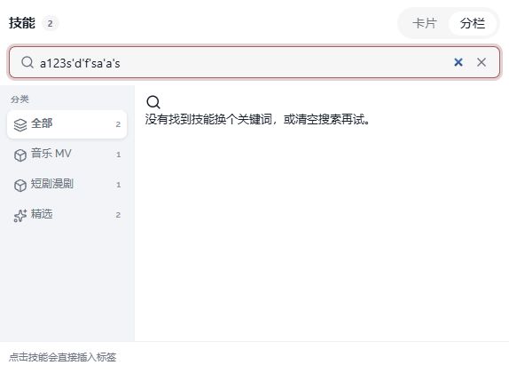

# 08 · 技能搜索空状态居中

- 状态：已完成
- 负责人：deepseek-auto
- 完成时间：2026-11-03 20:11

## 你的原话

> 图2， 你这里搜索空白的时候 加载的UI 请优化 居中显示

## 要解决的问题

技能面板切到「分栏」后，输入搜不到的关键词时，右侧空状态贴在左上角。用户希望它在右侧内容区上下左右居中，图标、标题、说明成一组，不要偏向一侧。

## 范围与位置

- 页面：Agent 输入框 → 技能 → 分栏 → 搜索无结果。
- 参考代码：`packages/plugins/plugin-agent/src/components/agent-conversation/AgentComposer.vue` 中 `.ac-skill-panel` 的 `.ac-empty-state`；`packages/plugins/plugin-agent/src/components/agent-conversation/agent-composer/part4.css` 的 `.ac-split-main`、`.ac-split-scroll`。
- 相关资源：`packages/plugins/plugin-agent/src/components/agent-conversation/AgentMessageList.css` 的 `.ac-empty-state` / `.ac-empty-icon` / `.ac-empty-title` / `.ac-empty-desc`；`images/08-技能搜索空状态-现状.png`。
- 关联问题：07 修滚动容器，09 修 MCP 面板；三处共用空状态样式，改样式前先确认不会把消息流空态改坏。公共浮层箭头与间距见 11。

## 现在 vs 期望

| | 现在 | 期望 |
| --- | --- | --- |
| 空状态位置 | 右侧内容区左上角，图标和文字贴边 | 在右侧内容区水平、垂直居中 |
| 左侧分类栏 | 仍占固定宽度，显示分类和数量 | 保持原样，不因空状态消失 |
| 搜索框 | 保留输入和清除按钮 | 保持原样 |
| 空状态内容 | 放大镜图标 + 标题 + 说明 | 同样内容，间距更整齐，整体成一组 |
| 窄面板 | 可能被挤到一侧 | 仍然居中，文字可换行 |

## 问题原因

- 状态：已确认
- 复现步骤：技能 → 分栏 → 输入 `a123s'd'f'sa'a's` 之类无匹配关键词；右侧空状态贴近内容区左上角。
- 证据（日志 / 截图 / 调用路径）：`.ac-empty-state` 自带 `height: 100%` 和 `justify-content: center`，但它位于 `.ac-split-scroll` 内；该滚动容器只负责溢出滚动，没有显式把可用高度传给子元素，空状态只能按内容高度贴顶。
- 根因：Composer 里的空状态只写了类名，没有自己的居中样式；`.ac-empty-state` 的 flex 居中等规则在 `AgentMessageList.css` 的 scoped 样式里，兄弟组件收不到，浏览器里实际计算为 `display:block`，内容贴在左上角。
- 修复证据：给面板补独立的空状态居中规则，并把结果区内容层、模型卡片外壳接进纵向 flex 高度链。Chrome 实测技能分栏无结果时，空态容器 422×288，图标、标题、说明组的中心与视口中心偏差为 0，三个子项水平中心偏差均为 0。

## 修改方案

- 改哪里：`part4.css` 的 `.ac-split-scroll` 或空状态内层容器，以及 `.ac-empty-state` 的布局；不改搜索与卡片。
- 怎么改：给右侧结果区确定高度并保持 `min-height: 0`，让空状态用 flex 在可见区域内居中；文字区限制最大宽度并允许换行。
- 为什么这样改：居中应随可用空间自适应，不能靠固定高度把面板撑高，也不能隐藏左侧分类栏来制造居中假象。
- 风险 / 影响面：`.ac-empty-state` 也被模型、MCP 和消息流共用；只调整结果区承载布局时，消息流欢迎空态不应受影响。
- 验证方式：在 Chrome 中分别在技能、模型、MCP 搜索无结果词，测量空状态上下留白；在亮色、暗色、320px 宽面板下检查。

## 验收标准

- [x] 技能分栏下输入 `a123s'd'f'sa'a's` 之类无匹配关键词，空状态整体在右侧内容区居中。
- [x] 图标、标题、说明水平居中对齐，组内间距均匀。
- [x] 左侧分类栏、顶部标题、切换按钮、搜索框位置不变。
- [x] 清空搜索后立即恢复技能卡片，不需要关闭再打开面板。
- [x] 模型分栏、MCP 面板出现同类空状态时，使用同一套居中规则。
- [x] 面板高度变化时，空状态仍居中，不溢出、不被底栏遮住。
- [x] 亮色、暗色主题下图标与文字对比度足够。

## 不能动

- 不改搜索过滤条件、分类过滤和技能卡片内容。
- 不改消息流的欢迎空态（`.ac-welcome`）布局。
- 不把左侧分类栏隐藏来让空状态看起来居中。
- 不新增固定像素高度把面板撑高。

## 假设与待确认

- 假设：「居中显示」指在右侧结果区的可见区域居中，不是在整个面板里居中。
- 假设：图标、标题、说明作为一组整体居中，文字本身保持居中对齐。
- 待确认：无；如希望连左侧分类栏一起隐藏，需要另外说明。

## 执行指令

先复现：技能 → 分栏，输入截图中的搜索词，确认 `.ac-empty-state` 的父容器是否真的给了高度。
只改空状态布局：让承载它的 `.ac-split-scroll` 或内层容器有确定高度，空状态用 flex 居中，并保持 `min-height: 0` 不撑破面板。
同一套类名被模型、MCP 和消息流共用，改前确认影响范围；消息流欢迎空态不受影响。
改完用 Chrome 在技能、模型、MCP 三处分别搜一个无结果词，检查亮色、暗色和窄面板。

## 图片

图片说明：搜索框输入无匹配关键词后，右侧放大镜、标题和说明都贴在内容区左上角；左侧分类栏仍正常显示。

## 执行记录

- 改动文件：`packages/plugins/plugin-agent/src/components/agent-conversation/agent-composer/part4.css`、`packages/plugins/plugin-agent/src/components/agent-conversation/AgentScrollArea.vue`、`packages/plugins/plugin-agent/src/__tests__/composerScrollArea.test.ts`
- 验证命令与结果：`pnpm -C packages/plugins/plugin-agent test` 通过（54 个测试文件、437 条测试）；`pnpm -C packages/plugins/plugin-agent typecheck` 通过。Chrome 实测技能分栏搜索无结果时，空态 422×288，组中心偏差 0、子项水平中心偏差 0；暗色和 Agent 面板拖到 360px 宽时仍居中，结果区高度与视口一致。模型、MCP 空态共用同一套 `.ac-panel .ac-empty-state` 规则。
- 完成时间：2026-11-03 20:11
