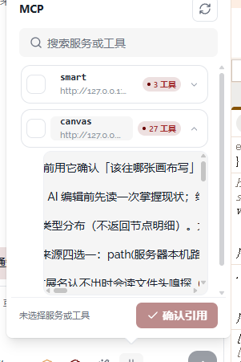

# 09 · MCP面板尺寸与工具列表

- 状态：已完成
- 负责人：deepseek-auto
- 完成时间：2026-11-03 20:11

## 你的原话

> 还有你的 MCP 面板， 可以看到很多问题， 你的面板太小，按钮太大， 展开MCP显示的应该是工具列表

## 要解决的问题

MCP 下拉面板要更像一个可操作的工具选择器：面板加宽，展开某个服务时显示该服务的工具清单。现在展开后显示的是一大段工具说明文字，用户看不到「有哪些工具、分别做什么、能不能单独选」。
按钮尺寸由 10 单独负责，本条只保证加宽后的面板内容不拥挤。

## 范围与位置

- 页面：Agent 输入框 → MCP。
- 参考代码：`packages/plugins/plugin-agent/src/components/agent-conversation/AgentComposer.vue` 中 `.ac-mcp-panel`；`packages/plugins/plugin-agent/src/components/agent-conversation/useAgentConversation.ts` 的 `mcpToolsOf`、`mcpExpanded`、`toggleMcpExpand`、`filteredMcpResources`、`mcpPickedServers`、`mcpPickedTools`。
- 相关资源：`packages/plugins/plugin-agent/src/components/agent-conversation/agent-composer/part3.css` 的 `.ac-mcp-list`、`.ac-mcp-card`、`.ac-mcp-tools`；`part4.css` 的 `.ac-server-*`、`.ac-panel-foot`；`images/09-MCP面板尺寸与工具列表-现状.png`。
- 关联问题：06 修开合，07 修滚动条，08 修空状态，10 修按钮尺寸。公共浮层箭头与间距见 11。

## 现在 vs 期望

| | 现在 | 期望 |
| --- | --- | --- |
| 面板宽度 | 固定 280px，服务地址和工具说明被截断 | 加宽到能放下服务名、状态、工具名和说明，窄屏仍不超出视口 |
| 行内按钮 | 复选块、展开箭头、检测按钮偏大 | 仅由 10 统一收紧；本条只验收加宽后面板内不拥挤 |
| 展开服务 | 显示一大段长说明文字，很难扫读 | 显示工具列表：每行工具名 + 一句说明 + 单独勾选 |
| 工具搜索 | 命中工具时只显示命中项 | 保留；命中项仍按工具行展示 |
| 工具数量 | 右侧显示「3 工具 / 27 工具」 | 保留，并且能从展开列表核对 |
| 底部操作 | 「未选择服务或工具」+ 大号确认按钮 | 保留语义，长文案不挤压；按钮尺寸见 10 |
| 滚动 | 工具区内部再套一层滚动，出现两条滚动条 | 统一一个滚动层，工具列表自然接在服务下面 |

## 问题原因

- 状态：已确认
- 复现步骤：打开 MCP → 展开 `canvas`；面板宽约 280px，展开区显示大段工具说明文字，缺少可逐项勾选的工具列表。
- 证据（日志 / 截图 / 调用路径）：`.ac-mcp-panel` 的下拉宽度固定为 280px；工具行依赖探测结果 `mcpToolsOf(name)`，展开容器 `.ac-mcp-tools` 自带 `max-height: 180px` 与第二层 `overflow-y: auto`，与主列表形成两条滚动。
- 根因：面板宽度按单行服务卡片设计，未给工具名与说明留空间；展开区同时承担说明展示与工具选择，视觉上把多行说明当成了「列表」。另有独立接线缺陷：`AgentComposer` 没解构控制器的 `editorRef`，模板 ref 绑到空引用，确认引用后不会插入标签。
- 修复证据：Chrome 实测 MCP 下拉外框 360px、面板内容 348px；探测返回「全部正常」，两个服务分别 3 / 27 个工具；展开 `canvas` 后列出 27 条工具行（工具名 + 两行说明 + 独立勾选），搜索 `canvas_get` 只保留命中服务与 1 条工具行。勾选 1 个工具后底栏显示「0 个服务 · 1 个工具」，确认引用关闭面板并把 `canvas.canvas_get` 标签插入输入框。

## 修改方案

- 改哪里：`AgentComposer.vue` 的 MCP 下拉宽度与展开区模板；`part3.css` 的 `.ac-mcp-tools`；必要时调整 `filteredMcpResources` 的命中工具展开方式。
- 怎么改：默认宽度提到约 360px（不超过视口），展开区按工具逐行渲染，每行工具名 + 说明 + 独立勾选；没有探测结果时显示明确提示，不伪造列表。滚动只保留一层，优先 `ScrollArea`。
- 为什么这样改：工具选择需要可扫读、可逐项勾选；服务与工具两级都保留，避免把两个动作合并。加宽是为了容纳工具名与说明，不改变数据来源。
- 风险 / 影响面：影响 MCP 下拉和工具探测展示，不改增删配置、传输类型与标签格式。
- 验证方式：修好 06 后在 Chrome 检查两个服务、搜索命中、勾选服务与工具、确认引用；再跑插件测试与类型检查。

## 验收标准

- [x] MCP 面板比现在宽，服务名、地址、右侧状态不再互相挤成省略号；在约 320px 宽的面板里仍完整落在视口内。
- [x] 加宽面板后，服务行的勾选、展开箭头、检测按钮不再互相挤压；按钮自身的尺寸验收交给 10。
- [x] 点服务行或展开箭头，展开区显示工具列表；每行包含工具名、说明和独立勾选状态。
- [x] 未检测到工具时，展开区给明确提示（例如「还没有检测到工具，点重新检测」），不显示空白。
- [x] 搜索服务名或工具名后，命中工具自动展开，只显示命中的工具行。
- [x] 勾选整个服务、勾选单个工具、再取消，底部已选数量实时正确；确认引用后插入的标签与勾选一致。
- [x] 展开长工具列表时，只有列表区域滚动，面板标题、搜索、底部确认栏固定。
- [x] 加宽后按钮文字不溢出，工具说明最多显示两行并有完整 title。

## 不能动

- 不改 MCP 配置的增删、传输类型和探测接口。
- 不改 `mcpToolResource` 生成的引用标签格式（`服务.工具` / `mcp__服务__工具`）。
- 不把「勾选服务」和「勾选工具」合并成一个动作。
- 不删除「重新检测」入口；没有工具数据时不能伪造列表。
- 不改其它下拉的定位参数和同一时刻只开一个菜单的规则。

## 假设与待确认

- 假设：「展开 MCP 显示的应该是工具列表」指展开区按工具逐行列出，而不是显示一段说明文字。
- 假设：「按钮太大」已经拆到独立问题 10，由 10 统一验收勾选框、展开箭头、刷新和确认按钮尺寸。
- 待确认：面板希望固定更宽（例如 360px），还是随内容自适应到某个上限？没有补充时按「默认 360px、最大不超过视口」执行。

## 执行指令

先修好 06，再复现：打开 MCP，展开 `canvas`，确认工具数据来自 `mcpToolsOf(name)`，以及展开区渲染的是工具行还是说明文本。
只改面板宽度和工具展开内容；没有探测结果时如实提示，不编造工具。滚动只保留一层，优先用 `ScrollArea`；底部确认栏固定。
改完在 Chrome 检查两个服务、搜索命中、勾选服务与工具、确认引用，并跑插件测试和 typecheck。

## 图片

图片说明：面板宽约 280px，`smart` 和 `canvas` 行内复选块与箭头偏大；展开 `canvas` 后看到的是大段工具说明文字，不是可勾选的工具列表。

## 执行记录

- 改动文件：`packages/plugins/plugin-agent/src/components/agent-conversation/AgentComposer.vue`、`packages/plugins/plugin-agent/src/components/agent-conversation/agent-composer/part1.css`、`part3.css`、`part4.css`、`packages/plugins/plugin-agent/src/__tests__/composerScrollArea.test.ts`、`composerEditorRef.test.ts`
- 验证命令与结果：`pnpm -C packages/plugins/plugin-agent test` 通过（54 个测试文件、437 条测试）；`pnpm -C packages/plugins/plugin-agent typecheck` 通过。Chrome 实测面板宽 360px、服务工具数 3/27；展开 `canvas` 显示 27 条工具行，搜索 `canvas_get` 自动展开且只留 1 条；勾选数量实时更新，确认引用后 `canvas.canvas_get` 标签插入输入框。工具区只有外层 `ScrollArea` 一层滚动，展开后视口 295px、内容 1360px；360px 宽 Agent 面板下仍落在视口内。检测与引用依赖后台管理令牌，独立 dev 端口需先在「设置 → 插件」填一次；这属于本机调试配置，不是产品逻辑。
- 完成时间：2026-11-03 20:11
