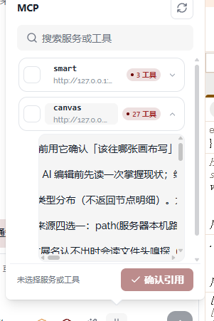

# 10 · Agent面板按钮尺寸过大

- 状态：已完成
- 负责人：deepseek-auto
- 完成时间：2026-11-03 20:11

## 你的原话

> 还有 你的UI 中有些按钮太大了， 比如MCP 里面 我提到了 就没有加入问题中

## 要解决的问题

Agent 面板里有些按钮比旁边的文字和内容大得多，挤占了列表空间，也让面板看起来松。用户希望这些按钮回到紧凑的工具面板尺寸；至少要覆盖 MCP 面板里的勾选框、展开箭头、重新检测和确认按钮，不只修 09 中顺带提到的那一处。

## 范围与位置

- 页面：画布 → Agent 对话 → 输入框底排与 MCP 下拉。
- 参考代码：`packages/plugins/plugin-agent/src/components/agent-conversation/AgentComposer.vue:317`、`:362`、`:390`、`:433`、`:553`、`:684`、`:699`、`:727`、`:744`、`:781`；`packages/plugins/plugin-agent/src/components/agent-conversation/agent-composer/part1.css:684`、`packages/plugins/plugin-agent/src/components/agent-conversation/agent-composer/part4.css:419`、`:533`、`:576`。
- 相关资源：`images/09-MCP面板尺寸与工具列表-现状.png`；`packages/ui-kit-shadcn/src/theme/sizes.ts` 的标准 / 紧凑档定义。
- 关联问题：09 已包含 MCP 面板太窄和展开工具列表；10 只负责按钮尺寸，避免两篇重复验收同一件事。公共浮层箭头与间距见 11。

## 现在 vs 期望

| | 现在 | 期望 |
| --- | --- | --- |
| MCP 服务行复选块 | 固定 20×20，行高被它撑大 | 与紧凑行匹配，视觉约 16～18px，点击区仍可用 |
| MCP 工具行复选块 | 固定 17×17 | 同样收紧，不与服务行忽大忽小 |
| 展开箭头 | 固定 22×22 | 与状态胶囊同高，约 18～20px |
| 「重新检测」按钮 | 走默认 `size=sm`，高 32px，大于标题行 | 高度 24～28px，图标与文字同步缩小 |
| 「确认引用」按钮 | 默认 `size=sm`，高 32px | 高度约 28px，不压过底部文字 |
| 输入框底排图标按钮 | 32×32 | 按 Agent 面板密度收紧到约 28×28 |
| 创作模式胶囊 | 高 32px | 与同排按钮同高，文字仍可读 |

## 问题原因

- 状态：已确认
- 复现步骤：打开 Agent 对话 → 打开 MCP → 观察服务行、展开箭头、重新检测、底栏确认按钮；打开输入框底排，观察六个图标按钮和创作模式胶囊。
- 证据（日志 / 截图 / 调用路径）：`part4.css:419` 把 `.ac-pick-box` 固定为 20×20，`.is-sm` 固定为 17×17；`.ac-expand-btn` 固定为 22×22；模板中「重新检测」和「确认引用」使用 `size="sm"`，按组件库标准档就是 32px 高；输入框底排六个按钮使用 `size="icon-sm"`，标准档为 32×32。
- 根因：MCP 面板内部同时混用固定像素（20 / 17 / 22）和组件库标准档（32），没有一套适配 Agent 下拉的面板紧凑尺寸；因此有的按钮过大，有的行高被单个控件撑开。另有一条样式作用域问题：28px 规则只写了 `html[data-plume-size]` 前缀，用户没选主题尺寸档时整组规则不命中，底排按钮又回到 24px。
- 修复证据：Chrome 实测六个工具条触发器与创作模式胶囊均为 28px 高，发送键 36px；未设置 `data-plume-size` 时同样是 28px。MCP「重新检测」和「确认引用」高 26px；服务行勾选点击区 24px（可见框 16px）、工具行勾选点击区 22px（可见框 14px），展开箭头 18px。

## 修改方案

- 改哪里：`AgentComposer.vue` 的 MCP 行内控件尺寸、输入框底排按钮尺寸；`part1.css` 的 `.ac-tb-icon` / `.ac-pill`，`part4.css` 的 `.ac-pick-box`、`.ac-expand-btn`、`.ac-detect-btn`、`.ac-confirm-btn`。
- 怎么改：把 MCP 面板的行内控件统一到一套紧凑尺度（建议复选 16px、工具行 14px、展开箭头 18px、文字按钮 24～28px），底排图标按钮与创作模式统一到 28px 高；按钮的实际可点区域可用透明 padding 保持不小于 24px，但可见框和图标同步收紧。
- 为什么这样改：这些控件服务于同一个高密度下拉，尺寸应服从面板行高，而不是反过来逐项撑高列表；统一尺度也能避免服务行与工具行一大一小。
- 风险 / 影响面：只改 Agent 输入区与 MCP 面板；不改主题的全局尺寸档和组件库默认档，避免影响其它页面。需检查亮色、暗色、窄面板和键盘可达性。
- 验证方式：在 Chrome 测量 MCP 服务行、工具行、底栏按钮和输入框底排按钮的实际尺寸；检查行高不再被按钮撑开，并跑 `pnpm -C packages/plugins/plugin-agent test` 与 `pnpm -C packages/plugins/plugin-agent typecheck`。

## 验收标准

- [x] MCP 服务行的勾选框、展开箭头与行高协调，不再比服务名和地址明显更大。
- [x] MCP 工具行的勾选框小于服务行，层级清楚，不与服务行同大。
- [x] 「重新检测」按钮高度在 24～28px 之间，图标和文字同排居中，不高于面板标题。
- [x] 「确认引用」按钮高度在 24～28px 之间，文字不换行，不压过底部的已选数量。
- [x] 输入框底排六个图标按钮统一为约 28×28，图标仍清晰，点击区域不小于 24px。
- [x] 「创作模式」胶囊与新按钮同高，文字和下拉箭头不被裁切。
- [x] 勾选框和展开箭头仍有独立 `aria-label` 或 `title`，键盘可以操作。
- [x] 亮色、暗色和约 320px 宽 Agent 面板下，按钮不溢出、不互相挤压。

## 不能动

- 不改全局主题尺寸档 `SIZE_OPTIONS` 和组件库默认尺寸，避免影响其它页面。
- 不改 MCP 的勾选逻辑、展开逻辑、探测接口和确认后插入的标签内容。
- 不把按钮缩到无法点中，或只缩小图标、保留过大的可点区域视觉。
- 不改 09 中已列出的面板宽度、工具列表内容和滚动结构。

## 假设与待确认

- 假设：用户说的「有些按钮太大」不只 MCP 里的四个位置，还包括输入框底排按钮；当前按这一范围验收。
- 假设：Agent 面板希望采用一套面板内紧凑尺寸，而不是修改全局「标准」档。
- 待确认：底排按钮希望是 28px 还是 24px？没有补充时按 28px、MCP 行内勾选 16px 执行。

## 执行指令

只收紧 Agent 输入区及 MCP 面板的按钮可见尺寸，统一一套紧凑尺度；不改全局主题档和组件库默认值。
先量当前实际尺寸，再改 CSS 与 `size` 档，确认行高不再被按钮撑开。改完在 Chrome 核对服务行、工具行、重新检测、确认引用和输入框底排，并跑插件测试与类型检查。

## 图片

图片说明：图中 MCP 服务行的勾选框、右侧展开箭头和底栏「确认引用」按钮相对面板偏大；此图同时用于 09 的面板宽度与展开内容问题，本任务只看按钮尺寸与行高。

## 执行记录

- 改动文件：`packages/plugins/plugin-agent/src/components/agent-conversation/AgentComposer.vue`、`packages/plugins/plugin-agent/src/components/agent-conversation/agent-composer/part1.css`、`part4.css`、`packages/plugins/plugin-agent/src/__tests__/composerScrollArea.test.ts`
- 验证命令与结果：`pnpm -C packages/plugins/plugin-agent test` 通过（54 个测试文件、437 条测试）；`pnpm -C packages/plugins/plugin-agent typecheck` 通过。Chrome 实测六个底排触发器与创作模式胶囊高度 28px、发送键 36px，未选主题尺寸档时仍为 28px；MCP「重新检测」「确认引用」26px；服务行勾选点击区 24px、工具行 22px；按钮带 `aria-label` / `title`，服务与工具勾选可用键盘操作；Agent 面板拖到 360px 宽和暗色主题下不溢出。
- 完成时间：2026-11-03 20:11
