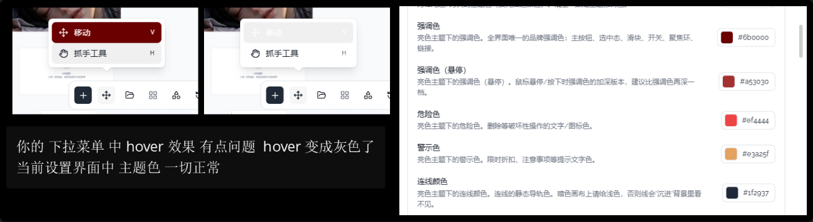

# 11 · 浮层组件统一配置

- 状态：进行中
- 负责人：root
- 完成时间：—

## 你的原话

> 图片3 下拉选择颜色块有问题

> 下拉菜单中 hover 效果有点问题 hover 变成灰色了；当前设置界面中主题色一切正常

> 这里的问题 3 其实与很多地方都相关。当下拉菜单处于主题颜色下时，选中时会有一个高亮显示效果，但其他地方并不是这样：有的选中效果是默认的灰色背景，有的根本没有背景，还有的是在后面打个勾。可以改为统一的 UI，变成打勾的方式。

> 这个地方 hover 的时候是替换图标，右侧一次只会显示一个图标。

> 这两个面板隔得太近了，希望两个面板保持一定的间隔。

> 底部「添加 / 移动 / 素材库」三个按钮的下拉菜单，"触发器"和下拉面板之间的箭头也有一个间隔，需要统一。

> 在这些问题中 可以看到 很多都是你的 dropdown（或者说下拉菜单导致）
> 你这些地方你帮帮我看到他们都是使用的 dropdown还是select 组件？？？
> 我需要统一一下，你可以将这些问题整合到一个里面

> 下拉是否显示箭头， 下拉菜单与trgger之间的间隔 我希望这个可以在我的设置界面中进行配置就和 你的 字体一样
> tootip ，popover ，select， 等组件也需要都使用这个配置，

> 你这些地方你帮帮我看到他们都是使用的 dropdown还是select 组件？？？
> 我需要统一一下，你可以将这些问题整合到一个里面

## 要解决的问题

把全站浮层统一到一套外观配置，不再由每个页面分别写 `side-offset` 和 `arrow`。

用户可以在「设置 → 外观 → 浮层」里调整：

- 下拉、选择、弹出面板、右键菜单、提示气泡是否显示指向箭头；
- 浮层可见边缘与触发器的间距；
- 子菜单与父菜单之间的可见间距，也使用同一组档位；
- 所有菜单选中项是否只用默认勾、不加额外主题色底。

同时明确组件选型：普通动作菜单用 `DropdownMenu`；设置或表单里只选一个值用 `Select`；带复杂内容的面板用 `Popover`；短文字提示用 `Tooltip`；鼠标右键或画布上下文菜单用 `ContextMenu`；可搜索的组合选择用 `Combobox`。

这里的「统一」是统一视觉配置和交互约束。不同组件仍各自负责自己的语义和开合逻辑；画布右键菜单目前由 `plugin-context-menu` 自绘，接入配置时要保留它自己的视口收边和二级菜单翻转逻辑。

## 范围与位置

- 页面：设置 → 外观 → 浮层；所有使用浮层的菜单、设置页、Agent 输入区、画布下拉、底栏与节点工具栏。
- 参考代码：`packages/ui-kit-shadcn/src/components/ui/dropdown-menu/DropdownMenuContent.vue`、`DropdownMenuSubContent.vue`、`DropdownMenuArrow.vue`；`select/SelectContent.vue`；`popover/PopoverContent.vue`；`tooltip/TooltipContent.vue`；`context-menu/ContextMenuContent.vue`、`ContextMenuSubContent.vue`；`combobox/ComboboxList.vue`；`packages/ui-kit-shadcn/src/styles/host.css`；`packages/plugins/plugin-theme-default/src/index.ts` 的 `Config` / `DEFAULT_THEME_APPEARANCE`；`packages/plugins/plugin-theme-default/src/themeBridge.ts` 的 `THEME_BRIDGE_VARS`；`packages/plugins/plugin-theme-default/src/components/settings/defaultMenu.ts`；`packages/canvas-render/src/contracts/uiCatalog.ts` 的 `useUiComponent`
- 相关资源：`images/02-画布菜单间距-现状.png`、`images/03-底栏按钮间距-标注.png`、`images/03-底栏按钮间距-局部.png`、`images/03-下拉hover与主题色-现状.png`、`images/03-画布列表选中-现状.png`、`images/03-模型面板选中-现状.png`、`images/03-设置下拉选中-现状.png`、`images/01-画布列表行尾-现状.png`
- 关联问题：本篇合并原画布下拉与底栏批次里的父子面板可见间距、带箭头浮层间距与测量基准；菜单选中样式见 03，画布列表行尾图标见 12，Agent 下拉开合与内容问题仍在 06、07、08、09、10。

## 现在 vs 期望

| | 现在 | 期望 |
| --- | --- | --- |
| 组件族 | DropdownMenu、Select、Popover、Tooltip、ContextMenu、Combobox 各写各的默认值 | 六类组件共用同一套浮层配置契约，保留各自语义 |
| 箭头 | DropdownMenu 默认不显示、部分调用点写 `arrow`；Select、Popover、ContextMenu 没有统一箭头；Tooltip 永远带箭头 | 设置里可选「显示 / 不显示」；六类组件一起生效 |
| 间距测量 | 多数调用点直接写 `side-offset`，量的是面板边缘到触发器，不是箭头尖端 | 设置的是「可见边缘距离」；Tooltip 要扣掉箭头高度，其它组件统一按可见边缘验收 |
| 触发器与浮层间距 | `side-offset` 有 0 / 4 / 5 / 6 / 8 / 10 / 24，视觉空隙从几乎没有到很大 | 设置里选统一档位，按可见边缘测量 |
| 父子菜单间距 | 画布子菜单当前贴边；其它子菜单各写各的 | 与触发器间距使用同一档，翻转后也一致 |
| 选中项 | 有的只有勾，有的有主题色底，有的只有底色没有勾 | 所有单选菜单统一只用默认勾，不加额外主题色底；悬停与键盘高亮保持独立 |
| 新增浮层 | 组件作者要自己记偏移和箭头规则 | 默认读取全局配置；只有明确需要时才在文档里单独覆盖 |

## 问题原因

- 状态：已确认（组件类型与默认值）；具体设置值仍需用户确认。
- 复现步骤：打开画布下拉、底栏三个按钮菜单、Agent 输入框下拉、模型面板、技能分栏、MCP 面板、设置里的下拉和取色面板；可见箭头有无、与触发器的距离各不相同。
- 证据（日志 / 截图 / 调用路径）：`DropdownMenuContent.vue:32` 默认 `sideOffset: 4`、`arrow: false`；`PopoverContent.vue:20` 默认 4；`TooltipContent.vue:13` 默认 0 且始终渲染箭头；`SelectContent.vue` 与 `ComboboxList.vue` 默认 4；`ContextMenuContent.vue` 没有统一默认偏移。业务调用点在 64 处以上写了自己的 `side-offset`，例如 `DockArea.vue:115`、`:179`、`:201` 写 24，`AgentComposer.vue` 的六个菜单共用 `COMPOSER_MENU_OFFSET = 10`，设置页的 `SelectContent` 统一写 4。
- 根因：箭头和间距是每类组件、每个调用点各自的 props，不在主题配置里；`ui-kit-shadcn` 只统一了圆角、字体和尺寸，没有统一浮层定位。
- 组件清单：用户问到的「到底是 dropdown 还是 select」已核对。Agent 输入框六个下拉（更多添加、创作模式、授权方式、模型、技能、MCP）是 `DropdownMenu`；画布列表、画布操作、缩放菜单是 `DropdownMenu`；设置字段、圆角/字体/模型等单选是 `Select`；取色面板、视频参数说明是 `Popover`；按钮和状态栏提示是 `Tooltip`；画布/节点右键菜单由 `plugin-context-menu` 自绘；可搜索组合是 `Combobox`。动作菜单和富内容面板继续用 `DropdownMenu`/`Popover`，不改成 `Select`。
- 不合并内容：Agent 输入框六个下拉开合闪退在 `06`；模型面板平台与滚动区在 `07`；技能搜索空状态在 `08`；MCP 面板宽度与工具列表在 `09`；Agent 面板按钮尺寸在 `10`。本篇只统一公共的箭头、间距、选中样式和组件选型。

## 修改方案

- 改哪里：`ui-kit-shadcn` 的六类浮层组件与默认值模块；`plugin-theme-default` 的 `Config`、`themeBridge`、`defaultMenu` 和设置分组；现有业务的显式 `side-offset` 与 `arrow` 调用点。
- 怎么改：新增一组 `--mct-popup-*` 变量和配套的纯函数配置解析；六类浮层默认从变量读取箭头和间距，只有显式覆盖时才保留业务值。设置页新增「外观 → 浮层」分组，包含「显示箭头」「触发器间距」「子菜单间距」「选中样式」四个字段。默认档保持当前观感，不改已有用户设置。
- 为什么这样改：沿用现成的 `themeBridge` 和 `Config` 路径，和字体、圆角、控件尺寸走同一条链路；变量落在 `<html>` 上，Teleport 到 body 的浮层也能读到。
- 风险 / 影响面：影响全站菜单和提示气泡；Tooltip 始终带箭头的老行为会变成可选，需要在设置里给出明确默认。现有 24px 底栏偏移不能直接改成 8，否则会压到托盘；本次先统一配置出口，再按可见边缘重新校准调用点。
- 验证方式：设置里切换箭头和间距，确认六类浮层立即变化；用 `getBoundingClientRect()` 量可见边缘；亮色、暗色、窄屏、翻转方向各测一次；跑 `pnpm -C packages/ui-kit-shadcn test`、`pnpm -C packages/plugins/plugin-theme-default test`、`pnpm -C packages/ui test`。

## 验收标准

- [x] 设置 → 外观 → 浮层里能看到「箭头显示」「触发器间距」「子菜单间距」「选中样式」四项，和字体设置一样能即时生效、刷新后保留。
- [x] DropdownMenu、Select、Popover、ContextMenu、Combobox 的箭头都由同一项配置控制；Tooltip 也遵守该配置。
- [x] 关闭箭头时，所有浮层都不再渲染箭头；开启时，箭头指向触发器中心，翻转后在正确一侧。
- [x] 同一档间距下，不同浮层的可见边缘距离一致，允许 1px 取整误差；父子菜单间距使用同一档。
- [x] 默认档与升级前观感一致；没有主动改设置的用户不会看到菜单突然换位置。
- [x] 单选菜单的选中项只用默认勾，不带额外主题色底；悬停、键盘高亮仍正常。
- [ ] 新增菜单只写语义组件和内容，不再手写 `side-offset` / `arrow`；组件库已有默认值覆盖业务调用点。
- [ ] 亮色、暗色、320px 窄面板、屏幕边缘翻转和长列表滚动下都能正常显示。

## 不能动

- 不改各浮层的业务动作、选项、搜索、选中和提交逻辑。
- 不改 `plugin-context-menu` 自绘右键菜单的 DOM 结构与视口收边算法；它可以通过同名变量读取配置，不能强行换成另一套菜单。
- 不改组件语义：动作菜单仍是 DropdownMenu，单值表单仍是 Select，复杂面板仍是 Popover，短提示仍是 Tooltip，右键仍是 ContextMenu，可搜索组合仍是 Combobox。
- 不把组件库替换成原生 `<select>` 或自定义一套新的 Popper。
- 不改 `side`、`align` 的语义和翻转碰撞策略。
- 不改圆角、字体、控件尺寸、主题配色和层级 token。
- 不一次性删除所有业务覆盖；先在组件库提供统一出口，再逐个校准需要特殊补偿的调用点。

## 假设与待确认

- 假设：箭头默认保持「DropdownMenu / Select / Popover / ContextMenu / Combobox 不显示，Tooltip 显示」，避免升级后整站突然多出一排箭头；画布列表行尾的图标替换单独由 12 验收。
- 注：旧稿 `03-收紧底部工具栏按钮间距.md` 里还有一句早先的「按钮间隔」说法，已由本轮用户补充确认：真正要改的是触发器与带箭头面板的间距，不是三个按钮彼此的距离。
- 假设：间距使用可配置档位，推荐「紧凑 4px / 标准 8px / 宽松 12px」；默认仍取标准 8px，作为计划值。
- 假设：子菜单间距与触发器间距共用同一档，避免出现两套数字。
- 待确认：默认是否要显示箭头？是六类组件统一显示，还是只有下拉菜单显示、Tooltip 单独控制？
- 待确认：间距默认取 8px，还是保持现在的 4px？如果选 8px，底栏那三处 `24` 仍需单独校准。
- 待确认：选中样式是否只保留默认勾，还是需要在设置里提供第二种样式？当前建议只做「默认勾」一种，减少选项。

Tooltip 的箭头是绘制层的一部分，不能只靠一个正数偏移得到「可见边缘 8px」。接入配置时要从总距离里扣掉箭头高度，或给 Tooltip 单独的可见边缘算法；这一条也需要在实现测试里钉住。

## 执行指令

先把六类浮层的箭头和间距收敛到 `ui-kit-shadcn` 的统一配置出口，并接到「外观 → 浮层」；默认值保持升级前观感。
再按组件语义清理业务里重复的 `side-offset` / `arrow`，只保留确实需要特殊补偿的调用点。
单选菜单统一只显示默认勾，不加主题色底。
不要改业务动作与选项；改完用 Chrome 逐类检查，并在翻转、窄屏、亮暗主题下量可见边缘。

## 图片

图片说明：这张图同时展示选中项、悬停颜色与菜单间距；本篇关注三者能否统一，不重复验收具体业务菜单的内容。

## 执行记录

- 已完成（基础层与设置页）：本轮改动见下面几行
  - 新增 `packages/ui-kit-shadcn/src/popup/popupConfig.ts`：箭头（auto/show/hide）、可见间距（4/8/12）、子菜单间距与选中样式的统一配置；`--mct-popup-*` 变量与 `themeBridge` 同步。
  - DropdownMenu / Select / Popover / Tooltip / ContextMenu / Combobox 全部改读统一配置；未传 `arrow` 时缺省 `undefined`（新增 `popupArrowDefaultContract.test.ts`），避免 Vue 把缺省布尔当成显式关闭。
  - Select 改用直接 SVG 箭头（`data-slot="select-arrow"`，10×5），浮层 `overflow-visible` + 内层滚动层，`popupDirectArrowSideOffset()` 把箭头高度加回边缘，保证尖端仍是配置间距（Chrome 实测 8px）。
  - ContextMenu / ContextMenuSub 内层滚动层补可用高度；DropdownSub、Combobox 内层已有。
  - `theme-default` 新增 `themePopupArrow` / `themePopupGap` / `themePopupSubGap` / `themePopupSelectedStyle` 四个设置字段；`themeBridge` 同步响应式配置与 CSS 变量；设置页出现「外观 → 浮层」并即时生效、刷新保留。
  - 选中项只用勾：`host.css` 清掉单选/复选菜单的主题色底，悬停与键盘高亮仍是浅灰底（契约测试同步）。
- 验证命令与结果：见下五行（真实跑过）
  - `pnpm -C packages/ui-kit-shadcn test` → 6 文件 / 27 用例全过；`pnpm -C packages/ui-kit-shadcn typecheck` → 通过。
  - `pnpm -C packages/plugins/plugin-theme-default test` → 42 文件 / 368 用例全过；typecheck 通过。
  - `pnpm -C packages/plugins/plugin-shortcut-manager test` → 6 文件 / 40 用例全过。
  - `pnpm -C packages/ui test` → 86 文件 / 592 用例全过；typecheck 通过。
  - Chrome 实测（5292）：
    - 「全部显示」开启后 Select 箭头 10×5、外框不裁切、尖端到触发器约 8px；面板边缘 12.9px（含箭头高度 5px）。
    - Popover 箭头 10×5，面板边缘 7.6px；DropdownMenu（添加节点）箭头 16×8；Tooltip、子菜单间距与选中态为浅灰底、无主题色底。
    - 亮暗主题切换正常；浮层设置刷新后保留。
- 待办（留给主对话）：见下三行
  - 业务调用点的显式 `side-offset` / `arrow` 清理：`plugin-agent`、`plugin-bottom-bar`、`plugin-node-*`、`ProjectCluster.vue`、`DockArea.vue`、`StatusArea.vue`、`TopRightArea.vue` 等未改。
  - `plugin-context-menu` 自绘右键菜单读取同一组变量的接入。
  - 长列表、屏幕边缘翻转与 320px 窄面板的全量目验。
- 改动文件：`packages/ui-kit-shadcn/src/popup/popupConfig.ts`、`packages/ui-kit-shadcn/src/components/ui/{select,popover,tooltip,dropdown-menu,context-menu,combobox}`、`packages/ui-kit-shadcn/src/styles/host.css`、`packages/plugins/plugin-theme-default/src/themeBridge.ts`、`packages/plugins/plugin-theme-default/src/index.ts`、`packages/plugins/plugin-theme-default/src/components/settings/defaultMenu.ts`
- 完成时间：—（保持进行中）
