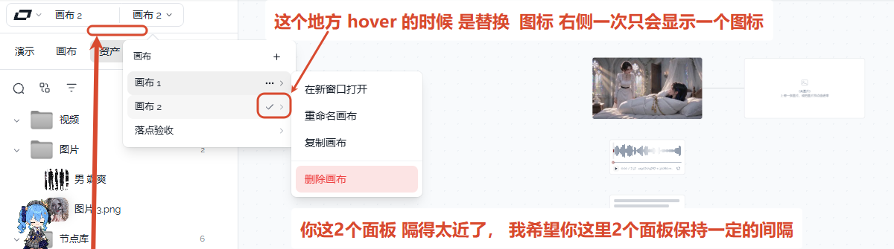

# 12 · 画布列表行尾图标与选中态

- 状态：已完成
- 负责人：画布与外壳对话
- 完成时间：2026-11-03

## 你的原话

> 这个地方 hover 的时候 是替换 图标 右侧一次只会显示一个图标

> 补充（2026-11-03）：默认情况下，它会在右侧显示一个折叠的图标（即向右的箭头）。我希望你可以改成：
> 1. hover 的时候显示 3 个点；
> 2. 选中的时候只需要这个背景就行，不需要提供一个勾了。

> 补充（2026-11-03）：我选中的时候只需要这个背景就行，不需要提供一个勾了。

## 要解决的问题

画布下拉的每一行，右边只放一个状态位，不再同时出现勾、三个点和右箭头。

- 默认显示一个向右的箭头，提示这一行还有次级操作。
- 鼠标移到这一行，或键盘聚焦到行尾时，箭头换成三个点。
- 当前画布只用整行背景表示选中，不再显示勾。
- 点击箭头或三个点都能打开该画布的操作菜单。

## 范围与位置

- 页面：左上角「画布 2」下拉菜单；打开左侧抽屉时，抽屉头部也有同一个画布下拉。
- 参考代码：`packages/ui/src/components/ProjectCluster.vue:160` 的 `.canvas-row`、`.canvas-row-more`、`.canvas-row-chevron`、`.canvas-row-dots`；`packages/ui/src/components/ProjectCluster.vue:190` 的 `DropdownMenuSubTrigger`。
- 相关资源：`images/01-画布列表行尾-现状.png`
- 关联问题：公共的箭头和间距规范在 11；选中只用背景的规则与 03 共用；本条只验收画布列表行尾的图标与选中态。

## 现在 vs 期望

| | 现在 | 期望 |
| --- | --- | --- |
| 当前画布，未悬停 | 整行灰底 + 勾 + 右箭头 | 整行浅色背景，不出现勾，只保留右箭头 |
| 当前画布，鼠标悬停 | 勾换成三个点，右箭头还在 | 三个点，行尾只占一个图标位 |
| 其它画布，未悬停 | 右箭头，勾不显示 | 右箭头 |
| 其它画布，鼠标悬停 | 三个点 + 右箭头 | 三个点 |
| 行尾可点区域 | 44px，给两个图标留了位置 | 32px 单图标宽度，行内容不跳 |
| 点击行尾图标 | 打开操作菜单 | 保持不变 |

## 问题原因

- 状态：已确认
- 复现步骤：打开左上角画布下拉，当前画布行显示灰底、勾和右箭头；鼠标移到这一行，勾换成三个点，右箭头仍在。
- 证据：`ProjectCluster.vue` 在 `DropdownMenuSubTrigger` 里同时渲染 `Check` 与 `MoreHorizontal`；同组件的 `.canvas-row-more :deep(svg.ml-auto)` 还专门给子菜单自动生成的箭头留了第二格；`.canvas-row-more` 因此写成 44px 宽。
- 根因：行尾承载了两个不同含义的图标（状态 + 可展开），却没约定同一时刻只显示一个；勾与自动箭头叠在一起，看起来像两个操作。

## 修改方案

- 改哪里：`packages/ui/src/components/ProjectCluster.vue` 的行尾触发器、图标显隐样式和测试 `packages/ui/src/__tests__/canvasChipMenu.test.ts`。
- 怎么改：在 `ProjectCluster.vue` 里覆盖 `DropdownMenuSubTrigger` 的默认尾部箭头，由行尾自己决定「右箭头 + 悬停三个点」的替换，不再让框架自动叠加第二个图标；移除 `Check` 及对应的选中勾样式，选中态只保留 `.canvas-row.is-active` 的整行背景；行尾宽度收回到 32px。
- 为什么这样改：用户明确要求右侧一次只显示一个图标，并且选中时只需要背景；把右箭头和悬停图标放在同一格里替换，才能同时满足这两点。
- 风险 / 影响面：画布列表在左上角和左抽屉头部共用，两处要一起生效；子菜单仍复用同一个触发器，点击行为不变。
- 验证方式：在 Chrome 中打开画布下拉，检查未悬停、悬停当前行、悬停其它行三种状态各只出现一个图标；切换画布后旧的背景消失、新的背景出现。

## 验收标准

- [x] 当前画布行未悬停时，只显示整行浅色背景和右箭头，行尾不出现勾。
- [x] 当前画布行悬停时，行尾只显示三个点；箭头和勾都不可见。
- [x] 其它画布行未悬停时，行尾只显示右箭头。
- [x] 其它画布行悬停时，箭头换成三个点，行尾仍只有一个图标。
- [x] 行尾宽度保持 32px，鼠标移入移出时行文字和按钮不左右跳。
- [x] 点击右箭头或三个点都能打开该画布的操作菜单，四项内容完整。
- [x] 点击画布名字仍能切换画布；切换后选中背景跟着移动，菜单自动收起。
- [x] 键盘把焦点移到行尾时，也能看到三个点，并且可以按回车打开菜单。
- [x] 亮色、暗色主题下，选中背景与悬停背景都能分辨；左上角和左抽屉头部各看一遍。

## 不能动

- 不改四项操作菜单的文字、顺序和真实动作。
- 不改点击画布名字切换画布的行为。
- 不改行的 32px 高度、13px 文字和整行可点的范围。
- 不改菜单的打开、关闭、翻转和点外部关闭逻辑。
- 不改其它菜单的图标和选中规则。

## 假设与待确认

- 已确认：默认折叠图标就是行尾的右箭头；它只表示可展开，点击后打开操作菜单。
- 已确认：选中背景沿用现有 `.canvas-row.is-active` 的浅色，不新增更重的强调色。
- 已确认：行尾宽度从 44px 收回到 32px，图标仍为 14px。
- 待确认：无。三条都已由本轮补充确认。

## 执行指令

只改画布列表行尾的图标和选中态：默认显示右箭头，悬停换成三个点，选中只用整行背景、不再显示勾；行尾固定 32px，点击仍打开原来的操作菜单。

同步更新 `canvasChipMenu.test.ts` 里旧的「勾 ↔ 三个点」规则，改为「箭头 ↔ 三个点」并断言不再渲染勾。改完在 Chrome 里看左上角和左抽屉头部，亮色、暗色各验证一次。

## 图片

图片说明：红框圈住的「画布 2」是当前画布，行尾同时有勾和右箭头；上方红字是用户第一轮对这条问题的说明。

## 执行记录

- 改动文件：`packages/ui/src/components/ProjectCluster.vue`、`packages/ui/src/__tests__/canvasChipMenu.test.ts`
- 验证命令与结果：`pnpm -C packages/ui exec vitest run src/__tests__/canvasChipMenu.test.ts` 通过（24 项）；`pnpm -C packages/ui typecheck` 通过；Chrome 实测亮/暗主题左上角和左抽屉头部，行尾均为 32px、默认右箭头、悬停三个点、无勾，当前画布只用整行背景，操作菜单四项完整；键盘方向键移到行尾时箭头换成三个点，回车可打开菜单。复跑全量 `pnpm -C packages/ui test` 时，设置页 `settingsShortcutPage.test.ts` 与其 `navPage` 提示词校验不一致而失败（1 项）；该文件及其设置模型由其它对话修改，不在本任务改动范围内，本任务相关测试通过。
- 完成时间：2026-11-03
