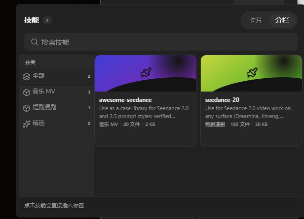
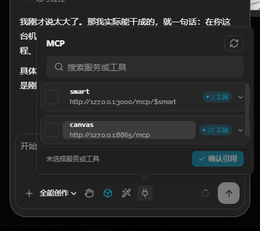

# 13 · Agent下拉面板密度与内边距

- 状态：待确认
- 负责人：未领取
- 完成时间：—

## 你的原话

> 优化你的这些UI，他们的padding存在问题。可以看到这里你的这个全能创作按钮，还有你的下拉菜单（技能、MCP）里面面板的这些UI，padding全部消失了？？还有你的这个UI，我认为不太好，UI太大了。下拉里面的按钮、搜索框都太大了，紧凑一些的好。

## 要解决的问题

Agent 输入区下方的六个触发按钮与下拉面板内部，间距和控件密度要回到一致的紧凑规格：按钮边框和图标之间要有正常呼吸感，面板里的搜索框、按钮、列表行不再显得又高又大。

## 范围与位置

- 页面：Agent 对话面板底部输入区及其六个下拉（全能创作、审核模式、模型、技能、MCP 等）
- 参考代码：`packages/plugins/plugin-agent/src/components/agent-conversation/AgentComposer.vue:317`、`packages/plugins/plugin-agent/src/components/agent-conversation/agent-composer/part1.css:666`、`packages/plugins/plugin-agent/src/components/agent-conversation/agent-composer/part2.css:207`、`packages/plugins/plugin-agent/src/components/agent-conversation/agent-composer/part4.css:152`
- 相关资源：`images/13-下拉面板密度-padding-现状.png`、`images/13-MCP面板密度-padding-现状.png`
- 关联问题：03（选中态规则）、10（按钮尺寸）、11（浮层统一配置）

## 现在 vs 期望

| | 现在 | 期望 |
| --- | --- | --- |
| 底排按钮 | 28 × 28，内嵌 SVG 16–17px，图标几乎贴边，视觉上像没有内边距 | 仍保持 28px 紧凑高度，SVG 收到 14px 左右，按钮内留出 6–7px 的视觉内边距 |
| 面板外框 | 下拉容器自身 padding 6px，宽 586px、高 432px | 外层留白保持 6px，内层按 4/6/8/10/12px 间距阶梯重新排，不再出现“贴边”观感 |
| 搜索框 | 36px 高、14px 字号，占满头部一行 | 与控件库 InputGroup 默认紧凑档一致，视觉高度回到 30px 左右、字号 13px |
| 列表行 / 瓦片 | 模型行 54px、技能分栏瓦片 188px 最小高度 | 行高和瓦片按内容密度下调，左右留白统一，不再有大面积空白 |
| 视觉评价 | 面板整体偏大 | 整体紧凑但不拥挤，符合 ui-style-guide 的间距阶梯 |

## 问题原因

- 状态：已确认
- 复现步骤：打开 `http://127.0.0.1:8865/#/canvas/824e779f34314f86`，展开 Agent 面板，依次点开技能、模型、MCP 下拉。
- 证据：Chrome 实测菜单容器 586 × 432、容器 padding 6px；头部 padding 8px 10px；搜索框高 36px、字号 14px；模型行高 54px、字号 14px；技能分栏瓦片最小高度 188px。底部六个触发按钮为 28 × 28，但内部 SVG 是 16–17px，图标到按钮边缘只剩约 5–6px，看起来像没有 padding。
- 根因：上一轮为修“按钮过大”，把底排按钮压到 28px，却没有同步缩小内部图标；面板容器保留了较大的宽度、高度与行高档位，内部元素间距没有按同一个紧凑档重新核算，导致“有 padding 但看起来贴边”“面板内容偏大”两种观感混在一起。

## 修改方案

- 改哪里：`AgentComposer.vue` 底排按钮的图标尺寸；`agent-composer/part1.css` 的 `.ac-toolbar-btn` 图标规则；`part2.css` 的 `.ac-panel-head`、`.ac-search-inline` 相关密度；`part3.css` 的模型行与技能瓦片；`part4.css` 的分栏滚动区与搜索框附加规则。
- 怎么改：底排按钮保持 28px 高度不变，SVG 统一降到 14px；搜索框回到控件库紧凑档，字号 13px；模型行、技能瓦片、MCP 工具行的内边距与高度按 12px 基准收紧；面板内部左右留白统一。
  1. 底排六个按钮保持 28px 高度不变，内部 SVG 统一降到 14px（技能/模型/MCP/授权图标原本 16px、加号 17px），让图标四周自然留出约 7px。
  2. 面板内搜索框与按钮用控件库默认紧凑档：搜索框高度不再写 36px，回到 InputGroup 默认（约 30px），字号 13px；清除按钮沿用 24px 点击区。
  3. 模型行、技能瓦片、MCP 工具行的内边距与字号统一到 12px 基准：模型行高从 54px 收到约 46px，技能分栏瓦片最小高度从 188px 收到约 150px，MCP 工具行保持 30px 左右；左右内边距统一 8px，头部与底部留白保持 8/10px。
  4. 不改全局控件库尺寸，只在 Agent 面板的 scoped 样式里按上述档位覆盖。
- 为什么这样改：尺寸压小的是“图标和内容”，不是按钮本体，避免再次出现边框贴字；间距统一后，面板看起来是同一套紧凑系统，而不是各处各一套。
- 风险 / 影响面：只影响 Agent 输入区六个下拉与底排按钮；不改消息流、设置页、画布其它浮层。
- 验证方式：Chrome 打开同一页面，分别量底排按钮、搜索框、模型行、技能瓦片、MCP 工具行的高度和左右留白；亮色、暗色各看一次；窄面板 360px 下确认底排不换行。

## 验收标准

- [ ] 底排六个按钮保持 28 × 28，内部 SVG 高度 ≤ 14px，图标与按钮边缘有明显留白
- [ ] 技能 / 模型 / MCP 面板搜索框视觉高度 ≤ 32px，字号 13px
- [ ] 模型行高度 ≤ 48px，技能分栏瓦片最小高度 ≤ 160px，MCP 工具行保持约 30px
- [ ] 面板内部左右留白统一，没有明显贴边或大块空白
- [ ] 亮色、暗色和 360px 宽面板下目验通过

## 不能动

- 不改底排按钮的 28px 高度与点击行为
- 不改下拉菜单的开合逻辑与“只保留一个菜单”的行为
- 不改全局 ui-kit 控件尺寸与主题变量
- 不动 `packages/plugins/plugin-theme-default/src/components/` 下的核心节点组件

## 假设与待确认

- 假设：用户说的“padding 全部消失”指的是图标贴边和面板内容贴边的观感，不是真的没有内边距。
- 假设：“紧凑一些”指整体控件高度和字号各降一档，不是无限压缩。
- 待确认：技能分栏瓦片是否可以接受 150px 左右的最小高度；若希望更小或更大，请补一句。

## 执行指令

只按“修改方案”里的四条改 Agent 输入区相关样式与图标尺寸；保持按钮高度、开合逻辑、选中态颜色不变；改完在 Chrome 里按验收标准逐条核对，并运行 `pnpm -C packages/plugins/plugin-agent test` 与 `pnpm -C packages/plugins/plugin-agent typecheck`。

## 图片

图片说明：技能分栏瓦片、分类栏与搜索框的当前密度，重点看瓦片高度与左右留白。

图片说明：MCP 面板的服务卡、搜索框与底部按钮的当前密度。

## 执行记录

- 改动文件：无（尚未执行）
- 验证命令与结果：尚未执行；确认方案后按验收标准运行
- 完成时间：—

