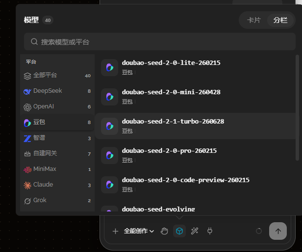

# 14 · 模型选中态与标题模型展示

- 状态：待确认
- 负责人：未领取
- 完成时间：—

## 你的原话

> 其次就是你的模型下拉选中之后不要显示主题色，这里的底部状态栏就你的模型那里有一个主题色在那里看着很别扭。
>
> 你可以在顶部标题位置下面添加当前使用的模型。

## 要解决的问题

模型下拉里选中的那一行不再用主题色提示；底部输入区的模型触发按钮也不再带主题色描边和底色；同时把“当前使用的模型”直接显示在面板顶部标题下方，让用户不用点开下拉就知道现在用的是哪个模型。

## 范围与位置

- 页面：Agent 面板顶部标题区、底部输入区模型触发按钮、模型下拉列表
- 参考代码：`packages/ui/src/components/areas/AgentPanel.vue:223`（标题外壳）、`packages/plugins/plugin-agent/src/components/agent-conversation/AgentComposer.vue:436`（模型触发按钮）、`packages/plugins/plugin-agent/src/components/agent-conversation/agent-composer/part1.css:784`（`.ac-tb-icon.is-on` 主题色）、`packages/plugins/plugin-agent/src/components/agent-conversation/agent-composer/part3.css:345`（`.ac-model-row[aria-selected='true']` 浅底）
- 相关资源：`images/14-模型选中态与面板密度-现状.png`
- 关联问题：03（菜单选中只用默认勾）、11（浮层统一配置）

## 现在 vs 期望

| | 现在 | 期望 |
| --- | --- | --- |
| 底排模型按钮 | `is-on` 时图标染主题色 `#0891b2`，另有浅色底和主题色描边 | 保持普通图标色，不因“已选模型”而染色 |
| 模型下拉选中行 | 整行 `rgba(255,255,255,0.05)` 浅底 + 深色描边 | 选中只用行尾默认勾（`.ac-check-mark`），不加整行底色或主题色 |
| 标题区 | 只有会话标题一行 | 标题下方显示当前模型名（无模型时显示“未选择模型”） |
| 信息来源 | 需要点开模型下拉才知道当前模型 | 标题区直接读当前模型，打开下拉时选中项仍自动滚入视区 |

## 问题原因

- 状态：已确认
- 复现步骤：打开 Agent 面板，选择任意模型后看底部模型图标；再打开模型下拉看选中行。
- 证据：Chrome 实测模型触发按钮带 `is-on`，底色约 2.5% 透明、描边为主题色 70%；模型下拉选中行背景为 5% 浅底。标题区只有会话标题。
- 根因：`part1.css` 里 `.ac-tb-icon.is-on` 用主题色标记“已选模型”，`part3.css` 里模型行选中态用了整行浅底；这与 03 号问题的“选中只用默认勾”不一致。标题区目前没有读当前模型的数据出口。

## 修改方案

- 改哪里：`AgentComposer.vue` 底排模型按钮的 `:class`、`part1.css` 的 `.ac-tb-icon.is-on` 规则、`part3.css` 的模型行选中态；`packages/ui/src/components/areas/AgentPanel.vue` 标题区增加当前模型展示；`packages/ui/src/composables/ui/useAgentShell.ts` 增加当前模型只读视图；`packages/plugins/plugin-agent/src/agent-service/types.ts` 的外壳视图类型同步字段。
- 怎么改：去掉底排模型按钮的染色类；模型下拉选中行去掉整行浅底，只保留行尾默认勾；Agent 面板标题下加当前模型小字；外壳视图类型同步只读模型字段。
  1. 底排模型按钮去掉 `is-on` 类（或让 `.ac-tb-icon.is-on` 不再染色），恢复普通图标色，与技能、MCP 按钮一致。
  2. 模型下拉选中行去掉整行浅底与描边，只保留行尾勾；卡片视图同样只用勾，不加底色。
  3. 外壳标题下方加一行小字，读当前模型：优先 `displayName`，没有就 `modelId`；服务还没给模型时显示“未选择模型”。数据从 agent 服务 state 的 `model` 与 `models` 组合出只读 getter，不改服务行为。
  4. 样式沿用面板现有小字规格（约 11–12px、次要色），不新增主题色。
- 为什么这样改：选中态回归“默认勾”这一套统一规则；当前模型常驻显示后，用户不必点开下拉确认。
- 风险 / 影响面：只影响 Agent 面板标题与模型选中观感；不改模型切换逻辑、会话切换逻辑与消息流模型分割线。
- 验证方式：Chrome 里切换模型、切会话、新建对话，核对标题小字跟着变；打开模型下拉确认选中行只有勾；亮暗主题各看一次。

## 验收标准

- [ ] 底排模型按钮不再有主题色底、描边或染色，与其它图标按钮一致
- [ ] 模型下拉选中行没有整行底色，只显示行尾默认勾
- [ ] 面板标题下方显示当前模型名，切模型、切会话、新建对话后文案正确更新
- [ ] 没有可用模型时显示“未选择模型”，不报错
- [ ] 亮色、暗色主题下目验通过

## 不能动

- 不改模型切换、会话切换、模型分割线的行为
- 不改设置页模型配置
- 不改 `is-warn`（授权方式自动档）的琥珀色提示
- 不动 `packages/plugins/plugin-theme-default/src/components/` 下的核心节点组件

## 假设与待确认

- 假设：标题下的小字显示模型名即可，不需要平台图标。
- 假设：卡片视图与分栏视图都按“只用默认勾”处理。
- 待确认：无

## 执行指令

按“修改方案”的 4 条执行：去掉模型按钮与模型行选中态的主题色；在 Agent 面板标题下加当前模型小字；保持其它交互与颜色不变；改完在 Chrome 里按验收标准核对，并运行 `pnpm -C packages/plugins/plugin-agent test`、`pnpm -C packages/plugins/plugin-agent typecheck` 与 `pnpm -C packages/ui typecheck`。

## 图片

图片说明：模型下拉选中行当前带整行浅底；标题区还没有当前模型信息。重点看选中行底色与标题区布局。

## 执行记录

- 改动文件：无（尚未执行）
- 验证命令与结果：尚未执行；确认方案后按验收标准运行
- 完成时间：—

