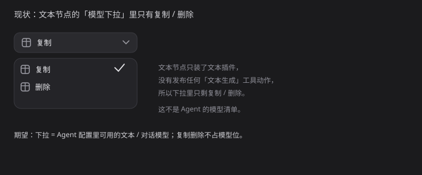

# 20 · 底栏模型下拉改用Agent模型

- 状态：待确认（已实现，等验收）
- 负责人：未领取
- 完成时间：—

## 你的原话

> 请检查一下你图片中底部状态栏里的“复制”和“删除”选项，你是在哪里添加的
>
> 这个地方的话，你应该提供文本模型，而不是当前的这个效果 这个地方就相当于是发送 AI Agent 的请求，你可以把我的 Agent 配置里提供的这些模型，作为下拉菜单进行显示

> 补充（2026-11-07）：这边先不做任何开发，先总结需求，前提是先查网络和本地代码。

> 补充（2026-11-07，第二轮）：Agent 插件 UI 里已经有一个配置好的模型下拉菜单，
> 能不能把它作为组件注册到上下文场域中，底栏直接使用，这样两边共用；
> 模型图标可以放在 Agent 里。其次，把「复制」和「删除」直接删掉，不需要了。

## 要解决的问题

文本节点的底栏，第一个下拉现在列的是「复制 / 删除」这类节点操作。用户要的是：这里显示 Agent 配置里可用的文本模型，选中哪个模型，发出去就按哪个模型请求。

这次明确了做法：不另写一个底栏专用的模型下拉，把 Agent 输入区那个模型面板抽成组件、注册进 `ui` 场，底栏按名取同一件；图标数据也留在 Agent 插件里。

「复制」「删除」两条动作直接删除，不再保留在任何入口。

## 范围与位置

- 页面：画布 → 选中文本节点 → 底部状态栏左侧第一个下拉。
- 参考代码：`packages/plugins/plugin-node-text/src/nodeTextPlugin.ts:134`（`text:duplicate`）、`:142`（`text:delete`）；`packages/plugins/plugin-bottom-bar/src/node-bottom-bar/useBottomBarActions.ts:60`（`actionOptions` 直接把动作清单当选项）；`packages/plugins/plugin-bottom-bar/src/node-bottom-bar/BottomBarActions.vue:115`（下拉渲染）；`packages/plugins/plugin-agent/src/ui/conversation/AgentComposer.vue:420`（Agent 模型下拉的 DropdownMenu 与触发器）、`:496`–`:560`（卡片 / 分栏两种面板）；`packages/plugins/plugin-agent/src/ui/conversation/useAgentMenus.ts:13`（菜单状态与平台分组）；`packages/plugins/plugin-agent/src/service/types.ts:73`（`models: ModelRow[]`）；`packages/plugins/plugin-agent/src/plugin/agentPlugin.ts:41`（`ctx.inject('agent', …)`）；`packages/vue-render/src/contracts/uiCatalog.ts:94`（`useUiComponent` 按名取件）。
- 相关资源：`images/20-模型下拉-现状.svg`
- 关联问题：21（预设按钮）、22（平台图标）

## 现在 vs 期望

| | 现在 | 期望 |
| --- | --- | --- |
| 下拉内容 | 复制、删除 | Agent 里已配置、可用的文本模型（可按平台分组） |
| 下拉实现 | 底栏自己列 `nodeBar` 动作 | 复用 Agent 的面板组件，两边共用同一件 |
| 语义 | 节点操作 | 发一句话时真实使用的模型 |
| 发请求 | 走底栏动作 `run`，不带模型参数 | 走 Agent 单轮接口，带上选中的 provider / modelId |
| 复制删除 | 占着下拉格 | 删除，不再注册 |
| 图标 | 文字样式通用图标 | 平台图标（与 22 同一套） |

## 问题原因

- 状态：已确认
- 复现步骤：打开画布，选中文本节点；点底栏左侧「复制」下拉，只出现「复制」「删除」两项。
- 证据：浏览器实测，文本节点下拉仅「复制 / 删除」两项，而图片节点下拉是「豆包 Seedream 4.5 / Dola Seedream 5.0 Pro / ChatGPT 官方 / GPT Image 2（API）」等生成动作；代码里 `useBottomBarActions` 的 `actionOptions` 直接来自 `nodeBar.list()`，文本插件只注册了复制、删除两条 `apply:'self'` 动作；Agent 侧虽然有完整的模型面板（搜索、卡片 / 分栏、平台左栏），但没有登记进 `ui` 场，底栏取不到。
- 根因：底栏把「底栏动作」当成「模型」展示；Agent 的模型面板与底栏之间没有共享组件，也没有共享选择入口。

## 修改方案

- 改哪里：`packages/plugins/plugin-agent/src/ui/conversation/`（抽出 `ModelPicker.vue` 与 `useModelPanel.ts`）；`packages/plugins/plugin-agent/src/plugin/agentPlugin.ts`（登记 `ui` 件）；`packages/plugins/plugin-bottom-bar/src/node-bottom-bar/BottomBarActions.vue` 与 `useBottomBarActions.ts`（按名取件、替换下拉）；`packages/plugins/plugin-node-text/src/nodeTextPlugin.ts`（删除复制 / 删除）。
- 怎么改：把 Agent 输入区里「模型触发器 + 面板」抽成 `ModelPicker.vue`，props 至少包含 `models`、`current`、`open`，事件 `pick(provider, modelId)`、`update:open`；面板里的搜索、卡片 / 分栏切换、平台左栏、滚动定位、空态全部搬过去，`useAgentMenus` 的模型部分拆成可复用的 `useModelPanel`；`AgentComposer.vue` 改为消费 `ModelPicker`，行为与现在一致；Agent 在 `apply` 里 `ctx.registryOf('ui').add('agentModelPicker', ModelPicker, { id: 'agent' })`；底栏 `useUiComponent('agentModelPicker')` 取件，取不到（Agent 没装）时退回现有动作下拉并提示。
- 为什么这样改：模型清单、平台分组、图标、选中态只有 Agent 一份，底栏不再维护第二套；图标也留在 Agent，符合用户这一轮的口径。
- 风险 / 影响面：`ModelPicker` 现在依赖 `agent.setModel()`（切模型会换会话）；底栏发单轮请求时只取选择结果，不能触发换会话，需要把「取选择」与「会话切换」拆开；面板宽度按 Agent 输入区设计，底栏空间窄，需要新增紧凑模式；模型很多（当前 181 条、52 条有密钥），搜索与限高必须保留；删除复制 / 删除后，旧画布里存过这两个 actionId 的节点要做回退，`packages/docs/public/surface-snapshot.json` 这类生成快照要重新生成。
- 验证方式：Agent 输入区与底栏各打开一次，确认是同一件、同一套图标与分组；底栏选中模型发送，文本节点写入回复；Agent 会话不受影响；图片 / 视频 / 音频下拉不变。

## 验收标准

- [ ] Agent 输入区与底栏使用同一个模型选择组件（注册在 `ui` 场，只有一份实现）
- [ ] 文本节点底栏下拉列出 Agent 配置中的文本模型，可按平台分组、可搜索
- [ ] 选择模型后发送，请求体带正确的 provider / modelId，回复写回当前文本节点
- [ ] 复制、删除两条动作与命令都已删除，界面和右键菜单里都不再出现
- [ ] 旧数据里存过 `text:duplicate` / `text:delete` 的节点能回退到默认动作，不报错
- [ ] 图片、视频、音频节点的下拉与现在一致

## 不能动

- 不改 Agent 插件里的模型配置数据与设置页
- 不改图片 / 视频 / 音频生成动作的注册与参数
- 不改底栏的输入框、参考、标记等其它区域

## 假设与待确认

- 假设：下拉只列「有密钥」的模型，与 Agent 输入区 `usableModels` 一致。
- 假设：文本节点发请求走 `/api/agent/chat/completion`，不新建会话、不进历史。
- 已确认：下拉按平台分组，显示「默认」标记与上下文长度。
- 已确认：复制 / 删除直接删除，不做替代入口。
- 待确认：注册名用 `agentModelPicker`，还是登记成通用的 `modelPicker` 由主题接管？
- 待确认：底栏紧凑模式下隐藏分栏、只留卡片视图，是否可接受？
- 待确认：模型选择是否要持久化到节点，刷新后保持？
- 待确认：文本节点没有输入内容时，发送按钮是否禁用？

## 执行指令

把 Agent 输入区的模型面板抽成 `ModelPicker` 并注册进 `ui` 场；Agent 与底栏都按名取同一件。文本节点底栏用它替代动作下拉，选中后按该模型调用 Agent 单轮接口，把回复写回节点。删除 `text:duplicate` / `text:delete` 两条动作与命令。图片 / 视频 / 音频下拉保持原样。改完用 Chrome 在真实画布里逐项验证。

## 图片

图片说明：这是按本地代码与浏览器实测复画的现状图；左边是下拉，右边说明为什么只剩这两项。

## 执行记录

- 改动文件：
  - packages/plugins/plugin-agent/src/ui/conversation/ModelPicker.vue（新增，从 Agent 输入区抽出的模型面板）
  - packages/plugins/plugin-agent/src/ui/conversation/ChoicePicker.vue（新增，同一套面板的通用版，图片 / 视频列生成动作）
  - packages/plugins/plugin-agent/src/plugin/agentPlugin.ts（登记 ui 件 agentModelPicker / agentChoicePicker，并提供 modelIcons 服务）
  - packages/plugins/plugin-bottom-bar/src/node-bottom-bar/BottomBarModelPicker.vue（新增，底栏取件复用）
  - packages/plugins/plugin-bottom-bar/src/node-bottom-bar/BottomBarChoicePicker.vue（新增，图片 / 视频同一套面板）
  - packages/plugins/plugin-bottom-bar/src/node-bottom-bar/bottom-bar-model-menu.css、bottom-bar-choice-menu.css（新增，底栏浮层的尺寸与滚动覆盖）
  - packages/plugins/plugin-bottom-bar/src/node-bottom-bar/useAgentChat.ts、modelPickerBridge.ts（新增，单轮请求与模型清单桥）
  - packages/plugins/plugin-node-text/src/nodeTextPlugin.ts（删除 text:duplicate / text:delete 两条动作与命令）
- 验证命令与结果：
  - pnpm -C packages/plugins/plugin-bottom-bar typecheck 通过
  - pnpm -C packages/plugins/plugin-bottom-bar test 47 文件 / 380 条通过
  - pnpm -C packages/plugins/plugin-agent typecheck 通过
  - pnpm -C packages/plugins/plugin-agent test 68 文件 / 562 条通过
- 浏览器实测（:5290，@Chrome）：
  - 文本节点底栏下拉列出 Agent 的 52 个可用模型（卡片 52 条，分栏 11 个平台）
  - 图片节点下拉同一套面板，8 条生成动作按平台聚合
  - 浮层外层已无第二层滚动：卡片 340×360，分栏 588×455
- 完成时间：—

## 补充修复（2026-11-07，两条滚动条与左栏被裁）

现象：卡片 / 分栏右侧有两条滚动条；分栏左栏最后一个平台只露半行。

根因（实测）：

1. 组件库 DropdownMenuContent 内部自带 data-slot="dropdown-menu-scroll"（overflow-y:auto），
   面板里又有 ScrollArea，限高时两层同时滚。
2. 底栏浮层只有「最大高度」，分栏左栏拿不到可用高度；再加上 Agent 面板的
   min-height: min(460px, …) 优先级与底栏覆盖相同，实际按 460px 撑高，露出外框的部分被裁。
3. 分栏向下展开时可用高度只剩约 300px，而 11 个平台按 32px 一行要 352px，最后一行必然被切。

改法：

- 外层滚动容器 overflow:hidden，只留面板自己的 ScrollArea；
- .ac-panel / .ac-model-panel / .cp-panel 显式 min-height:0 !important + height:100%，
  头部固定、列表区 flex:1 + min-height:0；
- 分栏切到向上展开（side="top"），宽度 588；
- 底栏单独把头部内边距和左栏行高压到 26px，11 行共 302px，正好落在可用高度内。

实测结果：分栏 588×455，左栏 scrollHeight === clientHeight === 302，最后一个平台完整可见；
整块面板只剩右侧一条滚动条。

