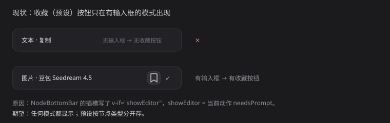

# 21 · 底栏预设按钮所有模式显示

- 状态：待确认（已实现，等验收）
- 负责人：未领取
- 完成时间：—

## 你的原话

> 然后你可以看到我的这个图片后面不是有一个收藏按钮吗。这个按钮当前只在图片模式下显示，我觉得不管在什么情况下，它都是显示的
>
> 可能在不同的类型上，他们的提示词预设是分开的

> 补充（2026-11-07）：先总结需求，不做开发。

> 补充（2026-11-07，第二轮）：音频节点也需要提供「预设」按钮，不管什么平台、什么类型都需要它。

## 要解决的问题

底栏的「预设提示词」按钮（书签 / 收藏图标）现在只在有输入框的模式出现。用户要求：所有节点类型、所有平台都必须显示；文本、图片、视频、音频各自使用自己的预设清单。

## 范围与位置

- 页面：画布 → 任意节点（文本 / 图片 / 视频 / 音频 / 分组等）→ 底部状态栏右侧。
- 参考代码：`packages/plugins/plugin-bottom-bar/src/NodeBottomBar.vue:587`（外层插槽 `v-if="showEditor"`）；`packages/plugins/plugin-bottom-bar/src/node-bottom-bar/useBottomBarActions.ts:157`（`showEditor = needsPrompt`）；`packages/plugins/plugin-bottom-bar/src/node-bottom-bar/BottomBarPresets.vue`（预设组件）；`packages/plugins/plugin-bottom-bar/src/promptPresets.ts:19`（单一 localStorage 键 `plume-canvas:prompt-presets`）；`packages/plugins/plugin-bottom-bar/src/bottomBarOverlay.ts:29`（`resolveBottomBarShown` 要求 `hasActions`）；`packages/plugins/plugin-node-audio/src/nodeAudioPlugin.ts`（音频插件没有注册任何 `nodeBar` 动作）。
- 相关资源：`images/21-预设按钮-现状.svg`
- 关联问题：20（模型下拉）、22（平台图标）

## 现在 vs 期望

| | 现在 | 期望 |
| --- | --- | --- |
| 文本节点 | 不显示（当前动作是复制 / 删除，无输入框） | 显示 |
| 图片 / 视频生成 | 显示 | 显示 |
| 音频节点 | 底栏整条都不出现（没有注册任何动作） | 底栏出现，且带预设按钮 |
| 数据 | 所有类型共用一份预设 | 按节点类型分开保存 |
| 点击后 | 把正文填进输入框 | 与当前类型对应的位置；没有位置时明确提示 |

## 问题原因

- 状态：已确认
- 复现步骤：选中文本节点，底栏右侧没有书签按钮；选中音频节点，底栏整条不出现；选中图片或视频节点，书签按钮出现。
- 证据：浏览器实测，文本节点底栏只有「参考 / 标记 / 展开 / @ / 模型」，没有输入框与预设按钮；音频节点连底栏都没有。代码里 `NodeBottomBar.vue` 给 `BottomBarPresets` 加了 `v-if="showEditor"`，`showEditor` 等于「当前动作要不要输入框」；`resolveBottomBarShown()` 还要求 `hasActions` 为真，而 `plugin-node-audio` 一条 `nodeBar` 动作都没注册；`promptPresets.ts` 只有一个存储键，没有类型维度。
- 根因：预设按钮被「输入框是否存在」绑死；底栏整条又被「有没有动作」绑死；预设数据没有按类型分区。删掉文本节点的复制 / 删除后，文本节点会变成「零动作」，底栏会更彻底地消失（见 20）。

## 修改方案

- 改哪里：`NodeBottomBar.vue`（插槽条件与底栏显示判定）、`BottomBarPresets.vue`（新增 `nodeType` / 落点 props）、`promptPresets.ts`（按类型分键）、`bottomBarOverlay.ts`（显示判定）、`plugin-node-audio/src/nodeAudioPlugin.ts`（如需动作也要补）。
- 怎么改：去掉按钮上的 `v-if="showEditor"`，按钮始终渲染，仅在 AI 生成中被锁定或没有可填位置时禁用并给 title 说明；`resolveBottomBarShown` 增加「有预设入口」这一条件，保证零动作的节点（文本、音频、分组）也能出底栏；传入当前 `nodeType`，按钮 title 显示「文本预设 / 图片预设 / 音频预设…」；存储键改成 `plume-canvas:prompt-presets:<nodeType>`，旧的单键做一次迁移到「通用」；没有输入框的模式，点预设时填入该类型的提示词字段，找不到位置就 `notify.info` 明确提示，不静默假成功。
- 为什么这样改：用户要的是「不管什么情况都能看到」；先把入口保住，再按类型分存，避免图片预设出现在文本节点里。
- 风险 / 影响面：零动作节点出底栏后，底栏会只剩预设按钮和展开按钮，布局需要重新排；分组节点是否要预设需要确认；旧数据迁移；音频节点没有输入框，预设点下去要有明确落点。
- 验证方式：文本、图片、视频、音频、分组各选一次，按钮都在；各类型新建一条预设互不串台；刷新后仍在；没有落点时提示清楚。

## 验收标准

- [ ] 文本、图片、视频、音频节点的底栏都出现预设按钮
- [ ] 各类型的预设清单互相独立，新建 / 删除只影响当前类型
- [ ] 旧版已保存的预设不会丢失（迁移到「通用」）
- [ ] 没有可填入位置时，点击有明确提示，不出现假成功
- [ ] AI 生成中按钮禁用，生成结束恢复
- [ ] 删除复制 / 删除后，文本节点仍能出底栏并看到预设按钮

## 不能动

- 不改预设面板已有的搜索、新建、删除交互
- 不改预设正文的插入方式（有内容时追加、空时直接填入）
- 不改底栏输入框与 AI 按钮

## 假设与待确认

- 假设：「不管什么类型」包含文本、图片、视频、音频；分组节点是否也算一类需要确认。
- 假设：图片 / 视频 / 音频的预设填进底栏输入框；文本节点填进 `data.text`。
- 已确认：音频节点必须显示预设按钮。
- 待确认：分组节点、3D 预览节点这类没有提示词的类型，按钮是显示但禁用，还是隐藏？
- 待确认：旧数据迁移成「通用预设」（所有类型可见），还是只给文本？
- 待确认：按钮是否显示当前类型的小角标，避免误以为共用一份？

## 执行指令

让预设按钮在所有节点类型下都显示（包括音频）；底栏显示判定不再只依赖「有没有动作」；预设数据按节点类型分开保存，旧的单份数据迁移后不丢；没有输入位置时给出明确提示。图片 / 视频现有的填入行为保持不变。

## 图片

图片说明：上图按当前代码与实测复画，标出「文本节点无按钮、图片节点有按钮」的差别。

## 执行记录

- 改动文件：
  - packages/plugins/plugin-bottom-bar/src/bottomBarOverlay.ts（shown 判定加 hasPresets）
  - packages/plugins/plugin-bottom-bar/src/NodeBottomBar.vue（去掉预设按钮的 showEditor 条件，新增 showPromptEditor）
  - packages/plugins/plugin-bottom-bar/src/node-bottom-bar/BottomBarPresets.vue（新增 nodeType / hasTarget，类型角标与无落点提示）
  - packages/plugins/plugin-bottom-bar/src/promptPresets.ts（按节点类型分键）
  - packages/plugins/plugin-bottom-bar/src/node-bottom-bar/prompt-presets.css（类型角标样式）
- 验证命令与结果：
  - pnpm -C packages/plugins/plugin-bottom-bar typecheck 通过
  - pnpm -C packages/plugins/plugin-bottom-bar test 47 文件 / 380 条通过
- 浏览器实测（:5290，@Chrome）：文本、图片节点底栏都出现「预设提示词」按钮；
  音频节点现在也会出底栏（走 hasPresets 这一条）。
- 完成时间：—

