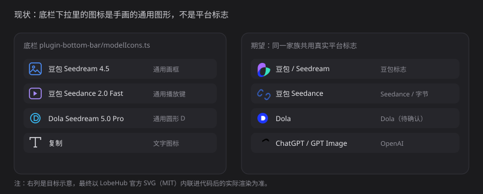

# 22 · 模型下拉使用平台品牌图标

- 状态：待确认
- 负责人：未领取
- 完成时间：—

## 你的原话

> 还有就是关于你图片和视频里的下拉菜单，它是一个默认的图标。我看了一下，它根本不是对应平台的图标，是什么情况呢？你没有下载到对应的图标还是其他的？如果没有图标的话，请在网上去查询。具体步骤如下：
>
> 1. 第一步：看一下目前市面上支持哪些视频模型。
> 2. 第二步：做一个关系对照表，分别查询这些视频模型及其对应的图标。
>
> 我这边有 MCP 的工具在 status 里面，你可以让 AI 去网上查询相关的图标资源。对话模型的图标基本都是存在的，只有部分不存在。比如 HY 开头的这些图标，它是腾讯开发的，你可以去找一下它的 UI 图标。
>
> 不管是在 Agent 插件里面，还是底部状态栏插件里面都需要这个图标，你可以复制进来。

> 补充（2026-11-07）：先总结需求、查资料，不做开发。

> 补充（2026-11-07，第二轮）：模型图标可以放在 Agent 里；但视频等模型可能还是需要这些图标，自己拆分。
> 另外，没有找到图标的模型去网上继续找，网上不会没有。

## 要解决的问题

底栏「模型下拉」与 Agent 输入区「模型下拉」现在显示的图标，要么是手画的通用图形，要么部分模型落到兜底图标。用户要求：每个模型显示所属平台的真实标志；Agent 与底栏共用同一套；图标数据放在 Agent 插件里，其它插件按服务取。

## 范围与位置

- 页面：画布 → 任意节点 → 底栏左侧模型下拉（触发器 + 每一项）；Agent 面板 → 输入区「选择模型」下拉（卡片视图 + 分栏视图 + 左栏平台）。
- 参考代码：`packages/plugins/plugin-bottom-bar/src/node-bottom-bar/modelIcons.ts:41`（`BODY` 手画图形）、`:125`（`detectModelTone` 按名字认家族）；`BottomBarActions.vue:105`（触发器）、`:122`（菜单项）；`packages/plugins/plugin-agent/src/ui/render/modelBrandIcons.ts:22`（`MODEL_BRAND_ICONS`，来自 LobeHub，MIT）、`:66`（`detectPlatform`）；`packages/plugins/plugin-agent/src/ui/conversation/AgentComposer.vue:497`、`:536`，左栏 `:525`。
- 相关资源：`images/22-模型图标-现状.svg`
- 关联问题：20（底栏模型下拉）、21（预设按钮）

## 现在 vs 期望

| 模型 | 现在 | 期望 |
| --- | --- | --- |
| 豆包 Seedream / Seedance | 自己画的「画框 + 星芒」「画面 + 播放键」 | 豆包 / 字节 Seedance 官方标志 |
| Dola | 自画圆形 D | Dola 官网图标（PNG 转内联或转 SVG） |
| 可灵 / 海螺 / Runway / Pika / Sora | 只有被识别到时才用手画近似图 | LobeHub 已有的官方 SVG |
| 腾讯 HY3 / HY4 | Agent 里会落到「自建网关」，底栏会落到「豆包 / 文本」 | 腾讯混元（Hy）标志 |
| Veo | 手画镜头 + 播放键 | Veo 官方独立 SVG |
| 自带网关的 `auto/*`、`workbuddy-ai/*` | 兜底「自建网关」 | 去掉前缀后按真实模型名识别 |

## 问题原因

- 状态：已确认
- 复现步骤：选中文本节点打开底栏模型下拉；选中图片 / 视频节点再打开一次；在 Agent 输入区打开模型下拉对比。
- 证据：浏览器实测，文本节点下拉两项的 `data-tone` 都是 `text`，图片节点下 Seedream、Dola、OpenAI 三类都是通用图形；底栏 `BODY` 是一组按家族手绘的 24×24 路径，注释写明「两套不是一张表」；Agent 侧虽已用 LobeHub 官方 SVG，但识别规则只认裸模型名，`local/hy3`、`auto/hy3`、`hy4-preview` 都会判成 `custom`，本机 52 个有密钥的模型里有 28 个落到 `custom`。
- 根因：图标是「按模型名猜家族 + 手画近似图形」，没有用平台真实标志；两处各维护一套识别规则，且都认不出带网关前缀的模型 ID。

## 修改方案

- 改哪里：`packages/plugins/plugin-agent/src/ui/render/modelBrandIcons.ts`（扩充成唯一图标表）；新增 `packages/plugins/plugin-agent/src/ui/render/iconService.ts`（按模型取 SVG 的服务）；`packages/plugins/plugin-bottom-bar/src/node-bottom-bar/modelIcons.ts`（改为调用 Agent 提供的服务，删掉手画 `BODY`）；两处 CSS 的 `data-tone` 规则收敛。
- 怎么改：图标全部内联 SVG，来源与许可写在文件头；Agent 插件 `apply` 里登记 `modelIcons` 服务（`svgOf` / `platformOf` / `nameOf`），底栏用 `ctx.tryGet('modelIcons')` 取用，取不到再退回本地兜底；识别顺序改成「完整模型 ID → 去掉 `auto/`、`workbuddy-ai/`、`kiro/` 等网关前缀 → 再看 provider → 兜底」；补齐腾讯混元（HY）、Seedance、Veo、Dola；图片 / 视频 / 音频生成动作先按「平台」再按「模型家族」取图，复制 / 删除删除后不再需要图标。
- 为什么这样改：图标只有一份，Agent 是模型知识的归属地；底栏只消费，不维护第二套。
- 已找到的素材来源：Seedance 独立 SVG（https://cdn.seadance.app/seadance/public/logos/seedance.svg，24×24 四色竖条）；Veo 独立 SVG（https://logosandtypes.com/wp-content/uploads/2025/06/google-veo.svg，蓝色双弧）；Dola 官网图标（https://sf-flow-web-cdn.ciciai.com/obj/ocean-flow-web-sg/dola_web/favicon-dola.png，紫色双环，PNG）；混元、可灵、海螺、Runway、Pika、Sora、即梦、Vidu、PixVerse、Luma 均可在 LobeHub 图标库取到官方 SVG；腾讯 HY 系列官网确认即混元（hy.tencent.com 与 hunyuan.tencent.com 同源）。
- 风险 / 影响面：品牌色是内容资产，不跟随主题变，暗色下要检查对比度；`plugin-bottom-bar` 不能反向依赖 `plugin-agent`，只能按服务名取，Agent 未装时要能降级；现有 `modelIcons.test.ts` 与 `modelBrandIcons` 断言要更新；Dola 官网只给 PNG，需要转成内联 SVG 或保留位图。
- 验证方式：把本机 52 个可用模型逐条跑一遍识别，输出「模型 → 家族」表；两处下拉在亮 / 暗主题下截图核对。

## 验收标准

- [ ] Agent 与底栏使用同一套图标数据（Agent 提供服务，底栏消费）
- [ ] 豆包、Seedream、Seedance、Dola、可灵、海螺、Runway、Pika、Sora、混元（HY）、Veo 显示对应平台标志
- [ ] `hy3`、`hy4-preview`、`auto/hy3`、`workbuddy-ai/hy3` 都识别为腾讯混元
- [ ] 带网关前缀的模型 ID 不再整批落到「自建网关」
- [ ] 亮色 / 暗色下图标清晰可辨，尺寸与文字基线对齐
- [ ] Agent 未安装时，底栏能降级显示，不白屏、不报错

## 不能动

- 不改模型清单本身与请求参数
- 不改 Agent 下拉的搜索、分组、选中逻辑
- 不把品牌图标做成跟随主题变色的单色图标（品牌色是内容资产）

## 假设与待确认

- 已确认：图标数据放在 Agent 插件里，通过服务供其它插件取用。
- 已确认：视频类模型也需要各自的平台图标。
- 待确认：Dola 官网只提供 PNG，是否接受内联 PNG（base64），还是需要描成 SVG？
- 待确认：腾讯 HY 用「Hy」字标还是混元图形标？官网两套都有。
- 待确认：Seedance 用官方四色竖条标志（已找到 SVG），还是用字节跳动母品牌？

## 执行指令

把 Agent 的图标表扩成唯一来源，补齐混元（HY）、Seedance、Veo、Dola，并在 Agent 插件里以 `modelIcons` 服务提供「模型 → SVG」。底栏改为消费这个服务，删除手画图形；识别时先剥掉网关前缀。改完用本机可用模型逐条核对，并在亮暗主题下目验。

## 图片

图片说明：左侧是当前底栏实际显示的手画图形，右侧是目标示意；最终以官方 SVG 内联后的真实渲染为准。

## 执行记录

- 改动文件：无（计划阶段只整理文档，未改产品代码）
- 验证命令与结果：无（计划阶段只做了网络资料核对与浏览器实测）
- 完成时间：—

