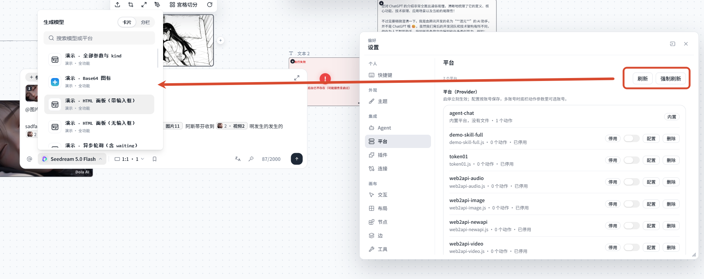
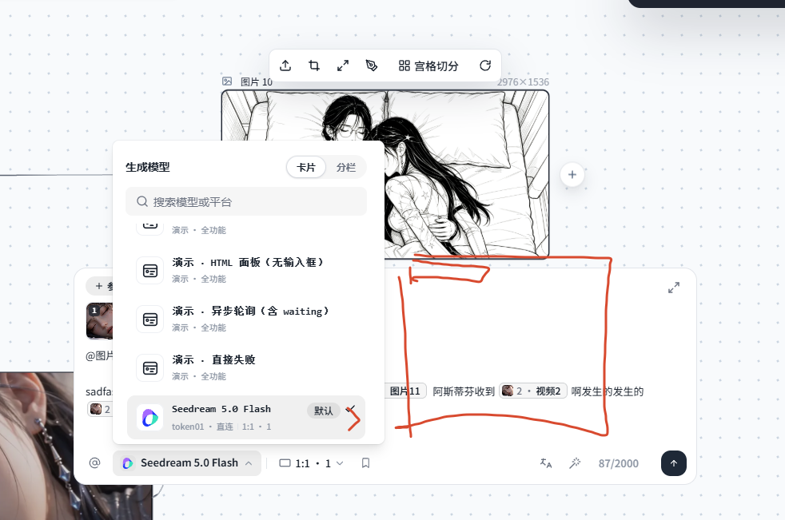
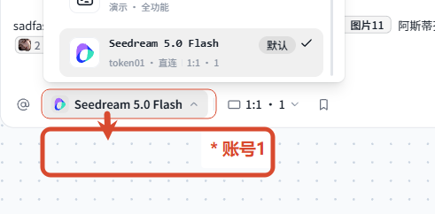

# 23 · 平台管理改弹窗

- 状态：进行中
- 负责人：/root
- 完成时间：2026-11-10 13:05

## 你的原话

> 你你这边的配置效果，我并不是很喜欢 你可以做成一个弹出框的效果

> 还有你这还有，你这边点击刷新之后，我没有看到任何变化。 （好像只有添加 没有删除 ）

> 还有，你这边如果配置了多个账号，那么我这边使用到对应的一个模型，到底使用的是哪一个账号呢？（我是不希望你在下拉菜单中单独多出相同的 选项 ） 我更希望你这里 可以配置一个下拉菜单 选择账号什么的 （我觉得 可以参考图片2 的效果 给他做成一个二级菜单）

> 其次就是很多 配置他们其实 有共同的配置项

> 其次就是 关于 provider 应该有自己的名称 和介绍（描述）， 在你的这个地方也可以进行很好的显示

> 还有你的 provider 也可以有自己的图标， 也支持 base64, svg，默认图标 （你可以把这个图片渲染做成一个通用的组件）

> 补充（2026-11-10）：我看到的 你这里的 我关闭对应 provider 你的这个下拉菜单没有变化， 这就是问题

> 补充（2026-11-10）：模型二级菜单 如果有多个账号 他才显示， 右侧有一个 箭头图标，hover 上去就会触发二级菜单（这个菜单需要注意使用 dropdownmenu 来实现）。这里我可以直接点击模型 来进行操作，也可以选中指定模型来进行操作；选中模型的时候 trigger 不需要有什么额外显示，如果选中对应账号的话 在 trigger 文本后面显示对应账号名称，比如图片 1 的效果。

> 补充（2026-11-10）：这里提到的参数，你可以想象一下 这里的所有 provider 的配置放在同一级别的 json 中，你可以设置他们的 key，key 支持 点隔开（比如 xxx.xxx.xxxx -> { "xxx.xxx.xxxx": ""}）。相同配置只需 对应的 key 一样就行。

> 补充（2026-11-10）：我这边说的从始至终都是图片节点，你的文本节点走的是另一种通道啊，你是不是完全就搞错方向了？你看图也知道，我这边选中的是图片节点呢。

> 补充（2026-11-10）：provider 在 `id`、`config` 同级直接写 `title` / `description` / `icon` 就行。

> 补充（2026-11-10）：平台的图标主要在 provider 界面中显示，同时也作为对应模型的兜底方案。之前兜底用的是下拉组件里的默认图标，现在有 provider 图标就用它兜底。

> 补充（2026-11-10）：刷新的话，按理说操作之后就应该实时生效，根本用不到这个刷新按钮。这边是可以删除这个刷新按钮的。

> 补充（2026-11-10）：配置用 key 实现，中间可以用点号隔开，它也算整体一个 key。多账号就在默认 key 后面加 `.[n]`，比如 `token1.baseurl` → `token1.baseurl.[0]`；解析时把 `.[0]`、`.[1]` 这种下标还原成数组。

> 补充（2026-11-10）：一个 provider 里可能有很多个配置。多账号就是对**全部配置**各来一轮 —— 有几个账号就重复它的所有配置。UI 上：① 把一些配置作为「平台通用」，添加账号时不用重复填；② 也可以单独配置某一项的全局通用值；③ 有多个账号时要提供一个默认账号，不需要记录上次选中的账号。

> 补充（2026-11-10）：图标兜底方案（动作自带 > Agent 品牌图标 > provider 的 icon > 猜标题 > 类型默认）是正确的。

> 补充（2026-11-10）：整个配置不管是通用还是账号级别，都应该放在一块儿，可以手动指定哪一个属性作为账号级别的。添加账号的时候，只针对对应的属性进行添加。账号里面也可以展开，展开之后就是把所有的属性进行一个渲染，这时又可以对整个账号做全量配置，需要一个标识，区别于修改了通用配置。

> 补充（2026-11-10）：UI 默认显示当前平台的所有配置。配置里有一个选项「指定为账号级别」，指定后自动切换成账号 UI 显示，并把该配置单独提炼到账号里作为第一项（当前只有一个账号，就直接提炼进第一个）。既然有「转为账号」，也要有「转为通用」。

## 要解决的问题

把「设置 → 集成 → 平台」里这条长表单改成一个能开能关的管理弹窗；弹窗里每个平台有自己的名字、一行介绍和图标，能完整地增、删、改、查；多个账号不再在底栏下拉里复制出多行同名模型，而是收进一个「账号」二级菜单里选（点模型本身就能直接用默认账号跑）；所有平台配置放平到同一个 JSON 里，靠点分隔的 key 复用相同配置；停用某个平台后，底栏里属于它的模型必须当场消失。

## 范围与位置

- 页面：设置 → 集成 → 平台（现在是设置页内一整列，目标是独立管理弹窗）；底栏模型下拉（账号二级菜单）
- 参考代码：`packages/plugins/plugin-manager/src/components/settings/ProviderManagerPage.vue`、`packages/plugins/plugin-manager/src/providerManagerService.ts`、`packages/plugins/plugin-manager/src/pluginManagerPlugin.ts:88`、`packages/cloud-server/src/routes/providerAdmin.ts:66`、`packages/cloud-server/src/providers/types.ts:67`、`packages/plugins/plugin-cloud-client/src/actions.ts:41`、`packages/plugins/plugin-bottom-bar/src/node-bottom-bar/actionIcon.ts:52`、`packages/plugins/plugin-bottom-bar/src/node-bottom-bar/BottomBarModelPicker.vue`
- 相关资源：`images/23-平台管理-现状.png`、`images/23-模型二级菜单-参考.png`、`images/23-账号名在触发器后面-期望.png`
- 关联问题：22（模型下拉的平台图标，图标来源可共用）、20（底栏模型下拉改用 Agent 模型，二级菜单落在同一个面板里）

## 现在 vs 期望

| | 现在 | 期望 |
| --- | --- | --- |
| 管理界面形态 | 嵌在设置页里的一整列长表单，编辑账号时把列表往下顶 | 点入口弹出独立管理弹窗，列表与编辑区分开，关掉回到设置页 |
| 平台名称 | 直接把 `provider.id` 当标题（如 `web2api-image`） | 显示平台自己的名字 + 一行介绍（描述） |
| 平台图标 | 没有图标 | 支持 SVG / Base64 / 默认图标，用同一个通用组件渲染 |
| 刷新按钮 | 只重新 GET 一次清单，界面看不出变化，也不会重扫目录 | 点一次就能看到变化（新增 / 删除 / 文件改动），并给出结果行 |
| 删除 | 按钮在行尾、与「配置」同款，删完静默少一行，容易被当成没删 | 删除入口清楚，删完当场少一行并提示删了哪个文件 |
| 多账号 | 配置里能加多个账号，但底栏不知道这次用哪个 | 只有多个账号时，模型行右侧出现箭头；hover/点击展开二级菜单选号；选中后 trigger 文本后面追加账号名 |
| 共同配置项 | 每个平台文件各写一份 `baseUrl` / `apiKey` 声明 | 所有平台配置平铺进同一份 JSON，key 用点分隔（如 `web2api.baseUrl`），同名 key 自动共用 |
| 停用后的下拉 | 停用后图片节点下拉会少项，文本节点的模型下拉来自 Agent 配置、完全不变 | 停用后该平台的模型在所有节点下拉里当场消失 |

## 问题原因

- 状态：已确认（刷新、删除、缺名字/图标、停用后图片节点下拉不变）、已确认根因（缺 `providers-version` 广播）
- 复现步骤：打开画布 → 右上设置 → 集成 → 平台；点「刷新」，列表内容不变；把几个平台停用后再点「刷新」，仍是「0 个动作 · 已停用」，看不出这次刷新做了什么；点「配置」，编辑区在列表下方展开，整页被撑长。
- 证据（日志 / 截图 / 调用路径）：图片节点用 `BottomBarChoicePicker` → `useBottomBarActions` 读 `nodeBar.list()`，数据来自 `/api/actions`；后台停用 `token01.js` 实测：版本 4 → 5，动作条数 8 → 1，`token01:*` 剩 0 条 —— 说明后台侧完全正确，是前端没去重拉。前端重拉有三个入口：`provider.ts:597` 首屏一次、`:600` 每 `pollMs`（默认 8000）一次、`:576` 的 `onActionsChanged`（等 `config/providers-version` 事件）。**但实测 `GET /api/kv/config/providers-version` 回 404**，后台从来没有人写过这个 key（`server.ts` 只写了 `history-rev`），所以这条实时入口是死的，只能等 8 秒兜底轮询，而且如果 SSE 断过就更久。另外 `BottomBarChoicePicker` 只在 `actions` 变化时重算，没有「动作列表变化后同步重算触发器名称」的显式重建，也会表现为「界面不变」。
- 旁证：`ProviderManagerPage` 的「刷新」只 `GET /api/providers`（不重扫），「强制刷新」才 `POST /api/providers/reload`。用户点「刷新」看不到变化，是这两个按钮语义不同造成的。
- 另一条证据（已作废的误判）：我上一轮说文本节点走 Agent 配置所以不变 —— 这条只对文本节点成立，与用户指出的图片节点无关，不作为本问题的根因。
- 根因：① 后台启停 / 配置变更后没有写 `providers-version`（键不存在），前端的实时重拉分支永远不会触发；② 平台声明缺少 `title` / `description` / `icon`，列表与兜底图标都没数据可用；③ 多账号没有 `.[n]` 这种数组下标写法，也没在前端接 `values.__accountId`；④ 「刷新」按钮语义错位，用户期望它本来就不需要。

## 修改方案

- 改哪里：`providers/types.ts`（`Provider` 加 `title` / `description` / `icon`）、`providerAdmin.ts`（下发这三个字段）、`server.ts`（启停 / 配置后写 `providers-version`）、`ProviderManagerPage.vue`（列表 + 编辑弹窗、去掉刷新按钮）、`actionIcon.ts`（抽通用图标件 + provider 兜底）、`ChoicePickerMenu.vue` / `BottomBarChoicePicker.vue`（账号二级菜单）、`providers/configStore.ts`（点分隔 key + `.[n]` 数组）。
- 怎么改：分七步 —— ① 实时生效：`reloadProviders()` 与启停 / 删除 / 保存账号之后都往 `kvStore` 写一次 `config/providers-version`（时间戳），前端 `remoteSync` 收到就 `reloadActions()`，同时保留 8 秒兜底轮询；② 删掉刷新按钮：`ProviderManagerPage` 顶部只留说明，`refresh()` 只在进页面调一次，`forceReload()` 与按钮一并移除（后台 reload 接口保留给脚本）；③ 展示元数据：`Provider` 增加可选 `title` / `description` / `icon`，与 `id` / `config` 同级，`GET /api/providers` 每行带上；④ 通用图标件：从 `actionIcon.ts` 抽「SVG / Base64 / 默认」三态渲染件（支持 `*` 角标），注册进默认主题，三处共用；⑤ 图标兜底链：动作自带 icon > Agent 品牌图标 > provider 的 icon > 按标题猜 > 节点类型默认图形；⑥ 账号二级菜单：`ChoicePickerMenu.vue` 菜单项右侧（多账号时）加 `DropdownMenuSub` + `DropdownMenuSubContent`，hover / 点箭头展开，项内账号名 + 勾，点模型本身跑默认账号，选中后 trigger 追加账号名并把值写进 `values.__accountId`；⑦ 配置 key 与数组：`providers-config.json` 里 `files` 改成平铺 `key → value`，支持 `a.b.c` 与 `a.b.[0]`，读取时把同前缀的 `[n]` 聚成数组（多账号即 `token01.baseUrl.[0]` / `.[1]`），同名 key 天然共用一份值。
- 为什么这样改：用户要的是「操作完就变」，所以实时通道必须真的写得进去（现在 404），按钮才会成为多余；provider 的图标既然要作为模型兜底，就应该在图标判定链里排在默认图形之前；配置用点分隔 + 下标是用户明确选的模型，照做最省事。
- 风险 / 影响面：`Provider` 加可选字段不影响现有 provider 文件；`toBarAction` 白名单要同步加账号相关字段，漏加会静默丢弃；写操作继续走现有令牌与审计。
- 验证方式：真机逐项点（见验收标准），并跑 `packages/cloud-server`、`plugin-manager`、`plugin-bottom-bar`、`plugin-cloud-client`、`packages/ui` 的测试与类型检查。

## 验收标准

- [x] 平台页显示名字、一行介绍和图标（SVG / Base64 / 默认）；停用后仍显示名字（展示信息快照）
- [x] 平台页没有「刷新 / 强制刷新」按钮；启停、保存之后后台写 `providers-version` 实时广播
- [x] 删除入口保留并走统一确认框
- [x] 配置项集中在一张清单里，每项右侧有「账号级」开关；打开后该项在每个账号里各存一份
- [x] 账号展开后能看到全部配置项；账号级项留空 = 继承、填写 = 已覆盖；账号卡片可「编辑全局属性」
- [x] 添加账号只为账号级字段建空位，通用字段不参与
- [x] JSON 落盘为 `pid.field` 与 `pid.field.[n]`，同名前缀的 `[n]` 读时还原成数组
- [x] 多账号在配置里标记默认号（`default`），不记录上次选中的账号
- [x] 动作清单带上 `providerIcon`（provider 图标作为模型兜底）与多账号清单
- [ ] 在真实浏览器里逐项点一遍（本对话 CUA 内核丢失，需换新对话补验）

## 不能动

- 不改 `providerAdmin` 的鉴权方式（写接口仍要管理令牌）与审计记录
- 不改 provider 文件「单文件、只能引 Node 内置模块」的约束
- 不改 `DELETE /api/providers/:file` 与启停接口的路径语义
- 不改底栏「一个模型只出现一行」的既有观感
- 不动 `BaseNode.vue`、`MovingHandle.vue`、`BaseTitle.vue`、`CustomEdge.vue`、`ConnectionLine.vue`、`DefaultBackground.vue`

## 假设与待确认

- 假设：「弹出框」指项目统一的 `Dialog`（居中、带遮罩、可关闭），不是浏览器新窗口，也不是右侧抽屉；「二级菜单」用项目现有的 `DropdownMenuSub` / `DropdownMenuSubContent` 实现：菜单项右侧一串灰色小字（当下是「默认」）+ 勾选标记，多个账号时才出现那个箭头；hover 或点箭头展开；选中后底栏触发器文本后面追加账号名（如 `Seedream 5.0 Flash 账号1`）。
- 已确认：`title` / `description` / `icon` 与 `id` / `config` 同级写在 provider 对象里（不用新导出）。
- 已确认：provider 图标主要显示在平台管理界面，同时作为对应模型的兜底图标（替代下拉组件里的默认图形）。
- 已确认：不需要刷新按钮，操作后应当实时生效；可以删掉这个按钮。
- 已确认：配置是「同一份 JSON + 点分隔 key」，同名 key 共用一份值；多账号用 `.[0]` / `.[1]` 下标，解析时还原成数组。
- 已确认：多账号 = 对**全部配置项**各存一轮，有几个账号就有几份完整 values（`token01.baseUrl.[0]`、`.[1]` 各存各的）。
- 已确认：界面是**一份配置清单**（不拆两块）；每项默认是「平台通用」，点「指定为账号级别」转成账号级，也能「转为通用」合并回一份。
- 已确认：账号可展开，展开后渲染**全部**配置项（通用项只读显示当前值，账号级项可填）；账号级项留空 = 继承平台通用值，填了 = 已覆盖，需要有明显标识区分。
- 已确认：添加账号时只为**账号级**属性建空位，通用属性不重复。
- 已确认：有多个账号时指定一个「默认账号」；不记录「上次选中的账号」。
- 已确认：图标兜底顺序为 动作自带 > Agent 品牌图标 > provider 的 icon > 猜标题 > 类型默认。

## 执行指令

先补 `providers-version` 广播（启停 / 删除 / 保存账号后写 KV），让前端实时重拉，然后删掉平台页的刷新按钮；`Provider` 加 `title` / `description` / `icon` 并下发；抽通用图标件并把 provider 图标接进兜底链；配置存储改成平铺 JSON + 点分隔 key + `.[n]` 数组；最后在底栏「生成模型」菜单里加账号二级菜单（单账号不显示箭头，选中后 trigger 追加账号名）。每步都按验收标准在真机上点一遍。

## 图片

图片说明：红框标出的「刷新 / 强制刷新」就是点了没有可见变化的地方；下面 6 个平台都显示「0 个动作 · 已停用」，看不出这次刷新到底做了什么。

图片说明：用户用红箭头指出，希望模型那一行右侧能展开一个二级菜单来选账号；截图里右侧被框出来的空白区域就是预期位置。

图片说明：上半部分是菜单里的选中态（右侧「默认」+ 勾），下半部分红框是期望效果 —— 底栏触发器上显示 `Seedream 5.0 Flash`，后面再跟上当前账号名（如 `账号1`）。

## 执行记录

- 改动文件：`packages/cloud-server/src/providers/configStore.ts`（点分隔 key + `.[n]` + 平台展示快照）、`packages/cloud-server/src/providers/load.ts`（新结构优先、旧结构回落）、`packages/cloud-server/src/providers/types.ts`（`Provider.title/description/icon`）、`packages/cloud-server/src/routes/providerAdmin.ts`（GET 带名字/图标/账号级字段/通用值；新增 `PUT /:file/values` 与 `PUT /model-defaults`）、`packages/cloud-server/src/routes/actions.ts`（每行动作带 `providerIcon` + 多账号清单）、`packages/cloud-server/src/server.ts`（`providers-version` 实时广播、展示信息快照、`saveKeyConfig`/`saveDefaults`/`accountsOf`）、`packages/cloud-server/src/plugins/builtin/routes.ts`（延迟取 providerAdmin，修账号清单为空）、`packages/cloud-server/src/tasks/agentChatProvider.ts`（内置平台名字/介绍）、`packages/cloud-server/providers/web2api-{image,video,audio}.js`（与数据根同步）、`.mini-canvas/providers/*.js`（补 title/description/icon）、`packages/plugins/plugin-cloud-client/src/{api.ts,apiTypes.ts,actions.ts}`（新接口与字段）、`packages/plugins/plugin-manager/src/providerManagerService.ts`（重写）、`packages/plugins/plugin-manager/src/components/settings/{ProviderManagerPage.vue,ProviderIcon.vue}`（重写/新增）、`packages/plugins/plugin-bottom-bar/src/node-bottom-bar/{actionIcon.ts,ChoicePickerMenu.vue,BottomBarChoicePicker.vue,bottom-bar-choice-menu.css}` 与 `packages/plugins/plugin-bottom-bar/src/NodeBottomBar.vue`（provider 图标兜底 + 账号入口）
- 验证命令与结果：`pnpm -C packages/cloud-server test --run` → 139 文件 / 937 用例全绿；`pnpm -C packages/cloud-server typecheck` 通过；`pnpm -C packages/plugins/plugin-bottom-bar test --run` → 456 全绿；`pnpm -C packages/plugins/plugin-manager test --run` → 60 全绿 + typecheck 通过；`pnpm -C packages/plugins/plugin-cloud-client test --run` → 177 全绿；`pnpm -C packages/ui test --run` → 87 文件 / 569 通过 1 跳过。HTTP 实测：`PUT /api/providers/token01.js/values` 落盘 `token01.baseUrl` + `token01.apiKey.[0]/[1]`，默认号写入，`GET /api/providers` 下发掩码与 `accountFields`，`GET /api/actions` 带 `providerIcon` 与 `accounts`，`GET /api/kv/config/providers-version` 由 404 变为可读时间戳。浏览器实测未能进行（本对话 CUA 内核目录丢失）。
- 完成时间：2026-11-10 13:05
