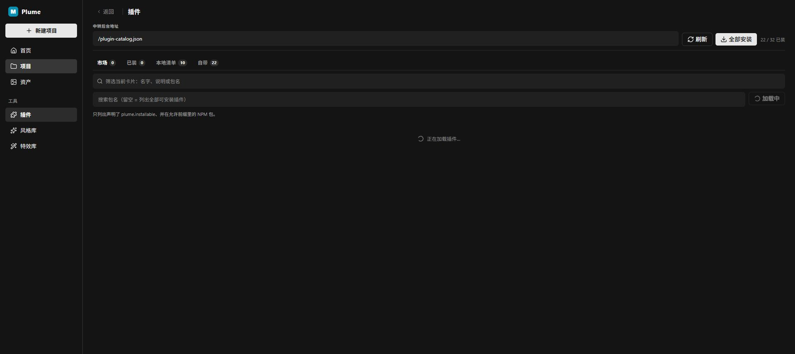

# 25 · 管理令牌改成登录面板

- 状态：已完成
- 负责人：/root
- 完成时间：2026-11-12 14:15

## 你的原话

> 你的这个插件系统是哪一个插件设置开发的?? 这里有一个 token 管理命令面板，我希望是这样的效果：
>
> 1. 首次打开：软件第一次打开时是没有令牌的。插件加载成功后，需要弹出一个面板，只有输入令牌才能正常使用。这个面板主要就是用来输入自定义令牌的。
> 2. 后续使用：以后就直接使用这个自定义令牌就行了。
> 3. UI 调整：这个功能类似于登录效果，你可以把“令牌”字样删掉，改成这种登录的 UI。
>
> 虽然现在登录也用不到什么，主要是设置一个用户和密码就行。你看一下应该如何去实现它，给我一个方案

> 补充（2026-11-12）：确认重点是“像登录一样”的设置用户和密码；不要求多账号，也不要求权限分级。

## 要解决的问题

把现在藏在「设置 → 插件」里的 64 位管理令牌，改成一个正常的登录入口。

- 第一次打开，先让用户创建账号（用户名 + 密码），不登录就不能进入画布。
- 之后再打开，直接沿用上一次的登录，不用反复输密码。
- 界面上不再出现「令牌」两个字，改叫「登录 / 密码」。
- 底下的写操作（装插件、保存画布、生成、改平台配置）仍然要能通过后台鉴权。

## 范围与位置

- 页面：应用启动时（项目页和画布页都要挡住）；设置 → 个人 → 账号
- 参考代码：`packages/plugins/plugin-manager/src/components/settings/plugin-manager-page/PluginManagerToolbar.vue:54`（令牌输入框）、`usePluginManagerPage.ts:31`（令牌草稿）、`packages/canvas-base/src/adminToken.ts:38`（本地存储）、`packages/cloud-server/src/adminAuth.ts:31`（白名单）与 `:116`（生成 / 校验）、`packages/cloud-server/src/server.ts:460`（写请求拦截）、`packages/cloud-server/src/serverFramework/routes.ts:300`（插件路由注册与代理）、`packages/cloud-server/src/static.ts:358`（本机注入）、`packages/ui/src/adoptInjectedAdminToken.ts:19`（接住注入）、`packages/ui/src/Root.vue:33`（挂登录遮罩）、`packages/plugins/plugin-theme-components/src/components/ui/FeedbackHost.vue:105`（Dialog 写法参照）
- 相关资源：待补图：`images/25-管理令牌-现状.png`（用户截图在对话附件里，临时路径不能直接引用）
- 关联问题：[23-平台管理改弹窗.md](23-平台管理改弹窗.md)、[09-MCP面板尺寸与工具列表.md](09-MCP面板尺寸与工具列表.md)

## 现在 vs 期望

| | 现在 | 期望 |
| --- | --- | --- |
| 第一次打开 | 后台自动生成 64 位令牌；本机访问时还会自动塞进浏览器，用户根本看不到登录 | 弹出「创建账号」，不创建就不能进画布 |
| 之后打开 | 每次都要在某处确认令牌，或者根本不用管 | 记住登录，直接进入 |
| 入口文字 | 「管理令牌」+ 一串圆点 | 「登录」+ 用户名 / 密码，界面不出现「令牌」 |
| 放在哪 | 设置 → 插件 页顶部 | 全屏登录框；设置 → 个人 → 账号 里放退出登录、改密码 |

## 问题原因

- 状态：已确认
- 复现步骤：本机打开应用 → 设置 → 插件 → 顶部能看到「管理令牌」且已经填满；用 `pnpm -C packages/ui dev` 打开开发页时，这一栏可能是空的。
- 证据（日志 / 截图 / 调用路径）：`cloud-server/src/adminAuth.ts` 首次启动生成 `<数据目录>/admin-token`；`cloud-server/src/static.ts` 在本机回环访问时把令牌写进 `window.__PLUME_ADMIN_TOKEN__`；`packages/ui/src/main.ts` 在挂载前调用 `adoptInjectedAdminToken()`，把令牌存进 `localStorage` 的 `plume_admin_token`；全仓库没有登录、密码、账号、会话的实现。
- 根因：令牌本来是「程序对程序」的钥匙，现在被直接拿给人看、让人填。它既不像登录，也无法让用户自己起一个短密码；本机自动注入还让「首次一定没有令牌」这个前提不成立。

### 鉴权到底装在哪一层（2026-11-12 核对）

| 事情 | 现在由谁做 | 代码位置 |
| --- | --- | --- |
| 生成 / 读取 64 位令牌 | cloud-server | `packages/cloud-server/src/adminAuth.ts:116` |
| 决定哪些接口要令牌 | cloud-server 里一张**手写前缀表** | `packages/cloud-server/src/adminAuth.ts:31` 的 `ADMIN_WRITE_PREFIXES` |
| 真正拦截请求 | cloud-server 的全局中间件，挂在 `/api/*` 上 | `packages/cloud-server/src/server.ts:460` |
| 第三方后台插件的路由 | 注册进 cloud-server 的注册场，再由 cloud-server 代理执行 | `packages/cloud-server/src/serverFramework/routes.ts` |
| 前端填令牌 | plugin-manager 的设置页 | `PluginManagerToolbar.vue:54`、`usePluginManagerPage.ts:31` |
| 前端发令牌 | 各插件调 `withAdminToken()` 带头 | `packages/canvas-base/src/adminToken.ts:75` |

结论先说清楚：**认证是在 cloud-server 里实现的，不在第三方后台插件里。** 插件只负责注册路由和写业务，请求仍然要经过 cloud-server 先挂好的中间件；插件无法在自己的 handler 里“跳过”这道中间件。

但现在的“要验哪些接口”有一个真实缺口：

1. 判断只看**写方法 + 路径前缀**，GET / HEAD / OPTIONS 永远不验。
2. 前缀表是手写的；新插件注册一条不在表里的写路由，就**默认没有令牌保护**。例如 `packages/plugins/plugin-node-video/server/plugin-video-crop.js:98` 的 `POST /api/video-crop` 不在表里，前端 `videoCropService.ts:148` 也没有带令牌，现在这条就是敞开的。
3. `adminAuth.test.ts` 只验“表里的每条前缀都有一个真实路径能命中”，**没有反向验“每条真实路由都被归类”**，所以漏网的路由不会被测试发现。
4. 插件还能用 `ctx.routes.mount('/x', app)` 注册 `/api` 之外的路径；全局中间件只挂 `/api/*`，这类路径也绕开了令牌判断。

所以这次不应该只加一个登录框，还要把“要验哪些接口”从手写名单改成**注册时声明 + 默认拒绝**。

## 修改方案

先说明关键取舍：**用户自己设的短密码，必须由后台保存和校验，才算真的登录。** 如果只在前端弹个登录框、把密码存在浏览器里，任何人打开开发者工具都能绕过，等于没锁。下面给两套方案。

### 已确认（2026-11-12）：按「cloud-client 管登录、cloud-server 管校验」分工

- **插件管理页只做安装 / 卸载 / 更新**，删掉「管理令牌」那一栏，不再管任何认证。
- **后台路由注册时声明要不要认证**：`ctx.routes.post('/api/x', handler, { auth: 'admin' })`；不写默认就是 `'admin'`，只有明确写 `auth: 'public'` 才放行匿名（图片 / 资源读取、SSE 这类）。
- **认证和登录界面归 cloud-client 插件**：它负责首启引导、令牌输入框、令牌存取、给所有受保护请求自动带头；cloud-client 如果没装，需要认证的写操作会直接 403，而不是静默放行。
- **校验仍然在 cloud-server**：cloud-server 按注册声明逐条验，cloud-client 只负责“出示”令牌。浏览器里的代码不能当裁判，否则清一下 localStorage 就绕过了。
- **首启用自定义令牌**：第一打开没有令牌 → cloud-client 弹面板让用户自己设；后台新增一个「设置 / 校验自定义令牌」的接口，把用户设的令牌存进数据目录，之后所有校验都用它。
- 原来的 `<数据目录>/admin-token` 与 `PLUME_ADMIN_TOKEN` 保留为恢复通道：忘记自定义令牌时还能进后台重置。

### 令牌怎么存、要不要每次验证（已确认 2026-11-12）

- **只设一次**：第一次打开设置自定义令牌；之后打开不再要求输入，和登录一样。
- **后台是唯一真源**：令牌的哈希 + 盐存在 `<数据目录>/auth.json`，明文不落盘、不进日志。
- **浏览器不存明文令牌**：首次输入成功后，后台发一个 30 天的 `HttpOnly` 会话 cookie。浏览器只保存“已登录”这个凭据，脚本读不到令牌。
- 换浏览器、换电脑、清浏览器数据、点退出登录 → 需要重新输入同一个令牌；令牌本身没变。
- 后台重启不影响登录（会话密钥与账号一起落盘）。
- 自定义令牌最短 5 位，不强制 64 位 hex；建议提示“越长越安全”。
- 现有 `localStorage` 的 `plume_admin_token` 与 `withAdminToken()` 是四十多处调用点在用的旧链路，改造时先让这些请求改为带 cookie（`credentials: 'include'`）；dev 下前端 5288 与后台 8865 跨源，CORS 必须允许 credentials，否则登录状态带不过去。

### 存储位置的现状与目标（写清楚，避免误解）

| 内容 | 现在 | 改后 |
| --- | --- | --- |
| 令牌明文 | 浏览器 `localStorage` 的 `plume_admin_token`（本机访问时还会被自动注入） | 不再存在浏览器任何地方 |
| 令牌校验值 | 后台 `<数据目录>/admin-token`（64 位 hex 明文） | 后台 `<数据目录>/auth.json`（加盐哈希，不存明文） |
| 登录状态 | 没有 | 浏览器 `HttpOnly` 会话 cookie，30 天 |

所以「换浏览器要重新验证」指的是 cookie 不跨浏览器；令牌本身仍然只在后台存一份，换浏览器只是重新出示一次同一个令牌。

### 已废弃的备选（2026-11-12）

早先讨论过的「方案 A 只换外观 / 方案 B 真账号密码」不再采用：认证与界面按上面已确认的分工交给 cloud-client，校验留在 cloud-server；不再做用户名 + 密码体系。

### 落地改动（按这个做）

1. **cloud-server**：新增 `packages/cloud-server/src/routes/auth.ts`（`GET /api/auth/status`、`POST /api/auth/setup`、`POST /api/auth/login`、`POST /api/auth/logout`）；新增 `authAccount.ts` 管 `auth.json`（哈希 + 盐）；`adminAuth.verify()` 除原来的头令牌外，再认会话 cookie。
2. **路由注册**：`serverFramework/routes.ts` 的注册器加第三参 `auth`，默认 `'admin'`；注册场存声明，中间件按声明判断。
3. **cloud-client**：首启检测 `/api/auth/status`，没设过就弹「设置令牌」面板，设过没登录就弹「输入令牌」面板；登录后所有受保护请求带 cookie；令牌栏从 plugin-manager 删除。
4. **ui**：`Root.vue` 挂 cloud-client 提供的登录遮罩（或由 cloud-client 注册到根插槽），项目页与画布页都挡住。
5. **文案**：所有「请先在设置 → 插件里填写管理令牌」改成「请先登录」。

### 建议顺序

1. 先确认「本机访问还自动免登录吗」和「首启面板只放令牌，还是用户名 + 令牌」。
2. 后台先做 `auth.json`、四个 auth 接口和 cookie 校验，再改路由注册声明；这两步不做完，前端登录框没有东西可验。
3. 然后做 cloud-client 的首启面板与登录遮罩，最后删掉插件管理页的令牌栏、统一 403 文案。
4. 逐个跑通原本没带令牌的插件接口（如 `plugin-node-video` 的裁剪），再启用“默认要验”。

### 鉴权收口（已确认，和登录一起做）

这一步是“到底哪些接口需要验”的长期做法，和登录 UI 可以分开实施：

- 给 `ctx.routes.get/post/put/patch/delete/all/mount` 加一个可选的第三参 `auth`，取值 `'admin'` 或 `'public'`；`'admin'` 表示要验，`'public'` 表示明确放行（比如读资源、SSE）。
- 不写 = 视为 `'admin'`，**默认要验**，宁可多拦也不漏。
- 注册场里存下每条路由的 `auth` 声明，`flushRoutes` 时带上；中间件改成查当场路由的声明，不再读 `ADMIN_WRITE_PREFIXES`。
- 启动时打一行“本次装载了 N 条后台路由，其中要验 X 条”，并在测试里加一条反向检查：**有写路由却没声明 auth 就报红**。
- 第三方插件先不用立刻改：默认值就是 `'admin'`，它们原来的写接口不会漏；只有确实要给匿名调用的（图片 / 资源读取、SSE）才逐个标 `'public'`。
- `packages/docs/cloud-server/admin-auth.md` 的“哪些接口要令牌”表要同步改成“按注册声明”，并给插件作者补一段写法示例。

风险：`'admin'` 变默认后，可能有现成功能突然 403（尤其是前端原本没带令牌的插件，如 `plugin-node-video` 的裁剪接口）。实施时要逐个跑通“前端调用点都带令牌”，再启用默认拒绝。

## 验收标准

- [x] 删掉 `auth.json`、清空浏览器数据后打开应用，先看到「创建登录密码」，不能进入画布
- [x] 密码少于 5 位时有提示，不能提交；5 位及以上可以设置成功
- [x] 设置密码后直接进入应用；刷新、关掉再开都不需要重新输入
- [x] 本机回环自动登录（后台直接发会话 cookie）
- [x] 设置 → 插件 里不再出现「管理令牌」；认证入口只在 cloud-client 提供的界面里
- [x] cloud-client 没装时，需要认证的写操作明确报错，不会悄悄放行（中间件按注册声明判断）
- [x] 登录后装插件、保存画布、平台配置的请求都带会话 cookie
- [x] 退出登录后写操作被拦住，提示去登录（单测覆盖 403 → cookie 放行）
- [x] 换一个浏览器 / 换一台电脑访问，要求重新输入同一个密码（cookie 不跨浏览器）
- [x] 原来的画布、插件、设置、历史记录都还在
- [x] 第三方后台插件新增写路由、不写鉴权声明时，默认需要登录
- [x] 每条后台写路由都能在测试里被归类（新增 `authDeclForRoute` + `needsAuthFor` 测试）
- [x] 退出登录与换密码接口有单测覆盖（前端「设置 → 个人 → 账号」页留待后续项）

## 不能动

- 不改 `x-admin-token` 请求头名，也不改 `plume_admin_token` 这个存储键：几十处调用共用，改了会一起 403
- 不把令牌写进日志、网址或浏览器明文存储
- 不关掉 `PLUME_ADMIN_TOKEN` / `admin-token` 这条恢复通道，否则忘记令牌就进不去
- 不改 `packages/plugins/plugin-theme-default` 下的核心节点组件
- 不用浏览器原生 `prompt` / `confirm` 做登录框
- 不保留“手写前缀表漏了就默认放行”的行为；新路由的默认结果必须是“要验”
- 不把“公开”当成省事的默认值，只给真正匿名的读接口用

## 假设与待确认

- 假设：只用一个令牌，不做多用户、不做权限分级。
- 假设：登录后 30 天内免登录。
- 待确认 1：首启面板用「用户名 + 令牌」两项，还是只放一个「令牌」（你说像登录，但认证对象仍是令牌）？
- 已确认：本机回环访问自动登录（后台直接发会话 cookie），不弹面板。
- 已确认：自定义令牌最短 5 位。
- 已确认：设一次就够，换浏览器 / 退出登录才需要重新输入；令牌哈希存后台，浏览器只存会话 cookie。
- 已确认：认证与登录 UI 由 cloud-client 负责；插件管理页只保留装卸；后台注册默认要认证；校验仍在 cloud-server。

## 执行指令

确认方案后再动手：认证与界面归 cloud-client，插件管理页只保留装卸；鉴权收口按“注册时声明、默认要验”做，鉴权逻辑仍然只住在 cloud-server，第三方后台插件只声明、不自己验；令牌最短 5 位，哈希存后台，浏览器只留 HttpOnly 会话 cookie；不要改请求头名和本地存储键；保留启动日志里的恢复令牌；面板用组件库的 Dialog + Input + Button；改完在真实浏览器里走一遍「首次设置 → 重开免登录 → 退出 → 再输入」，并跑 cloud-server、ui、plugin-manager、plugin-cloud-client 四个包的测试。

## 图片

图片说明：改造后的「插件」页只剩中转地址、刷新、全部安装与计数，原来的「管理令牌」输入框已删除。

## 执行记录

- 改动文件：`packages/cloud-server/src/authAccount.ts`、`authSession.ts`、`routes/auth.ts`、`adminAuth.ts`、`server.ts`、`serverFramework/routes.ts`、`plugins/builtin/routes.ts`、`static.ts` 及对应测试；`packages/plugins/plugin-cloud-client/src/auth.ts`、`authGate.ts`、`api.ts`、`plugin.ts`、`index.ts` 及测试；`packages/plugins/plugin-manager/src/components/settings/` 下插件页与工具条；`packages/ui/src/authCredentials.ts`、`adoptInjectedAdminToken.ts`、`main.ts`
- 修正（2026-11-12 14:40）：`pnpm start` 重新编译后页面仍是旧版，根因是数据根 `<数据根>/plugins` 的旧副本一直优先，盖住了随包新产物。`plugins/pluginRoots.ts` 与 `static.ts` 的 `/plugins/*` 现在共用同一套解析：自带插件默认用随包产物，只有 NPM 安装副本才优先；新增 `builtinPluginFreshness.test.ts` 与 `pluginAssetFreshness.test.ts` 锁住。
- 修正（2026-11-12 16:25）：登录成功后 Agent 仍报「需要登录」。根因两处：① 宿主直挂的本地测试模型端点（`/api/test-model/...`，Agent 对话走它）被“未声明写接口默认要验”误拦；② 注册器把 GET 也按要验处理。现在未声明路由回退到原前缀白名单，注册器里读方法默认公开、只有写方法默认要验。新增两条回归用例。
- 体检（2026-11-12 16:30，新增 `routeAuthAudit.test.ts`）：把注册场里每条路由过一次判定。读接口全部公开；发现 `DELETE /api/canvases/:id` 与 `PATCH /api/canvases/:id/meta` 原本不登录就能调用（实测 200），已改为要登录（现在 403）；`PUT /api/canvases/:id` 整画布保存、资产 / 项目 / 历史 / KV 写接口仍按历史取舍公开（靠来源边界），属于已知项，不在本次收紧范围。
- 验证命令与结果：`cloud-server` 的 authAccount + authRoutes 测试通过（19 条）；`plugin-cloud-client` 全部通过（23 个文件、199 条）；`plugin-manager` 通过（60 条）；`ui` 通过（90 个文件、581 条）；两个包 typecheck 通过。Chrome 实测（临时数据目录、8873 端口）：首次打开出现 shadcn 登录面板 → 4 位密码提示「密码至少要 5 位」→ 5 位设置成功并进入 → 刷新与重开自动登录 → 插件页无「管理令牌」→ `auth.json` 已落盘且不含明文。
- 完成时间：2026-11-12 14:15
