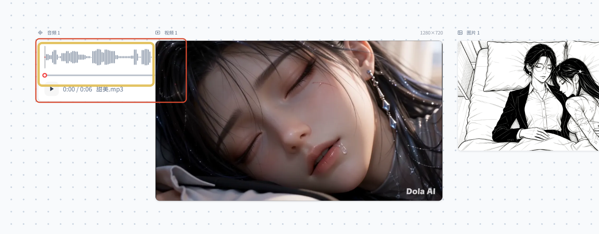

# 28 · 音频节点尺寸与布局对不上

- 状态：已完成
- 负责人：Codex
- 完成时间：2026-11-14

## 你的原话

> 图片中红色框是你这边音频节点的大小。但是你这边计算的时候，实际的大小就相当于黄色框的形状，或者是更小。
> 因为我这边还没有把边距算进去，所以你这个布局的「CTRL 上下左右」插件就存在问题，可能你的其他地方也会存在问题，因为你的音频节点没有正确获取对应的 size（即节点的宽高）。
> 我的节点是使用一个统一的字段来进行处理的。

## 要解决的问题

布局、对齐、自动布局读到的音频节点宽高，要和画布上真正画出来的卡片一致。

## 范围与位置

- 页面：画布（音频节点 + 视频节点 + 图片节点）
- 参考代码：
  - `packages/plugins/plugin-node-audio/src/nodeAudioPlugin.ts`（音频节点类型 / 建节点）
  - `packages/plugins/plugin-file-drop/src/fileDropEngine.ts`（拖入音频文件）
  - `packages/plugins/plugin-node-video/src/videoAudioFlow.ts`（视频转音频的占位节点）
  - `packages/engine/canvas-data/src/nodeStore.ts`（统一尺寸字段 `size` 的写口）
- 关联问题：无

## 现在 vs 期望

|  | 现在 | 期望 |
| --- | --- | --- |
| 音频节点尺寸 | 只有类型默认尺寸，节点上没有 `size`；布局只能靠兜底或默认值 | 每个音频节点都有统一的 `size`，布局读到的就是卡片实际宽高 |
| 旧画布 | 旧音频节点没有 `size`，布局框可能比卡片小 | 打开旧画布时自动补齐，不覆盖已有尺寸 |
| `data.cardWidth` 和 `size` | 节点已有 `size` 时，再只写 `data.cardWidth` 会与 `size` 脱节 | 二者始终同值 |

## 问题原因

- 复现步骤：画布里放一个音频节点和一个视频节点；选中后用 Ctrl+方向键紧凑排列，量两个节点的框与卡片边界。
- 证据：
  - 画布保存数据中，视频/图片节点都有 `size`，音频节点没有；
  - 修前 `view.nodeSize()` 只能回落到类型默认尺寸；卡片与实测/声明值不是同一条来源；
  - `nodeStore.applyPatch` 只在 `size` 为空时从 `data.cardWidth` 提升，已有 `size` 时后续卡片尺寸写入不会同步。
- 根因：音频节点没有写统一尺寸字段；数据层的“镜像提升”只在 `size` 缺席时生效。

## 修改方案

- 改哪里：`nodeStore`、音频节点插件、拖入文件、视频转音频、对应测试。
- 怎么改：
  - 音频插件建节点时同时写 `size`；旧节点在装载时和画布恢复后补齐（只补缺 `size` 的）；
  - 拖入音频文件、视频转音频占位节点也写 `size`；
  - `data.cardWidth/cardHeight` 显式写入时，`size` 跟着同步。
- 为什么这样改：尺寸只有一个正身 `size`，卡片镜像由它生成；布局、对齐、自动布局都读同一条链。
- 风险 / 影响面：会改数据层尺寸语义；已有 `size` 的节点不会被覆盖；补齐只针对音频类型且缺 `size` 的节点。
- 验证方式：单测 + Chrome 实测（读保存数据、量 DOM、执行 Ctrl+方向键排列）。

## 验收标准

- [x] 音频节点建出来后，`size` 与卡片尺寸一致。
- [x] 旧画布里的音频节点在打开后补齐 `size`。
- [x] 拖入音频文件、视频转音频创建的音频节点都有 `size`。
- [x] `data.cardWidth/cardHeight` 与 `size` 不再脱节。
- [x] Chrome 实测：音频节点外层与卡片都是 320×120；Ctrl+方向键排列后重新进入画布不报错。

## 不能动

- 不覆盖用户/其它插件已经写过的尺寸。
- 不改音频节点“不可拖拽 resize”的行为。

## 假设与待确认

- 假设：音频节点尺寸是固定 320×120（由类型默认尺寸决定，设置面板可改）。
- 待确认：无。

## 执行指令

把音频节点的尺寸收进统一字段；不改别的节点类型；改完跑相关包测试与类型检查，并在 Chrome 里用真实画布复测。

## 图片

图片说明：红框是视觉上的整张卡片，黄框是布局参与排列时用的框；二者不一致时，Ctrl+方向键会互相压住。

## 执行记录

- 改动文件：
  - `packages/engine/canvas-data/src/nodeStore.ts`
  - `packages/plugins/plugin-node-audio/src/nodeAudioPlugin.ts`
  - `packages/plugins/plugin-file-drop/src/fileDropEngine.ts`
  - `packages/plugins/plugin-node-video/src/videoAudioFlow.ts`
  - 对应测试 5 个文件
- 验证命令与结果：
  - `pnpm -C packages/engine/canvas-data test`：464 passed
  - `pnpm -C packages/plugins/plugin-node-audio test`：112 passed
  - `pnpm -C packages/plugins/plugin-file-drop test`：49 passed
  - `pnpm -C packages/plugins/plugin-node-video test`：294 passed
  - `pnpm -C packages/engine/canvas-render test`：622 passed
  - `pnpm -C packages/plugins/plugin-align-arrange test`：26 passed
  - `pnpm -C packages/plugins/plugin-auto-layout test`：44 passed
  - 相关包 `typecheck` 通过。
- 完成时间：2026-11-14
- 代码提交（可选）：未提交
