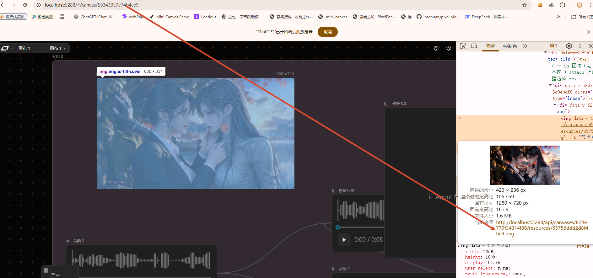

# 36 · 画布资源只认本画布

- 状态：已完成
- 负责人：Codex
- 完成时间：2026-11-17

## 你的原话

> 我这边图片复制粘贴，或者说我这边拖拽这个资产库数据（图片、节点组）到画布中的时候，你这里的图片资源链接存在一些问题。可以看到你一张画布引用了另一张画布的资源，包括你的这个节点组保存的时候就有问题。
>
> 我需要进行一个规范：不管你是通过什么方式把资源放在我的节点里面，首先，我画布中的节点都是通过引用来获取对应图片的，因为我当前的节点，就是我后台是如何保存数据的。我这边我的一个资源统一使用的是一个 ID 来进行绑定（你的这个链接，它是通过这个 ID 来获取 URL 地址的）。
>
> 我总结一下：不允许当前画布引用其他画布的内容和资源，所有资源都保存到对应的画布里面。因为我们这边一个画布就相当于是一个文件夹，画布中禁止出现第三方 url 和其他画布资源数据，这是硬性规定。

## 要解决的问题

一张画布就是文件夹，里面只能有它自己的东西。画布 A 里显示的图片、视频、音频，只能来自画布 A 自己的资源目录。

不管用户是复制粘贴、拖资产库、拖文件、导入节点组，还是后台生成，资源都要先复制进画布 A，再拿一个属于画布 A 的 ID。画布数据里不允许出现别的画布的地址（`/api/canvases/<别的画布id>/resources/...`）、别的画布的逻辑 ID（`<别的画布id>/<哈希>`）和第三方地址（`https://...`）。

## 范围与位置

- 页面：画布（本地 5288 与云端 8865 两种形态都要看）
- 参考代码：`packages/engine/canvas-data/src/resourceService.ts` 的 `ResourceStore` 与 `sanitizeTransientResourceUrls`、`packages/engine/canvas-data/src/storage/types.ts` 的 `ResourceAdapter`、`packages/plugins/plugin-cloud-client/src/cloudResourceAdapter.ts` 的 `resolveResource/putResource`、`packages/plugins/plugin-cloud-client/src/keys.ts` 的 `restoreMediaUrls`、`packages/plugins/plugin-cloud-client/src/restore.ts`、`packages/plugins/plugin-cloud-client/src/plugin.ts` 的 `migrateLocalResources`、`packages/plugins/plugin-file-drop/src/fileDropPlugin.ts` 的 `storeAndResolve/addFiles`、`packages/plugins/plugin-clipboard/src/clipboardPlugin.ts` 的 `prepareSnapshotMedia`、`apps/web/src/composables/ui/useCreateNode.ts` 的 `createAssetNode/addFolderAssetsToCanvas`、`packages/plugins/plugin-node-image/src/nodeImagePlugin.ts` 的 `addImageNodeWithSize`、`packages/plugins/plugin-node-video/src/nodeVideoPlugin.ts` 的 `addVideoNodeWithMeta`、`packages/plugins/plugin-node-image/src/imageOps.ts` 的 `imageSourceFields/displayUrlOf`、`packages/plugins/plugin-node-video/src/videoOps.ts`、`packages/plugins/plugin-node-audio/src/audioOps.ts`
- 相关资源：`images/36-跨画布引用-现状.png`
- 关联问题：37（节点组打包时把资源一起带走）

## 现在 vs 期望

| | 现在 | 期望 |
| --- | --- | --- |
| 当前画布 | `#/canvas/59343957e74b4ce9` | 不变 |
| 图片节点地址 | `/api/canvases/824e779f.../resources/65756dd2d8f4bc4.png`（别的画布） | `/api/canvases/59343957e74b4ce9/resources/<本画布哈希>` |
| 节点里存什么 | `resourceId` 加 `imageUrl`（可能是别的画布地址或外链） | 长期只认 `resourceId`；地址只用于本次渲染，不落盘 |
| 拖资产库图片进画布 | 直接把资产地址写进 `imageUrl`，字节没有进本画布 | 先把字节复制进本画布，拿到本画布 ID 再建节点 |
| 后台恢复画布 | `restoreMediaUrls` 把别的画布地址写回节点 data | 只在本画布内解析；解析不到就留空态并提示 |

## 问题原因

- 状态：已确认
- 复现步骤：一，打开画布 A，从资产库拖一张来自画布 B 的图，或从画布 B 复制图片节点粘贴到 A；二，保存后查看节点 data（或直接看图片请求地址）；三，图片地址仍是画布 B 的 `/api/canvases/<B>/resources/...`。
- 证据（日志 / 截图 / 调用路径）：`sanitizeTransientResourceUrls` 只删 `blob:` 和“带 resourceId 的 data:”，别的画布 URL 原样保存；`restoreMediaUrls` 会把解析出的地址写回 `imageUrl/videoUrl`，跨画布地址因此进入节点数据；`createAssetNode` 把 `asset.url` 直接交给图片/视频/音频服务，没有先复制进本画布；`fileDropPlugin.storeAndResolve` 同时写 `resourceId` 和地址；`clipboardPlugin.prepareSnapshotMedia` 用原 `resourceId` 解析，不复制字节；`cloudResourceAdapter.resolveResource` 对别的画布 ID 会按那个画布拼地址（现有单测明确写了“跨画布引用不自作主张改地址”）；用户截图里当前画布是 `59343957e74b4ce9`，图片却指向 `824e779f...`。
- 根因：**资源“入库”没有统一入口**。谁都可以直接把 URL 写进节点，而保存链路只清临时地址，不校验资源归属。

## 修改方案

- 改哪里：数据层资源契约、云端资源适配器、所有“把资源放进画布”的入口、保存与恢复链路。
- 怎么改：一，定一条硬规则：节点里的资源值只允许本画布逻辑 ID（`<当前画布id>/<hash>`）、本地资源 ID（`res-...`）、本画布资源 URL、以及没有 `resourceId` 的旧 `data:`；其它一律视为外来资源。二，新增统一入口 `resources.adopt(refOrUrl, { kind, name })`：已经是本画布资源就原样返回，是别的画布 ID/URL、资产库地址或第三方 http 地址就取字节、`put()` 进当前后端、返回新 ID，取不到字节返回 undefined 并由调用方明确提示。三，`ResourceAdapter` 增加可选 `ownsResource(ref)`，云端按 `canvasId` 比较、本地认 `res-`；`ResourceStore` 暴露 `owns()` 与 `adopt()`。四，文件拖入/粘贴、资产库拖入与“添加到画布”、文件夹批量添加、跨页面粘贴、云端生成产物写回、节点组导入全部改走 adopt。五，`sanitizeTransientResourceUrls` 扩展为“临时地址与外来地址都清掉”；外来 `resourceId` 不清空，但记入待修复清单。六，画布打开后扫一遍节点，把外来 ID/URL 逐个 adopt 并写回本画布 ID（一次事务），修不好的清掉地址并提示“有 N 个资源无法迁入本画布”。七，`restoreMediaUrls` 不再把地址写回 data，只确认资源存在。八，本地模式至少保证只写 `resourceId`、不写 URL。
- 为什么这样改：只有一个入库口，才不会有人漏改；归属判定放在资源层，保存、导入、粘贴共用一套规则。
- 风险 / 影响面：会动图片/视频/音频的写入与恢复；旧存档可能短暂空白，要靠修复流程补；生成任务写回、视频裁剪/剪辑、音频波形都要回归。
- 验证方式：单测覆盖四种合法值与三种外来值；真实浏览器里复制粘贴、拖资产、拖文件、刷新、切画布各验证一次，并直接检查 `canvas.json` 里没有别的画布 id 和外链。

## 验收标准

- [x] 画布 A 的 `canvas.json` 里，所有 `resourceId` 都以 A 的 id 开头（本地模式以 `res-` 开头）
- [x] `canvas.json` 里没有 `http://`、`https://` 形式的媒体地址
- [x] 从画布 B 复制图片节点粘贴到 A，图片能显示，且节点指向 A 的资源
- [x] 从资产库拖图片/视频/音频到 A，节点指向 A 的资源，不是 `/api/assets/files/...`
- [x] 刷新、切走再切回，图片/视频/音频都还在
- [x] 存量跨画布画布打开后自动修复；修不好的有明确提示，不静默留外链
- [x] 删除节点再撤销，资源不破图

## 不能动

- 不改 `kernel` 的依赖方向，不让 `kernel` 依赖任何 `@plume-canvas` 包
- 不改画布的“文件夹”语义，不把资源复制到全局共享目录
- 不改核心节点外壳文件（`BaseNode.vue`、`MovingHandle.vue`、`BaseTitle.vue`、`CustomEdge.vue`、`ConnectionLine.vue`、`DefaultBackground.vue`）
- 不删除旧存档兼容分支；只允许在读取时回退，不允许在写入时继续产生外来地址

## 假设与待确认

- 已确认：本轮“硬性规定”先严格落在云端画布；本地单机模式沿用同一个浏览器资源库，但节点同样只写 `resourceId`。
- 已确认：外链图片迁不进来时**不阻止拖入**，节点建出来显示空态，并提示「有 N 个资源无法迁入本画布」；地址字段一律不落存档。
- 已确认：存量修复在打开画布时**自动执行并落盘**（一次事务），不额外弹确认。
- 已确认：本地模式本轮**不**按画布切片存储；两个本地画布仍共用一个 IndexedDB，但节点只认 `res-` 引用。

## 执行指令

先做资源层的 `owns/adopt` 和保存清理，再把文件拖入、粘贴、资产库拖入、文件夹添加、云端写回逐个改成走 adopt；最后加打开时的存量修复。改完用真实画布验证，并直接检查保存后的 `canvas.json`。

## 图片

图片说明：当前画布是 `59343957e74b4ce9`，节点图片地址却是 `824e779f...` 画布的资源；这是本次要禁止的情况。

## 执行记录

- 改动文件：`packages/engine/canvas-data/src/storage/types.ts`、`packages/engine/canvas-data/src/storage/indexedDbResourceAdapter.ts`、`packages/engine/canvas-data/src/resourceService.ts`、`packages/engine/canvas-data/src/canvas/canvasBasePlugin.ts`、`packages/engine/canvas-render/src/host/createPlumeHost.ts`、`packages/plugins/plugin-cloud-client/src/cloudResourceAdapter.ts`、`packages/plugins/plugin-cloud-client/src/shims.ts`、`packages/plugins/plugin-cloud-client/src/keys.ts`、`packages/plugins/plugin-cloud-client/src/plugin.ts`、`packages/plugins/plugin-cloud-client/src/appliers.ts`、`packages/plugins/plugin-clipboard/src/clipboardPlugin.ts`、`packages/plugins/plugin-file-drop/src/fileDropPlugin.ts`、`packages/plugins/plugin-node-image/src/nodeImagePlugin.ts`、`packages/plugins/plugin-node-video/src/nodeVideoPlugin.ts`、`packages/plugins/plugin-node-audio/src/nodeAudioPlugin.ts`、`apps/web/src/composables/ui/useCreateNode.ts`、`apps/web/src/assetUploadPlugin.ts` 及对应测试
- 验证命令与结果：`pnpm -C packages/engine/canvas-data test` 47 文件 480 条通过；`canvas-data`、`canvas-render`、`apps/web` typecheck 通过；`plugin-cloud-client` 23 文件 200 条、`plugin-clipboard` 43 条、`plugin-file-drop` 49 条、`plugin-node-image` 143 条、`plugin-node-video` 299 条、`plugin-node-audio` 112 条、`plugin-node-ui` 393 条、`apps/web` 98 文件 650 条全部通过；Chrome 实测 5288 加 8865 的画布 `59343957e74b4ce9`，资产库「图片 1.png」添加到画布后 `canvas.json` 的 `resourceId` 为 `59343957e74b4ce9/65756ddd2d8f4bc4.png`，全文没有 http(s)、别画布地址或资产库地址
- 完成时间：2026-11-17
