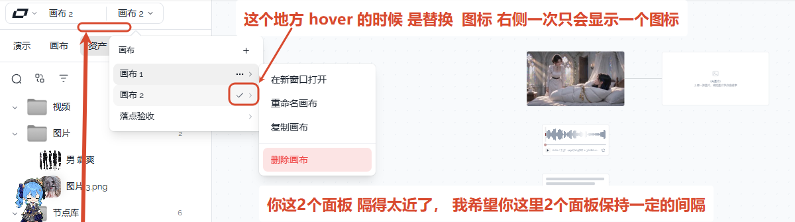

# 01 · 画布列表行尾只显示一个图标

## 你的原话

> 这个地方 hover 的时候 是替换 图标 右侧一次只会显示一个图标

## 要解决的问题

画布下拉里，每一行最右边现在会同时出现两个图标：当前画布是「勾 + 右箭头」，其它行悬停时是「三个点 + 右箭头」。

希望改成：

- 当前画布那一行，不悬停时只显示「勾」。
- 鼠标移到这一行，勾消失，换成「三个点」。
- 其它行平时不显示，鼠标移上去只显示「三个点」。
- 不管什么状态，行尾最多只看到一个图标。

## 范围与位置

- 页面：左上角「画布 2」下拉菜单；打开左侧抽屉时，抽屉头部也有同一个画布下拉。
- 组件 / 文件：
  - `packages/ui/src/components/ProjectCluster.vue`：`canvas-row-more` 里的 `Check`、`MoreHorizontal`，以及子菜单触发器模板里的 `ChevronRightIcon`。
  - `packages/ui/src/__tests__/canvasChipMenu.test.ts`：现有显隐规则的测试；改完要补一条「行尾只有一个图标」的检查。
- 关联问题：本目录的 02 也改 `ProjectCluster.vue`，建议同一次改完、分别验收。

## 现在 vs 期望

| | 现在 | 期望 |
| --- | --- | --- |
| 当前画布行，未悬停 | 勾 + 右箭头，两个图标 | 只有勾 |
| 当前画布行，鼠标悬停 | 勾换成三个点，但右箭头还在 | 只有三个点 |
| 其它行，鼠标悬停 | 三个点 + 右箭头 | 只有三个点 |
| 行尾可点区域 | 44px，给两个图标留了位置 | 一个图标的标准可点区（建议 32px），不出现空图标位 |
| 点击名字 / 点击图标 | 分别切换画布 / 打开操作菜单 | 保持不变 |

## 验收标准

- [ ] 当前画布行未悬停时，行尾只能看到 1 个图标（勾），看不到右箭头。
- [ ] 鼠标移到当前画布行，勾消失并换成三个点，行尾仍然只有 1 个图标。
- [ ] 鼠标移到其它画布行，只出现三个点，不出现右箭头。
- [ ] 行尾按钮的宽度不因悬停改变，鼠标移入移出时行内容不左右跳动。
- [ ] 点击行尾图标仍能打开「在新窗口打开 / 重命名画布 / 复制画布 / 删除画布」四项菜单。
- [ ] 点击画布名字仍能切换画布，菜单会自动收起。
- [ ] 亮色、暗色主题都检查一遍；左上角和左侧抽屉头部各检查一遍。

## 不能动

- 不改四项操作菜单的文字、顺序和功能。
- 不改「勾表示当前画布」的含义。
- 不改点击名字切换画布、点击三个点开菜单这两种行为。
- 不改行的 32px 高度、整行悬停底色和 150ms 左右的淡入淡出。
- 不改其它菜单的箭头显示规则。

## 假设与待确认

- 假设：用户要去掉的是子菜单自动加的右箭头；不是让勾和三个点同时留着。
- 假设：隐藏箭头后，行尾按钮从 44px 收回到 32px 的单图标宽度；如果保留 44px 会在右边留下明显空白。
- 待确认：以上两条是否同意。若希望保留 44px 宽度，只需改验收标准里的宽度，不影响其它规则。

## 给执行 AI 的指令

只改画布列表行尾的图标呈现：去掉这个行尾自动带出的右箭头，保留「勾 / 三个点」的替换；任何时刻行尾最多一个图标。

保持点击切画布、点击图标开菜单、四项菜单、整行底色、32px 行高和淡入淡出不变。改完在左上角和左抽屉头部各看一遍亮色、暗色，并确认鼠标移入移出行内容不跳。

## 图片

图片说明：红框圈住的「画布 2」是当前画布，行尾同时有勾和右箭头；上方红字是用户对这条问题的说明。

