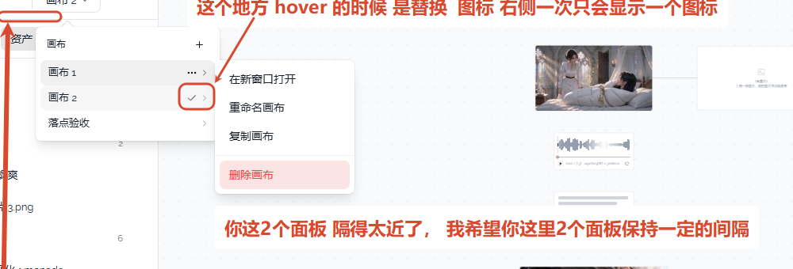

# 02 · 画布列表和操作菜单留出间隔

## 你的原话

> 你这2个面板 隔得太近了，我希望你这里2个面板保持一定的间隔

## 要解决的问题

画布列表是左边的面板，点行尾三个点后，操作菜单在右边展开。现在两块面板的边缘几乎贴在一起，看起来像一块被切开的面板。

希望两块面板之间留出清楚、稳定的空隙，菜单仍然贴着对应那一行展开，不要跑到很远的地方。

## 范围与位置

- 页面：左上角「画布 2」下拉菜单；左侧抽屉头部的同一个画布下拉。
- 组件 / 文件：
  - `packages/ui/src/components/ProjectCluster.vue`：`<DropdownMenuSubContent>` 现在只设置了最小宽度，没有设置侧向间隔。
  - `packages/ui-kit-shadcn/src/components/ui/dropdown-menu/DropdownMenuSubContent.vue`：会把 `sideOffset` 原样传给底层菜单。
- 关联问题：本目录的 01 也改 `ProjectCluster.vue`，建议一起改、分别验收。

## 现在 vs 期望

| | 现在 | 期望 |
| --- | --- | --- |
| 两块面板的左右关系 | 边缘几乎贴在一起，截图里只有一条很窄的缝 | 父面板右边缘到子面板左边缘留 8px 的可见空隙 |
| 子菜单跟哪一行 | 跟当前点开的行对齐 | 保持不变 |
| 父菜单 | 子菜单打开时保持显示 | 保持不变 |
| 屏幕右边空间不够时 | 交给菜单组件自动翻转 | 翻转后仍保持 8px 空隙 |

## 验收标准

- [ ] 在 100% 页面缩放下，画布列表右边缘到操作菜单左边缘的水平空隙为 8px，允许 7–9px 的取整误差。
- [ ] 空隙是稳定的：打开不同行的操作菜单，间隔不忽大忽小。
- [ ] 操作菜单仍然贴着对应行的高度展开，不上下乱跳。
- [ ] 子菜单打开时，父级画布列表不消失。
- [ ] 菜单在屏幕右侧空间不足而翻到左边时，仍然保持 8px 空隙。
- [ ] 亮色、暗色主题都检查一遍。

## 不能动

- 不改两个菜单的宽度：父菜单最小 232px，操作菜单最小 176px。
- 不改四项菜单的文字、顺序、图标和点击行为。
- 不改画布列表的行高、行尾图标和整行悬停底色。
- 不把这条规则推广到全站所有子菜单；本次只改画布下拉这一对面板。

## 假设与待确认

- 假设：8px 指两块面板**看得见的边缘**之间的距离，不是菜单组件内部的偏移参数。
- 实现提示：父面板自带内边距。先给子菜单设置 `side-offset="8"`，再在浏览器里量两块可见面板的边缘；如果量出来不是 8px，就调这个参数，直到可见空隙落在 7–9px。
- 待确认：8px 是否合适。若想要更宽，例如 12px，只改这个数值和验收标准。

## 给执行 AI 的指令

只改画布下拉的操作子菜单与父菜单之间的水平间隔：让两块面板的可见边缘相距 8px，保留现有宽度、对齐、翻转、条目和开关行为。

不要全站批量修改子菜单。改完在浏览器里量父面板右边缘和子面板左边缘，确认是 8px 左右；再检查亮色、暗色，以及靠近屏幕右边时的翻转状态。

## 图片

图片说明：左边是画布列表，右边是「画布 2」的操作菜单；红字指出两块面板隔得太近。

