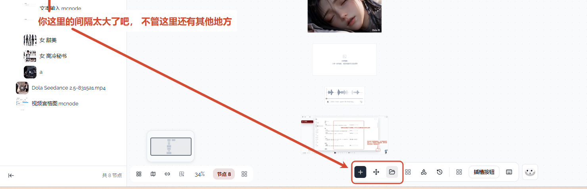
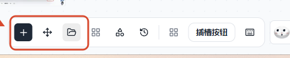

# 03 · 收紧底部工具栏按钮间距

## 你的原话

> 你这里的间隔太大了吧，不管这里还有其他地方

## 要解决的问题

底部工具栏里，相邻的图标按钮之间留着 8px 的空隙，看起来比按钮本身还抢眼。用户希望把这一类按钮之间的空隙收紧到 4px，并把右上角同样的图标按钮组一起统一。

这次只改「按钮和按钮之间」的空隙，不改按钮大小、工具栏高度和按钮顺序。

## 范围与位置

- 页面：底部中间的「画布工具栏」；右上角的「主题切换 / 设置」两个按钮。
- 组件 / 文件：
  - `packages/ui/src/components/areas/DockArea.vue`：外层托盘和 `SlotComposer` 现在使用 `gap-2`（8px）。
  - `packages/ui/src/components/areas/TopRightArea.vue`：两个图标按钮的容器现在使用 `gap-2`（8px）。
  - `packages/ui/src/components/areas/StatusArea.vue`、`packages/ui/src/components/areas/left-drawer/CanvasTabToolbar.vue`、`packages/ui/src/components/areas/LeftDrawer.vue`：已经是 4px，作为对照，不改。
- 关联问题：无。与 01、02 改的文件不同。

## 现在 vs 期望

| | 现在 | 期望 |
| --- | --- | --- |
| 底部工具栏相邻按钮 | 8px 空隙 | 4px 空隙 |
| 底部工具栏和 Agent 球之间 | 8px 空隙 | 保持 8px，不跟着收紧 |
| 右上角两个图标按钮 | 8px 空隙 | 4px 空隙 |
| 按钮大小 | 32px 图标按钮 | 保持 32px |
| 工具栏高度 | 50px | 保持 50px |
| 按钮顺序、图标、点击 | 现有行为 | 完全不变 |

## 验收标准

- [ ] 在 100% 页面缩放下，底部工具栏里相邻两个 32px 图标按钮之间的水平空隙为 4px。
- [ ] 底部工具栏和右侧 Agent 球之间仍是 8px，不出现挤在一起的感觉。
- [ ] 右上角「主题切换 / 设置」两个按钮之间为 4px。
- [ ] 按钮仍是 32px，工具栏仍是 50px，图标仍是原来的大小和顺序。
- [ ] 分隔线、插件条目「插槽按钮」和「快捷键」按钮都没有重叠、被裁掉或换行。
- [ ] 在 1280px 宽的窗口里，底部工具栏仍能完整显示。
- [ ] 亮色、暗色主题都检查一遍。

## 不能动

- 不改按钮的点击行为、图标和顺序。
- 不改底部工具栏的高度、圆角、边框、底色和外层左右内边距。
- 不改底部工具栏与 Agent 球之间的距离。
- 不改状态栏、左侧页签和抽屉工具栏；它们现在已经是 4px。
- 不为了收紧间距而缩小按钮或图标。

## 假设与待确认

- 假设：用户说的「间隔太大」指工具栏内部按钮之间的水平空隙，不是工具栏到屏幕底边的距离。
- 假设：「其他类似地方」包括右上角两个图标按钮；状态栏和左侧页签已经是 4px，不重复改。
- 待确认：如果用户还想收其它位置，需要指出具体位置，再单独列一条。

## 给执行 AI 的指令

把底部工具栏内部的按钮组间距从 8px 收紧到 4px，右上角两个图标按钮也改成 4px；保持按钮 32px、工具栏 50px、Agent 球距离 8px、按钮顺序和点击行为不变。

改完在真实页面检查「插槽按钮」、分隔线和快捷键按钮没有重叠；再量一遍相邻按钮的实际空隙，确认是 4px。亮色、暗色和 1280px 宽窗口都要看。

## 图片

图片说明：红框圈住的是「添加 / 移动 / 素材库」三个按钮；红字指出这里的间隔太大，并提醒其它类似位置也要看。

图片说明：放大后可以直接对照按钮之间和按钮组之间的空隙。

