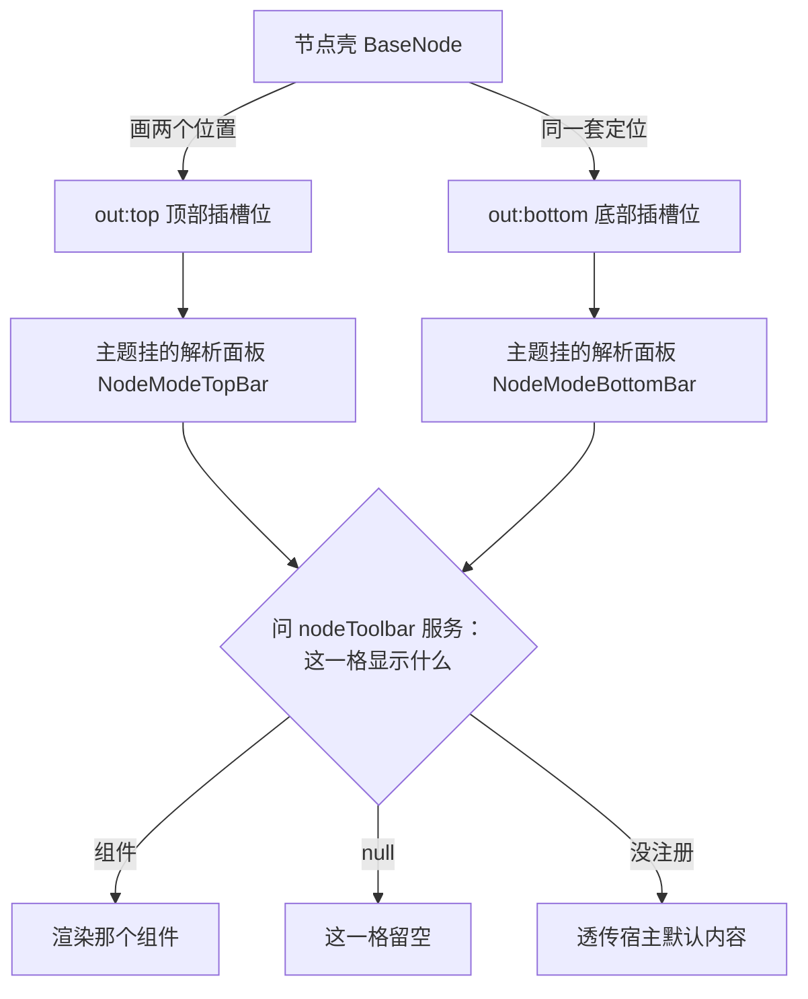

# 案例 9 · 往节点状态栏装按钮（nodeToolbar 式）

## 这个案例能做到什么

**装上这个插件，图片节点的顶部状态栏里多出一个「盖章」按钮**；再点菜单里的「进入盖章模式」，
顶部状态栏整条换成你自己的按钮组，退出后恢复原样。不改图片插件一行代码，也不改主题插件。

装上后你会看到：

- 平时：顶部那排按钮（上传 / 裁剪 / 扩展 / …）里多了「盖章」；
- 功能模式：顶部整条只剩你的按钮 + 「退出」；底部状态栏此期间保持原样（想让它也换，见下文）。

这一页讲清三件事：**往哪里装**（三种方式）、**怎么装**（完整代码）、**为什么这样设计**（原理）。
仓库里 `plugin-ui-demo`（往按钮组里插一条）和 `plugin-node-image`（注册默认顶栏 + 功能模式）用的就是这套机制。

## 先弄懂：卡片上下有哪两根栏

每个节点的卡片上方和下方各有一个**固定插槽位**（位置由节点壳 BaseNode 统一负责：
离卡片多远、水平居中、画布缩放时按钮大小不变，全都算好了）。你的插件不跟位置打交道，
只回答一个问题：**这一格里显示什么**。



服务怎么裁决（按顺序，命中即停）：

1. **会话里指定的模式**（这个节点正在某个功能模式里）声明了这一格 → 用它；
2. 没进模式（或模式没声明这一格）→ 回退到 `id: 'default'` 的注册；
3. 还是没有 → 透传宿主默认内容（老式段注册照常工作）。

三个关键规则（都由服务保证，你不用操心）：

- **同一个 id 可以注册多份**：用 `types` 区分适用节点类型，`order` 最小者赢（与全仓插槽排序同一套约定）；
- **顶栏和底栏分开裁决**：图片插件只注册 `topBar`、bottom-bar 只注册 `bottomBar`，两份都叫 `default`，互不覆盖；
- **一根栏有三种取值**：组件（渲染它）/ `null`（这一格不显示）/ 字符串（跟随另一个模式 id 的同一格，写 `'default'` 即保持默认面板）。

## 三种装按钮的方式，先选对

| 我想做的事 | 用哪种 | 本页哪节 |
| --- | --- | --- |
| 给**某类节点的默认顶栏**多一个按钮（和上传/裁剪并排） | 方式 A：往按钮组的插槽里插一条 | [方式 A](#方式-a-往按钮组里插一条) |
| 给**没有状态栏的节点类型**配一根默认栏 | 方式 B：注册 `default` 模式 | [方式 B](#方式-b-注册一根默认栏) |
| 做一个**临时接管状态栏的功能模式**（裁剪/扩展那种） | 方式 C：注册自己的模式 + enter/exit | [方式 C](#方式-c-注册一个功能模式) |

## 完整代码

```
my-stamp-button/
├── package.json       # 插件身份证
└── src/
    ├── index.ts       # 注册：默认按钮 + 功能模式
    └── StampPanel.vue # 功能模式的顶栏内容
```

```json
// 文件：my-stamp-button/package.json
{
  "name": "@my/stamp-button",
  "version": "0.0.0",
  "private": true,
  "type": "module",
  "miniCanvas": {
    "title": "盖章按钮",
    "description": "往图片节点顶栏装一个「盖章」按钮 + 一个功能模式",
    "pluginName": "stamp-button",
    "installable": true
  },
  "main": "./src/index.ts",
  "types": "./src/index.ts",
  "exports": {
    ".": { "types": "./src/index.ts", "default": "./src/index.ts" },
    "./*": "./src/*"
  },
  "dependencies": {
    "@mini-canvas/canvas-base": "workspace:*"
  },
  "peerDependencies": {
    "@mini-canvas/canvas-render": "workspace:*",
    "vue": "^3.5"
  }
}
```

```ts
// 文件：my-stamp-button/src/index.ts
import { markRaw } from 'vue'
import type { Context } from '@mini-canvas/canvas-base'
import StampPanel from './StampPanel.vue'

export const name = 'stamp-button'
export const inject = [] as string[]   // nodeToolbar 是主题的服务：可选依赖用 tryGet，不进 inject

export function apply(ctx: Context): void {
  // ── 方式 A：往图片默认顶栏的按钮组里插一条 ──
  //  只对「面板内部开了 SlotComposer」的默认栏有效（目前是图片顶栏 image.topToolbar）。
  //  按钮会与 host/upload、host/crop、host/expand 排在**同一排**，不会另起一块。
  ctx.slots.register('image.topToolbar', {
    id: 'stamp-button/entry',
    order: 500,                 // 排在内置按钮（100/200/300）后面
    component: markRaw(StampEntry),
  })

  // ── 方式 B + C：注册默认栏与功能模式（都走 nodeToolbar 服务）──
  const register = (): boolean => {
    const svc = ctx.tryGet<{ registerMode?(mode: unknown): void } | undefined>('nodeToolbar')
    if (!svc?.registerMode) return false

    // 方式 B：给图片节点注册一根默认顶栏（如果它还没有的话）。
    //  注意：这里**只是演示**——图片插件自己已经注册了默认顶栏（topBar: ImageTopToolbar）。
    //  你若也注册 id:'default'，就要跟它比 order：order 更小 = 顶替它。
    //  ⚠️ 只声明你负责的那一格：只想换顶栏就别写 bottomBar（否则会把别人的底栏顶掉）。
    //
    // svc.registerMode({
    //   id: 'default',
    //   types: ['image'],
    //   topBar: MyImageTopBar,
    //   order: 100,             // 与图片插件同 order 时后注册者胜
    // })

    // 方式 C：注册一个功能模式。进入后：
    //  - 顶栏整格换成 StampPanel（topBar 指定的组件）；
    //  - 底栏整格**消失**（bottomBar: null）—— 用户口径：功能模式只在顶栏操作，
    //    底部不要再铺一块重复的控制栏。
    svc.registerMode({
      id: 'stamp/mode',
      types: ['image'],
      title: '盖章模式',
      topBar: markRaw(StampPanel),
      bottomBar: null,
    })
    return true
  }
  if (!register()) {
    // 主题还没装（装配顺序在后/热装）：等它上架再试一次，成功就解绑。
    //  这与案例 7「等 bottom-bar 装好」是同一条两腿走路的规矩。
    const off = ctx.on('ctx:plugin-installed', () => {
      if (register()) off.dispose()
    })
  }
}
```

方式 A 里那条按钮组件：

```vue
<!-- 文件：my-stamp-button/src/StampEntry.vue -->
<!-- 往默认顶栏按钮组里插的一条：必须按名取主题按钮，不许自绘 -->
<script setup lang="ts">
import { useCanvasRender, useSoleNodeSelected, useUiComponent } from '@mini-canvas/canvas-render'
import { openStampMode } from './stampSession'   // 你自己的会话状态（纯内存，不写节点 data）

const props = defineProps<{ nodeId?: string; data?: Record<string, unknown> }>()
const { ctx } = useCanvasRender()
const Button = useUiComponent('toolbarButton')       // 普通按钮（图标 / 图标+文字）
const DropdownButton = useUiComponent('toolbarDropdown') // 下拉按钮（菜单是独立浮层）

const selected = useSoleNodeSelected(props.nodeId ?? '')
const STAMP_ICON = '<svg viewBox="0 0 24 24" fill="none" stroke="currentColor" stroke-width="2"><circle cx="12" cy="12" r="9"/><path d="M8 12h8"/></svg>'

function enter(): void {
  if (!props.nodeId) return
  openStampMode(props.nodeId)
  ctx.tryGet<{ enter?(id: string, modeId: string): void }>('nodeToolbar')
    ?.enter?.(props.nodeId, 'stamp/mode')
}
</script>

<template>
  <!-- 显隐自己判断：恰好选中本节点才出现 -->
  <Button v-if="selected" title="盖章" :icon="STAMP_ICON" @click="enter" />
</template>
```

方式 C 的模式面板：

```vue
<!-- 文件：my-stamp-button/src/StampPanel.vue -->
<!-- 功能模式的顶栏内容：整格替换默认按钮组 -->
<script setup lang="ts">
import { useCanvasRender, useUiComponent } from '@mini-canvas/canvas-render'
import { closeStampMode } from './stampSession'

const props = defineProps<{ id: string; data: Record<string, unknown> }>()
const { ctx } = useCanvasRender()
const Button = useUiComponent('toolbarButton')
const DropdownButton = useUiComponent('toolbarDropdown')

const STAMP_ICON = '<svg viewBox="0 0 24 24" fill="none" stroke="currentColor" stroke-width="2"><circle cx="12" cy="12" r="9"/><path d="M8 12h8"/></svg>'

function exit(): void {
  closeStampMode()
  ctx.tryGet<{ exit?(id: string): void }>('nodeToolbar')?.exit?.(props.id)
}
</script>

<template>
  <!-- 菜单 + 二级菜单都是 toolbarDropdown 的能力（独立浮层，不嵌进面板） -->
  <DropdownButton
    title="盖章形状"
    :icon="STAMP_ICON"
    :items="[
      { key: 'round', label: '圆形' },
      { key: 'square', label: '方形' },
      { key: 'more', label: '更多', children: [{ key: 'star', label: '星形' }] },
    ]"
    @pick="(key) => $emit('pick', key)"
  />
  <Button title="应用" variant="primary">应用</Button>
  <Button title="退出盖章" variant="danger" @click="exit">退出</Button>
</template>
```

<a id="方式-a-往按钮组里插一条"></a>

## 方式 A · 往按钮组里插一条

适用：图片顶栏这种**面板内部开了 SlotComposer** 的默认栏。按钮与内置按钮排在同一排，
支持被其它插件继续排序。

```ts
ctx.slots.register('image.topToolbar', {
  id: '你的插件/条目名',   // 同槽唯一；卸载自动摘除
  order: 500,             // 内置：上传 100 / 裁剪 200 / 扩展 300
  component: markRaw(MyEntry),
})
```

两条硬规矩：

1. **组件必须按名取主题按钮**（`useUiComponent('toolbarButton')`），不许自绘 ——
   否则同一排出现两种圆角/高度，就是用户报过很多次的「按钮在外面」问题；
2. **显隐自己判断**（`useSoleNodeSelected`）：宿主只管位置，每个条目自己决定「我该不该出现」。

限制：目前只有图片顶栏开了这个插槽。视频/音频的默认栏是普通组件，想插按钮就用方式 B/C。

<a id="方式-b-注册一根默认栏"></a>

## 方式 B · 注册一根默认栏

适用：给某类节点配「平时就显示」的状态栏。

```ts
svc.registerMode({
  id: 'default',
  types: ['video'],
  topBar: VideoTopBar,       // 只注册你负责的那一格
  order: 100,
})
```

裁决规则：同 id 多份注册里，**types 命中本节点类型、且声明了这一格**的那些，order 最小者赢。
所以：

- 只想换顶栏就**只写 topBar** —— 写了 `bottomBar` 就等于把别人的底栏也顶掉；
- 想给不同节点类型不同的栏 → 同 id 注册多份，types 区分（这就是 bottom-bar 给
  `['text','image','video','audio']` 一份、你可以再给 `['image']` 另一份的用法）；
- `order` 与主题槽、插槽排序同一套约定：**小者赢**。

<a id="方式-c-注册一个功能模式"></a>

## 方式 C · 注册一个功能模式

适用：裁剪/扩展/宫格切分这类「临时接管」。

```ts
svc.registerMode({
  id: 'stamp/mode',          // 跨插件约定：插件名/模式名
  types: ['image'],
  topBar: StampPanel,        // 接管顶栏
  bottomBar: null,           // null = 底栏整格消失（不想动底栏就别写这个字段）
})

// 进入 / 退出（幂等）：
svc.enter(nodeId, 'stamp/mode')
svc.exit(nodeId)
```

进入后顶栏整格换成 `topBar`，底栏按 `bottomBar` 的取值处理：不写 = 保持默认面板；
`null` = 消失；字符串 = 跟随另一个模式（写 `'default'` 即保持默认面板）。
会话是响应式的，`enter` 一执行，两根栏同时切换，不需要谁通知谁。

## 原理：从节点壳到你按钮的完整链路

按渲染顺序走一遍：

1. **节点壳画两个位置**。BaseNode 读 `out:top` / `out:bottom` 两个区域栈，
   用同一套数学定位（`resolveNodeSlotStyle`：`left:50%` + `bottom: calc(100% + 偏移)` +
   `translateX(-50%) scale(1/zoom)`）。偏移数值来自主题配置（「布局/控制栏」两个滑块），
   所以**换偏移配置对两根栏同时生效**。

2. **主题往两个位置各挂一个解析面板**（装配时执行一次）：

   ```ts
   // packages/plugins/plugin-theme-default/src/index.ts
   ctx.nodes.attach('*', { region: 'out:top',    component: NodeModeTopBar })
   ctx.nodes.attach('*', { region: 'out:bottom', component: NodeModeBottomBar })
   ```

   `'*'` = 所有节点类型。每个节点、每个位置，永远只有这一个渲染入口 ——
   这就是「为什么不会再出现两套栏」的根源。

3. **解析面板问服务**：

   ```ts
   const bar = svc.resolveBar(props.id, 'top', props.type)
   // → { kind: 'component', component } | { kind: 'none' } | { kind: 'inherit' }
   ```

   底栏比顶栏多一道判断：**必须恰好选中本节点**（`useSoleNodeSelected`）。
   因为下栏挂在每个节点的锚点上，不加这道判断，未选中的节点也会各长一条生成栏。

4. **服务按（模式 → default → inherit）裁决**。裁决时只在「声明了这一格」的注册里比 order ——
   顶栏底栏分开算，谁也不覆盖谁。字符串取值会顺着引用链走（深度上限 8 层，防写错死循环）。

5. **渲染**：`component :is` 挂上你的组件，props 是 `{ id, data }`。
   你的按钮内部用 `useUiComponent` 按名取主题件（`toolbarButton` / `toolbarDropdown`），
   换主题时整套跟着换，你的代码零改动。

## 两个按钮件的速查

### toolbarButton（普通按钮）

```vue
<Button title="上传图片" :icon="ICON_UPLOAD" />              <!-- 纯图标 -->
<Button title="确认" variant="primary">确认</Button>          <!-- 图标/文字 -->
<Button title="取消" variant="danger">取消</Button>           <!-- 危险动作 -->
<Button title="收藏" :icon="ICON" :active="on" />            <!-- 开关态 -->
```

### toolbarDropdown（下拉按钮）

```vue
<DropdownButton
  title="宫格切分"
  :icon="ICON"
  :items="[
    { key: 'a', label: '动作一' },
    { key: 'sub', label: '自定义', children: [          <!-- children = 二级菜单 -->
      { key: 'a1', label: '格子一' },
    ] },
    { key: 'panel', label: '色板', panel: {            <!-- panel = 右侧自定义面板 -->
      render: ({ close }) => h(MyColorPicker, { onPick: close }),
    } },
  ]"
  placement="bottom"        <!-- 方向 + 对齐：bottom / bottom-start / bottom-end -->
  :arrow="false"            <!-- 菜单上方的小箭头，默认关 -->
  @pick="(key, path) => …"
/>
```

默认：箭头隐藏、底部左对齐（`placement: 'bottom-start'`）。菜单与二级菜单都是独立浮层，
卡片间隔固定 12px。

想把一块自绘面板挂进某一项（宫格选择器、色板这类），就给那一项加 `panel`：
`component` 直接给组件、`render` 自己组内容（能拿到 `close` / `pick`），`children` 仍是文字二级菜单。
宫格切分就是「滑到几乘几、点一下直接切」——面板里不需要再放一个确定按钮。
完整说明见 [工具栏下拉按钮](/plugins/theme-components/toolbar-dropdown-button)。

## 注意事项

1. **不 import 其它插件**：跨插件只认服务名（`ctx.tryGet('nodeToolbar')`）和 ui 目录名。
   插件之间互相 import 是硬红线。
2. **主题没装也能活**：注册函数 + `ctx:plugin-installed` 两腿走路（案例 7 同款），
   不赌装配顺序。
3. **markRaw 包组件**：`component: markRaw(MyPanel)` —— 注册槽和服务注册都要包，
   避免 Vue 把组件定义变成响应式。
4. **功能模式的面板自己守门**：确认/取消之后记得 `exit`；面板根元素建议按会话状态 `v-if`，
   防止模式已退出还挂着旧 UI。
5. **别跟默认模式抢 order 除非你真的想顶替**：图片顶栏 order 是 100，
   演示插件用 500 —— 故意排在后面。想顶替才给更小的 order。

## 真实插件参照

| 想抄什么 | 看哪里 |
| --- | --- |
| 往按钮组插一条 + 下拉二级菜单 | `packages/plugins/plugin-ui-demo`（DemoTopEntry） |
| 注册默认顶栏 + 功能模式（裁剪/扩展，bottomBar: null） | `packages/plugins/plugin-node-image/src/nodeImagePlugin.ts` |
| 默认底栏的注册者（与节点插件平等） | `packages/plugins/plugin-bottom-bar/src/nodeBarPlugin.ts` |
| 服务本体（裁决规则全在这一个文件） | `packages/plugins/plugin-theme-default/src/components/node/nodeToolbarService.ts` |
| 解析面板（顶/底各一个） | 同目录 `NodeModeTopBar.vue` / `NodeModeBottomBar.vue` |
