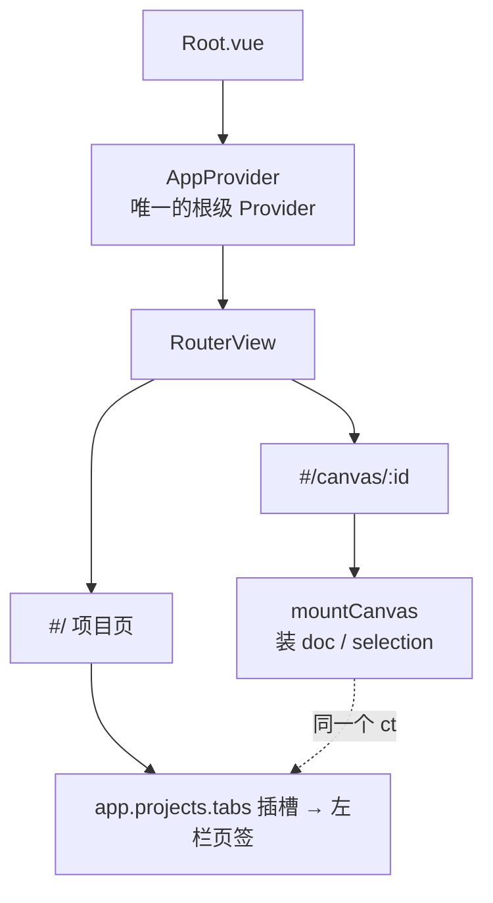

# 案例 10 · 在项目页加一个插件页签

## 这个案例能做到什么

**装上这个插件，项目页（`#/`）左栏多出一个「我的工作台」页签**；
点开就是整页工作台。不用先打开画布，也不用改宿主的任何组件。

页面里有三个按钮：

- **新建项目**：直接调 `projectsApi` 服务，创建后列表刷新就能看到；
- **刷新列表**：重新拉一次项目清单；
- **加入画布**：项目页没有画布时置灰，鼠标悬停显示「打开一张画布后可使用」；
  进入 `#/canvas/:id` 后同一条目自动变成可用，回到项目页又自动置灰。

整个过程只用了「应用级上下文 + 一个固定插槽」，没有第二个 Provider。
同一个组件在画布模式下也可以注册成浮层（素材库就是这么做的），壳不同、内容同一份。

## 先弄懂：项目页与画布页的关系

整个应用只有**一个根 Provider、一个 Context**。项目页一开始就有它；
进入画布时，宿主只是往同一个 Context 里临时装上 `doc` / `selection` / `view`。



因此插件只要 `inject: []`，项目页就能启动；需要画布能力时再 `ctx.tryGet('doc')` 现取。

## 完整代码

```
my-project-panel/
├── package.json
└── src/
    ├── index.ts          # 注册插槽
    └── ProjectPanel.vue  # 面板内容
```

```json
// 文件：my-project-panel/package.json
{
  "name": "my-project-panel",
  "version": "0.0.0",
  "private": true,
  "type": "module",
  "miniCanvas": {
    "title": "我的工作台",
    "description": "项目页上的插件面板示例",
    "pluginName": "my-project-panel",
    "installable": true
  },
  "main": "./src/index.ts",
  "types": "./src/index.ts",
  "exports": {
    ".": { "types": "./src/index.ts", "default": "./src/index.ts" },
    "./*": "./src/*"
  },
  "dependencies": {
    "@mini-canvas/canvas-base": "workspace:*"
  },
  "peerDependencies": {
    "@mini-canvas/canvas-render": "workspace:*",
    "vue": "^3.5.34"
  }
}
```

```ts
// 文件：my-project-panel/src/index.ts（参照 packages/ui/src/projectsPanelPlugin.ts）
import { markRaw } from 'vue'
import type { Context, PluginModule } from '@mini-canvas/canvas-base'
import ProjectPanel from './ProjectPanel.vue'

export const name = 'my-project-panel'
// 关键：不依赖 doc。依赖了就会停在 PENDING，项目页永远看不到这张卡。
export const inject = [] as string[]

export function apply(ctx: Context): void {
  ctx.slots.register('app.projects.tabs', {
    id: 'my-project-panel/main',
    order: 10,
    component: markRaw(ProjectPanel),
    // 左栏页签的文字与图标都从这里读；scroll: false = 页面自己滚（全高页面用）。
    meta: { title: '我的工作台', icon: LayoutGridIcon },
  })
}

export const projectPanelPlugin: PluginModule = { name, inject, apply }
```

```vue
<!-- 文件：my-project-panel/src/ProjectPanel.vue -->
<script setup lang="ts">
import { computed, onBeforeUnmount, onMounted, ref } from 'vue'
import { useCanvasContext, useUiComponent } from '@mini-canvas/canvas-render'

/** 项目数据服务的最小形状（按名取，不 import 宿主） */
interface ProjectSummary { id: string; name: string; createdAt: number; canvasCount: number }
interface ProjectsApi {
  listProjects(): Promise<ProjectSummary[]>
  createProject(name: string): Promise<ProjectSummary>
}

const { ctx } = useCanvasContext()
// 通用按钮按名从 ui 目录取：换主题时这张卡跟着换，不用改 import。
const Button = useUiComponent('Button')

const api = ctx.tryGet<ProjectsApi>('projectsApi')
const projects = ref<ProjectSummary[]>([])
const busy = ref(false)
const error = ref('')

async function load(): Promise<void> {
  if (!api) return
  try {
    projects.value = await api.listProjects()
  } catch (err) {
    error.value = err instanceof Error ? err.message : String(err)
  }
}

async function create(): Promise<void> {
  if (!api) return
  busy.value = true
  error.value = ''
  try {
    const project = await api.createProject('新项目')
    projects.value = [...projects.value, project]
  } catch (err) {
    error.value = err instanceof Error ? err.message : String(err)
  } finally {
    busy.value = false
  }
}

onMounted(() => void load())

// doc 不是响应式的；进入/离开画布时宿主会装卸插件，借这两个事件重算。
const tick = ref(0)
let offInstalled: { dispose(): void } | undefined
let offUninstalled: { dispose(): void } | undefined
onMounted(() => {
  offInstalled = ctx.on('ctx:plugin-installed', () => (tick.value += 1))
  offUninstalled = ctx.on('ctx:plugin-uninstalled', () => (tick.value += 1))
})
onBeforeUnmount(() => {
  offInstalled?.dispose()
  offUninstalled?.dispose()
})

const hasCanvas = computed(() => {
  void tick.value
  return Boolean(ctx.tryGet('doc'))
})
</script>

<template>
  <div class="rounded-2xl border border-line bg-panel p-4">
    <div class="text-sm font-medium text-ink">我的工作台</div>
    <p class="mt-2 text-xs text-ink-dim">项目页不用启动画布也能显示这张卡。</p>

    <p v-if="!api" class="mt-2 text-xs text-ink-dim">
      宿主没有提供项目数据服务，只显示静态内容。
    </p>
    <p v-else class="mt-2 text-xs text-ink-dim">共 {{ projects.length }} 个项目</p>
    <p v-if="error" class="mt-2 text-xs text-red-500" role="alert">{{ error }}</p>

    <div class="mt-3 flex flex-wrap gap-2">
      <component :is="Button" variant="outline" :disabled="!api || busy" @click="create">
        新建项目
      </component>
      <component :is="Button" variant="outline" :disabled="!api || busy" @click="load">
        刷新列表
      </component>
      <component :is="Button" variant="outline" :disabled="!hasCanvas">
        加入画布
      </component>
    </div>
    <p v-if="!hasCanvas" class="mt-2 text-xs text-ink-dim">
      打开一张画布后可使用「加入画布」。
    </p>
  </div>
</template>
```

最后把插件加进成品装配即可（应用级、项目页就启动）：

```ts
// 文件：packages/ui/src/assembly.ts
import { projectPanelPlugin } from 'my-project-panel'

export const APP_PLUGIN_REGISTRY: readonly AppPluginEntry[] = [
  // …其它应用级插件
  { plugin: projectPanelPlugin, kind: 'app', reason: '项目页工作台面板' },
  // …画布级插件
]
```

## 为什么按钮会自己变可用

`hasCanvas` 不缓存结果，每次渲染都问一次 `ctx.tryGet('doc')`；
宿主装卸画布会话时会发出 `ctx:plugin-installed` / `ctx:plugin-uninstalled`，
所以项目页与画布页之间来回切换，按钮状态不需要刷新页面。

## 注意事项

1. **不要写 `inject: ['doc']`**：那会让整个插件停在 PENDING，项目页根本看不到面板。
   需要画布能力时用 `ctx.tryGet('doc')` 现取。
2. **别在 setup 里缓存 `doc`**：它是随画布会话装卸的，缓存了就会一直是 `undefined` 或旧值。
3. **插槽 id 要唯一**：本项目用 `<插件名>/<用途>` 的形式，避免两个插件撞上同一个 id。
   同一个插件想同时出现在「项目页页签」和「画布浮层」，用两个不同的 id 注册到两个槽。
4. **`component` 用 `markRaw` 包一下**：避免 Vue 把组件定义变成响应式对象。
5. **通用件按名取**：`useUiComponent('Button')`，不要 `import` 某个主题包的按钮；
   换主题时面板会自动换外观。
6. **项目数据走服务**：成品应用的 `projects-api` 插件已经上架 `projectsApi`，
   面板用 `ctx.tryGet('projectsApi')` 取即可。自己的宿主没装它时要把按钮禁用并说明原因，
   不要偷偷直接 fetch。
7. **整页要自己撑住高度**：页签正文默认由宿主滚动；像素材广场那种「内部再滚」的页面，
   给 `meta.scroll: false`，并把根元素写成 `height: 100%`，否则会出现两条滚动条。

## 真实插件参照

| 想抄什么 | 看哪里 |
| --- | --- |
| 最小项目页页签 | `packages/ui/src/projectsPanelPlugin.ts` + `components/projects/ProjectsShowcaseTab.vue` |
| 同一份内容：项目页整页 / 画布浮层 | `packages/plugins/plugin-style-library/src/components/ProjectsStyleTab.vue`、`StyleLibraryOverlay.vue` |
| 项目页能浏览、缺画布时禁用「加入」 | `packages/plugins/plugin-style-library/src/components/StyleGalleryView.vue` |
| 根级唯一 Provider 与画布会话分离 | `packages/ui/src/AppProvider.vue`、`packages/canvas-render/src/host/canvasSession.ts` |
| 插槽宿主本身 | `packages/vue-render/src/SlotHost.vue`（`canvas-render` 继续转发同名导出） |
