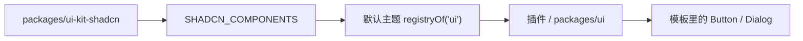

# UI 开发：从组件库到插件上下文

**一句话**：所有界面件都来自 `packages/ui-kit-shadcn`，由默认主题登记进插件系统，
`packages/ui` 和所有插件通过 `useUiComponent()` 取用。

这页讲清三件事：组件从哪里来、缺组件怎么补、界面里怎么写。

## 组件流转



| 层 | 位置 | 做什么 |
| --- | --- | --- |
| 组件源 | `packages/ui-kit-shadcn/src/components/ui/` | 原样的 shadcn-vue 组件 |
| 清单 | `packages/ui-kit-shadcn/src/registry.ts` | 生成 `SHADCN_COMPONENTS` |
| 登记 | `packages/plugins/plugin-theme-components/src/index.ts` | 以导出名登记到 `ui` 注册场（端口/临时线由 `plugin-theme-canvas` 登记） |
| 消费 | `packages/ui`、`packages/plugins/*` | `useUiComponent()` 按名取 |

注册名就是源码导出名：`Button`、`Input`、`DialogContent`、`DropdownMenuTrigger`。
不再使用 `shadcn` 前缀。

## 取组件

子组件多时一次解构：

```vue
<!-- 文件：packages/plugins/my-plugin/src/Panel.vue -->
<script setup lang="ts">
import { useCanvasContext, useUiComponent } from '@mini-canvas/canvas-render'
import type { NotifyContract } from '@mini-canvas/canvas-base'

const {
  Button,
  DropdownMenu,
  DropdownMenuContent,
  DropdownMenuItem,
  DropdownMenuTrigger,
} = useUiComponent()

const { ctx } = useCanvasContext()
const notify = ctx.tryGet<NotifyContract>('notify')

function save(): void {
  notify?.success('已保存')
}
</script>

<template>
  <DropdownMenu>
    <DropdownMenuTrigger as-child>
      <Button variant="outline">更多</Button>
    </DropdownMenuTrigger>
    <DropdownMenuContent align="start">
      <DropdownMenuItem @select="save">保存</DropdownMenuItem>
    </DropdownMenuContent>
  </DropdownMenu>
</template>
```

解构出来的每一项是 Ref，模板里自动解包；主题热替换时它们原地更新。
只想取一个时可以写 `const Button = useUiComponent('Button')`。

应用最外层是 `packages/ui/src/Root.vue`，它在 `CanvasProvider` 外面，用
`useUiComponentOutside('Toaster')`（`App.vue` 才是 Provider 的宿主）。普通组件不要用它。

## 补一个新组件

1. 把 shadcn-vue 组件按原样放进 `packages/ui-kit-shadcn/src/components/ui/<家族>/`，
   目录里的 `index.ts` 逐个导出组件。
2. 在 `packages/ui-kit-shadcn/src/index.ts` 加一行 `export * from './components/ui/<家族>'`。
3. 在 `src/registry.ts` 的 `FAMILIES` 加模块，并在 `src/shadcnFamilies.ts` 的
   `SHADCN_FAMILY_NAMES` 加同一个家族名。
4. 默认主题遍历 `SHADCN_COMPONENTS` 自动登记，不需要逐个添加名字。

家族名要前后一致；`registry.ts` 收组件，`shadcnFamilies.ts` 判“是不是 shadcn 生成件”，
两边漏一边会漏登记或漏调试标记。

不是 shadcn 生成的组件（例如 `SettingsRow`）不要放进 `FAMILIES`，
在默认主题里单独 `ui.add`。

## 滚动、弹窗、通知

### 滚动直接用原生容器

需要滚动的地方，直接用会溢出的普通 `div`（`overflow-y: auto` 等），
不要再包一层自定义滚动组件。滚动条就是浏览器默认的形状和位置，外观由默认主题统一给
（`packages/plugins/plugin-theme-components/src/styles/scrollbars.css`）：细、低对比、
悬停才变亮，亮暗主题各一套。

```vue
<!-- 文件：packages/ui/src/components/MyPanel.vue -->
<template>
  <div class="flex h-64 min-h-0 flex-col">
    <div class="flex-1 p-2 space-y-1 overflow-y-auto">
      <div v-for="item in items" :key="item.id">{{ item.label }}</div>
    </div>
  </div>
</template>
```

父容器要有确定高度并允许收缩（`min-h-0` / `flex-1`），否则不会滚。

要读写 `scrollTop` 或监听滚动时，把 `ref` 直接挂在这个 div 上即可。

### 弹窗优先 AppDialog

`packages/ui/src/components/AppDialog.vue` 已经接好遮罩、Esc、焦点和滚动锁。
长内容用原生溢出的容器，不要手写别的滚动实现。

### 通知用 notify 服务

默认主题提供 `notify`（底层 `vue-sonner`），Toaster 只从 `ui` 目录取一次。
业务插件不要 import `vue-sonner`，也不要自己挂 Toaster。

它和 `ctx.get('canvas').notify(...)` 不是同一个服务：后者是跟随鼠标的画布浮字，
适合拖线、吸附这类即时提示；右下角通知走 `ctx.get('notify')`。

```ts
import type { Context, NotifyContract } from '@mini-canvas/canvas-base'

export function save(ctx: Context): void {
  const notify = ctx.get<NotifyContract>('notify')
  notify.success('已保存')
  notify.error('保存失败', { description: '请稍后重试' })
}
```

根 `Context` 没有服务直属性：写 `ctx.get('notify')` / `ctx.tryGet('notify')`，
不要写 `ctx.notify.success()`。

常驻加载态用同一个 id 原地更新：

```ts
const id = notify.loading('正在生成…', { duration: Infinity })
notify.success('生成完成', { id })
```

## 检查

```bash
pnpm -C packages/ui-kit-shadcn typecheck
pnpm -C packages/plugins/plugin-theme-components typecheck
pnpm -C packages/plugins/plugin-theme-canvas typecheck
pnpm -C packages/ui typecheck
```

改完用 Chrome 实测：按钮、下拉、弹窗、滚动、通知都要点到。

## 相关

- [默认组件库](/plugins/theme-components)：现有组件清单与逐件说明
- [注册场](/intro/registries)：`order` 与覆盖规则
- [服务注入](/kernel/services)：`ctx.get` / `ctx.provide` 的规则
